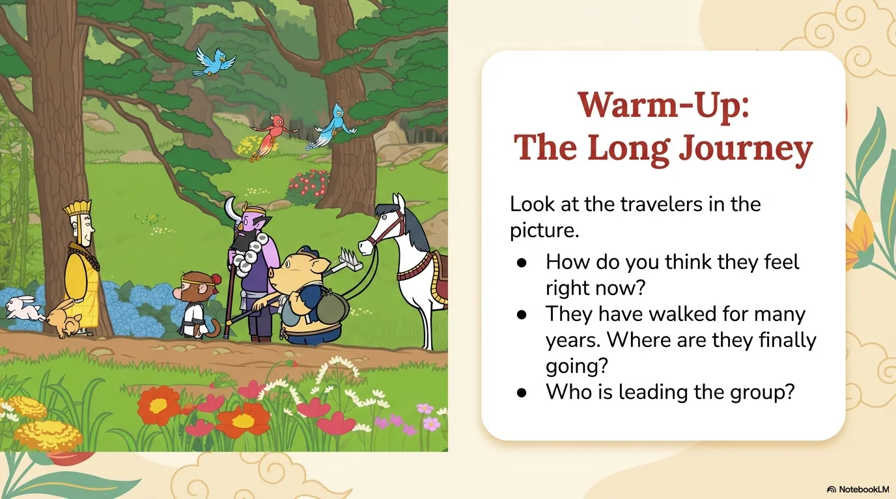
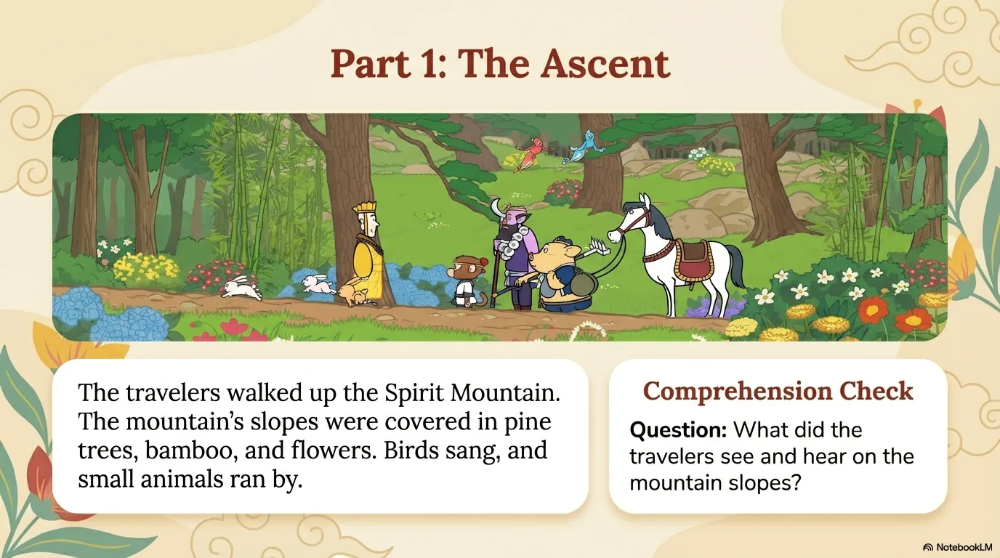
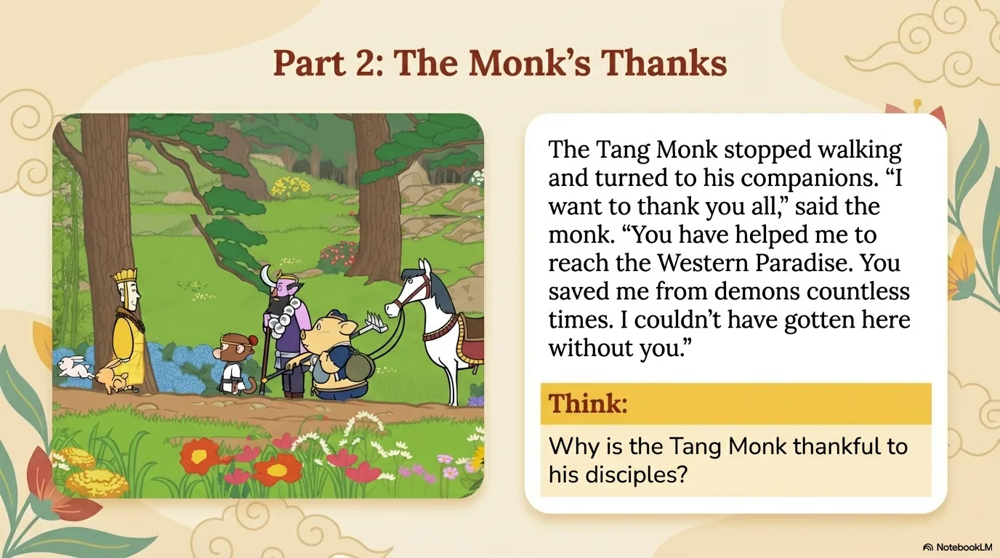
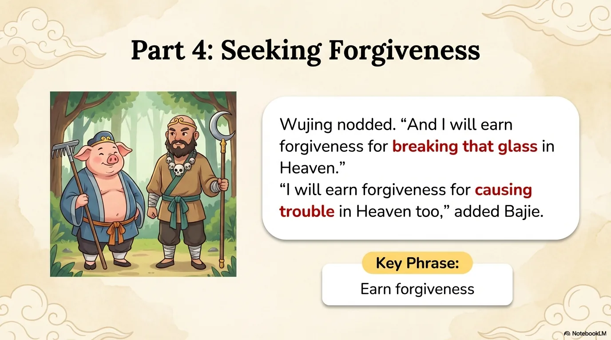
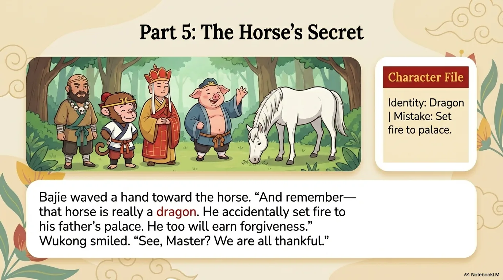
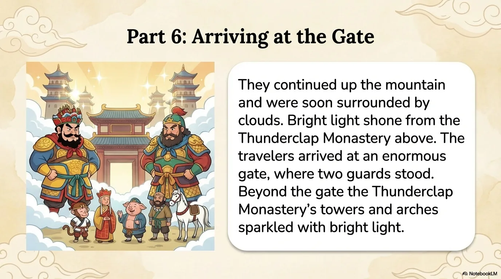
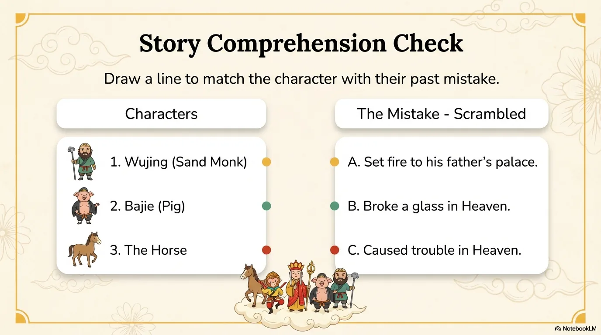
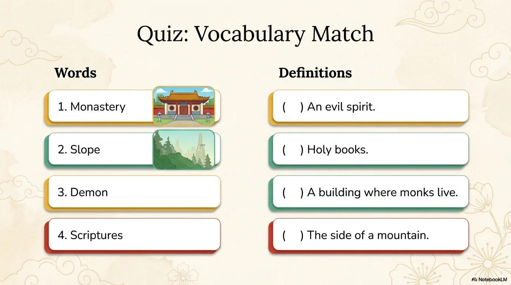
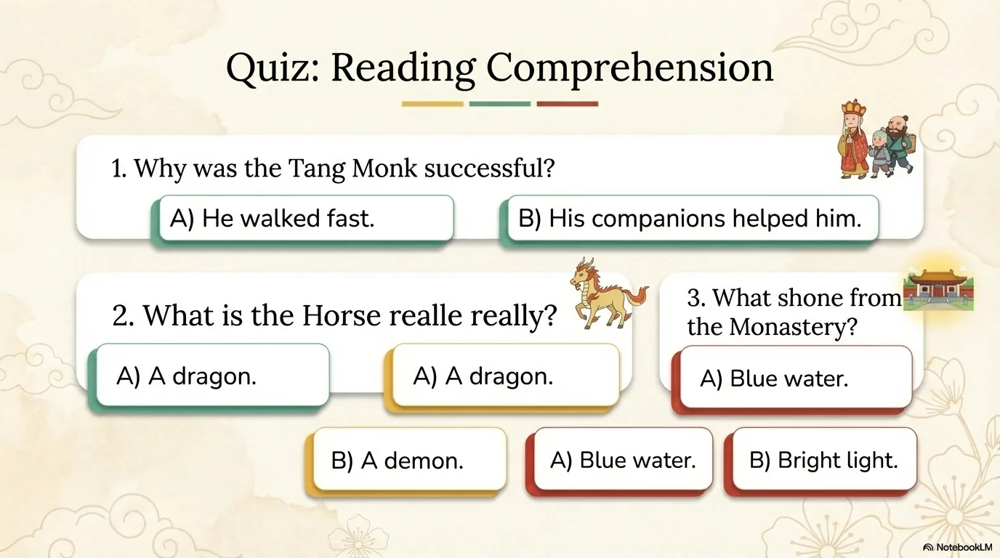

# 豆豆龙英语 · 第 105 集课件（EP105 草稿）

- 来源：`105_Journey to the West 105_The Thunderclap Monastery.pptx`（主课件，20 页）
- OCR：`blocked`（no local OCR provider importable (pytesseract missing): No module named 'pytesseract'）
- 分类：待人工审核（unknown）
- 审核状态：`unreviewed`

## Slide 001

- 来源：`ppt/media/image1.png`（relationship `rId2`）
- 尺寸：1376×768
- 源 SHA-256：`334be8965e4a6d58c1037d0ae195ce7bec9abfb0e293f8b9354a5347a5118ba8`
- 输出 SHA-256：`9bd43876332c2adfdd8e5fa5dcf30abfa44037341960bf94e08db5c32f7b2ff3`
- 分类：unknown ｜ OCR：blocked ｜ 审核：unreviewed

## Slide 002

- 来源：`ppt/media/image3.png`（relationship `rId2`）
- 尺寸：1376×768
- 源 SHA-256：`5a577e29f217822284831e92f12a65b53d52577ae3fa3b458d55a5e257d67782`
- 输出 SHA-256：`e7dcc97110bb52f75c701f011593a35d3ebdc4e63a935c68b0cb594aaddb1bde`
- 分类：unknown ｜ OCR：blocked ｜ 审核：unreviewed

## Slide 003

- 来源：`ppt/media/image4.png`（relationship `rId2`）
- 尺寸：1376×768
- 源 SHA-256：`1ed381e6eb32af2cacbf2ecf4818317d1ed3ebaa2abac5010262167da627a04d`
- 输出 SHA-256：`77d869117990e059a39e7db815d8723cbd92902c73a2cd060ab1f3345ab7ce6a`
- 分类：unknown ｜ OCR：blocked ｜ 审核：unreviewed

## Slide 004

- 来源：`ppt/media/image5.png`（relationship `rId2`）
- 尺寸：1376×768
- 源 SHA-256：`e953385e1f577edd497dfc5d38d302236066855e732682a4942941894c64e83c`
- 输出 SHA-256：`4dc5913502a97b48cbee4617f3df255a7638007b5e99c8fe87879c2ae793176c`
- 分类：unknown ｜ OCR：blocked ｜ 审核：unreviewed

## Slide 005

- 来源：`ppt/media/image6.png`（relationship `rId2`）
- 尺寸：1376×768
- 源 SHA-256：`27500cb665fe6924988bea8e0c30b70da59858e98eda5b29850a8b3c39aff5d8`
- 输出 SHA-256：`2a95d4e2e9a5929e6429cf5d7d8736c93d5f1917245f671f2af19f976471c28d`
- 分类：unknown ｜ OCR：blocked ｜ 审核：unreviewed

## Slide 006

- 来源：`ppt/media/image7.png`（relationship `rId2`）
- 尺寸：1376×768
- 源 SHA-256：`275207f04e762a2f89e2f88a773cb4c51043f978e346a530956d62a7d30c68bb`
- 输出 SHA-256：`9e9ea63f330e035708e4fc39d90942c95d5c8203205d6f830ab1c7a9914413ba`
- 分类：unknown ｜ OCR：blocked ｜ 审核：unreviewed

## Slide 007

- 来源：`ppt/media/image8.png`（relationship `rId2`）
- 尺寸：1376×768
- 源 SHA-256：`e2a8db842f3bab99cd7c2319d34e60641584cadc19ed499e2d43c7dea59381f9`
- 输出 SHA-256：`08aa46ff5674f86a7f1ea95b188af9778250ff9774f4a951385779333bb106f8`
- 分类：unknown ｜ OCR：blocked ｜ 审核：unreviewed

## Slide 008

- 来源：`ppt/media/image9.png`（relationship `rId2`）
- 尺寸：1376×768
- 源 SHA-256：`0eabd254f82a1a9c02b3ec7a51c6a4fac83dbd9ec2f38d620e7102b2e6ecf1ae`
- 输出 SHA-256：`fb79ab5e417d15ef8748145573b9df3b4ab89693a72e4538e8979fd40d03367f`
- 分类：unknown ｜ OCR：blocked ｜ 审核：unreviewed

## Slide 009

- 来源：`ppt/media/image10.png`（relationship `rId2`）
- 尺寸：1376×768
- 源 SHA-256：`0e0b1757ddbb40c4594e551cc2fc6da5f8b0249cf82ccdeb22ac6f4b8b736763`
- 输出 SHA-256：`a6847974bb9c370187aca8266dbf13905c45ea3a20501e08cd0952aa49b4c080`
- 分类：unknown ｜ OCR：blocked ｜ 审核：unreviewed

## Slide 010

- 来源：`ppt/media/image11.png`（relationship `rId2`）
- 尺寸：1376×768
- 源 SHA-256：`0d5c275d6ae982f6c8456679f38c69477fec980a8932d383d9d9c6f4f8cba150`
- 输出 SHA-256：`450c1766edf72013371f0cd8e435423cf7cc28273e2584ff6eb364e98e13254c`
- 分类：unknown ｜ OCR：blocked ｜ 审核：unreviewed

## Slide 011

- 来源：`ppt/media/image12.png`（relationship `rId2`）
- 尺寸：1376×768
- 源 SHA-256：`993ddce1f7c998fa287cde54fcf6ca577787b271fa82a55f1ead2ee0e02f63bc`
- 输出 SHA-256：`8f2941a33e48c1525c832c95bfc44442ce6f859e5edb5d079556bdb1eb9b8aca`
- 分类：unknown ｜ OCR：blocked ｜ 审核：unreviewed

## Slide 012

- 来源：`ppt/media/image13.png`（relationship `rId2`）
- 尺寸：1376×768
- 源 SHA-256：`8211762ea1b583fd4ad42a983e539622666d1d45fb8f79f5b95cbab5557d50d3`
- 输出 SHA-256：`fe2505a71df74bfb4489b7a81077cb327cd1b891fd1840d14e01ac73d45eccec`
- 分类：unknown ｜ OCR：blocked ｜ 审核：unreviewed

## Slide 013

- 来源：`ppt/media/image14.png`（relationship `rId2`）
- 尺寸：1376×768
- 源 SHA-256：`d825d9099a0add28ecdb802545ac43e7ede19b35448f23ad9e3b10fe3e343f1b`
- 输出 SHA-256：`a4bfadeaa29be29bb1fad7e6368e56f1a67816b23e54bef0d2d94d4593b9a044`
- 分类：unknown ｜ OCR：blocked ｜ 审核：unreviewed

## Slide 014

- 来源：`ppt/media/image15.png`（relationship `rId2`）
- 尺寸：1376×768
- 源 SHA-256：`83cbc533b8f0fe36f3a3c838b56f1c650b53597c5964aa60461666f0b067c854`
- 输出 SHA-256：`ad5424d097f0d93b981e23ae835c9cac832aa7621af1554906d48729e25afd33`
- 分类：unknown ｜ OCR：blocked ｜ 审核：unreviewed

## Slide 015

- 来源：`ppt/media/image16.png`（relationship `rId2`）
- 尺寸：1376×768
- 源 SHA-256：`7e5a7f93b3e456177ab1d77ba92a8ea8368e21940e822421a982f1365dcc8bfb`
- 输出 SHA-256：`e32d078d561174e519187fca026ac94c4536e17db4600983ca0f55ed62fbf55f`
- 分类：unknown ｜ OCR：blocked ｜ 审核：unreviewed

## Slide 016

- 来源：`ppt/media/image17.png`（relationship `rId2`）
- 尺寸：1376×768
- 源 SHA-256：`58660d35da08db00f90c8e16cfc8d889cc80035ac57cb71dffcb4568ef061fa6`
- 输出 SHA-256：`6ecadd30b803d8c9ba9ab4255f34df2dff920988749942c91f9b0f011c95fc7e`
- 分类：unknown ｜ OCR：blocked ｜ 审核：unreviewed

## Slide 017

- 来源：`ppt/media/image18.png`（relationship `rId2`）
- 尺寸：1376×768
- 源 SHA-256：`f22aeb2c5a8afebe8615efee41b07895bda7d3cd401057f4f79763a0f0231fe9`
- 输出 SHA-256：`2e012f5727df23b9bc645c8b559f14a7db2068138cee8748065a7d844e59453f`
- 分类：unknown ｜ OCR：blocked ｜ 审核：unreviewed

## Slide 018

- 来源：`ppt/media/image19.png`（relationship `rId2`）
- 尺寸：1376×768
- 源 SHA-256：`8d97858e5b192c1200d1a0737ebff9cef778115040d558291279168e4e08cf9e`
- 输出 SHA-256：`5cbb21b47abf87ebd62a4cb529b5e8291f52959b3207c1ecd072b737448a4de4`
- 分类：unknown ｜ OCR：blocked ｜ 审核：unreviewed

## Slide 019

- 来源：`ppt/media/image20.png`（relationship `rId2`）
- 尺寸：1376×768
- 源 SHA-256：`55c2e6a385f965171b642f50d653b807bc70742e0c91df4a4fe633fc225d7300`
- 输出 SHA-256：`8eeb3f397f54a37308276c05775f0c1f5d22d036cf7375ba939047597d0a2053`
- 分类：unknown ｜ OCR：blocked ｜ 审核：unreviewed

## Slide 020

- 来源：`ppt/media/image21.png`（relationship `rId2`）
- 尺寸：1376×768
- 源 SHA-256：`98054dbad2df806a8ce999562c1f3e1c6e0b97753c00eac33e35de90f554f750`
- 输出 SHA-256：`aec9f1371f9c85db9fd78f10c8fe5e4759fc6b3f75efb6e9987601da6a8187cb`
- 分类：unknown ｜ OCR：blocked ｜ 审核：unreviewed
