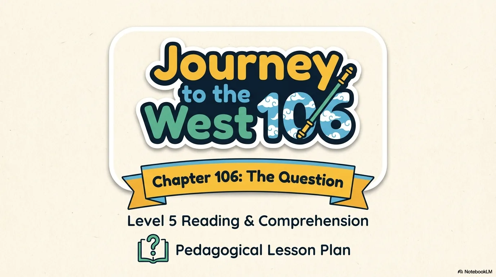
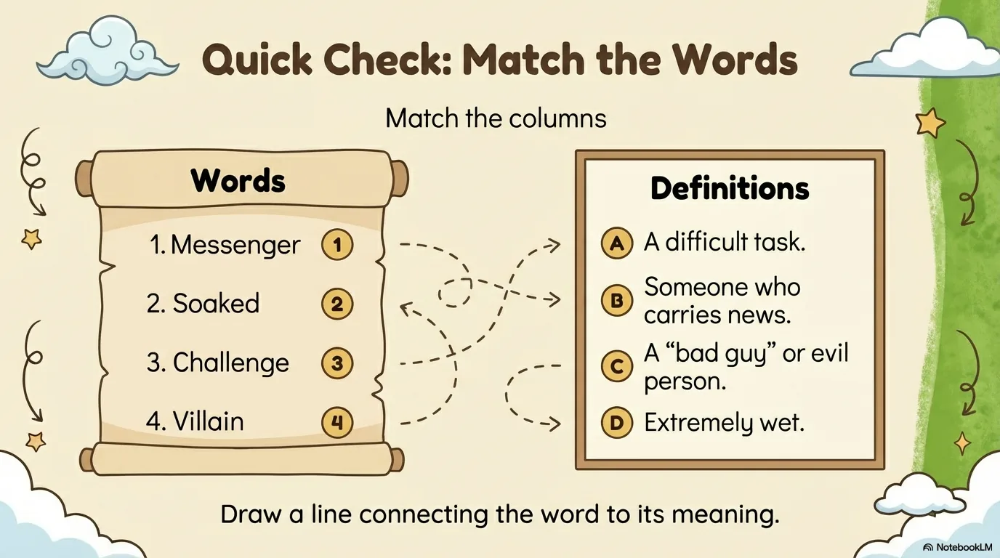
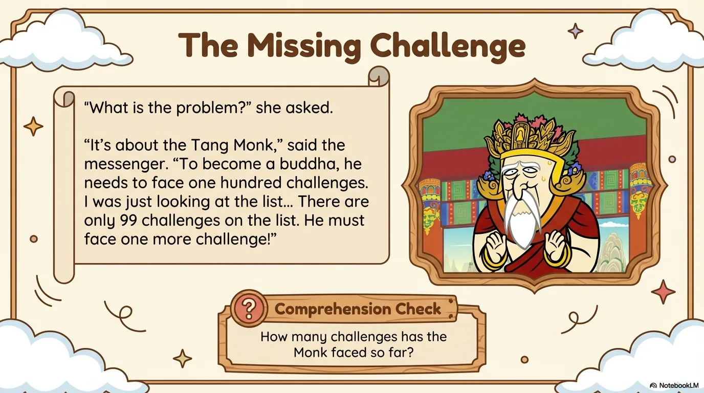
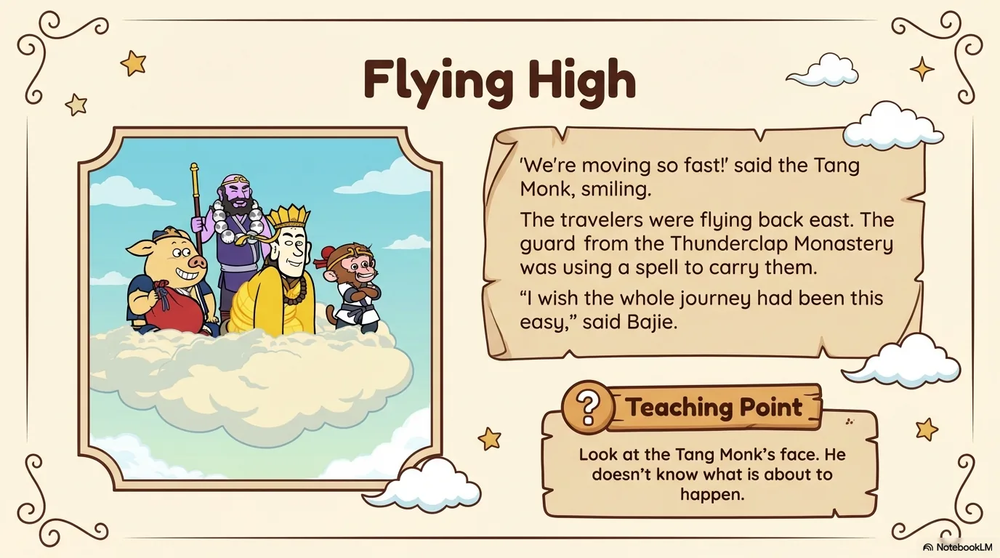
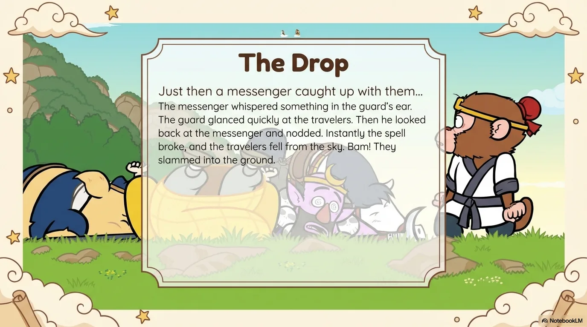
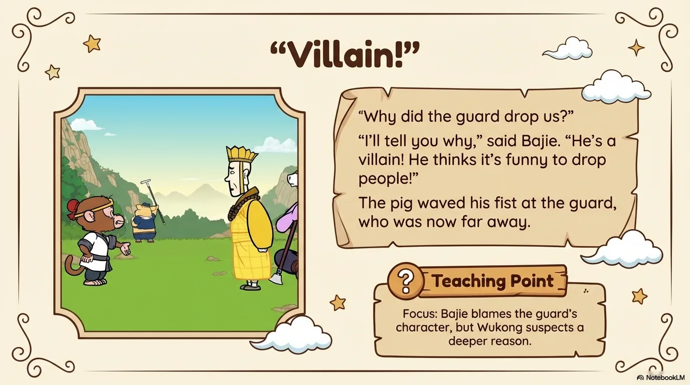
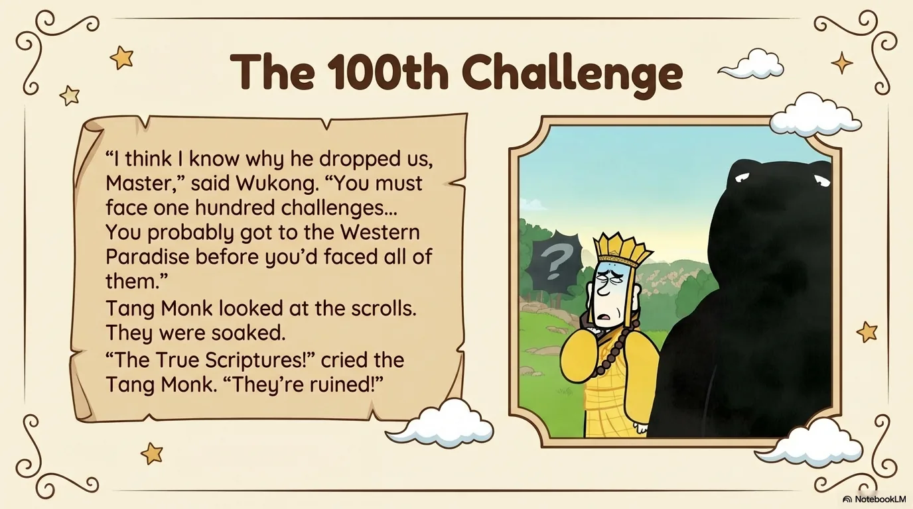
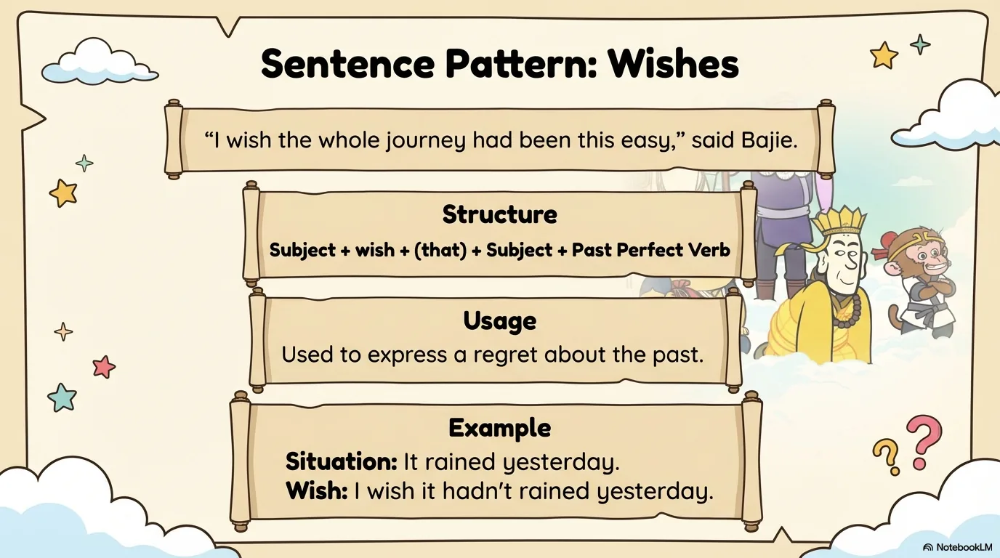
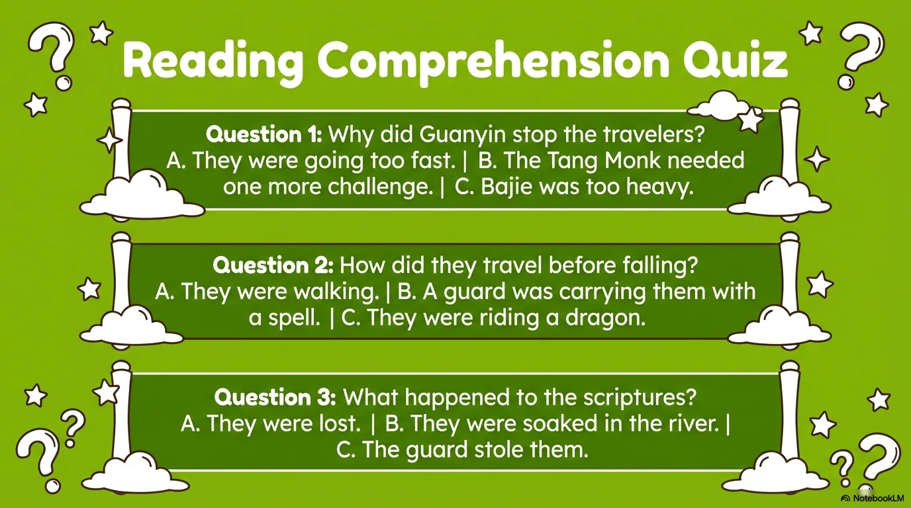
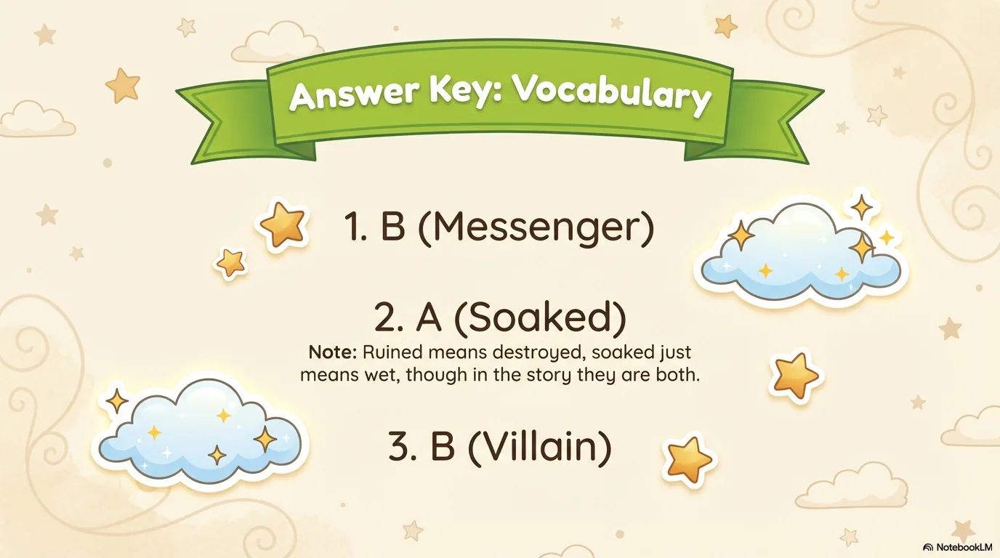

# 豆豆龙英语 · 第 106 集课件（EP106 草稿）

- 来源：`106_Journey to the West 106_The Question.pptx`（主课件，20 页）
- OCR：`blocked`（no local OCR provider importable (pytesseract missing): No module named 'pytesseract'）
- 分类：待人工审核（unknown）
- 审核状态：`unreviewed`

## Slide 001

- 来源：`ppt/media/image1.png`（relationship `rId2`）
- 尺寸：1376×768
- 源 SHA-256：`1c628672b274b875bb6f4c8203bd0398a501eaefe43816528c1a8e85fb274adb`
- 输出 SHA-256：`1a71fced41137b91fc5cde3a2ac348d2c82484fbc6db8f20f38149b2cfb9185e`
- 分类：unknown ｜ OCR：blocked ｜ 审核：unreviewed

## Slide 002

- 来源：`ppt/media/image3.png`（relationship `rId2`）
- 尺寸：1376×768
- 源 SHA-256：`46f53c564cb55a21ace8f2720f70cc29824f08f7e259a99975a3b8e99911b5d3`
- 输出 SHA-256：`e76e4a2f78c9994b18ab59e2ef308039ff2277e09ac3a3d4173bec674b13a34a`
- 分类：unknown ｜ OCR：blocked ｜ 审核：unreviewed

## Slide 003

- 来源：`ppt/media/image4.png`（relationship `rId2`）
- 尺寸：1376×768
- 源 SHA-256：`105acb648259a0fd172805e0cc0279b7805c4a06cb58656e8fb1b85410f259f6`
- 输出 SHA-256：`7c713a89b3ed114ec891e20043bf264baffb8cb380e86405b4ceba56da3de2cb`
- 分类：unknown ｜ OCR：blocked ｜ 审核：unreviewed

## Slide 004

- 来源：`ppt/media/image5.png`（relationship `rId2`）
- 尺寸：1376×768
- 源 SHA-256：`64a0254537c9e37e210c0aa09630f2b2bc149368c13a8659b342a39cd5373b26`
- 输出 SHA-256：`9c9f3a47be00d8d1a11997a7b2ce5eeb3d6d969bf7c363367c442e2bde8bd157`
- 分类：unknown ｜ OCR：blocked ｜ 审核：unreviewed

## Slide 005

- 来源：`ppt/media/image6.png`（relationship `rId2`）
- 尺寸：1376×768
- 源 SHA-256：`282958263ca75b023f077086848b76ef458abdc868565864854f81353e46d5d4`
- 输出 SHA-256：`64ec1f343ef35235e16e6d20b9b0508b9cdcb2c4f7bc1a417c4ec55e8145fcef`
- 分类：unknown ｜ OCR：blocked ｜ 审核：unreviewed

## Slide 006

- 来源：`ppt/media/image7.png`（relationship `rId2`）
- 尺寸：1376×768
- 源 SHA-256：`521d8ff9471473edcd4e67f84401c383a62ef1e96de9e24a427e2f7b1fe962f4`
- 输出 SHA-256：`fb638ee75a21b0a29d45202e0ae0339a09da1a0515094be2b392ac59c9a24be2`
- 分类：unknown ｜ OCR：blocked ｜ 审核：unreviewed

## Slide 007

- 来源：`ppt/media/image8.png`（relationship `rId2`）
- 尺寸：1376×768
- 源 SHA-256：`18e0886d4b5e2430517d8ad1c2af85cfa18cf4da3e89d26a114a8b9ac220f27a`
- 输出 SHA-256：`153d31e4e8bede530f8fdd17e8c37e44d8aa843c3c112da7eef1a0f548a37906`
- 分类：unknown ｜ OCR：blocked ｜ 审核：unreviewed

## Slide 008

- 来源：`ppt/media/image9.png`（relationship `rId2`）
- 尺寸：1376×768
- 源 SHA-256：`da1085684a530888122ff680777e89da62926aa2d62c14ce1829639cbda74e71`
- 输出 SHA-256：`c42adaa3f8c0aabfd9502a4985363912de611aa748b403d58ff11e3c39649529`
- 分类：unknown ｜ OCR：blocked ｜ 审核：unreviewed

## Slide 009

- 来源：`ppt/media/image10.png`（relationship `rId2`）
- 尺寸：1376×768
- 源 SHA-256：`11bed09e36152c72fea7840d742881a748389b944220e7c365ffb24f76d5736b`
- 输出 SHA-256：`1937a93363d197615e90acd01d069cb8e6a55ba43cf74695779f968a0587b26c`
- 分类：unknown ｜ OCR：blocked ｜ 审核：unreviewed

## Slide 010

- 来源：`ppt/media/image11.png`（relationship `rId2`）
- 尺寸：1376×768
- 源 SHA-256：`03c8cf1ae37eabc29a014d13f1fd6444090d1492970489a694a9ca1f68430c8f`
- 输出 SHA-256：`cda9684fdc0ae9d35efe97bac8b2081bb6c27eb9ae83324782c90ffd8e361fcd`
- 分类：unknown ｜ OCR：blocked ｜ 审核：unreviewed

## Slide 011

- 来源：`ppt/media/image12.png`（relationship `rId2`）
- 尺寸：1376×768
- 源 SHA-256：`d84048cd54877efa00f88874631be95b670c0fa814d4c6dc675a1816506c23c4`
- 输出 SHA-256：`4513ff3dcb3361cff4e1cd0972fca317bb4c1ca8d0b0ea248986d2e4bf827655`
- 分类：unknown ｜ OCR：blocked ｜ 审核：unreviewed

## Slide 012

- 来源：`ppt/media/image13.png`（relationship `rId2`）
- 尺寸：1376×768
- 源 SHA-256：`3779764300a3e12ca6d3d95723b4ddb529a3a66909429f5b860ce9f3990ff8cb`
- 输出 SHA-256：`6dc2be43d82075927072b8c40808c109743b07d51971ff67b359e5e66d080ce1`
- 分类：unknown ｜ OCR：blocked ｜ 审核：unreviewed

## Slide 013

- 来源：`ppt/media/image14.png`（relationship `rId2`）
- 尺寸：1376×768
- 源 SHA-256：`fc38f28e5cb8c834390ff4c788a17e87dad107af4cd8e9d096c4565ac2e52c8f`
- 输出 SHA-256：`9968c03811e634375d8d90eb5a057c9f156e8ae424977612ff52539bf48be3e8`
- 分类：unknown ｜ OCR：blocked ｜ 审核：unreviewed

## Slide 014

- 来源：`ppt/media/image15.png`（relationship `rId2`）
- 尺寸：1376×768
- 源 SHA-256：`a5fc9793b18da1b1834fc05e63a7f492621b9c53c2984901998769590d9e101a`
- 输出 SHA-256：`d3ccab7300ede59fe00e459157cc4eff9adfdbe15655bbc997e6ee58d680f33d`
- 分类：unknown ｜ OCR：blocked ｜ 审核：unreviewed

## Slide 015

- 来源：`ppt/media/image16.png`（relationship `rId2`）
- 尺寸：1376×768
- 源 SHA-256：`723659f0e575b58e8e043a5900d88ac01a0fbe7e65acfd0b531c8e39da7762fb`
- 输出 SHA-256：`61ff1b399255f06ca512b0c5c35c3c0255a749995d127408c8dfcf03e794241e`
- 分类：unknown ｜ OCR：blocked ｜ 审核：unreviewed

## Slide 016

- 来源：`ppt/media/image17.png`（relationship `rId2`）
- 尺寸：1376×768
- 源 SHA-256：`ee75d3743f764c2a6732943e4e0408411c5c8bae42704978ac85e9d6ea1ee839`
- 输出 SHA-256：`a8a90d0a87e1975ffc5b180013ca21f9b19b2024ed1bfce0914d23b754b8a566`
- 分类：unknown ｜ OCR：blocked ｜ 审核：unreviewed

## Slide 017

- 来源：`ppt/media/image18.png`（relationship `rId2`）
- 尺寸：1376×768
- 源 SHA-256：`c3b566d099eadbfb4853679a6bfc068a6ba2351189c375466dbe449a6ee2dac9`
- 输出 SHA-256：`8df094173a2633b857cfbb1b189bf2ce02040af964890e2fb94cfe0feb4735b1`
- 分类：unknown ｜ OCR：blocked ｜ 审核：unreviewed

## Slide 018

- 来源：`ppt/media/image19.png`（relationship `rId2`）
- 尺寸：1376×768
- 源 SHA-256：`b67d2bf0eabc5fa3194d71cce8f30cc6ae2997f67ac7919200263e99f78fc2fd`
- 输出 SHA-256：`2785565d14fe865d929a6e9cf97fd8b3ec09ff5d82efa704fc6dbb45ffb97ee1`
- 分类：unknown ｜ OCR：blocked ｜ 审核：unreviewed

## Slide 019

- 来源：`ppt/media/image20.png`（relationship `rId2`）
- 尺寸：1376×768
- 源 SHA-256：`f190fc21a70f058b4dbeeef9b6f07d85f50df0366a4a07c9996063413fb3e19e`
- 输出 SHA-256：`15122e22ebfb60d20d22a5c95ef5a0a1dbe83bc4f4be8f30a4ceb0bb806b8591`
- 分类：unknown ｜ OCR：blocked ｜ 审核：unreviewed

## Slide 020

- 来源：`ppt/media/image21.png`（relationship `rId2`）
- 尺寸：1376×768
- 源 SHA-256：`ec76563dd746335423826a90edea4236d12f96f85cac5fa43d96afbb3ee00865`
- 输出 SHA-256：`4b936cc5a17690b27d078b8bc4653c13c4ceb9a7baa3716e5dce18f1b663b6fb`
- 分类：unknown ｜ OCR：blocked ｜ 审核：unreviewed
