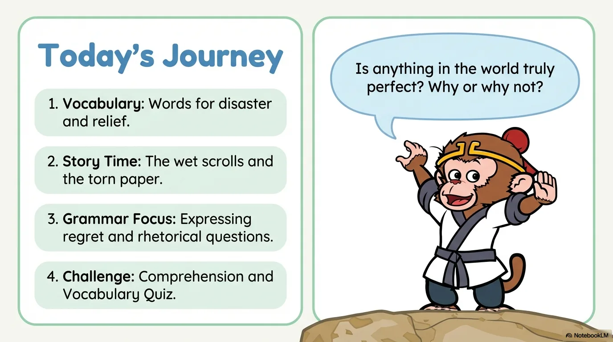
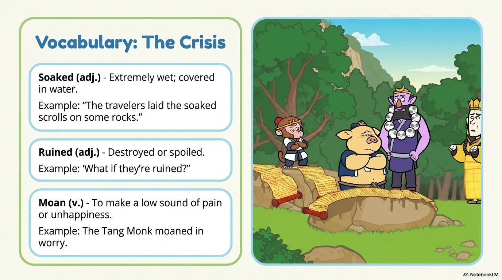
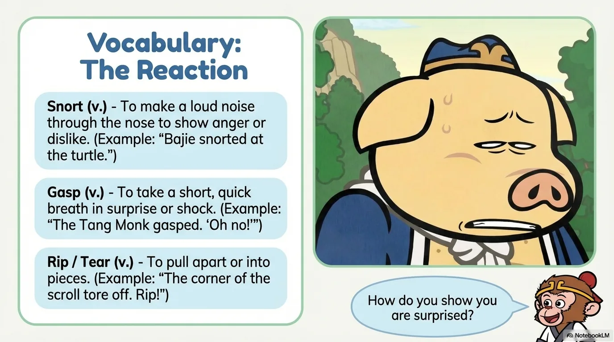
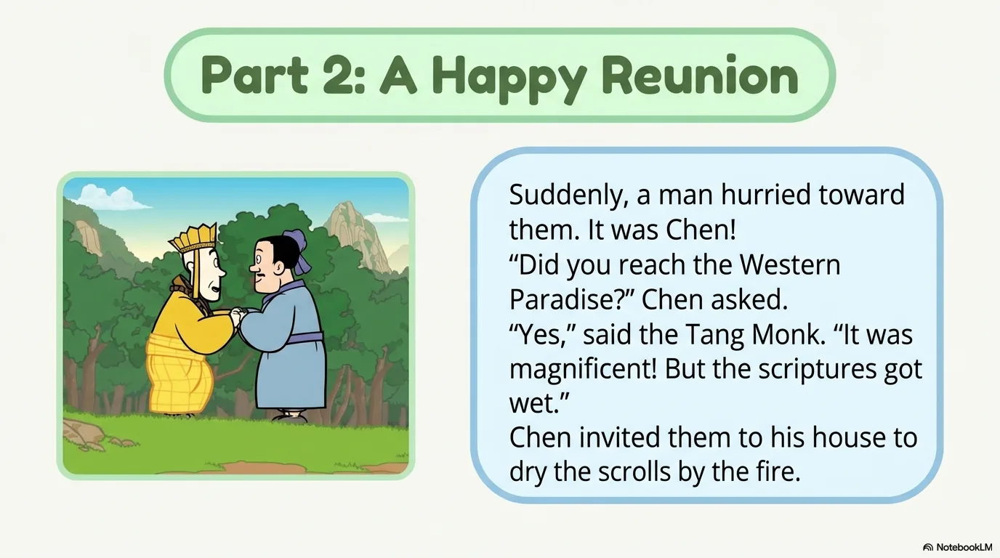
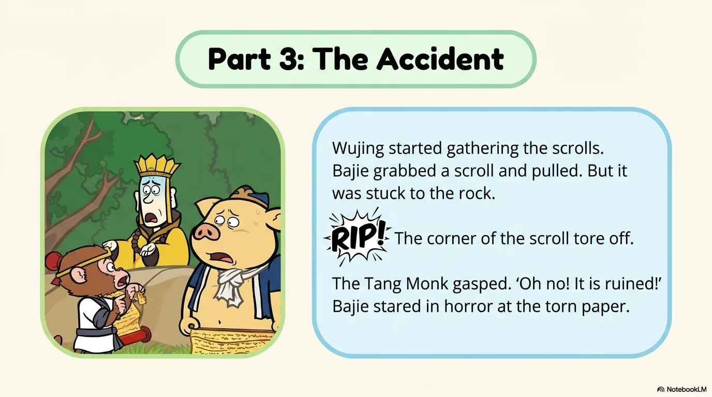
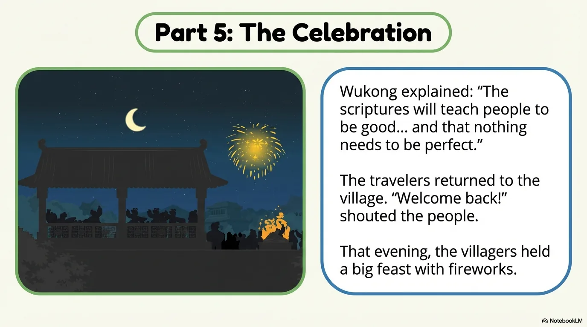
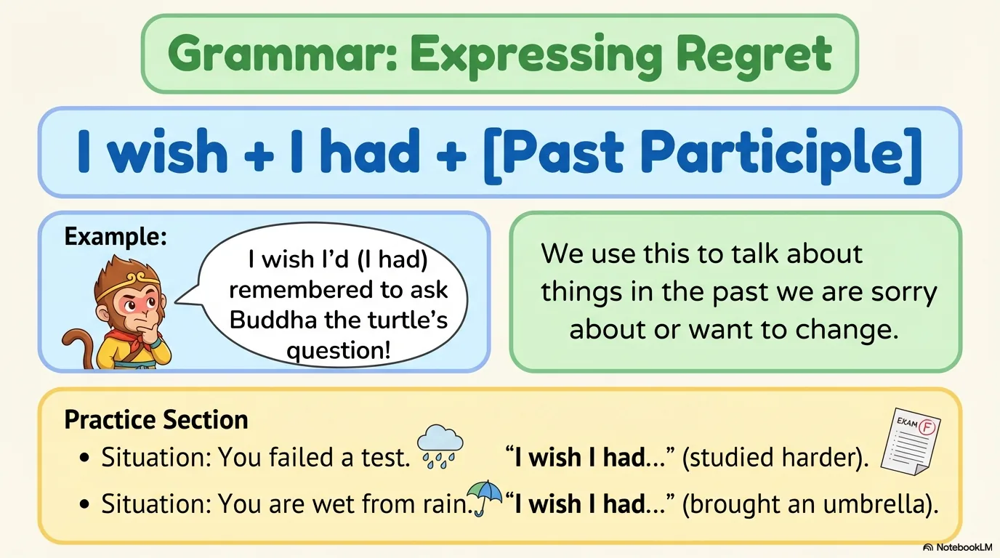
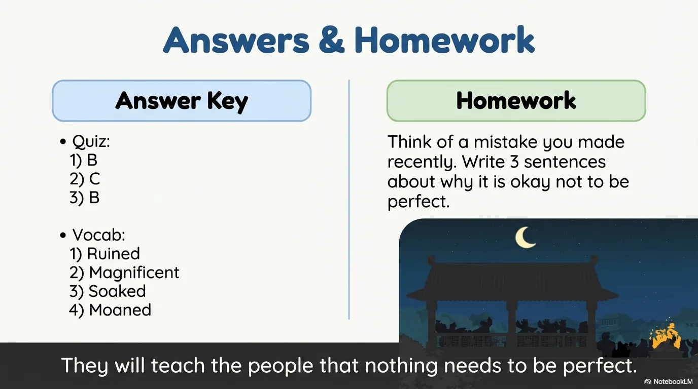

# 豆豆龙英语 · 第 107 集课件（EP107 草稿）

- 来源：`107_Journey to the West 107_Nothing Is Perfect.pptx`（主课件，15 页）
- OCR：`blocked`（no local OCR provider importable (pytesseract missing): No module named 'pytesseract'）
- 分类：待人工审核（unknown）
- 审核状态：`unreviewed`

## Slide 001

- 来源：`ppt/media/image1.png`（relationship `rId2`）
- 尺寸：1376×768
- 源 SHA-256：`149497716f0af57df65938d979721187327e9591f0bd2169b6d1648cfe37ea52`
- 输出 SHA-256：`05b56f6ec11ca7cd7d4bc7367689711a4ad5a4155624825d6e6f5f8d8093b9c9`
- 分类：unknown ｜ OCR：blocked ｜ 审核：unreviewed

## Slide 002

- 来源：`ppt/media/image3.png`（relationship `rId2`）
- 尺寸：1376×768
- 源 SHA-256：`28cbe5956d5f723cd97e9e8cb262f78af469560211cfa9085469cfa230eaf88a`
- 输出 SHA-256：`752f66fc95da16b81bec9c3f2938c44b0644ccdfc413f9e879daa384d6defa93`
- 分类：unknown ｜ OCR：blocked ｜ 审核：unreviewed

## Slide 003

- 来源：`ppt/media/image4.png`（relationship `rId2`）
- 尺寸：1376×768
- 源 SHA-256：`a96f18c50878d1cf4ed15f620ef36ca8d50ac1349785c95b1617135d72331c82`
- 输出 SHA-256：`e79a00cdccf813b77b9a80e3c1aa0d453ccc195df3f498f78057ee41f7f50578`
- 分类：unknown ｜ OCR：blocked ｜ 审核：unreviewed

## Slide 004

- 来源：`ppt/media/image5.png`（relationship `rId2`）
- 尺寸：1376×768
- 源 SHA-256：`e88259cb2b98f9d825beea05bf53af7e439c25d1fd91209ff88d0091c276363d`
- 输出 SHA-256：`9638aedc533bee32821eeb103626917acc0dd550a82189b1538113d6f01000cb`
- 分类：unknown ｜ OCR：blocked ｜ 审核：unreviewed

## Slide 005

- 来源：`ppt/media/image6.png`（relationship `rId2`）
- 尺寸：1376×768
- 源 SHA-256：`830dd89c613093ec8b45c92ea9e4c619529cba0302a09c6b89021162f6f3427f`
- 输出 SHA-256：`d873994ce31ed479c79f5c219f5d08d54f7fdd91b27f974cba9c897d529b3622`
- 分类：unknown ｜ OCR：blocked ｜ 审核：unreviewed

## Slide 006

- 来源：`ppt/media/image7.png`（relationship `rId2`）
- 尺寸：1376×768
- 源 SHA-256：`4c2a241f7f6c7ca013827e92f45bec4262921301c5da66e2ac92f1b4cb288923`
- 输出 SHA-256：`ffd7db60fb8f780acf52d8341299ba42e153f3eeac308792eba92c8b7f2e11f7`
- 分类：unknown ｜ OCR：blocked ｜ 审核：unreviewed

## Slide 007

- 来源：`ppt/media/image8.png`（relationship `rId2`）
- 尺寸：1376×768
- 源 SHA-256：`66ba130c4883d8f2a2045a67eaded0c0f09e3340ed5306864d206f4b1c46cd65`
- 输出 SHA-256：`54274c13ffd750aeaae65f89b5643a5662460abb2d854abf4b0fbc2f20cbe1c4`
- 分类：unknown ｜ OCR：blocked ｜ 审核：unreviewed

## Slide 008

- 来源：`ppt/media/image9.png`（relationship `rId2`）
- 尺寸：1376×768
- 源 SHA-256：`5997353963c73b94555edd65544773b421413a5170f8f36fe60c1e19335dc4cb`
- 输出 SHA-256：`46993f533079e2f95a3424c62646c4b3389448027af53fb5bcb822e1ddfe6d98`
- 分类：unknown ｜ OCR：blocked ｜ 审核：unreviewed

## Slide 009

- 来源：`ppt/media/image10.png`（relationship `rId2`）
- 尺寸：1376×768
- 源 SHA-256：`bf8336b9d17290dc5ab2458a282fa4ef9ea293f39711282cb0a8618903857389`
- 输出 SHA-256：`3125952c5cf40b468397e6b2d1070bcf98f7b9de7f14863ef1d013fb67320876`
- 分类：unknown ｜ OCR：blocked ｜ 审核：unreviewed

## Slide 010

- 来源：`ppt/media/image11.png`（relationship `rId2`）
- 尺寸：1376×768
- 源 SHA-256：`81363edba0746dba4a4de16ca40daf20ce787de9a053e05de2183e2b7364f350`
- 输出 SHA-256：`b7168941da2e294fa3e0f602a14231af01e84a80a6d89fb6ccba2947f22edc21`
- 分类：unknown ｜ OCR：blocked ｜ 审核：unreviewed

## Slide 011

- 来源：`ppt/media/image12.png`（relationship `rId2`）
- 尺寸：1376×768
- 源 SHA-256：`f21704ee03a4b8f09b73b3407ebee8f6a119187cf777d91a0174afabb9962044`
- 输出 SHA-256：`a53a07e6fdcd9d139bb9614fcc014c2bb6697e7c29f227da5fe1725dd5f489aa`
- 分类：unknown ｜ OCR：blocked ｜ 审核：unreviewed

## Slide 012

- 来源：`ppt/media/image13.png`（relationship `rId2`）
- 尺寸：1376×768
- 源 SHA-256：`908fa0c1ed07f414cf17035f2b15578a555da2b52687c524e31fe448f112fc76`
- 输出 SHA-256：`1a0a762754c2333f343027a18a655ef1a58840c1bd322ce1ad039cd58be006e8`
- 分类：unknown ｜ OCR：blocked ｜ 审核：unreviewed

## Slide 013

- 来源：`ppt/media/image14.png`（relationship `rId2`）
- 尺寸：1376×768
- 源 SHA-256：`ab75e80fd71149366f8473ef2a89bb5e4a800dc315ae1d8e2d5d348310a89b6b`
- 输出 SHA-256：`5038d338d0cb640f54faf994a0ac3a08ddbe6618874ef3281f11f1a0de3fb4ed`
- 分类：unknown ｜ OCR：blocked ｜ 审核：unreviewed

## Slide 014

- 来源：`ppt/media/image15.png`（relationship `rId2`）
- 尺寸：1376×768
- 源 SHA-256：`2831a381585991bd1df2c3557b0d2b4f34351412c7656969de5a8960a32b6530`
- 输出 SHA-256：`d4bf4991061a16102b88518b96f4cf6e7c038f0feac7d14ce8be929072c07b57`
- 分类：unknown ｜ OCR：blocked ｜ 审核：unreviewed

## Slide 015

- 来源：`ppt/media/image16.png`（relationship `rId2`）
- 尺寸：1376×768
- 源 SHA-256：`d292618ffb1aaf8445c885453d554aa244577096fc47782032628b87e5146ee9`
- 输出 SHA-256：`9fa4ad869b4e489ecd4d5cd0824bfd43530205c32ac1a9e4307d9384be9f9e0b`
- 分类：unknown ｜ OCR：blocked ｜ 审核：unreviewed
