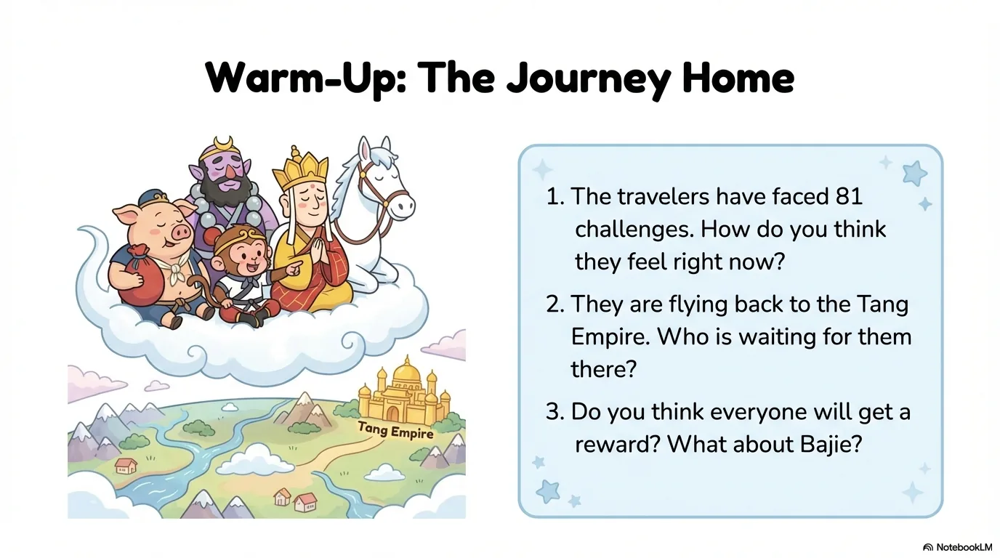
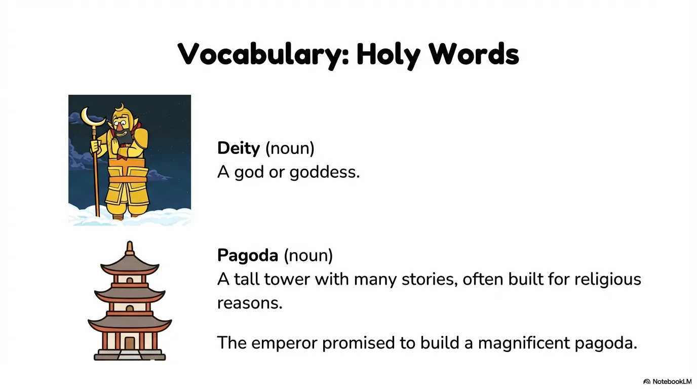
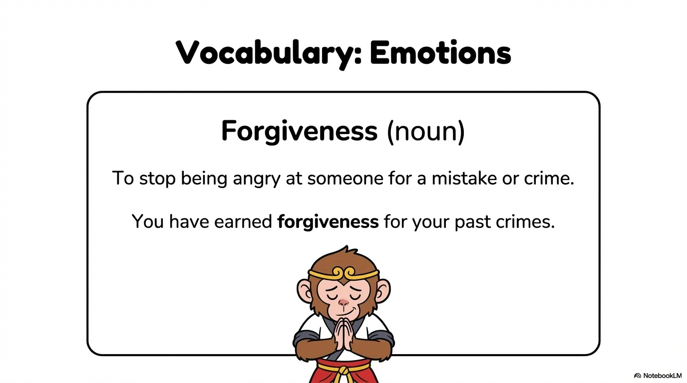
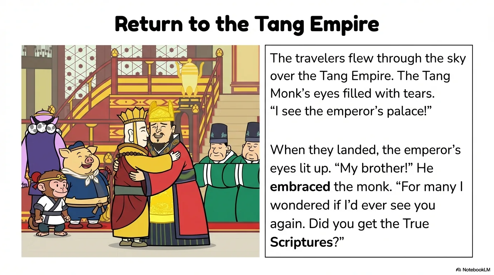
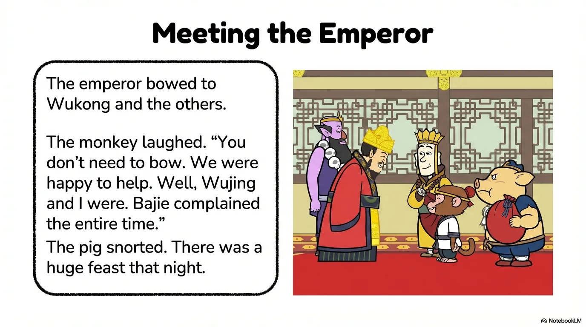
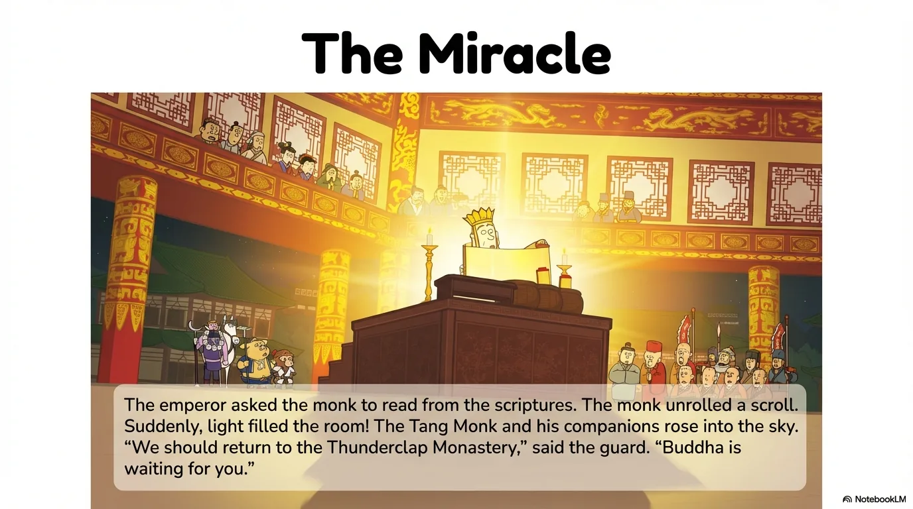
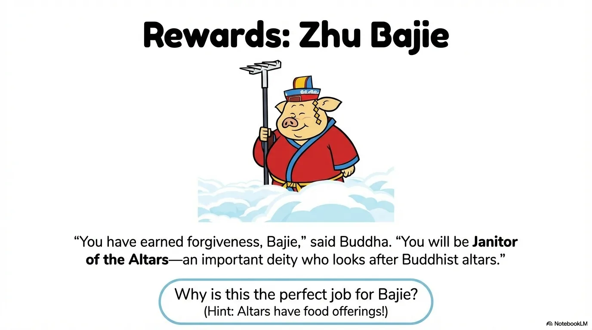

# 豆豆龙英语 · 第 108 集课件（EP108 草稿）

- 来源：`108_Journey to the West 108_Rewards.pptx`（主课件，20 页）
- OCR：`blocked`（no local OCR provider importable (pytesseract missing): No module named 'pytesseract'）
- 分类：待人工审核（unknown）
- 审核状态：`unreviewed`

## Slide 001

- 来源：`ppt/media/image1.png`（relationship `rId2`）
- 尺寸：1376×768
- 源 SHA-256：`8820c5072e2a141d77b610346776ec26637cfba909f1d83fbb9a55bd66ea4cf9`
- 输出 SHA-256：`578915140b2ce0980bf58f371d87390f50bed85168c1c01cb3cacf7e6f5602ae`
- 分类：unknown ｜ OCR：blocked ｜ 审核：unreviewed

## Slide 002

- 来源：`ppt/media/image3.png`（relationship `rId2`）
- 尺寸：1376×768
- 源 SHA-256：`502368f7c225c4440cd9187c48230adf954776e2731197dee85c89b828d9825e`
- 输出 SHA-256：`37993b8eed2785fb9fcb3b6b614a5f3ddd514fbdead8bec60c1e0f01e29743d0`
- 分类：unknown ｜ OCR：blocked ｜ 审核：unreviewed

## Slide 003

- 来源：`ppt/media/image4.png`（relationship `rId2`）
- 尺寸：1376×768
- 源 SHA-256：`c7025a8c4b34f1b61c9ee6bcdb171b936820f47165d7091b09b39ff247cf1eb7`
- 输出 SHA-256：`97fe73c3c316ba231578e93ceeae4fb888cba53fc4aaab1de1a7c45d873ad330`
- 分类：unknown ｜ OCR：blocked ｜ 审核：unreviewed

## Slide 004

- 来源：`ppt/media/image5.png`（relationship `rId2`）
- 尺寸：1376×768
- 源 SHA-256：`3bd0b4257c0dac2f0feb0c2f42b4a4e5a6cb25762675543f2291b61aaa8de94b`
- 输出 SHA-256：`b2929ecf814684f4255940b9954fb3ecb544df01149b0d47d039f08885000f11`
- 分类：unknown ｜ OCR：blocked ｜ 审核：unreviewed

## Slide 005

- 来源：`ppt/media/image6.png`（relationship `rId2`）
- 尺寸：1376×768
- 源 SHA-256：`a5d36462571e72d462b031c3deaed2e5a1840a93752768df331aad72d81da6dc`
- 输出 SHA-256：`461b28860f1ef638b18e3d12c2c588596b1a0e0ab1bafa9bb0a52a69cf4495e3`
- 分类：unknown ｜ OCR：blocked ｜ 审核：unreviewed

## Slide 006

- 来源：`ppt/media/image7.png`（relationship `rId2`）
- 尺寸：1376×768
- 源 SHA-256：`2998987baf1f629ac0e4b6f8129a710c4783f45f2800af9b691202e60b7fefde`
- 输出 SHA-256：`f7672197de0720e5ffb24d7b3ccfc369b4b1947d3f343910a1e4e64230d5ea6b`
- 分类：unknown ｜ OCR：blocked ｜ 审核：unreviewed

## Slide 007

- 来源：`ppt/media/image8.png`（relationship `rId2`）
- 尺寸：1376×768
- 源 SHA-256：`b0499e717d73ab6cf2b454a00d155f28fda887264fcbbbf0ae7567b586a37750`
- 输出 SHA-256：`25f1613469d19008fa55c8982d3d07cb927d4b349489551946f8fe1c3e9d1dc3`
- 分类：unknown ｜ OCR：blocked ｜ 审核：unreviewed

## Slide 008

- 来源：`ppt/media/image9.png`（relationship `rId2`）
- 尺寸：1376×768
- 源 SHA-256：`84620e9184a71ba36015caad3e095c3ee8c0ca8d4c42158a5ee21de50328c45e`
- 输出 SHA-256：`5b04e4f3c0c888bba113c5bc1d2aa04a89cfaf6693f2d445ce62419e37c967cf`
- 分类：unknown ｜ OCR：blocked ｜ 审核：unreviewed

## Slide 009

- 来源：`ppt/media/image10.png`（relationship `rId2`）
- 尺寸：1376×768
- 源 SHA-256：`629ede56313212daf07a25a674a99e30bbf1adfd1286c08a887638f4de35c501`
- 输出 SHA-256：`a3efd6c8368c6b113919bf8f9b7c99aa99ed03ec7b99cef73c0c759c6b5d7807`
- 分类：unknown ｜ OCR：blocked ｜ 审核：unreviewed

## Slide 010

- 来源：`ppt/media/image11.png`（relationship `rId2`）
- 尺寸：1376×768
- 源 SHA-256：`a152e78c9eef6a4aafc37f7eed2ba25c58f1bae1557d4024381326f0d12fc1b3`
- 输出 SHA-256：`10c1946b0e7813411566e092c436ce46b53149a544a98f6fdac4cc3470122911`
- 分类：unknown ｜ OCR：blocked ｜ 审核：unreviewed

## Slide 011

- 来源：`ppt/media/image12.png`（relationship `rId2`）
- 尺寸：1376×768
- 源 SHA-256：`cc62c177045defd581c46743cee53e6d5764cdf8eef9b2b05d3043336bf928fa`
- 输出 SHA-256：`48c1d169ef391da58c488e69139dad33bf9a82a64021c7488c3a8941815bc9ab`
- 分类：unknown ｜ OCR：blocked ｜ 审核：unreviewed

## Slide 012

- 来源：`ppt/media/image13.png`（relationship `rId2`）
- 尺寸：1376×768
- 源 SHA-256：`a680f513524fe9754eccd0548c904cde07ffa6283885fba12687a8871cc8b492`
- 输出 SHA-256：`85bceb63235755d3b00d92f171740c72cf7138967bc83a6d9fb5bb4bbdc29c87`
- 分类：unknown ｜ OCR：blocked ｜ 审核：unreviewed

## Slide 013

- 来源：`ppt/media/image14.png`（relationship `rId2`）
- 尺寸：1376×768
- 源 SHA-256：`0dddd67f3184da2790080d678ef675514ebbf1483519df58d2386a4897141e36`
- 输出 SHA-256：`187ff2ffb78c182bdbdee16fa9893a08637f1a51397524a420a790384c67c7f4`
- 分类：unknown ｜ OCR：blocked ｜ 审核：unreviewed

## Slide 014

- 来源：`ppt/media/image15.png`（relationship `rId2`）
- 尺寸：1376×768
- 源 SHA-256：`ec6c3c75c0001d50d8e722b9951f94490183801ab59c781dd07f634e6406334c`
- 输出 SHA-256：`edf552acd050a2ed4dbb0fb0884506d4c52fb9acaf5d03b4103f83914bb18b2b`
- 分类：unknown ｜ OCR：blocked ｜ 审核：unreviewed

## Slide 015

- 来源：`ppt/media/image16.png`（relationship `rId2`）
- 尺寸：1376×768
- 源 SHA-256：`4b6ee589bcb2219648a75907b194e53dd7a54823ba67afc3886932481d984baf`
- 输出 SHA-256：`e637137defee5f43edc55ef808a8476c057c52f56dd20b90cdc635f7cbb215e3`
- 分类：unknown ｜ OCR：blocked ｜ 审核：unreviewed

## Slide 016

- 来源：`ppt/media/image17.png`（relationship `rId2`）
- 尺寸：1376×768
- 源 SHA-256：`54949c7b72ffe52e215dcdec7403efc04a4950f20441503d4ad44fa77849e542`
- 输出 SHA-256：`67d7b13f825eea446d6f2b03eb6611a9d838cb5870853cce8433e91538b95e8a`
- 分类：unknown ｜ OCR：blocked ｜ 审核：unreviewed

## Slide 017

- 来源：`ppt/media/image18.png`（relationship `rId2`）
- 尺寸：1376×768
- 源 SHA-256：`8b9728809cb262039ec5c29cfd9ab0886741909b05f02aaedc929ec9d06b56c8`
- 输出 SHA-256：`b3f9e38fb5446929d1ac9bb243dd89120132005211e5fb3bda5917dd647e02e3`
- 分类：unknown ｜ OCR：blocked ｜ 审核：unreviewed

## Slide 018

- 来源：`ppt/media/image19.png`（relationship `rId2`）
- 尺寸：1376×768
- 源 SHA-256：`7eb9980d403f0093856c655bf91c3f59c313b7f934722ce83a16c8a55d698e3f`
- 输出 SHA-256：`0418d4d622f57c19527fc0e7638ff29e28f993a0c0b065920d307f4bd4ceddb0`
- 分类：unknown ｜ OCR：blocked ｜ 审核：unreviewed

## Slide 019

- 来源：`ppt/media/image20.png`（relationship `rId2`）
- 尺寸：1376×768
- 源 SHA-256：`967e82dad30ee15277b269ef62ea6b14711887957258c239d3fafda805eab081`
- 输出 SHA-256：`b8eb815626e693c31eb641dda938233844d33197e30302078cadd0254628d010`
- 分类：unknown ｜ OCR：blocked ｜ 审核：unreviewed

## Slide 020

- 来源：`ppt/media/image21.png`（relationship `rId2`）
- 尺寸：1376×768
- 源 SHA-256：`86b574e0a731d96bc777a7d2e478dcfc2958d33600087193ccc7636fcff4228f`
- 输出 SHA-256：`72ad848338050337c94b877dba5740bf0c7e0c639693a9367d153a5a8e25cb52`
- 分类：unknown ｜ OCR：blocked ｜ 审核：unreviewed
