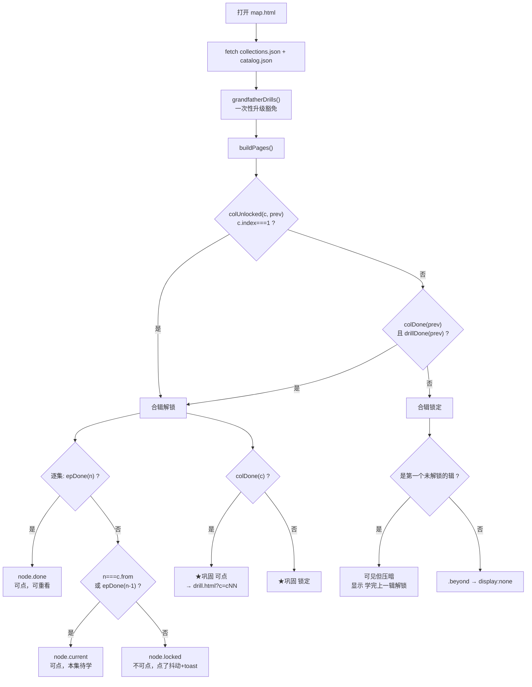
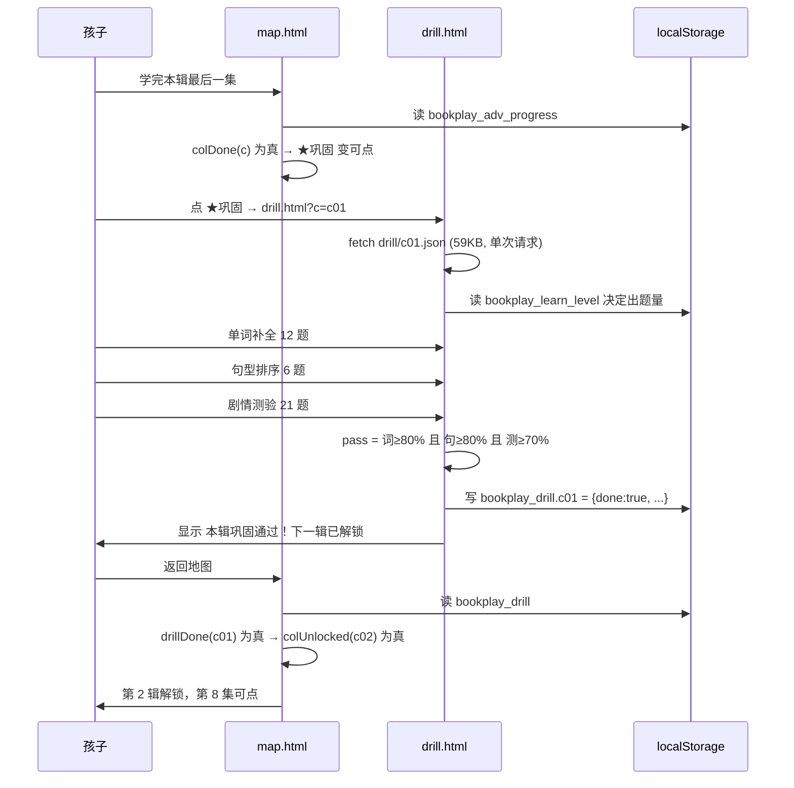
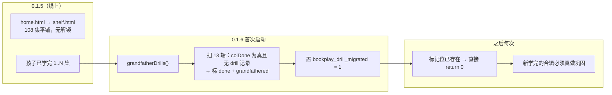

# 图解：解锁状态机与渲染流程

## 1. 合辑与集的解锁判定

关键点：`epUnlocked` **不再**自己判合辑是否解锁 —— 外层 `nodesHTML(c, isUnlocked)` 已经用 `isUnlocked` 把过闸了。这是根因分析里那两处崩溃的修法。

## 2. 巩固通关闭环（P0 要验的就是这条链）

**"写 bookplay_drill"到"第 2 辑解锁"这一段一次都没跑通过。** 前面被 `map.js` 的崩溃阻断，崩溃修了但这条链仍未验证 —— 这就是 P0。

## 3. 升级豁免的时间线

设计意图：**只豁免升级那一刻的历史进度**，之后一视同仁。这样既不惩罚已经学过的孩子，也不让巩固形同虚设。
