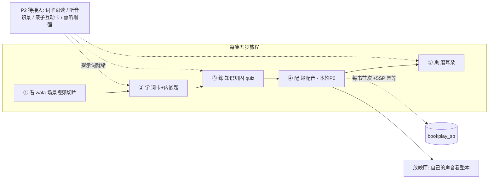
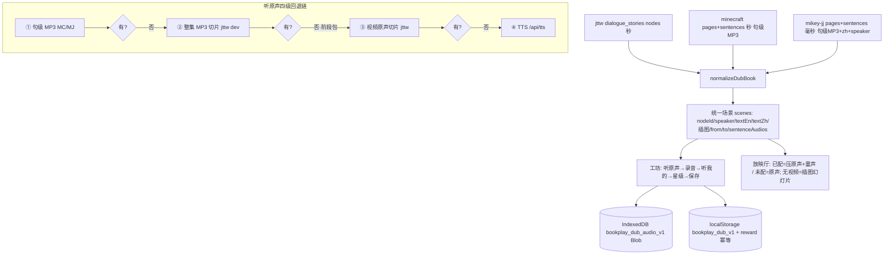
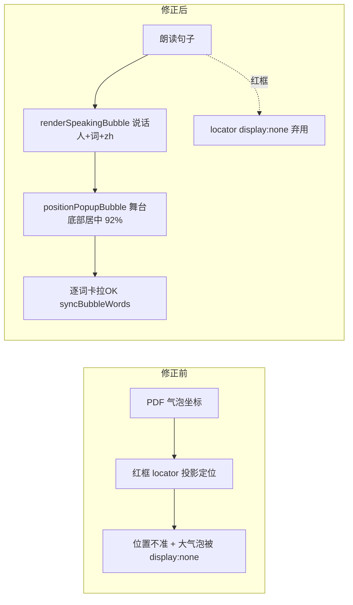

# 图解 · 学习闭环与趣配音架构

## 图 1 · 每集五步旅程与本轮落点

一句话结论：趣配音是五步旅程里唯一新增的环节（④ 配），其余环节要么已覆盖、要么列入 P2。

## 图 2 · 趣配音多系列归一与听原声回退链

一句话结论：三套书结构差异被 `normalizeDubBook` 收敛成统一场景模型；所有"放原声"的地方走同一条四级回退链，因此阶段包缺 MP3 也不受影响。

## 图 3 · v3 气泡修正前后

一句话结论：红框按 PDF 坐标定位天生不准，v3 现在完全不画框，改用舞台底部大弹窗（复用既有卡拉OK气泡组件）。

