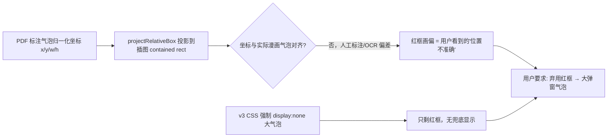

# 根因分析

> 本包四个"问题→根因"记录，均已验证（读代码/数据 + 实测复现）。

## R1 · Mikey JJ 阅读器红框错位

- 锚点：`prj/engine/storybook.js` `updateBubbleLocator()`（旧 v3 唯一显示路径）、`prj/engine/storybook-ui.js` `projectRelativeBox()`、`prj/engine/storybook-v3.css`（旧版 `#sb-speaking-bubble{display:none!important}`）。
- 修复：见 `解决方案.md` S4。

## R2 · mikey-jj 地图"小人还有问题"

- 根因 1：`map.js` 旧代码 `ROUTE_COMPANION_SPRITE_URL = SERIES_ID==="jttw" ? 图集 : ""` → mikey 永远用内联 SVG **悟空画风黄色占位小人**，画风与 Mikey 漫画不符。
- 根因 2：`placeCompanion()` 仅当路线有进度（`current/done`）或解锁才创建伙伴 → 无进度时页面上根本没有小人（实测 figureCount=0）。
- 结论：不是"生图质量差"，是**没有 mikey 素材 + 展示条件限制**。修复 = 接线 mikey 图集路径 + 探测回退 + GPT 生图 SOP（用户执行生成）。

## R3 · 我的世界页级时间不可用

- `storybooks-minecraft/book1.json` 页0：页级 `start_sec:0, end_sec:38.65`，但其句子实际 `158.35→165.17`。整本书页级与句级系统性错位（推测：页级来自另一套对齐产物）。
- 影响：按页切片"听原声"会切错段。**对策已实现**：`normalizeDubBook` 句级时间存在时取 `min(start)..max(end)`，页级仅作无句级时的回退。

## R4 · 阶段包（C01/C02）内趣配音"听原声"会失败

- `pack_datapack.py` `SKIP_PREFIXES` 含 `assets/lf_ep*`（整集 MP3 被裁掉），而 `dub.js` 旧逻辑只按 `book.audio` 切片。
- 对策已实现：回退链（句 MP3 → book.audio → **视频原声**（包内含 `assets/video`）→ TTS）。
