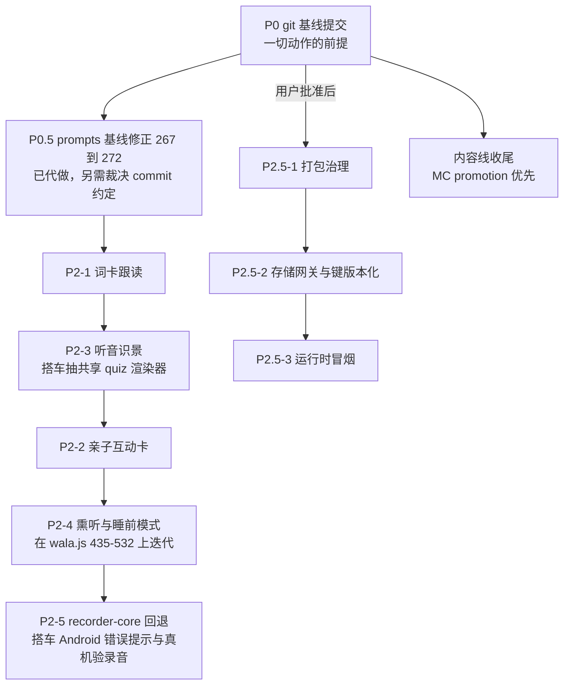

## 一、建议执行顺序（flowchart）

主线 A→B 沿 P0 往下；P2.5 三项待批准后插入；内容线收尾与主线无依赖可穿插。

## 二、引擎五大文件行数对比（SVG，wc -l 实测）

<svg viewBox="0 0 560 260" xmlns="http://www.w3.org/2000/svg">
<defs><clipPath id="barclip"><rect x="120" y="30" width="400" height="220"/></clipPath></defs>
<rect x="0" y="0" width="560" height="260" fill="#ffffff"/>
<text x="16" y="20" font-size="13" fill="#333333" font-family="sans-serif">prj/engine 五大文件行数（2026-09-04 wc -l 实测，虚线为文档旧口径 1659）</text>
<line x1="120" y1="30" x2="120" y2="250" stroke="#cccccc" stroke-width="1"/>
<line x1="120" y1="250" x2="520" y2="250" stroke="#cccccc" stroke-width="1"/>
<line x1="341" y1="30" x2="341" y2="250" stroke="#b0b0b0" stroke-width="1" stroke-dasharray="4,3"/>
<text x="341" y="246" font-size="10" fill="#888888" font-family="sans-serif">1659（架构路线文档旧口径）</text>
<g clip-path="url(#barclip)">
<rect x="120" y="40" width="358" height="24" fill="#d9822b"/>
<rect x="120" y="80" width="336" height="24" fill="#d9822b"/>
<rect x="120" y="120" width="178" height="24" fill="#4a9edd"/>
<rect x="120" y="160" width="163" height="24" fill="#4a9edd"/>
<rect x="120" y="200" width="140" height="24" fill="#4a9edd"/>
</g>
<text x="112" y="57" font-size="12" fill="#333333" font-family="sans-serif" text-anchor="end">storybook.js</text>
<text x="112" y="97" font-size="12" fill="#333333" font-family="sans-serif" text-anchor="end">wala.js</text>
<text x="112" y="137" font-size="12" fill="#333333" font-family="sans-serif" text-anchor="end">map.js</text>
<text x="112" y="177" font-size="12" fill="#333333" font-family="sans-serif" text-anchor="end">lesson.js</text>
<text x="112" y="217" font-size="12" fill="#333333" font-family="sans-serif" text-anchor="end">drill.js</text>
<text x="484" y="57" font-size="12" fill="#333333" font-family="sans-serif">2681</text>
<text x="462" y="97" font-size="12" fill="#333333" font-family="sans-serif">2518</text>
<text x="304" y="137" font-size="12" fill="#333333" font-family="sans-serif">1332</text>
<text x="289" y="177" font-size="12" fill="#333333" font-family="sans-serif">1226</text>
<text x="266" y="217" font-size="12" fill="#333333" font-family="sans-serif">1050</text>
</svg>

橙色为整合债焦点（拆分候选）；wala.js 橙色含义是"从 1659 拆分后回潮至 2518"，storybook.js 是"从未拆分过的最大文件"。
