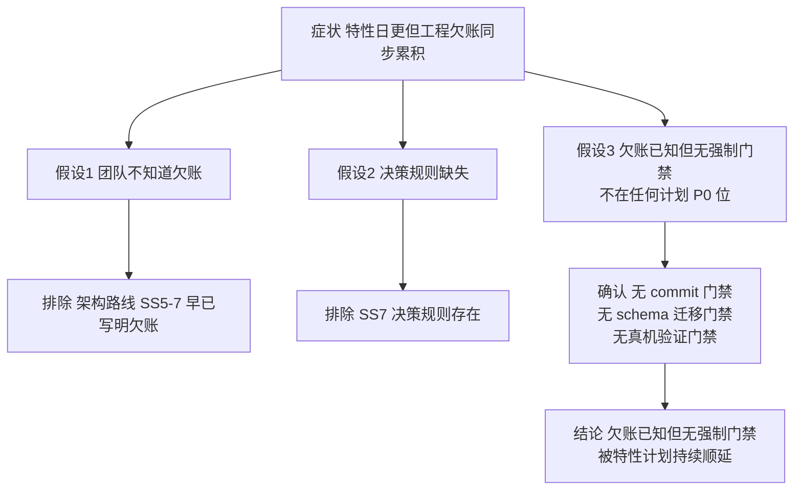

## 根因

特性计划产出速度持续高于工程消化速度——"非特性"工作（git 基线、schema 版本化、端到端验证、打包治理）不在任何计划的 P0 位，被逐日顺延，欠账在工程安全、验证、整合三个层面复利累积。

## 结论等级

- **已验证部分**：欠账真实存在且已量化——git 0 commit、16 个无版本存储键、31 个测试文件进 APK、真机待验项在 3+ 份报告中 recurring（证据全部见 关键发现.md）。
- **推测部分**："产出速度 > 消化速度"是解释性判断，未做定量。且存在部分反证：P2 prompts 已内建"npm test 全绿 + 验收报告 + 状态表"门禁，说明新计划已吸收部分教训——**根因主要是历史欠账，而非欠账仍在恶化**。
- **反证/冲突**：`docs/项目架构与优化路线.md` §7 早已写明决策规则（含"若只是增加新方案文档但不缩小真实缺口，则暂缓"），规则存在而未触发——支持"流程缺强制门禁"而非"规则缺失"。

## 分析过程

1. 症状侧写：08-29 ~ 09-04 每日均有特性计划落地并验收，同期 P0 git 基线（08-30 计划第 1 条）始终未做。
2. 排除"不知道"：架构路线 §5 已逐条列出端到端验证、schema 迁移、发布流程欠账。
3. 排除"无规则"：§7 决策规则存在且合理。
4. 确认"无门禁"：P2 prompts 验收标准只有 npm test + 报告 + 状态表，没有 commit 门禁、存储键版本门禁、真机门禁——欠账项因此永远排不进执行位。

## 证据

- git：`git log` fatal 输出（本会话实录，见 测试分析报告.md 附录）
- 存储键：`prj/engine/storage.js:9-24`；`bookplay_drill` 散落 4 文件 21 处（代理核查）
- 打包：`scripts/prepare-mobile.mjs` 全量 `fs.cp`；`打包数据包.bat` 硬编码段
- 真机欠账模式：`docs/reports/2026-09-04-趣配音多系列扩展验收.md` 等 5 份最新报告的 🔲 项高度重合

## 最小反证实验

- **实验名**：基线提交后的一周观察（详见 行动项/待做实验.md 实验 2）
- **做法**：完成 P0 git 基线后，按现 P2 prompts 跑完①②两个特性，统计新增"真机待验"条目数与新 localStorage 键数
- **若实验失败意味着**（两项接近 0）：当前 prompts 门禁足以兜住，"欠账仍在恶化"降级，P2.5 可减配为仅打包治理一项
