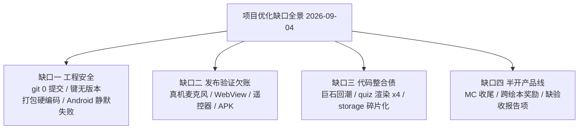

## 缺口全景图

## 已验证结论（本会话直接验证）

- ✅ git main 分支 0 commit（`git log` → "fatal: your current branch 'main' does not have any commits yet"）
- ✅ `npm test` 实测 **272 pass / 0 fail**（node --test，31 个 `.test.mjs`，耗时 1.28s）
- ✅ 五大文件行数：storybook.js **2681** / wala.js **2518** / map.js **1332** / lesson.js **1226** / drill.js **1050**（`wc -l`）
- ✅ 5 个 P2 prompts 把"当前基线 267 个测试"写死为验收标准（grep 命中 prompts/01/02/03/04/05）——已过期，本包落盘时修正为 272
- ✅ P2 计划状态表 6 项全部"未开始"（`docs/plans/2026-09-04-西游记多形式学习闭环P2/00-总览.md` §3）
- ✅ handoff 技能已安装至 `C:\Users\No'mi'l\.agents\skills\handoff`（SKILL.md + references/ 5 份）

## 已验证结论（探索代理逐文件核查，附定位，接手时可复核）

### 缺口一：工程安全
- ✅ storage.js（WalaStorage，13 键）只被 dub.html 和 wala.html 加载；其余页面各自直读 localStorage：map.js **15 处**、storybook.js **13 处**、lesson.js **13 处**；`drill.js:154` 重复实现 addSP
- ✅ `prj/engine/storage.js:9-24` KEYS 13 键中 **10 键无版本后缀**（read_mode/annot/pass_mode/learn_level/play_rate/adv_progress/adv_vocab_stat/sp/autoplay/side_cards）
- ✅ 全仓另有 16 个无版本键：`bookplay_wordbook`、`bookplay_story_progress`、`bookplay_save_jttw`、`bookplay_prefs`、`bookplay_drill`（21 处引用、散落 4 文件、无统一 KEY 常量）等——schema 迁移无从谈起
- ✅ `scripts/prepare-mobile.mjs` 无过滤全量拷贝（`fs.cp recursive`）：31 个 `.test.mjs`（含 65KB storybook 测试）、`wala_test_check.js` 全部进 APK
- ✅ `打包数据包.bat` 硬编码 `PACK_VERSION=0.1.7`（与 package.json 双份真相）、合辑固定 `c01,c02`、报告路径固定日期
- ✅ 端口 18787 双写：`capacitor.config.json` + `LocalRangeServer.java:20`
- ✅ Android 原生层静默失败：`LocalRangeServer.java:32-34` bind 失败直接 return 无提示；`:70` `catch (Exception ignored)` 吞请求异常；`DataPackStore.java:104-116` 硬编码 4 个设备路径候选
- ✅ 死代码：`prj/engine/home.js`（79 行，无任何页面引用）、`wala_test_check.js`

### 缺口三：代码整合债
- ✅ quiz 题型渲染 4 套：`storybook.js:1641/:2213`、`drill.js:860`、wala.js 内嵌；数据层共享（quiz.js / episode-vocab-quiz.js）但 UI 渲染不共享；双命名空间 `WalaQuiz` vs `BookPlayEpisodeVocabQuiz`
- ✅ 内容硬编码进引擎：`episode-vocab-quiz.js:8-56` 巨型 `LEGACY_CHINESE_TO_EN` 中英映射字典
- ✅ 缓存版本手工维护：`map.js?v=48`、`wala.js?v=71`、`storybook.js?v=quiz-audio2`（用功能名当版本号，漏改即脏缓存）
- ✅ 测试防波堤薄：media.js（音频回退链核心）、quiz.js、adventure.js、main.js、setup.js、tv-remote.js **零测试**；map.js/drill.js 测试仅源码正则断言，对重构几乎无保护
- ✅ `npm test:content` 仅挂 3 个 pytest，`test_android_serve.py`、`test_android_variants.py` 未纳入
- 🔲 `adventure.js`（345 行）与 wala.js 音频引擎同构、疑似可合并退役——代理读码判断，未做行为对比

### 缺口二：发布验证欠账（历次验收报告 recurring）
- ✅ 重复出现的"真机待验"：真实麦克风录音链路（3+ 次）、Android WebView 麦克风授权与 IndexedDB 配额、iOS Safari audio/mp4、真电视遥控器巡检、"本轮未打 APK"（磨耳朵/跟读等报告原话）
- ✅ `docs/项目架构与优化路线.md` §5 P1"运行时端到端验证"（Range 206、EP1/54/108、刷新恢复）至今未做

### 缺口四：半开产品线（文档历史核查）
- ✅ Minecraft 统一播放器：367 句中文复核 **0/367**、101 句词级时间待复核、任务 08 promotion 未执行（V3 仍走 `ui=unified-v3` 候选，默认 legacy）
- ✅ 跨绘本角色奖励：P1 三项未勾选、P2 全部未开始（`docs/plans/2026-09-03-跨绘本角色动作与收集奖励系统.md`）
- ✅ 巩固测验音频补齐：工具入库但**无验收报告、未声明完成**；小节两遍制 tasks 01-07 无状态标记
- ✅ Mikey-JJ 生产：`docs/handoff/mikey-jj-episodes-remaining/` 为空目录；Penguin book3 中断在资产采集阶段

## 待验证假设

- 🔲 P2.5 治理三项（打包/存储网关/运行时冒烟）的实际收益成本比——用最小反证实验校准（见 根因分析.md）
- 🔲 真机四项（WebView 收音/授权、iOS 分支、遥控器、APK 全链路）——需用户配合真机环境

## 口径说明

- **测试基线采用 272**：来源本会话 2026-09-04 `npm test` 实测（可复现），与 002 包口径一致；267 为 P2 规划会话旧口径，已废弃，prompts 中遗留已修正
- **wala.js 行数采用 2518**：来源本会话 `wc -l`；`docs/项目架构与优化路线.md` §P1 的 1659 是 08-31 拆分完成时快照，已滞后未勘误
- **无版本键计数采用"16 键（另有 storage.js 内 10 键）"**：前者为探索代理全仓核查口径，后者为本会话复核 storage.js:9-24 的子集口径，两者不矛盾

## 被否决方案

- ❌ 捡回 RPG 改编旧方案 — `docs/需求/` 有完整技术方案但 plans 零接管；需求文档自述"先工作流再谈 RPG"，工作流已实现，回归须重新立项
- ❌ 金币装备装饰经济上线 — `docs/plans/2026-09-01-瓦拉英语金币装备装饰调研与设计方案.md` 已自降级为备选
- ❌ P2 之外新增学习特性 — 上游九环节矩阵已裁定不接入项（儿歌/发音评分），P2 方案刚定稿应先执行
