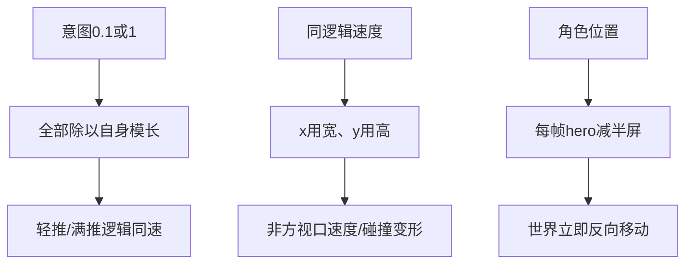

# 根因分析

> 运动模型的两个源码缺陷已定位，缺声的设备根因尚未确认。

## 运动证据链

当前moveStep关键实现如下，输入强弱在这里丢失：

```javascript
const mag = Math.hypot(Number(intentX) || 0, Number(intentY) || 0);
if (!mag) return { dx: 0, dy: 0, facing: null, moving: false };
return {
  dx: (intentX / mag) * speed * dtSec,
  dy: (intentY / mag) * speed * dtSec,
};
```

来源：prj/engine/game-core.js:38。逻辑世界按视口宽和高分别转像素；在1280×720、速度0.92的前轮诊断口径下，一秒理论水平1177.6px、垂直662.4px，比值约1.78。这不是实际设备每秒录屏位移。



## 语音解释边界

✅ 已看到Android的/api/tts路由与NativeTts后备。前轮源码分析显示ensureTtsIndexes主要加载sent/quiz索引，并非覆盖游戏用到的全部词索引。

🔲 文件未进包、旧数据覆盖、索引未命中、play拒绝、语言包、系统音量/BGM均为候选；未获取真机URL/状态码/play错误之前不能选定单一根因。

原故事JSON具备source node和音频时段，但生成intro及组装NPC时丢失元数据，这是原声无法沿现有数据链直接消费的接线缺口，不证明提取后的音质。

## 最小反证实验

| 假设 | 最小动作 | 若不成立 |
|---|---|---|
| 模长归一导致摇杆无档位 | 同一函数输入0.1/1，比较位移，再记录真实指针幅度 | 函数不同则先检查实际加载源码；不要重复修改旧副本 |
| 分别缩放导致横竖不等速 | 同一宽高比、固定有效时间记录world与screen位移 | 检查CSS缩放、dt、碰撞和实际场景rect |
| 缺声由查找/打包链引起 | 断网直接播已知包内静态MP3，再触发同词游戏事件 | 直接播放也失败则转解码/权限/音量/设备通道 |
| 新代码未被设备加载 | 核对实际/engine响应与public/engine及源码hash | hash相同再查交互；不同先修发布链 |

实验必须在确认后的隔离数据/浏览器环境或明确目标设备执行。比较母本时固定视口、输入持续时间和录屏标准，不以“感觉一样”作唯一结论。

