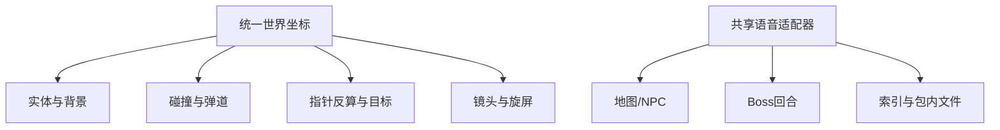

# 解决方案

> 沿现有引擎分阶段迭代，先修运动样板，再连完整一局和声音。

## 主工件

[九份方案入口](../../../plans/2026-09-07-降妖记移动镜头与语音优化/README.md)是详细设计；[T00–T11实施计划](../../../plans/2026-09-07-降妖记移动镜头与语音优化/07-分阶段实施计划.md)给出具体文件、依赖、命令与通过条件。本包只交接，不重新生成另一套实施计划。

## 改造前后与风险

| 范围 | 当前 | 拟实现 | 风险/验证 |
|---|---|---|---|
| game-core/game.js/game.css | 分轴缩放、硬跟随 | 统一世界尺度、边缘静止区和平滑 | 高：所有实体、弹道、碰撞、点击反算回归 |
| game-input/tv-remote | 全局输入交叠 | 单指归属、双指投掷、弹层所有权 | 高：触屏与其它TV页面回归 |
| game/battle状态 | 跨页重建、字段可能丢失 | run快照、合并、奖励幂等 | 高：旧存档、重复结算和重玩 |
| lesson入口 | 内联链接 | 完成后自动选择层、可跳过 | 中：学习奖励和下一集门禁 |
| game-audio与数据 | TTS为主、吞错 | 静态引用、重听、取消、BGM让路 | 高：断网、快速翻句、后台 |
| 打包 | 三通道可能漏依赖 | JSON/音频闭包核验、缺项构建失败 | 高：新装与旧包升级 |

## 高风险影响链

## 语音来源规则

先复用content/assets/adv_audio下已有词句；NPC引用原文时使用审核过的原视频/音轨切句，新编引导和嘲讽补静态配音。

原声每项保留源路径、SHA、音轨/时间基准、sourceNodeId、speaker、start/end、试听状态。MP3和MP4时间戳不能假定一致；提取整段音轨不等于分离干净人声。

## 推荐验证节奏

A：T00–T02运动输入样板 → B：NPC/Boss/返回完整一局 → C：断网关键声音 → D：准确版本APK新装/升级。每一检查点带正常输入录屏和数值，不等全批结束才看结果。

`game-input.js`、`game-audio.js`、`build_game_audio.py`、`validate_game_runtime.py`及相应新测试均为拟新增文件，不可把文档中的未来命令报告为已执行。

