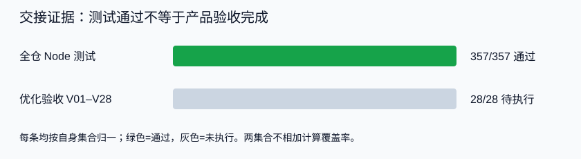

# 交接时测试分析报告

> PARTIAL：Node基线通过，游戏优化和真机验收仍待执行。

## 执行摘要

本次确认落盘后的准备阶段重新运行npm.cmd test，进程退出码0。以下是全仓Node测试，不是本次新增的357条测试，也不是游戏全链路验收。

| 指标 | 目标/历史 | 当前 | 结果 |
|---|---|---|---|
| 全仓Node总数 | 004历史347，当前保持≥357 | 357 | PASS |
| 通过 | 357 | 357 | PASS |
| 失败 | 0 | 0 | PASS |
| 取消/跳过/待办 | 0 | 0/0/0 | PASS |
| 优化验收V01–V28 | 适用项提供证据 | 尚未执行 | PENDING |
| 原声音频切片/试听 | 审核后才能发布 | 未执行 | PENDING |
| 改造版APK构建/安装 | 版本及资源可追溯 | 未执行 | PENDING |

数字自洽：357=357通过+0失败+0取消+0跳过+0待办。V01–V28与Node测试属于不同集合，不相加、不混算覆盖率。

## 命令实录

从G:/Game/BookPlay书戏运行，保留汇总；完整工具输出可沿README的transcript入口定向回查。

```text
> npm.cmd test
> node --test prj/engine/*.test.mjs
1..357
# tests 357
# suites 0
# pass 357
# fail 0
# cancelled 0
# skipped 0
# todo 0
# duration_ms 2320.989
ExitCode=0
```

该结果产生于交接准备期，之后只写文档和图解。执行阶段如果代码已改变，必须重新跑测试，不拿此旧快照直接交付。

## 验证状态图

下图按各自集合画百分比，不能将两条的分母视为相同：



## 已核实的其它证据

| 项目 | 方法 | 能证明什么 |
|---|---|---|
| moveStep与updateCamera | 直接读取当前核心函数 | 输入幅度丢失和居中跟随的源码逻辑 |
| lesson结果卡 | 读取finishLesson现有分支 | 已有进入/跳过链接，仍非独立自动选择层 |
| Android服务入口 | 读取LocalRangeServer | 有/api/tts；/engine加载public目录 |
| 核心文件与APK | Get-FileHash | 识别本次快照，hash见环境信息 |
| 前轮文档检查 | 严格UTF-8与链接检查 | 9份方案、11个被检查文档、19条本地链接，0错误 |

最后一行是前轮方案检查记录，不是005新包验证结果。005生成后另行检查：16个文件（13份Markdown、2份Mermaid源图、1份SVG），40条本地链接有效，Markdown frontmatter齐全，严格UTF-8与替换字符/行末空白检查0错误，SVG XML解析通过且有viewBox，005索引行唯一并与历史表连续。定向git diff --check退出码0；仅提示既有索引文件未来可能从CRLF规范化为LF。图解未做浏览器渲染验收，不把XML解析等同于视觉检查。

## 音频旧证据的边界

前轮对ep1–7各12个previewWords检查英文/中文索引及目标文件，共84个词出现项；各2个intro英文共14个句出现项。来源是当前content数据树存在性核查，未做逐句试听、解码或APK覆盖测试。

本次未重跑音频库存检查，以上作为已记录的先前证据承接，不升级为当前真机播放结果。新增对白和Boss引导也不在该样本范围。

## 当前失败与风险

Node没有失败项，但用户报告的游戏问题未修复/未验收。不能把“无失败Node测试”翻译成“产品无问题”。

必须保留的下一步：T00确认真实运行版本；T01–T02正常输入运动样板；其后逐项完成V01–V28。缺设备、缺音频或缺E2E依赖时写pending并说明具体原因。
