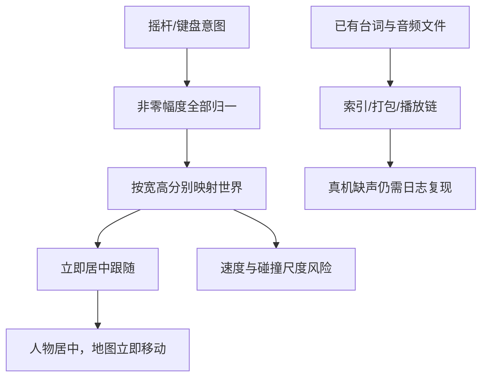

# 关键发现

> 已有游戏接线，但源码层面的缺口与真机完成声明不能混为一谈。

## 已验证的源码事实

下列定位相对仓库根，行号为生成快照；后续以函数名定位。本节“已验证”只指源码事实或明确诊断，不等于实物设备复现。

| 事实 | 证据 | 边界 |
|---|---|---|
| 非零摇杆输入总被归一化 | prj/engine/game-core.js:38 moveStep | 0.1和1输入幅度均产生相同逻辑速度 |
| 镜头立即居中 | prj/engine/game.js:246 updateCamera | camera=hero−0.5，按vw/vh平移世界 |
| 世界是4×4 | prj/engine/game-core.js:11 | 004索引中的3×3是旧快照 |
| 巩固结果已有进入/跳过链接 | prj/engine/lesson.js:1334 finishLesson | 通过后内联呈现，不是自动独立选择层 |
| Android有TTS接口 | LocalRangeServer.java:90 serveTts | 不能说APK根本没有/api/tts |
| Android引擎实际从public路径加载 | LocalRangeServer.java:94 serveAsset | 仅校验assets/engine不足以证明设备版本 |
| Node全仓357通过 | 本包测试分析报告命令实录 | 非端到端/真机验收 |

## 缺口传播关系

## 前轮调查保留的重点

完整逐项证据见[现状证据与参考差异](../../../plans/2026-09-07-降妖记移动镜头与语音优化/01-现状证据与参考差异.md)，避免重复扫描全部仓库。

- 输入：pointerdown只激活、无唯一指针归属和完整中断清理；TV方向焦点与角色方向并行处理。
- 地图：4×4世界与约33.334%背景分块不一致；点位数据被硬编码覆盖，词球点击层存在pointer-events风险。
- 状态：Boss入口允许小怪未清直接挑战；NPC done恢复和奖励字段合并不足；Boss返回缺from=battle且重建世界。
- Boss：错词只在既有hpWords内重排；动画期多按钮连点存在重复判定风险，尚需运行复现。
- 声音：地图speakTerm吞错，未统一watchMedia；部分对白仅显示文字，sourceNodeId/音频时段未完整透传。

## 口径说明

- 当前357来源为生成前重新运行；004的347为历史底线，二者不是同一次执行。
- “两代全落地/忠实移植”来自旧004索引，不作为当前体验验收证据；保留历史记录，在本包明确未闭环项。
- 前轮音频存在性检查覆盖7集×12词=84出现项，7集×2开场句=14出现项；未试听/解码/核查APK覆盖，不能写成“语音已接入”。
- 母本镜头也居中跟随；用户此次明确选择边缘平滑跟随，是需求修订，不能把滚图本身当作移植错误的证据。
- 不知道设备实际加载哪个包/哪个版本；版本配置或源码更新不自动更新已安装APK。

## 待验证与否决

🔲 真机是否发生双指丢控制、连点重复判题、音频被BGM遮盖，以及各因素贡献程度仍待复现。

❌ 不加回点击式快卡，不复制每集引擎，不用一段视频按句数均分时间冒充逐句原声，不把字幕存在当语音已播。

