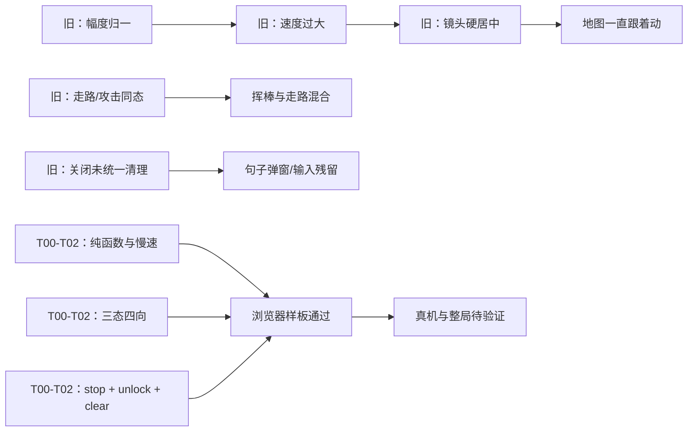

# 根因分析：移动、动作与整局未闭环

> 过去的“地图跟着动、动作太快、走路挥棒混合、句子弹窗不消失”已有代码级修复；剩余风险主要来自设备和跨页状态尚未实测。

## 根因

旧实现把不同层的问题叠在一起：输入幅度被归一化，速度常量按视口比例过大，镜头每帧把人物硬居中；角色渲染没有严格区分走路和攻击；弹层关闭没有统一停止音频、清空意图和释放锁。T00–T02 已分别拆开这些责任，但完整游戏是否在实际 WebView 中稳定，仍不能只由单元/契约测试推断。

## 结论等级

- **已验证部分**：当前源码具有 `moveStepViewport`、`edgeCameraStep`、三态四向资源、单 pointer 清理和 `closeDialogue` 清理；Node/Python 测试及浏览器 DOM 断言通过。
- **推测部分**：如果设备仍“快”或“双指失控”，候选原因是 WebView CSS 像素/刷新率、pointer capture 差异、摇杆尺寸或实际安装的包不是本次 hash；需设备日志和轨迹验证。
- **整局边界**：NPC/Boss 门控、存档和音频适配有源码契约，但没有现场贯穿操作；不能把契约覆盖误写成根因已彻底排除。
- **反证/冲突**：旧 004/005 文档的 3×3、347/357 和立即跟随口径与当前 4×4、408、用户边缘镜头冲突，已在关键发现中降级并说明采用口径。

## 分析过程

1. 对照 `word-memory-map` 的玩法与当前 `game.js`，确认大地图路由、词球、小怪、NPC、Boss 并非完全缺失；问题是行为和状态的实现/验证不完整。
2. 追踪输入到渲染：`game-input.js` 产出意图，`game-core.js` 计算步进，`game.js` 更新实体和镜头。旧的归一化与硬跟随解释了轻推满推同速和地图立即移动。
3. 追踪动作到资源：`setHeroPose`/`setMonsterPose` 根据 `moving`、`attackUntil` 选资源；攻击函数显式置 `moving=false`，因此走路与挥棒不再共享一个状态。
4. 追踪弹层生命周期：`openDialogue` 锁输入，`closeDialogue` 停止 audio、清空 `dlg`、隐藏面板并解除锁；若答题完成还有 pending wave，则在关闭后继续刷波。
5. 追踪交付消费者：浏览器加载 `../data/game/...`，Android 由 `assets/public/engine` 服务；没有 ADB 设备时，无法确认实际消费者、媒体解码和触控手感。

## 证据链

## 当前解释边界

- ✅ “代码为何出现快走/地图硬跟随/动作耦合”的解释有源码和行为测试支持。
- 🔲 “设备上是否仍快、是否丢 pointer、是否无声”的解释不能在无设备时定论。
- 🔲 “NPC/Boss/返回断点在哪里”需用真实顺序和日志定位，不能用 debug 直接跳过。

## 最小反证实验

### 实验：同包浏览器轨迹 vs Android 轨迹

- **步骤**：在 1280×720 浏览器和安装了精确 SHA-256 APK 的设备上，分别记录 1 秒轻推、1 秒满推、中央区移动和越边缘移动；同时记录 `BookPlayGameDebug.hero/camera` 或等价日志。
- **若实验失败意味着**：若浏览器通过而设备仍快/镜头硬跟，当前根因要从算法改写为设备 CSS/包版本/输入适配问题；先核对 `assets/public/engine` 和安装 hash，不要盲目继续降速。
- **若实验通过意味着**：移动实现可以保持，转向 T03–T08 的地图、状态、语音和整局证据。

### 实验：弹层关闭后的延迟事件

- **步骤**：打开 NPC 普通句，点击重听后立即关闭，再触发 `ended/error` 事件替身；断言 `dlg=null`、面板隐藏、方向意图为零且无迟到播放。
- **若实验失败意味着**：回退到 `game-audio.js` generation token / `closeDialogue` 清理链，先补测试再改 UI。
