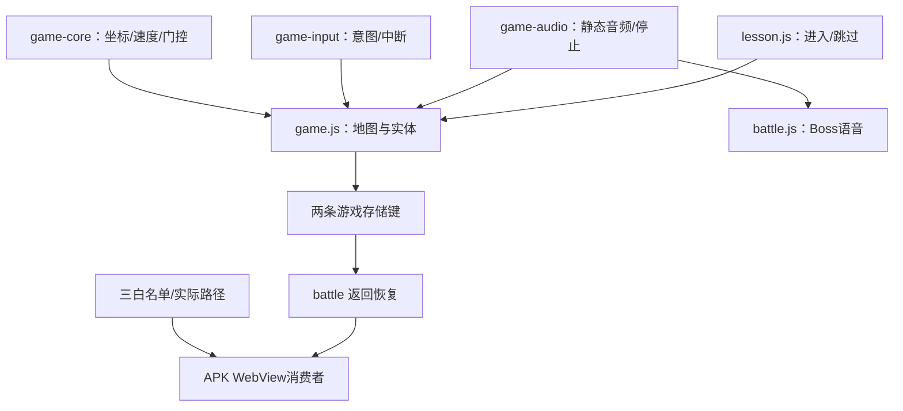

# 解决方案与后续路线

> 沿现有 `game` / `battle` 引擎把样板做成可验证整局，再扩集；不复制每集引擎。

## 当前实现基线

| 变更点 | 入口 | before | after | 风险 | 证据 |
|---|---|---|---|---|---|
| C1 坐标/速度 | `game-core.js` 的 `moveStepViewport` | 非零意图一律全速，横竖按世界单位视觉不等 | 保留幅度、斜向限幅、视口补偿；慢速档位 | 🟡 需设备调参 | `game-core.test.mjs`、浏览器轨迹 |
| C2 边缘镜头 | `game-core.js` 的 `edgeCameraStep` + `game.js:updateCamera` | 每帧人物居中，地图立即动 | 中央死区静止，越边缘指数平滑，边界硬钳制 | 🟡 需设备视觉检查 | `results.json` |
| C3 角色动作 | `game.js:setHeroPose/setMonsterPose` | 走路与挥棒混合，怪物长期 south | 四向 `idle/walk/attack`，攻击期间停止移动，怪物按运动主轴换向 | 🟡 资源缺失会降级占位 | `现状复现.md` |
| C4 输入与弹层 | `game-input.js`、`closeDialogue` | pointer/失焦/弹层可能留意图 | 单 pointer、全中断清理、关闭停止语音并解锁 | 🟡 WebView 行为待验 | 输入测试、浏览器 DOM |
| C5 静态语音 | `game-audio.js` + `content/game/audio/ep1.json/ep5.json` | 只能从文本/TTS推断有声 | 静态索引优先、generation token、可重听，缺失才 fallback | 🟡 需解码试听 | `build_game_audio.py validate` |

## 影响传播图

## 后续实施路线

### P0-A：现场基线与整局断点

1. 先确认 `adb devices -l` 有目标 serial；安装 `release/storyhall-jttw-mobile-debug.apk`，核对版本 1.0.14、versionCode 19 和 SHA-256。
2. 断网启动 ep1，按正常输入走到词球、小怪撞击、NPC、Boss 和返回；每步保存日志/截图/断点。任何一步断开就先修最小链路，不用 debug 跳过来宣称通过。
3. 设备不可用时，只跑浏览器 1280×720 和 `BookPlayGameDebug.step` 轨迹，报告继续标记触屏/TV待验。

### P0-B：T03–T05 地图、NPC、Boss 和返回

- **T03 文件**：`content/game/maps.json`、`prj/tools/build_game_levels.py`、`prj/engine/game-core.js`、`prj/engine/game.js`。确保 hero/wave/NPC/Boss 点位来自关卡数据，删除覆盖点位的硬编码；校验可达、越界、主题和资源缺失。
- **T04 文件**：`content/game/dialogues/ep1.json`、`ep5.json`、`game-core.js`、`game.js`、`battle-core.js`。保持 intro → wave1 → NPC → wave2 → boss-ready；`sourceNodeId/speaker/audioRef` 透传；NPC 奖励按稳定 id 幂等；退出不清学习结果。
- **T05 文件**：`battle-core.js`、`battle.js/html/css`、`game.js`。Boss 有 `roundId` 和整回合输入锁；一次命中只消费一次；进入前快照，返回带 `from=battle`，不重播 intro/不刷死小怪。

### P0-C：T06–T08 语音和巩固入口

- **T06–T07**：先清点 ep1/ep5 台词，按 existing / extract-candidate / synthesis-needed / unresolved 分类；原声逐句核 source、时间线、speaker、SHA 和试听；静态索引和共享播放器支持重听、取消、后台 stop。
- **T08**：用真实巩固题走完 finishLesson，自动出现“进入游戏 / 暂时跳过”；区分未制作、未导入、加载失败；跳过只结束游戏入口，不改学习通过和复习路径。

### P0-D：T09–T10 打包与真机验收

- 三条白名单同时检查：阶段包 `pack_datapack.py:COMMON_FILES` 逐文件、APK 内置依赖闭包、APK 引擎 `pack_android.py:ENGINE_FILES`；再检查运行时真正消费的 `assets/public/engine/`。
- 生成新 APK 后记录版本、内容版本、hash、索引引用和缺失项；先新装，再保留数据升级，验证两条游戏存储键兼容。

### T11 与 P1/P2

样板通过后按同一数据契约扩 ep2–4、ep6–7，再按 `docs/playbooks/降妖记整局玩法/新开一集清单.md` 扩 ep8+。P1 处理道具图标 sheet、受击帧、小地图和装饰；P2 再考虑听音选怪、c02+ 与桌面打字扩展，不能挤占主线。

## 方案选择与注意事项

- **采用**：薄适配器 + 纯函数规则 + 现有页面；便于 Node 契约测试、浏览器验证和 Android 复用。
- **不采用**：重写整张地图、引入 pet-battle 的选队/PvP、把打字输入强加到触屏/TV、每集一套 JS。
- **参数原则**：`0.018/0.0012/0.0024` 是起始值；只有在同一设备轨迹和帧率证据下才调参，并保留失败对照。
- **存储原则**：只使用 `bookplay_battle_progress_v1` / `bookplay_battle_collection_v1`；学习与音频自身键不迁移、不清空。
