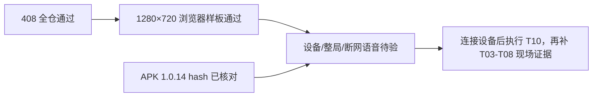

# 降妖记 T00–T02 与后续缺口测试分析报告

> 一句话结论：⚠️ PARTIAL——源码与浏览器移动样板通过，真机整局、触控/TV、断网语音和 APK 安装仍未执行。

## 执行摘要

**结论**：⚠️ PARTIAL。T00–T02 的可复现命令和浏览器 DOM 断言均通过；设备相关项目因 `adb devices` 为空保持待验。

| 指标 | 目标 | 实测 | 结果 |
|---|---:|---:|---|
| 全仓测试 | ≥357，0失败，0跳过 | 408 pass / 0 fail / 0 skipped | ✅ |
| 游戏定向 JS | 0失败 | 60 pass / 0 fail | ✅ |
| 定向 Python | 0失败 | 37 pass / 0 fail | ✅ |
| 阶段包/运行时/音频组合 | 0失败 | 21 pass / 0 fail | ✅ |
| ep1/ep5 音频索引 | 两集无缺失引用 | `validate OK` / `validate OK` | ✅（索引级） |
| 真机安装与整局 | 现场证据 | 未执行，ADB 无设备 | 🔲 |

> 数字自洽：不同定向套件互有重叠，60、37、21 不与 408 相加；每行均为独立命令输出。当前阶段不是 408 项产品验收全部通过。

## 验证项明细

| # | 验证项 | 方式 | 期望 | 实测 | 结果 |
|---|---|---|---|---|---|
| V-T01 | 保留摇杆幅度、斜向限幅 | `game-core.test.mjs` | 轻推慢走、斜向不加速 | 通过 | ✅ |
| V-T02 | 横竖屏幕速度统一 | `moveStepViewport` 测试 | 1280×720 横竖/斜向像素速度相等 | 通过 | ✅ |
| V-T03 | 世界坐标回环 | `worldToScreen/screenToWorld` 测试 | 回环误差为 0 | 通过 | ✅ |
| V-T04 | 中央死区镜头 | 浏览器 ep1/ep5 DOM | 中央移动 world transform 不变 | ep1 右移、ep5 下移均满足 | ✅ |
| V-T05 | 边缘平滑与边界钳制 | `edgeCameraStep` 测试 + 浏览器 | 越边缘后滚动，不越界 | 测试与 DOM 均通过 | ✅ |
| V-T06 | 主角/小怪四向走路 | 浏览器资源/状态检查 | north/south/east/west 可切换 | ep5 观察到 east/north/west；主角 south walk | ✅（浏览器） |
| V-T07 | 走路/攻击分离 | `game-page.test.mjs` + DOM | attack 时 `moving=false` | 主角和小怪均满足 | ✅（浏览器） |
| V-T08 | pointer 唯一归属与清理 | `game-input.test.mjs` | 第二指不劫持；失焦/后台清零 | 通过 | ✅（模拟 DOM） |
| V-T09 | 对话关闭生命周期 | 浏览器 DOM | hidden、lock、dlg、意图均清理 | `true/false/null/{0,0}` | ✅ |
| V-T10 | ep1/ep5 静态索引 | `build_game_audio.py validate --eps 1,5` | 无缺失引用 | 两集 `validate OK` | ✅（索引级） |
| V-T11 | APK 包内关键路径 | ZIP/哈希检查 | `assets/public/engine` 和音频索引存在 | 缺失 0 | ✅（静态包级） |
| V-T12 | 真机触屏/TV/音频/整局 | ADB + 正常游玩 | 全链路有设备证据 | 未执行 | 🔲 |

## 浏览器数据对比

| 场景 | 初始人物 | 中央区动作 | 越边缘动作 | 结论 |
|---|---|---|---|---|
| ep1 右移 | 27.5% / 40.5% | 27.95%，world 不变 | 32.69%，camera x=0.1569，world `-803.3px` | ✅ 中央先走、后滚 |
| ep5 下移 | 27.5% / 41.0% | 41.813%，world 不变 | 46.75%，world y=`-856.8px` | ✅ 中央先走、后滚 |



## 失败项与未执行项

- **V-T12 真机项**：失败类型不是功能失败，而是环境阻塞；`adb devices` 当前无设备。必须连接设备后安装准确 hash，再把每个断点记录为通过/失败/待验。
- **屏幕录制**：本环境没有录屏工件；DOM 数值不能代替视觉录屏。
- **原声试听**：没有 source/time-range/speaker/review 记录的片段保持 pending；索引 validate 不能升级为“原声已接入”。

## 包与环境证据

- APK：`release/storyhall-jttw-mobile-debug.apk`，1.0.14 / versionCode 19，SHA-256 `6F001B80E1B6D98DEE1ECB46FE60F4F04838B789C90F292C66B8AC210D1486F7`。
- 阶段包：`C:/Users/No'mi'l/AppData/Local/Temp/bookplay-jttw-pack-20260908/c01-ep1-ep5.zip`，5,702 entries，SHA-256 `504A966918186C752B74A754AFAB33D230BC4EB11D0089C24CF04547B1691FB8`。
- 详细命令实录、源码 hash、包内路径和 pending 列表：[`../../reports/降妖记优化验收/results.json`](../../reports/降妖记优化验收/results.json)、[`../../reports/降妖记优化验收/artifact-hashes.json`](../../reports/降妖记优化验收/artifact-hashes.json)、[`../../reports/降妖记优化验收/现状复现.md`](../../reports/降妖记优化验收/现状复现.md)。

## 风险与建议

| 风险 | 等级 | 缓解 |
|---|---|---|
| 无设备导致错误声称真机通过 | 🔴 | 报告保持 PARTIAL；先拿 serial 和安装日志 |
| 设备消费的引擎副本与源码不同 | 🔴 | 解包/运行时同时核对 `assets/public/engine` |
| 速度在不同 DPR/刷新率失真 | 🟡 | 实验 1 记录轨迹后才调参 |
| 新音频漏进白名单 | 🔴 | `COMMON_FILES`、内置闭包、`ENGINE_FILES` 三门禁 |

## 附录：验证命令实录

```powershell
npm.cmd test
node --test prj/engine/game-core.test.mjs prj/engine/game-input.test.mjs prj/engine/game-page.test.mjs prj/engine/game-audio.test.mjs prj/engine/storybook-game-entry.test.mjs
python -X utf8 -m pytest -q prj/tests/test_game_audio_pipeline.py prj/tests/test_game_runtime_contract.py prj/tests/test_pack_android_builtin.py prj/tests/test_make_release.py prj/tests/test_episode_lesson_runtime.py
python -X utf8 -m pytest -q prj/tests/test_stage_pack.py prj/tests/test_stage_pack_runtime.py prj/tests/test_pack_datapack.py prj/tests/test_pack_android_builtin.py prj/tests/test_game_audio_pipeline.py prj/tests/test_game_runtime_contract.py
python -X utf8 prj/tools/build_game_audio.py validate --eps 1,5
```

## 报告状态

本报告只描述 2026-09-08 已执行证据。设备连接、完整整局、原声提取或后续代码修改后，应新建/更新对应报告并重新运行全仓测试；不能沿用本报告把未执行项标成通过。
