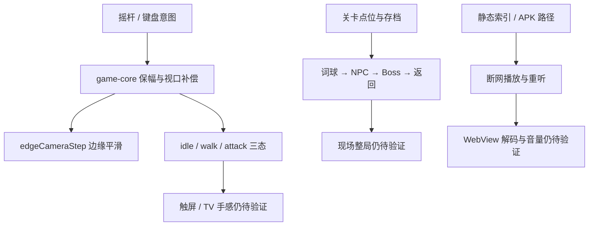

# 关键发现

> 代码层 T00–T02 已闭环，设备层和整局层仍是主要欠账。

## 已验证结论

| 状态 | 结论 | 证据与边界 |
|---|---|---|
| ✅ | 全仓测试为 408 pass、0 fail、0 skipped | `../../../reports/降妖记优化验收/results.json`；命令为 `npm.cmd test`，不代表真机 |
| ✅ | `WORLD_TILES` 当前为 4；世界坐标、屏幕坐标和镜头回环有行为测试 | `prj/engine/game-core.js` 的 `WORLD_TILES`、`worldToScreen`、`screenToWorld`；004 的 3×3 是旧快照 |
| ✅ | 输入保留模拟幅度，斜向不加速，非方形视口补偿横竖速度 | `moveStep`、`moveStepViewport` 及 `game-core.test.mjs` |
| ✅ | `edgeCameraStep` 在中央死区静止、越边缘指数平滑、世界边界硬钳制 | `prj/engine/game-core.js`；浏览器 DOM 轨迹见验收报告 |
| ✅ | 主角/小怪各自有 `idle / walk / attack` 和四向资源，攻击期间 `moving=false` | `prj/engine/game.js` 的 `setHeroPose`、`setMonsterPose`、`monsterAttack`；浏览器已观察 attack 资源 |
| ✅ | 小怪按运动主轴切换 north/south/east/west；停止时保持最后方向 | `directionFromDelta`、`setMonsterDir`；浏览器 ep5 已看到 east/north/west |
| ✅ | 摇杆只接受一个活动 `pointerId`，失焦/后台会清零，弹层关闭不会续走 | `prj/engine/game-input.js` 与 3 个输入行为测试 |
| ✅ | 关闭对话会停止音频、清空 `dlg`、隐藏面板、释放锁并清零意图 | `prj/engine/game.js` 的 `closeDialogue`；浏览器断言 `hidden=true / locked=false / dlg=null` |
| ✅ | ep1/ep5 静态游戏音频索引无缺失引用；APK 包内 `assets/public/engine` 与索引存在 | `build_game_audio.py validate --eps 1,5`、`artifact-hashes.json`；尚未证明设备解码/播放 |
| ✅ | 巩固页已有进入游戏/暂时跳过链接，游戏路由带 `from=lesson` | `prj/engine/lesson.js` 的 `finishLesson`；自动弹层和真实题目流程仍需 E2E |

## 浏览器样板数值

固定 1280×720、清空 localStorage 后：

- ep1：出生 `left:27.5%; top:40.5%`；中央右移约 1 秒后 `left:27.95%` 且 world transform 不变；继续移动约 10.5 秒后 `left:32.69%`，camera x=`0.1569`，地图开始滚动。
- ep5：出生 `left:27.5%; top:41.0%`；中央下移约 1 秒后 `top:41.813%` 且 world transform 不变；继续下移约 10.5 秒后 `top:46.75%`，地图开始滚动。
- ep5 小怪运行中切换 east/north/west 资源；主角攻击使用 `wukong-south-attack.gif` 且 `moving=false`。

这些是浏览器 DOM 断言，不是屏幕录制或真机手感结论。

## 待验证假设

- 🔲 设备 WebView 的 CSS 像素、触屏 pointer 事件和 `devicePixelRatio` 不会把当前速度再次放大。
- 🔲 双指操作时第二根手指能投掷或点击实体而不劫持摇杆；不同 WebView 对 pointer capture 的行为一致。
- 🔲 现有 NPC/Boss 契约在真实操作顺序中不会出现门控、返回或奖励重复；契约测试不足以证明页面状态串接。
- 🔲 断网时 `game-audio.js` 选择的静态 src 可从 APK 实际加载路径解码，BGM 不会盖住人声。
- 🔲 `lesson.js` 的入口在“真实巩固完成、未通过结果、未发布集、最后一集”四种导航下均可见且可跳过。

## 缺口传播关系

## 口径说明

- 测试数量采用 `../../../reports/降妖记优化验收/results.json` 的 2026-09-08 新鲜结果 408；005 的 357 只作为上一阶段基线，004 的 347 只作为历史底线。采用 408 是因为它是同一工作区更新后的可复现实测值。
- 世界边长采用当前 `prj/engine/game-core.js` 的 `WORLD_TILES=4` 和当前构建数据；004 索引中的 3×3 是旧快照，已废弃为当前验收口径。
- “已接入语音”只降级为“ep1/ep5 静态索引存在且 validate 通过”；因为没有设备解码、断网播放或试听记录，不能升级为“真机已播放”。
- 母本立即居中跟随不是本次修复目标；用户已明确改为边缘平滑镜头，故边缘滚动不是移植错误。

## 被否决方案

- ❌ 把点击式快卡答题加回大地图：用户已要求词球捡投，且会破坏参考玩法。
- ❌ 一段视频按句数均分时间冒充逐句原声：没有来源/时间段/试听证据。
- ❌ 每集复制一套 `game.js`：后续集应复用同一引擎和数据契约。
- ❌ 用桌面键盘或 Node 测试代称触屏/TV/真机通过：证据等级不一致。
