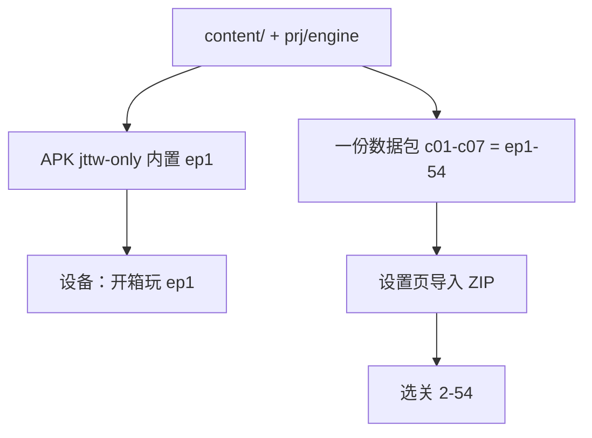

# 解决方案（地图 / 游戏 / 打包）

> 引擎保持 DOM；地图一屏；发布 = 轻 APK + 一份 1–54 数据包。

## 地图界面（已接到代码）

入口：`prj/engine/map.js` + `map.html` / `map.css`（选关圆）与 `game.js`（进关后的大地图）。

要点：

- 选关 1–54 解锁圈，不是 c08。
- 进关后 `game.html?ep=N`。一屏主题图：`maps.json` `worldTiles: 1`。
- 摇杆世界位移必须归一化成意图，否则会「冻住朝向」。
- 小怪 PACK 占位 + 分离，减轻挤成一坨。
- 镜头：角色先在屏内走，近边缘再推相机（006 已做；本会话未改核心公式）。

## 游戏部分（已接到代码）

| 层 | 路径 | 职责 |
|----|------|------|
| 大地图页 | `prj/engine/game.js` | DOM、精灵切换、撞击进战 |
| 规则 | `prj/engine/game-core.js` | 走、追、道具、NPC |
| 输入 | `prj/engine/game-input.js` | 单 pointer、弹层清意图 |
| 语音 | `prj/engine/game-audio.js` | 索引优先 |
| 战斗 | `prj/engine/battle.js` + `battle-core.js` | 词球、连击、Boss 技能 FX |

SKIN 表：

- `content/game/cast.json`：`minorsByEp` / `npcByEp` / `bossByEp`
- `content/game/sprites.json`：`idleFrames` / `walkGifs` / `attackGifs`
- `content/game/boss-kits.json`：每 Boss `attack/special/defend` 的 fx
- `content/game/levels/epN.json`：由 `build_game_levels.py` 派生

后期小怪 id：heaven-soldier、temple-novice、mountain-bandit、blackwind-imp、sand-yaksha、bone-wraith、yellowrobe-imp、court-guard、forest-beast、gourd-imp、fire-imp。

具名 Boss id（南向 walk 已独立 GIF）：yellowrobe、rulai、jinchi、laojun、king、tudigong、prince、heishui、yingchou。ep4 仍是 subodhi，ep28 zhenyuan，ep47 假唐僧 tang。

战斗跳过 URL：`battle.html?ep=N&skip=intro,preview,waves,quiz&from=game`。

## 打包（已接到代码）



命令：

```bat
npm run android:build:jttw
python -X utf8 prj/tools/pack_datapack.py --collections c01,c02,c03,c04,c05,c06,c07 --published none --version 1.0.15 --out release/西游记数据包-1.0.15.zip
```

ENGINE_FILES 已含 `game-core.js` `game-input.js` `game-audio.js`。

## 方案 A：当前（采用）

轻 APK + 一份 1–54 ZIP。证据：用户口头 + builtin manifest。

## 方案 B：全量 108 集视频进包

未采用。c08+ 用户未要；`assets/video` 整目录 2.7 GB。

## 方案 C：APK 内置 1–54 游戏图

否决。与 prune 和「一个大文件」冲突。
