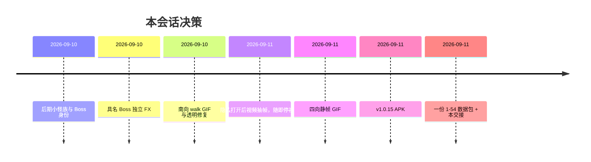

# 决策记录

## 决策 1：FLOW 一套，SKIN 按集换

- **选择**：不改玩法循环；每集换立绘、地图、台词、Boss、特效。
- **原因**：用户反复锁定「不要新玩法」。
- **否决**：每集一套新玩法；从宠物积分包抄异世界文案。

## 决策 2：APK 只内置第 1 集

- **选择**：`npm run android:build:jttw` → `--builtin-profile jttw-only`。
- **原因**：开箱可玩；后面关用一份数据包导入。
- **否决**：把 2–54 精灵打进 assets/data。

## 决策 3：数据包只维护一份

- **选择**：`c01–c07`（ep1–54）+ `game/` 与 `assets/game-*` 整树；输出 `release/西游记数据包-1.0.15.zip`，拷进 `release/v1.0.15/datapack/`。
- **原因**：用户要求「只要维护一个大文件，每次放到最新发布包」。
- **否决**：并行维护 c01 / c01-c02 / ep01 多份 ZIP 作为主发布物。

## 决策 4：走路不用视频管线

- **选择**：隐私打开后曾用视频抽 8 帧；用户说额度后，剩余 Boss/四向全部静帧左右脚。
- **原因**：`image_to_video` 429 且消耗大。
- **否决**：为四向再打 30+ 条视频。

## 决策 5：显示名

- **选择**：猪八戒、沙僧。
- **否决**：猪刚鬣、流沙河妖。

## 时间线

