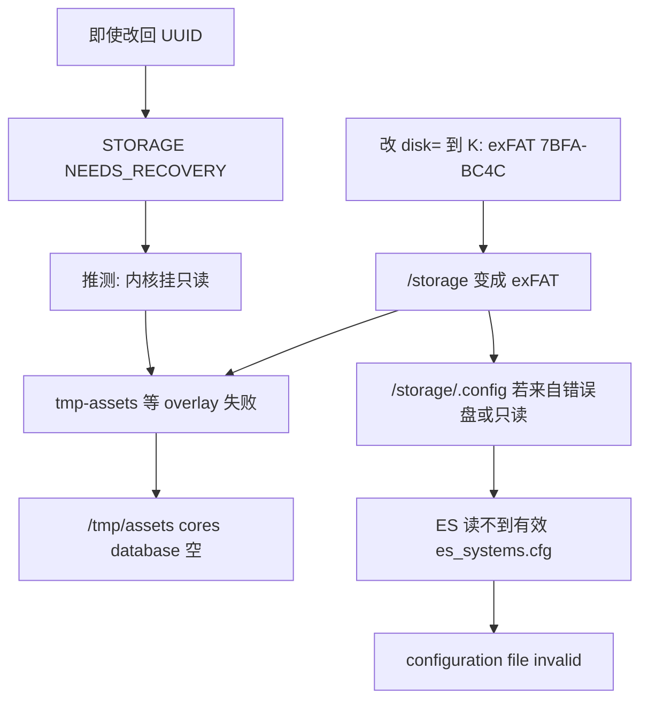

# 根因分析

开机两张图是同一条因果链的两端，不是两个独立 bug。

## 层 1：已验证 — 错误 `disk=` 足以打出图 1

`automount` / overlay 单元都假定 `/storage` 是 **ext4 或 btrfs**。  
把 `disk=` 指到 exFAT 后：

- `tmp-assets.mount` 等全部 FAIL（与用户截图逐条对应）
- firstboot 仍继续：“Installing user manual PDFs”“Please set language”

这与 Lakka #1848 的 overlay 失败模式同类，只是那里是 NFS，这里是 exFAT。

## 层 2：已验证 — ES 无效配置是读不到系统表

`start_es.sh` → `emulationstation --log-path /var/log`  
`001-emulationstation` 把 `/storage/.emulationstation` 链到 `/storage/.config/emulationstation`。  
STORAGE 上 `es_systems.cfg` 是 **symlink 到 `/usr/config/...`**。若 `/storage` 挂错或只读，链接解析失败，ES 就显示那句英文。

K: 上后来补的实体 `es_systems.cfg` **不是** ES 开机读取路径。

## 层 3：推测 — 改回后仍失败

已验证事实：

- 超级块 UUID 正确、目录树在
- `feature_incompat` 含 journal recovery 位（解析值 `0x22c6`，含 `0x4` NEEDS_RECOVERY）
- `s_error_count=0`，state 字段为 1
- 本机 Cygwin `e2fsck` 已能跑版本号，但打不开 `\\.\PhysicalDrive5`（Permission denied），`/dev/sdf2` 被映射成不存在的 Cygwin 设备路径

未验证：

- 设备实际 `mount` 选项是否 ro
- `journalctl -u tmp-assets.mount` 现文
- 改回后用户看到的是否仍是同一屏，还是语言选完才 ES 崩

## 层 4：游戏列表空（独立）

`automount.find_games`：只考虑 ≥约 8GB 的分区，外卡优先。K: 40G 符合。挂载点 `/storage/games-external`，再 `mount --bind .../roms /storage/roms`（因 `.ms_unsupported`）。

若 K: 根目录直接是 `gba/` 而不是 `roms/gba/`，bind 后 `/storage/roms` 里没有主机子目录，ES 就扫空。  
`migrate_roms` 脚本就是为这种情况准备的，但会 mv 文件，**不能在开机修复未完成时跑**。

## 硬件证据分层

- **已看到**：分区表、超级块、extlinux、STORAGE 根目录解析、K: 目录树、开机截图
- **已人工确认**：用户两张照片（语言屏 overlay FAIL；ES invalid config）
- **仍不能确认**：板级/卡损坏；改回后的设备内核日志；STORAGE 是否只读挂载
