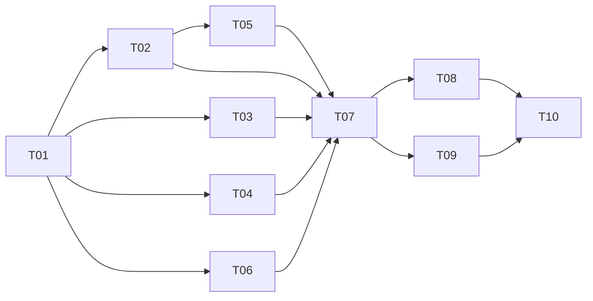

# 全项目优化实施计划

**目标：** 修复审查发现的可用性与数据一致性问题，让 Web、Android Mobile、Android TV 与离线内容具备可重复的测试和发布验收。

**架构：** 保留原生 JS 与 Python/Capacitor 技术栈，以现有模块为边界小步优化。先统一内容能力、媒体协议、存储合同和打包来源，再用行为测试保护提取与性能优化。

**技术栈：** 原生 HTML/CSS/JS、Node test、Python pytest、Java/Android、Capacitor 8.4.2；计划引入固定版本的 Playwright 作为开发测试依赖。

日期：2026-09-06。审查基线：HEAD `0ee010d` + 开始时已有工作区修改。优化实现当前均未开始；审查与计划已完成。后续执行按本文件逐任务推进，保持 [报告](../../reports/2026-09-06-全项目审查/README.md) 与实际证据可追溯。

## 1. 目录与使用顺序

```text
2026-09-06-全项目优化/
  README.md                总计划、依赖、阶段与执行规则
  STATUS.md                自动从 state.json 生成的实时看板
  ACCEPTANCE.md            测试、验收、性能预算和证据模板
  tools/sync_status.py     校验/更新任务状态并生成看板
  tasks/
    README.md              任务索引
    state.json             唯一可变状态源
    T01/ ... T10/
      TASK.md              文件范围、命令、验收、回滚
      subtasks/S01.md ... S03.md
      evidence/            执行后的实际验收记录
```

执行者先读总计划、对应TASK与子任务，再读被修改代码和已有测试。先领取状态、实现最小复现、修复、验证、复核、更新状态。任务文件中的“新增文件/命令”是后续实现目标，不表示这些代码已存在。

## 2. 优先级与执行顺序

| 阶段 | 任务 | 用户可见成果 | 结束条件 |
|---|---|---|---|
| M0 基线受控 | T01 | 统一知道哪些检查失败、为什么、谁接手 | 分层验证入口可复现，5项失败登记，环境边界明确 |
| M1 稳定性 | T02、T03、T04 | 首本可进入、导入可靠、媒体片段正确、录音删除真实生效 | A01–A05/A08相关用例通过；原生未测项不能写完成 |
| M2 交付闭环 | T05、T06、T07 | 单一打包来源、已发布题离线可听、真实跨端回归 | 内容缺项0、成品闭包通过、浏览器及设备证据齐备 |
| M3 维护与体验 | T08、T09 | 可控模块边界、定位并改善慢点、遥控可达 | B04关闭，完整回归通过，性能/焦点对照验收 |
| M4 收口 | T10 | 一份可追溯版本和事实文档 | 所有门禁通过、回滚与版本收据齐全 |

依赖图：



T02/T03/T04/T06 可按文件责任分别推进，但本计划不自动派发代理或启动其他任务。大范围模块重构必须晚于真实行为测试；T07 的测试夹具可以提前草拟，正式验收依赖不能跳过。

**资源估算：23–37 人日**（各TASK区间求和，不是承诺日历工期），含实现、测试、复核，不含设备等待及缺失媒体生成等待。建议按里程碑滚动承诺：先安排5–8人日处理M0和最高优先缺口，再用实测速度重估。一个完整 task 不一定应在一天做完；每个 subtask 内按最小变更提交。

## 3. 当前范围与不应误做的事

- 本次授权交付为审查报告和后续可执行计划；所有业务修复均留在todo。
- 既有18个dirty文件涉及音频与页面，开始实现时重新核对，不能覆盖或代为提交。
- T01可在其他失败尚未修复时完成，但只能说明“基线受控”，不说明发布通过；B04交T08关闭，没有依赖死循环。
- 既有词卡跟读、听音识景、亲子页已实现；熏听/录音后续增强应对照差异，不能见旧状态就重建整套。
- 先验证目录/包来源，后考虑多包注册；不改达标判定、不清存档、不批量重生成媒体。
- 原始数据、生成图片/音频、APK/ZIP继续不进入Git；测试可使用小型临时fixture。

## 4. 实时状态操作

“实时”指每次执行动作后更新的活计划，不是后台监控。`tasks/state.json`是唯一事实源；STATUS是派生文件，不手工同时修改多份状态。

```powershell
# 仓库根；只核验结构、依赖与看板是否同步
python -X utf8 docs/plans/2026-09-06-全项目优化/tools/sync_status.py --check

# 领取第一个子任务；owner填真实执行人/任务名
python -X utf8 docs/plans/2026-09-06-全项目优化/tools/sync_status.py --subtask T01-S01 --status doing --owner "执行人"

# 在对应 evidence 下保存实际验收报告后提交复核
python -X utf8 docs/plans/2026-09-06-全项目优化/tools/sync_status.py --subtask T01-S01 --status review --evidence tasks/T01/evidence/S01-验收.md

# 复核完成后关闭（复核人写在证据报告正文）
python -X utf8 docs/plans/2026-09-06-全项目优化/tools/sync_status.py --subtask T01-S01 --status done

# 遇到缺失设备/素材时写具体解除动作
python -X utf8 docs/plans/2026-09-06-全项目优化/tools/sync_status.py --subtask T01-S02 --status blocked --blocker "缺少固定依赖清单；下一步盘点实际import与版本"
```

done/review必须有存在且非README占位的证据文件；开始子任务必须满足父任务依赖和同任务前序。脚本只验证文件与状态合同，**不会代替人判断证据内容是否真实达标**。父任务状态由子任务推导。每次改状态自动更新日期和看板，执行`--check`通过后再交付。

进行中时至少每次完成一个子任务更新：当前结果、下一步、阻塞原因与解除动作、证据路径。新发现先记录关联F/B编号，若是新问题新增编号和任务，不悄悄扩大现有任务范围。

## 5. 可执行的验收规则

详细用例见 [ACCEPTANCE.md](ACCEPTANCE.md)。任务done不是“代码已写”，而是子任务达标、有实际日志、没有未解释回归、相关真机项通过。最终关闭T10须满足：P1未关闭数0，当前五项失败全部关闭，所有发布内容引用完整，三端关键用户路径经过运行验证。

失败处理：先归因实现缺陷、合同变更、环境缺失或测试本身错误；只有带证据的合同变更才可修改预期。超时/skip/没有设备必须写未验，不可转换为pass。风险较高的迁移、构建和资源替换使用临时根或staging验证，回滚路径写入任务证据。
