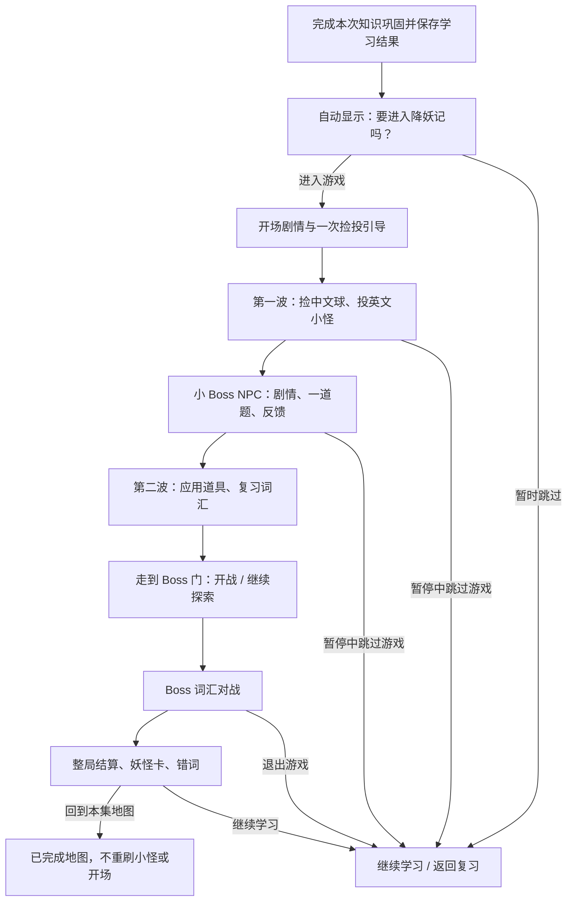

# 整局流程与交互

## 1. 孩子实际看到的流程



主线保留三次使用所学词汇：地图中文→英文匹配；NPC 剧情听懂和答题；Boss 把地图错词再用一次。游戏跳过不抹掉已经完成的学习，也不伪造游戏通关奖励。

## 2. 自动邀请应如何实现

`finishLesson` 先保存结果和既有奖励，再自动打开同页选择层。选择层首屏可见，焦点在“进入降妖记”；不自动开始战斗，不用计时器默认帮孩子选择。

建议文案：

> 本集练习完成！要去花果山试试刚学的单词吗？
> 走一走，捡词球，帮助伙伴，再挑战小头目。
> [进入降妖记] [暂时跳过游戏]

- “进入”：加载本集已发布游戏数据，再进入 `game.html?ep=N&from=lesson`。
- “跳过”：本次巩固通过时沿现有 next route 继续；未通过时回结果 / 错题复习，不绕过现有学习门禁。
- 未通过但完成了有效题目的孩子也可把游戏作为练习。此为本方案建议；不要为开放练习而修改 passed 或 done。
- 无有效题、关卡没制作 / 尚未导入时，不弹不能进入的强邀请。结果卡显示“本集游戏待开放”或“导入本集内容”，同时保留继续学习。
- 能力检查依据实际关卡可用性及本集数据，不只用 `ep <= 7` 写死永久规则。网络错误与“未发布”分开反馈，支持重试。
- 弹层关闭回结果卡；已获得的贴纸和纪念品仍可查看 / 领取，不能因邀请消失。
- 第 108 集沿现有 getNextHref 回地图；不得生成 ep109。

地图节点和绘本完成卡保留直接入口。无论哪个入口进入，都使用同一个 game.html 与本集数据。

## 3. 游戏 HUD 与触屏操作

横屏优先，但竖屏也可用。推荐布局：

```text
┌ 本集名称 / 当前任务 ─────── 护盾、词进度 ─ 语音、暂停 ┐
│                                                        │
│            地图、角色、头顶英文词牌                     │
│            屏幕边缘：下一目标方向箭头                   │
│                                                        │
│ [左摇杆]    当前中文词球 / 六道具托盘       [投掷]       │
└────────────────────────────────────────────────────────┘
```

- 摇杆从当前右下改左下；右手负责点选小怪 / 投掷。按住移动时另一手仍能投掷。
- 点中小怪时显示目标圈。有球按原玩法投掷；无球可点读英文，并提示去捡球。
- 右下“投掷”使用当前选中的合法目标，不自动揭示正确匹配；紫金葫芦生效时才可自动找正确目标。
- 没球时按钮显示“先捡词球”；附近 NPC 时出现“对话”，不把对话的近距离范围用作远程投掷范围。
- 词牌字号、碰撞体积、触摸点击区分别设置。怪图片缩小不能把点击区一并缩到难点。
- 词牌只显示英文；地上只显示短中文释义，长解释放提示区域。不要在球上塞整段词典释义。
- 当前任务常驻：“去北边找小妖 → 0/4”“去找菩提弟子”“前往 Boss 门”。箭头不提前暴露答案。

触屏交互区建议至少 48×48 CSS px，主要投掷 / 对话按钮 64px；TV 在既有 tv.css 基础上按观看距离放大。台词和长词不得盖住操控区。

## 4. 暂停、退出、完成

暂停菜单始终有“继续游戏”“跳过游戏并返回学习”“回选集”。退出保留历史错词和已确认的奖励，但本次未胜利不能算通关。

打开对话 / 暂停 / 页面隐藏时：停止角色移动、清空按键 / 摇杆意图、冻结伤害和镜头、停止当前语音。恢复时必须重新输入才能走；临时道具计时按游戏有效时间暂停。

Boss 完成后结算只发生一次。回地图呈现本次完成状态，可探索、点读或主动选择“重玩”；不能默认清空本次世界重刷第一波。

当前 battle 页仍有独立关底测验。优化建议将它缩为最多 2–3 个本局错词的可跳过复习；无错词直接结算。游戏前已经做完巩固，不再把一整套测验当作游戏结算门禁。

## 5. 建议时长与内容密度

| 环节 | 样板目标 | 内容 |
|---|---|---|
| 引导 / 开场 | 20–40 秒 | 1–2 句故事原文 + 1 次无伤操作教学 |
| 两波地图 | 3–5 分钟 | 共 8 个词；第一波学习匹配，第二波加入道具 |
| NPC | 20–45 秒 | 简短剧情 + 1 题，可重听；答错有带读 |
| Boss 与结算 | 1–2 分钟 | 4 个核心词位，优先纳入本局错词 |

这些是试玩目标，不是已有性能数据。原文超长、走路过远、语音重复或追击过快时按实测调整；不能靠把人物速度拉高来掩盖地图空旷。
