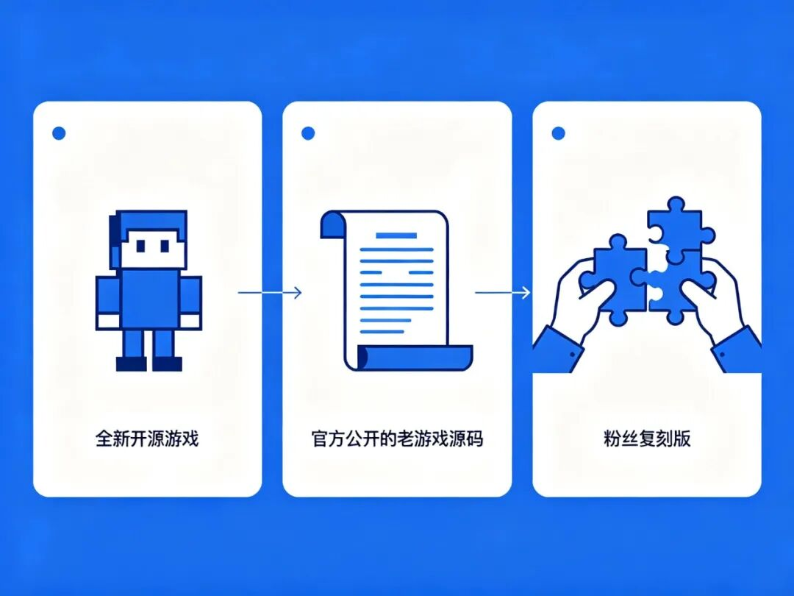
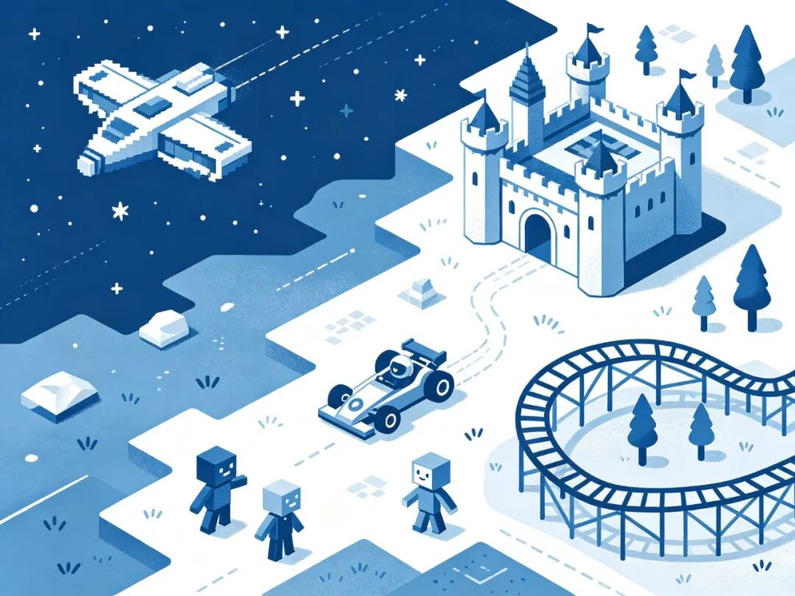
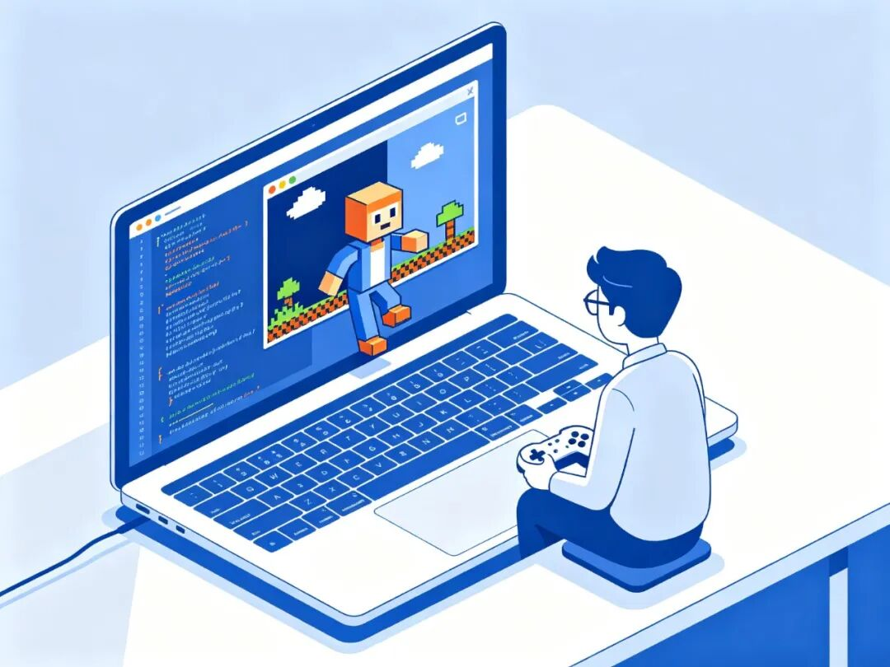

# 1.4 万人 star 的开源游戏清单：不花钱就能玩，经典老游戏源码全公开

> 作者: 小艾 | 平台: 微信公众号 | 日期: 2026-09-14 20:41 | 原文: https://mp.weixin.qq.com/s/DAIXhNVyU0ovOho9cTOEZg

> **摘要**: 不用找盗版，也不用从零学编程：这里把能合法免费玩、还能读源码的游戏按类型整理好了。

> 不用找盗版，也不用从零学编程——这里把能合法免费玩、还能读源码的游戏按类型整理好了。

一面摆满像素游戏卡带的陈列柜，像一座免费的游戏博物馆

两个场景你肯定不陌生。

一是想玩点好游戏，又不想动不动几十上百块，网上找的盗版要么带病毒，要么下完打不开。二是想试试自己做游戏，打开教程发现从"hello world"到"能做出一个能玩的东西"之间隔着十万八千里，半路就放弃了。

GitHub 上有个仓库，恰好把这两件事一起解决了。它叫 open-source-games（作者 bobeff），1.4 万 star，收录了几百个开源游戏，按类型分好类，点进去就能下载或读源码。协议是 CC0，意思是连版权都不保留，随便用。

● ● ●

## 01 它不是游戏，是一本"游戏目录"

先说清楚，这个仓库本身不做游戏。它干的事和很多 "awesome 列表"一样：把好东西按门类列出来，附上官网和源码链接。

它按玩法分了 18 个大类：动作、冒险、模拟经营、城市建造、第一人称、平台跳跃、解谜、赛车、即时战略、Roguelike、角色扮演、沙盒、飞行射击、体育、第三人称、塔防、回合制策略……基本上你想玩的类型都有。

你打开 README，就是一张大表格。每个游戏下面写一句话说明，再给两个链接：一个去官网下载试玩，一个去 GitHub 读它的源代码。

别小看"能读源码"这件事——这正是它和普通游戏推荐网站最大的区别。

全新开源游戏、官方公开老游戏源码、粉丝复刻版，三种来源

● ● ●

## 02 这里面其实是三种游戏

仔细翻你会发现，清单里的开源游戏根本不是一回事，大致分三类，搞清楚了才知道怎么玩。

第一类是原生开源新作。从一开始就是开源社区做的新游戏，没有商业版，纯粹爱好者作品。比如太空开放世界 Endless Sky（探险、贸易、战斗，内容多到玩几十小时）、竞技场射击 Xonotic、2D 联机平台跳跃 DDraceNetwork、那个只有六个音的神作 VVVVVV。这些下载下来直接能玩。

第二类是经典游戏的官方源码。当年的商业游戏厂商后来把源代码公开了，最有名的就是 id Software 全家桶：Doom、Quake、Wolfenstein 3D 全部源码都在 GitHub 上公开。还有 Duke Nukem 3D、Shadow Warrior、Descent 3。

第三类是粉丝反编译和复刻。这个最浪漫：一群爱好者把已经买不到、跑不起来的老游戏，从汇编一行行逆推回可读的 C 代码，或者重新实现引擎。你能看到 Super Mario 64 的完整反编译、塞尔达传说的逆移植，还有一堆模拟经营经典的现代复刻。

● ● ●

## 03 想入坑，先从这几个玩起

几百个游戏，一上来容易看花眼。按类型挑几个口碑最稳的：

模拟经营爱好者，直接收这"四件套"：OpenTTD（经典运输大亨的现代复刻，联机+mod+宽屏）、OpenRCT2（过山车大亨2复刻）、OpenLoco、CorsixTH（主题医院复刻）。童年那些"再玩五分钟就睡"的游戏，现在免费、能联机、还支持高清屏。

飞船、城堡、赛车、过山车，一个拼贴起来的游戏世界地图

喜欢太空和探索，Endless Sky 一个就够泡很久。想打 FPS，Xonotic 和 AssaultCube 都是老牌开源竞技射击，免费、秒开、社区还在。想玩点怪的，试试 .kkrieger——整个第一人称射击游戏只有 96KB，比一张表情包还小，是 demoscene 的传奇作品。

至于老游戏源码全家桶，如果你只是想玩，直接下载 Chocolate Doom、ZDoom 这类现代移植版就行；如果你想学游戏开发，那这些就是宝——一个完整、能跑、有千万人验证过的商业游戏源码，比任何教程都实在。

● ● ●

## 04 为什么这事对程序员也很重要

很多人以为开源游戏清单就是个"白嫖游戏"的地方。它对开发者的价值其实更大。

你想学习怎么做一个游戏，教科书和引擎教程教你的是"怎么做一个三角形、怎么让一个方块动起来"。但一个真正好玩的游戏，难的是平衡、关卡、手感、数据结构——这些东西教程里没有。

而开源游戏把完整答案摆在你面前：一个已经上线、经过几百万玩家检验的游戏，它的全部代码、全部数据结构、全部设计取舍，你都能一行行读。

打开的笔记本上一半是代码一半是像素游戏，小人拿着手柄

比如你想知道一个 1993 年的 FPS 是怎么在 4MB 内存里跑起来的，去读 Doom 的源码。你想知道一个 1999 年的城市经营游戏怎么做经济模拟，去读 OpenTTD。这不是"看别人的代码"，这是站在几十年游戏设计经验的肩膀上。

● ● ●

## 05 三个事先提醒，免得下完打不开

泼点冷水。

第一，很多老游戏的"源码版"自己不带游戏数据。像 Doom、Duke Nukem 这些，源码公开了，但你还需要原版游戏的资源文件（地图、贴图、音效）才能跑。下了个程序双击没反应，十有八九是缺数据文件，README 里一般会写要哪个。

第二，这个仓库最后一次更新是 2026 年初，已经半年多没动了。个别链接可能失效，个别项目可能停更。它是一份 2026 年中的快照，不是实时更新的导航。

第三，别把它当盗版替代品。清单里每一项要么是原生开源，要么是厂商自己公开了源码、或者在合法范围内的复刻。你玩得理直气壮，是因为它本来就免费合法。

● ● ●

## 写在最后

游戏行业越来越大，可真正能让人安心玩、还能亲手拆开看看的作品反而不多。这个仓库做的事，是把那些"不设防"的游戏找出来、分好类、指给你看。

哪怕你不是开发者，挑两个模拟经营或太空探索装上，周末就能杀进去几个小时。如果你正好在学编程，那更值得翻一遍——最好的游戏开发教材，从来不是书，而是一个你能随便拆的完整游戏。

去 GitHub 搜 open-source-games，按你的口味那个分类慢慢挑。
