# GPT6 Pro20两个周额度搞出来的GTA？！我！说！核！弹！爆！炸！尼！尔！多！隆！马！

> 作者: 七叶怀瑾 | 平台: 微信公众号 | 日期: 2026-09-06 22:15 | 原文: https://mp.weixin.qq.com/s/eVtebp-uUi8yf0Curwo8fA

> **摘要**: woc啊

提示词：  /goal 好，那你就用unity搭配blender给我弄出一个完整的可以玩的类似GTA5的完整的东西出来，建模要精细完善，人物模型可以用直接哪来的来干。然后游戏玩法要和GTA5一样多样，然后游戏的资产和算法都要可以长期复用。你改弄工具弄工具，要带着第一原理性思维和长期主义复利的想法去做这个游戏的开发流程。一件事情的意义多想想。

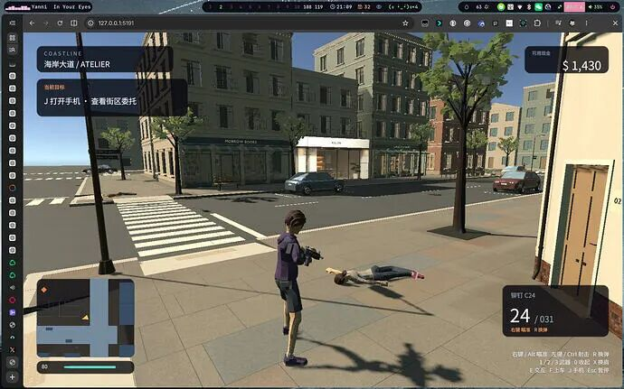

## 核弹爆炸了MD

## 他甚至有完整的任务系统

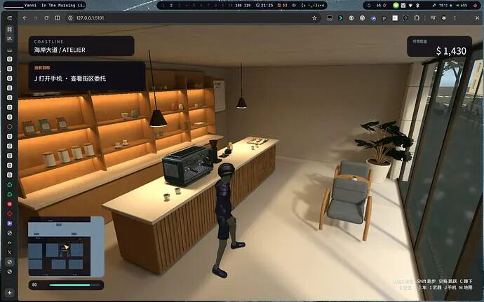

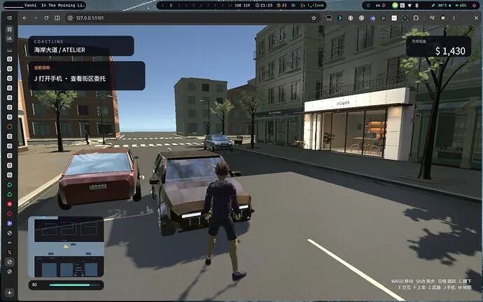

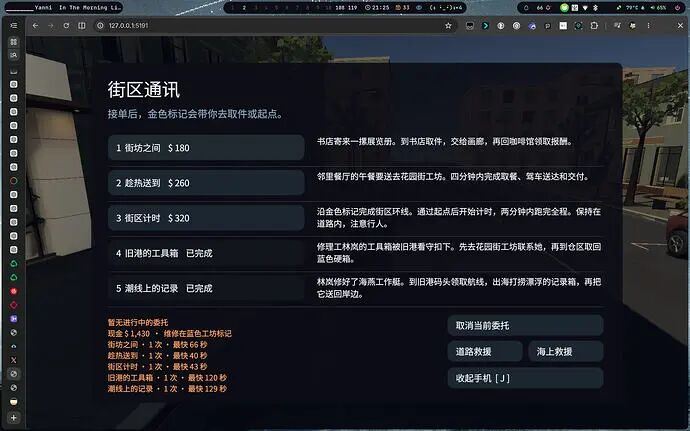

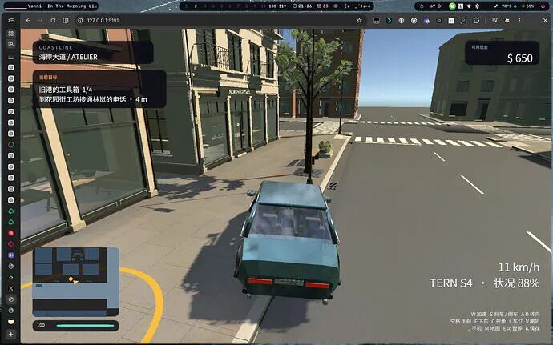

甚至枪械还有两种过肩视角

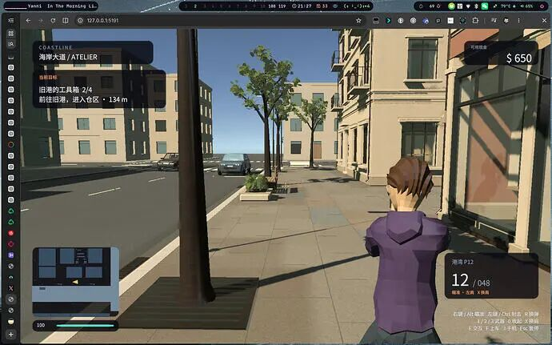

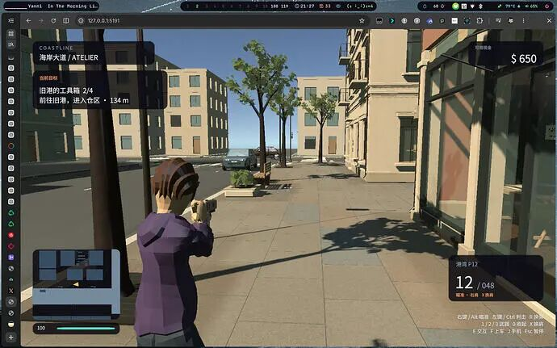

甚至还写了掩体算法

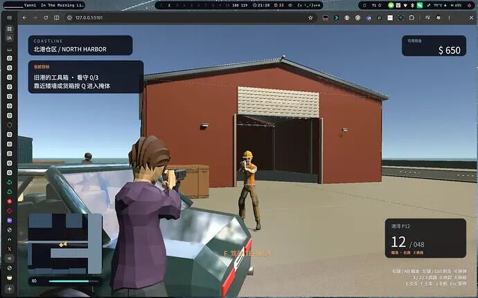

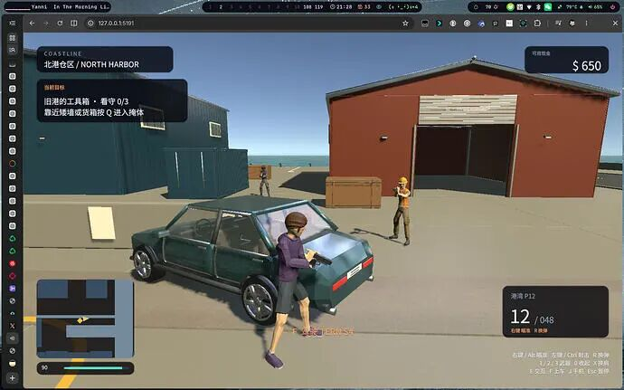

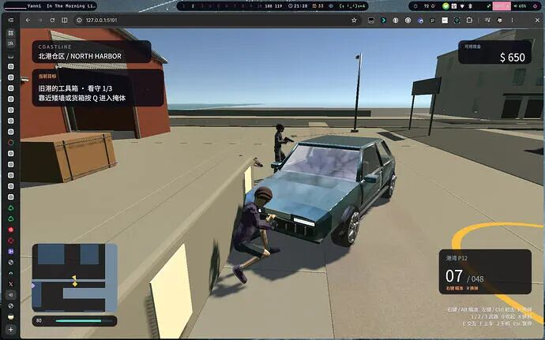

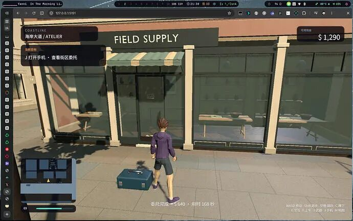

第二个大任务：去码头开船拿箱子

## 没错哥们还会游泳

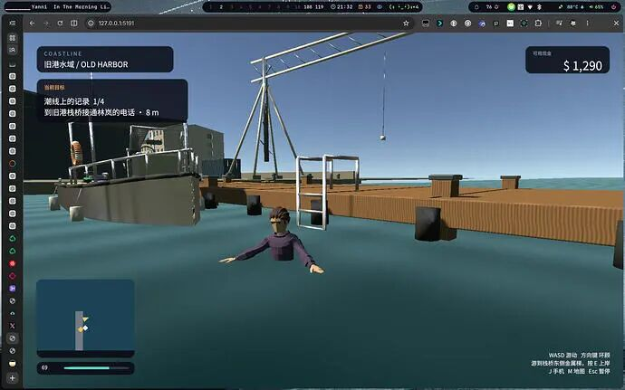

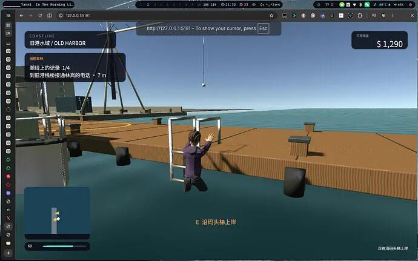

还有贴心提示

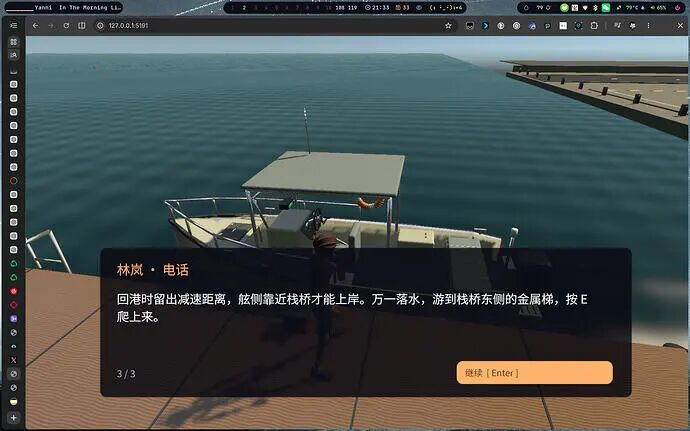

对的哥们还可以开船

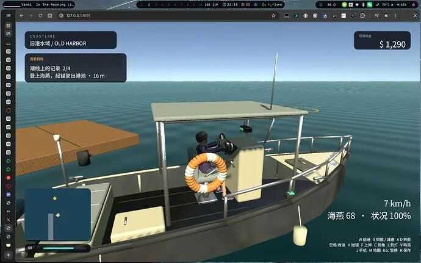

## 载具手感和惯性无比NB 哦对了记住这个箱子

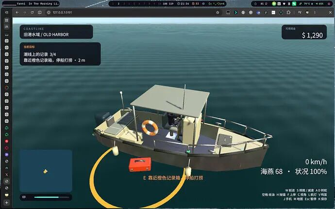

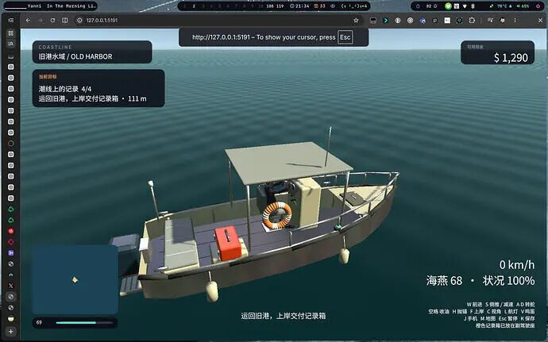

哦对了还有海浪，船还会略略的动

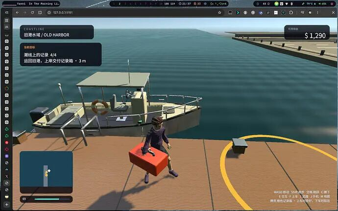

来看看街区

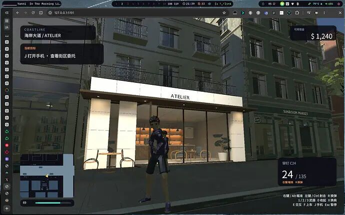

以及GTA经典：

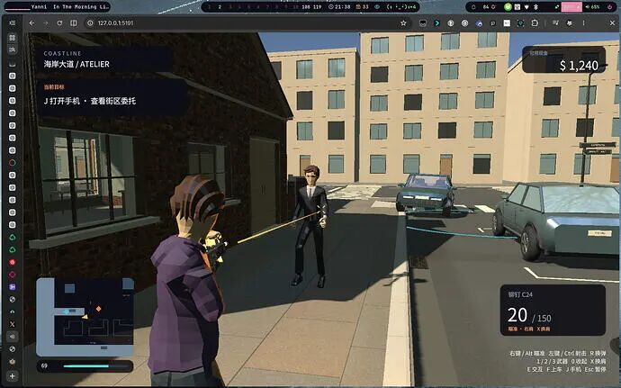

## 现在已经燃尽了，卡都碎完了，没招啦

## Tibo快快重置呜呜呜

## 独立游戏王朝了
