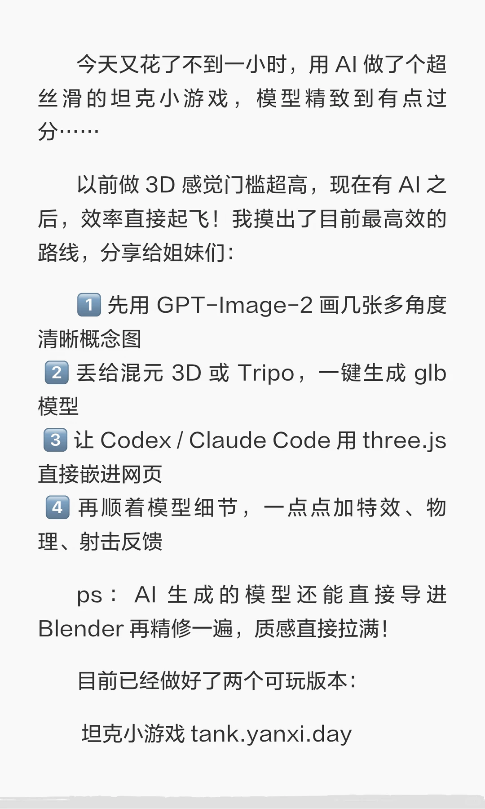
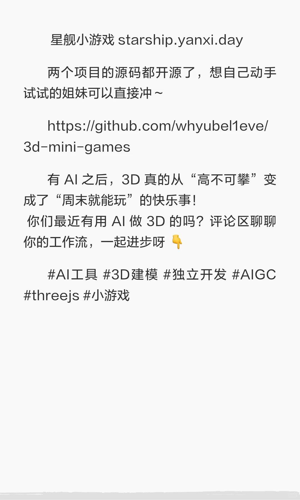

---
title: "AI 加持后，做 3D 小游戏真的太爽了！"
source: "https://www.xiaohongshu.com/discovery/item/6a9c135f000000002902c332?app_platform=android&ignoreEngage=true&app_version=9.43.1&share_from_user_hidden=true&xsec_source=app_share&type=normal&xsec_token=CBPqmUZC9Kn3VDkO53ttMksxISY937wCCEjksyX4x3s2k%3D&author_share=1&xhsshare=CopyLink&shareRedId=N0dINjg3NUpMPko6S0EySDs0P0lFSjdL&apptime=1788613609&share_id=30aa57b22ddb4eea88636358bb0860e4&share_channel=copy_link"
author: "小白的AI星球"
author_uid: "614c5ff6000000000201e0b7"
date: "2小时前 湖北"
tags: ["游戏开发", "3D", "AI生成", "智能体", "游戏设计", "虚拟现实", "大模型", "AI辅助开发", "3D建模", "three.js", "小游戏开发", "AIGC工作流"]
platform: "xiaohongshu"
category: "游戏设计"
summary: "作者分享了借助AI工具链在不到一小时内独立完成3D坦克小游戏的高效开发流程：先用GPT-Image-2生成多角度概念图，再通过混元3D或Tripo一键生成glb模型，最后用Codex/Claude Code结合three.js嵌入网页并添加特效与物理反馈，模型还可导入Blender精修。作者已开源坦"
---

# AI 加持后，做 3D 小游戏真的太爽了！

> 作者: 小白的AI星球 | 日期: 2小时前 湖北 | 原文: https://www.xiaohongshu.com/discovery/item/6a9c135f000000002902c332?app_platform=android&ignoreEngage=true&app_version=9.43.1&share_from_user_hidden=true&xsec_source=app_share&type=normal&xsec_token=CBPqmUZC9Kn3VDkO53ttMksxISY937wCCEjksyX4x3s2k%3D&author_share=1&xhsshare=CopyLink&shareRedId=N0dINjg3NUpMPko6S0EySDs0P0lFSjdL&apptime=1788613609&share_id=30aa57b22ddb4eea88636358bb0860e4&share_channel=copy_link

> **摘要**:作者分享了借助AI工具链在不到一小时内独立完成3D坦克小游戏的高效开发流程：先用GPT-Image-2生成多角度概念图，再通过混元3D或Tripo一键生成glb模型，最后用Codex/Claude Code结合three.js嵌入网页并添加特效与物理反馈，模型还可导入Blender精修。作者已开源坦

AI 加持后，做 3D 小游戏真的太爽了！
✨ AI 加持后，做 3D 小游戏真的太爽了！不到 1 小时搓出一辆精致坦克 ✨
	
今天又花了不到一小时，用 AI 做了个超丝滑的坦克小游戏，模型精致到有点过分……
	
以前做 3D 感觉门槛超高，现在有 AI 之后，效率直接起飞！我摸出了目前最高效的路线，分享给姐妹们：
	
1️⃣ 先用 GPT-Image-2 画几张多角度清晰概念图
2️⃣ 丢给混元 3D 或 Tripo，一键生成 glb 模型
3️⃣ 让 Codex / Claude Code 用 three.js 直接嵌进网页
4️⃣ 再顺着模型细节，一点点加特效、物理、射击反馈
	
ps：AI 生成的模型还能直接导进 Blender 再精修一遍，质感直接拉满！
	
目前已经做好了两个可玩版本：
坦克小游戏
星舰小游戏
	
两个项目的源码都开源了，想自己动手试试的姐妹可以直接冲～
	
有 AI 之后，3D 真的从“高不可攀”变成了“周末就能玩”的快乐事！
你们最近有用 AI 做 3D 的吗？评论区聊聊你的工作流，一起进步呀 👇
	
AI工具 #3D建模 #独立开发 #AIGC #threejs #小游戏#AI新手村 #游戏开发 #3D #AI生成 #智能体 #游戏设计 #虚拟现实 #大模型
2小时前 湖北

#AI辅助开发 #three.js #小游戏开发 #AIGC工作流

## 图片

## 图片文字 (OCR)

> OCR 仅供参考，可能包含识别错误；请以原图为准。

99
加持后，做3D
AI
小游戏真的太爽
了！
不到
小时
1
搓出一辆精致坦克
右划查看全文

今天又花了不到一小时，用AI做了个超
丝滑的坦克小游戏，模型精致到有点过
分……
以前做3D感觉门槛超高，现在有AI之
后，效率直接起飞！我摸出了目前最高效的
路线，分享给姐妹们：
1 先用GPT-Image-2 画几张多角度
清晰概念图
2
丢给混元3D或Tripo，一键生成glb
模型
3
让Codex/ClaudeCode用three.js
直接嵌进网页
4
再顺着模型细节，一点点加特效、物
理、射击反馈
pS：AI生成的模型还能直接导进
Blender再精修一遍，质感直接拉满！
目前已经做好了两个可玩版本：
坦克小游戏tank.yanxi.day

星舰小游戏starship.yanxi.day
两个项目的源码都开源了，想自己动手
试试的姐妹可以直接冲～
https://github.com/whyubel1eve/
3d-mini-games
有AI之后，3D真的从“高不可攀”变
成了“周末就能玩”的快乐事！
你们最近有用AI做3D的吗？评论区聊聊
你的工作流，一起进步呀
#AI工具#3D建模#独立开发#AIGC
#threejs #小游戏
