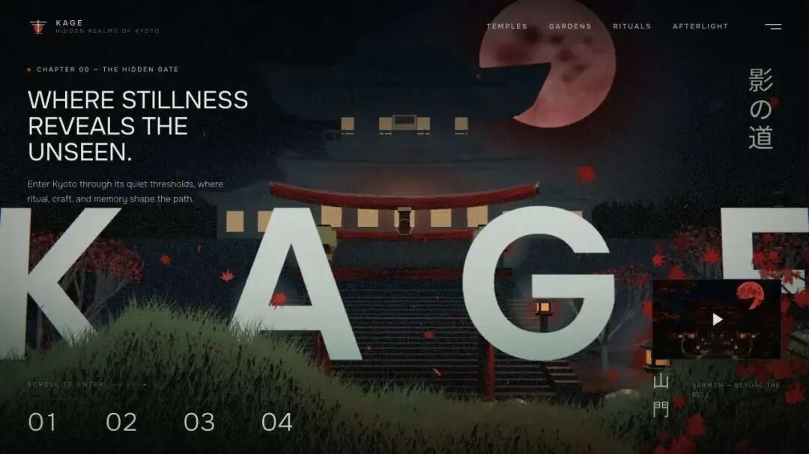
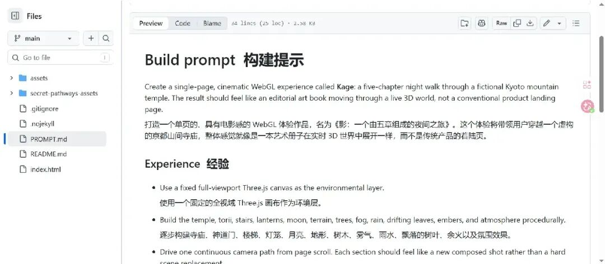

# GitHub 又爆了！一个 HTML 做出了沉浸式 3D 世界

> 作者: Hardy417 | 平台: 微信公众号 | 日期: 2026-08-20 07:30 | 原文: https://mp.weixin.qq.com/s/VFGaSdA4yaEdpnjN-lp2oQ

> **摘要**: 最近 GitHub 上出现了一个很有意思的项目。它没有复杂的框架，没有 React，没有 Vue，甚至没有构建工具。

最近 GitHub 上出现了一个很有意思的项目。它没有复杂的框架，没有 React，没有 Vue，甚至没有构建工具。打开页面之后，你看到的却是一座**正在夜色中缓缓展开的京都山寺。**

随着鼠标滚动，镜头一点点向前，穿过山门，走进庭院，灯笼亮起，雾气在山间缓缓移动，雨落下来，树叶从镜头前飘过，远处挂着一轮朱红色的月亮。整个页面不像网站，更像一部可以用鼠标"走进去"的互动电影。

项目名字叫 **Kage**，来自设计师、开发者 Meng To。而更有意思的是：**这个项目已经把源码和构建提示一起公开了。**

## 先看效果：这不是普通的 Three.js Demo



Kage 的官方介绍非常直接：

> An interactive five-chapter night walk through a Kyoto mountain temple.

翻译一下：**一场穿越京都山寺的五章节互动夜游。**

官方 Demo 一共设计了五个章节，包括：The Hidden Gate、Borrowed Scenery、Charred Cypress、Lantern Light、The Vermilion Moon。

整个体验并不是简单的"滚动页面 → 图片切换"，而是：

```
滚动
↓
WebGL Camera 移动
↓
3D 场景变化
↓
灯光 / 雾 / 雨 / 树叶同步变化
↓
文字与画面进行过渡
```

所以你真正"看到"的，不是一组图片，而是一台正在实时运行的 3D 场景。官方 GitHub 明确说明，Kage 使用 Three.js 实时移动 WebGL Camera，并结合程序化建筑、灯笼光、雾、雨、漂浮树叶、月亮以及 Bloom 后处理等效果。

## 最夸张的地方：它居然没有 React

现在做这种视觉网站，很多人的第一反应：Next.js、React、Vite、Three.js、GSAP，一堆 npm 包，然后 `npm install` 安装一大堆依赖，接着 `npm run dev` 启动开发服务器，最后打包、部署。

但 Kage 完全不是这个路线。它是一个**非常小的静态网站。** 官方仓库直接写明：`index.html` 里面包含了 HTML 结构、CSS、Three.js 场景构建、滚动动画、交互逻辑。

甚至**不需要 package manager，** 也没有 build step。官方直接使用 vendored 的 **Three.js r149** 进行 WebGL 渲染。

## 这意味着什么？

意味着整个项目的核心思路其实非常简单：

```
HTML + CSS + JavaScript + Three.js + 生成式视觉素材
```

没有复杂工程，没有庞大的组件体系，没有层层封装。甚至本地运行都非常简单：

```
python3 -m http.server 4173 --bind 127.0.0.1
```

然后打开 `http://127.0.0.1:4173/` 就可以运行。

官方 README 还明确说明：项目没有构建步骤、环境变量、Analytics Script、运行时网络依赖，本质就是一个静态网站。

## 但是别被"单文件"骗了

虽然项目很小，但里面的技术细节一点都不少。Kage 把整个视觉体验拆成了几个部分。

### 第一层：Three.js 3D 世界

寺庙、鸟居、山路、灯笼、地形、月亮，这些并不是一张完整的大图片，而是运行时构建出来的场景。

官方 README 明确说明：

> The temple, torii, lanterns, moon, terrain, rain, leaves, fog, and post-processing are constructed at runtime.

也就是说：**真正的 3D 世界，是浏览器运行的时候生成的。**

### 第二层：滚动驱动 Camera

这是整个项目最有意思的地方。普通网页是"Scroll → 页面位置变化"，而 Kage 是：

```
Scroll
↓
Camera Position
↓
Camera Rotation
↓
Scene Progress
↓
Lighting
↓
Visual Effects
```

所以**滚动本身就是控制器。** 你向下滚动，就相当于镜头向前走，进入新的章节，环境开始变化，文字逐渐出现，然后消失。

### 第三层：程序化效果

如果你打开源码，会发现很多效果根本没有直接使用视频。例如：雨、树叶、雾、灯光、月亮，这些效果是在运行时生成的。

这样做最大的好处就是：**整个体验仍然是实时的。** 摄像机可以移动，灯光可以变化，粒子可以运动，用户也可以控制整个观看过程。

### 第四层：AI 生成的视觉素材

这可能才是这个项目最值得关注的地方。Kage 并不是"全部使用 AI 生成"，也不是"全部使用 Three.js"，而是**两者结合。**

官方 README 明确说明：项目中的 cinematic scene plates 和 foreground artwork 使用 **GPT Image 2** 生成，之后再进行艺术指导和组合。

最终：

```
AI 生成素材 + Three.js 实时 3D + HTML 图层 = 最终画面
```

这就是为什么它看起来既像电影，又像游戏，又像网页。

## AI 没有替代 Three.js

这里其实非常容易产生一个误解。看到 GPT Image 2，很多人会觉得：AI 已经可以直接生成这种网站了？

其实不是。AI 负责的是**视觉素材，** Three.js 负责**实时空间，** 浏览器负责**交互，** HTML / CSS 负责**排版。** 最终组合起来，才形成了 Kage。

所以它真正展示的不是"AI 取代前端"，而是**AI 开始成为前端创作工具链的一部分。**

## 更狠的一步：作者连 Prompt 都公开了

如果只是开源 `index.html`，其实还没有那么特别。Kage 还有一个非常值得关注的文件：`PROMPT.md`。

官方把它描述为：**portable implementation brief**

也就是**一份可以帮助别人重新构建或者重新解释这个体验的实现说明。** 里面描述了场景结构、页面布局、动效语言、视觉约束、交互方式。

这意味着：作者开源的不只是**代码，** 还包括**如何让 AI 参与创造这套代码的上下文。**



## 这其实是一个非常重要的变化

以前开源项目：

```
源码 + README
```

现在 AI Coding 时代：

```
源码 + README + Prompt + Skills + Design Constraints
```

为什么？因为**代码告诉你怎么实现，** 而 Prompt 告诉 AI：**为什么这么实现。** 这两者正在逐渐变成同等重要的资产。

## Kage 甚至把 Three.js Skills 抽出来了

这也是我觉得这个项目特别值得关注的地方。官方 README 提到：Kage 使用的 Agent Skills 中，一些技巧已经被提取出来，包括 falling leaves、pointer trail，并放到了相关的 Skill Library 中。

也就是说：以后你不一定需要重新告诉 AI"帮我做一个鼠标跟随效果"，而可以直接**加载对应 Skill，** 然后：

```
Skill → 场景能力 → AI Agent → 代码
```

这其实就是：**AI 开发正在从 Prompt 走向 Skill。**

## 为什么这个趋势很重要？

过去我们使用 AI 写前端，通常是：

```
我：帮我写一个 Three.js 场景
AI：生成代码
```

效果通常很随机，因为 AI 缺少设计规范、动效规范、代码结构、视觉约束、交互规则，所以最后很容易变成"能跑，但是不好看。"

而 Skill 的思路是：

```
Skill → 定义能力 → 定义实现方式 → 定义约束 → AI 调用 → 生成代码
```

这样 AI 的输出就更加稳定。

## Kage 最值得学习的，其实不是代码

如果你是一名前端开发者，我反而不建议你只把 Kage 当成**Three.js Demo。** 真正值得学习的是它的架构。

整个项目可以抽象成：

```
          AI
          ↓
     生成视觉素材
          ↓
    ┌────────────┐
    │ HTML / CSS │
    └────────────┘
          +
    ┌────────────┐
    │ Three.js   │
    │ WebGL      │
    └────────────┘
          +
     Scroll Control
          ↓
      Interactive
          ↓
       Story
```

这已经不是传统意义上的**网站开发，** 更接近 **Creative Coding，** 也就是**用代码进行视觉创作。**

## 一个页面，为什么可以做得像游戏？

因为现在浏览器已经越来越像一个游戏引擎。你有 WebGL、Canvas、GPU、3D Camera、Shader、Particle、Post Processing，再加上 AI，视觉素材的生产成本也开始下降。

于是：

```
过去：设计师 + 3D Artist + 前端 + 动画师 → 一个项目

现在：设计 + AI + Three.js + 前端 → 一个人也可以做
```

这才是 Kage 最值得关注的地方。

## 但它不是"生产环境模板"

这一点也必须说清楚。Kage 很漂亮，但它并不是一个通用网站框架，也不是 Next.js 替代品，更不是 Three.js 官方模板。它本质上是**一个独立的 Creative Coding / Interactive Storytelling 项目。**

而且 GitHub 当前 README 明确说明：原始 Kage 代码和艺术作品目前**没有授予复用或再分发许可，** 其中 vendored 的 Three.js r149 仍保留自己的 MIT 许可声明。（[GitHub][1]）

所以：**可以学习，可以研究，可以阅读源码，** 但不要直接把整个项目复制进商业项目。

## 如果你是前端开发者，应该学什么？

我认为有 5 个方向。

**1. Three.js**

学习：Scene、Camera、Light、Mesh、Material、Renderer。

**2. Scroll-driven Animation**

不要只做"滚动 → 页面移动"，尝试：滚动 → Camera → Scene → Lighting → Animation，让滚动真正成为**交互控制器。**

**3. Creative Coding**

不要总想着"后台管理系统 + 表格 + 弹窗"，偶尔也可以做：空间 + 光影 + 粒子 + 声音 + 叙事。这会打开完全不同的前端世界。

**4. AI Image + WebGL**

AI 负责**生成素材，** WebGL 负责**让素材活起来。** 这是非常值得尝试的一种组合。

**5. Agent Skills**

未来 AI Coding 的竞争，可能不只是谁的模型更强，还包括**谁拥有更好的 Skills。** 一个优秀的 Skill，本质上就是：

```
经验 + 最佳实践 + 代码模式 + 约束 → AI 能力
```

## 写在最后

Kage 看起来只是一个**京都山寺 Three.js 网页，** 但如果你站在前端开发的角度重新看它，会发现它其实展示了一个非常明显的趋势：

以前：**前端负责把设计稿做出来。** 现在：**前端开始直接创造空间和体验。**

以前：**Prompt 让 AI 写代码。** 现在：**Skill 开始让 AI 获得可复用的创作能力。**

以前：**网页是页面。** 现在：**网页可以是一座可以走进去的世界。**

而 Kage，恰好把这些东西放在了同一个项目里。

**AI 生成视觉素材。Three.js 构建实时世界。WebGL 驱动空间。Scroll 控制镜头。Prompt 描述实现。Skill 沉淀能力。**

这可能才是这个项目真正值得我们关注的地方。

> GitHub：https://github.com/MengTo/kage在线体验：https://mengto.github.io/kage/作者：https://x.com/MengTo/status/2086023649526452265

你平时做前端项目会用到 Three.js 吗？你觉得 AI 生成素材 + WebGL 实时渲染这种组合，未来会成为主流吗？如果让你用 AI 做一个沉浸式网页，你最想做什么场景？评论区聊聊～

*各位互联网搭子，要是这篇文章成功引起了你的注意，别犹豫，**关注、点赞、评论、分享走一波**，让我们把这份默契延续下去，一起在前端的海洋里乘风破浪！*
