# Three.js x Astra 100 个案例库

> 作者: AI 游戏冒险家 | 日期: 编辑于 5小时前 北京 | 原文: https://www.xiaohongshu.com/discovery/item/6aa4ad2d000000001203c637?app_platform=android&ignoreEngage=true&app_version=9.45.0&share_from_user_hidden=true&xsec_source=app_share&type=video&xsec_token=CBxLtoocRnxdhQv6ff5jfLaEAA0-sfhWddHnh01Fo3PjM%3D&author_share=1&xhsshare=CopyLink&shareRedId=N0dINjg3NUpMPko6S0EySDs0P0lFSjdL&apptime=1789183140&share_id=ad7b0c298b4946c4953749d2122606b9&share_channel=copy_link&track_code=4TS2qAKtSAt

> **摘要**:Three.js与Astra合作推出100个案例库，旨在通过边玩边学的方式帮助开发者掌握Three.js技术。案例库提供丰富的实践资源，降低学习门槛，适合独立开发者及对3D网页开发感兴趣的程序员参考与练习。

Three.js x Astra 100 个案例库
#AI #threejs #独立开发 #开发者
编辑于 5小时前 北京

#Three.js #案例库 #3D开发 #WebGL

## 视频

[视频 1](./video.mp4)

<video controls width="100%"><source src="./video.mp4" type="video/mp4">您的浏览器不支持视频播放。</video>

附件: [音频](./audio/audio.wav) | [处理清单](./video_manifest.json)

## 视频图文总结

> 按关键帧关联完整视频转录；文字保留机器转写原文，时间点仅用于定位。

### 1. 00:00

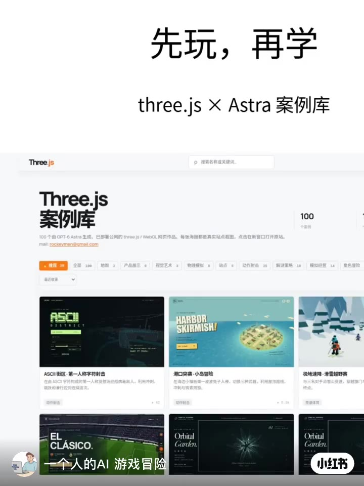

- 内容摘要：想知道ai写出来的网页到底能玩到什么程度（00:00-00:03）
- 画面文字（OCR）：先玩，再学
three.js ×Astra案例库
Three.js
搜索名称或关键词
Three.js
案例库
100
个套
100个由GPT-6Astr生成，已部公网的theejWbOL网页作品，每张海都是真实站点截图，点击在新窗口打开原站。
推
全100
地图
产品用示
视觉艺术3
物理模拟
站点
动作射击2
证简路10
模拟经营14
角色
近收
HARBOR
SKIRMISH!
ASCII街区·第一人称字符射击
港口突袭·小岛冒险
极地速降·滑雪越赛
在由ASCI学符构成的第一人控场病逝放人，用冲
在海边小推抵面一波溢免子入经，切操三种武额，利闸星预路柱.
与三名对手海雪山竞，
剧压和流行应对连绿流次。
冲到与控影周题
终点
招作附选
体育
EL
Orbital
Orbital
CLASICO
Garden.
Garden.
个人的AI游戏冒险
小红书

### 2. 00:04

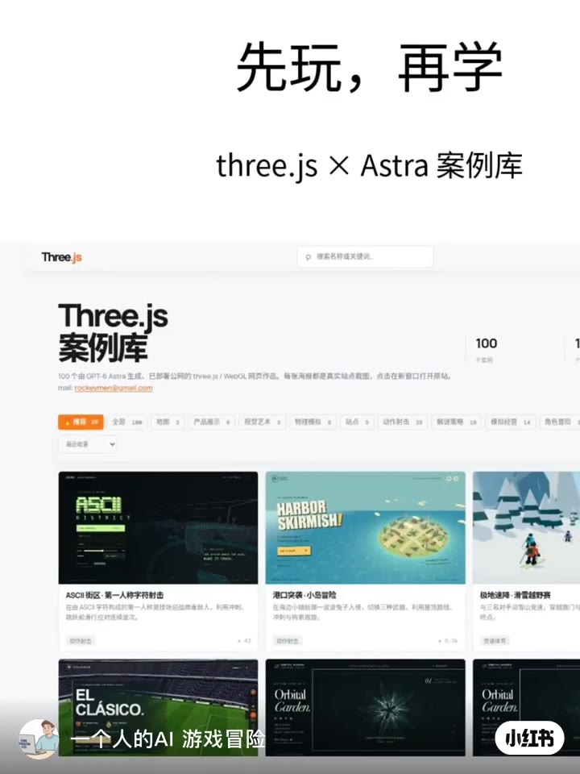

- 画面文字（OCR）：先玩，再学
three.js × Astra 案例库
Three.js
搜索名称或关错词
Three.js
案例库
100
个
100个由GPT6Asra生成、已部公网的tee/WebL网页作品，每张海报都是真实站点载图，点击在新窗口打开原站
维荐
全
100
地图
产品示
视觉艺术
物模拟
站点
动作射否 20
10
模拟经营：4
角色
近收票
HARBOR
SKIRMISH!
ASCII街区·第一人称字符射击
港口突袭·小岛冒险
极地速降·滑雪越野赛
在由ASC字符构成的第一人称宽技场社质查故人。
同程冲
在海边小抵强一波流免子入慢，结膜三种武器，利用座顶结挂
与三名对手山量速，穿
税滑行应对连续波次
冲到与素烈型。
点
42
s
登证体育
EL
Orbital
Orbital
CLASICO.
Garden.
Garden.
个人的AI
游戏冒险
小红书

### 3. 00:06

- 内容摘要：这里把分散在各处的作品整理成了一个可以直接打开体验的案例库（00:03-00:09）
- 画面文字（OCR）：先玩，再学
个人的AI游戏冒险
云
three.js×Astra案例库
Three.js
索名称或关错词
2
全部100
地图2
产品示
视觉艺术
物理模
站点
动作射击
解10
模经营14
收量
在由ASC字特成的一人称技场病数人，利用冲制
在海边小抵一波波兔子入慢，切换三种武路，顶路线
与三名对手泊雪山
监题检准行由到流次
冲到与约索图
格点
.42
地n出
.53
党迎体育
EL
Orbital
Orbital
CLASICO.
Garden.
Garde
球场精英·国家德比
轨道花园·光点塑
轨道花
在30球进行巴赛罗对童家马德型的11人制比赛，传球、时门
轨道花雕光影艺术培，示验手与引力交积的担学整
交互式
并期换理器
变，
BENGALURU
ORR RUSH
ORR竞速-班加罗尔
永恒荒野·饥荒
潜水员
穿行加罗尔的地道路，开坑法和外摩托，利用加向
《机》间的同页生存与略游戏：截图醒示了真林探索
物
淮水斑
摆击争超车空间。
收集。
包，
以及生命。饱食与理智状迹。
总种植结合
1.0
频经验
检经

### 4. 00:08

- 画面文字（OCR）：先玩，再学
个人的AI游戏冒险
元
three.js ×Astra案例库
Three.js
接索名称或关错词
28
全部100
地图
产品展示
视觉艺术
物理根拟
站点
动作射击
略10
模据经营
收量
在由ASC字符构成的一人称技场通病放人，利用冲
在海边小抵街一波波兔子入楼，地换三种武，利用顶路线。
与三名对手雪山
路行应时续流次
冲到与的索
格点
.42
动作出
.52
党迎体育
EL
Orbital
Orbital
CLASICO.
Garden.
Garde
球场精英·国家德比
轨道花园·光点雕塑
轨道花
在3D球场进行巴赛罗对童家马德里的11人制比客，传球、门
轨花光影艺术培，示粒子引力交识的程登雕整
交互式
共切操维
变形。
BENGALURU
ORR RUSH
ORR竞速·班加罗尔
永恒荒野·饥荒
潜水员
行加罗尔的回堵道路，避开航法和外卖率托，利用进与向
《机》风格的页生存与略戏：截图解示了真林索、物资
滋水
运击争车空间
收旗、包，以及生命、饱食与理验状迹。
鸟种植结
1.0
经
检经

### 5. 00:10

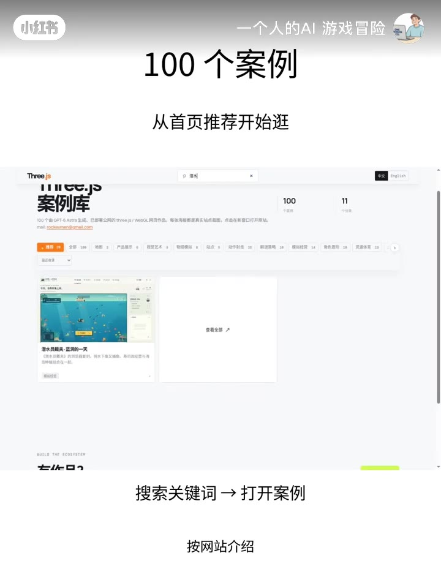

- 画面文字（OCR）：一个人的AI游戏冒险
100 个案例
从首页推荐开始逛
Three.js
mcc.js
Inglish
案例库
100
11
干出面
雅
全部100
地图
产品显示
程复艺术1
格理模
站点
动作射
1
解原略10
模经管1
角色置险10
见通体算11
收
查看全部
潜水员戴夫·蓝洞的一天
（国水且约，水下又色，与
当种植丝价在一起.
经管
专作
搜索关键词→打开案例
按网站介绍

### 6. 00:15

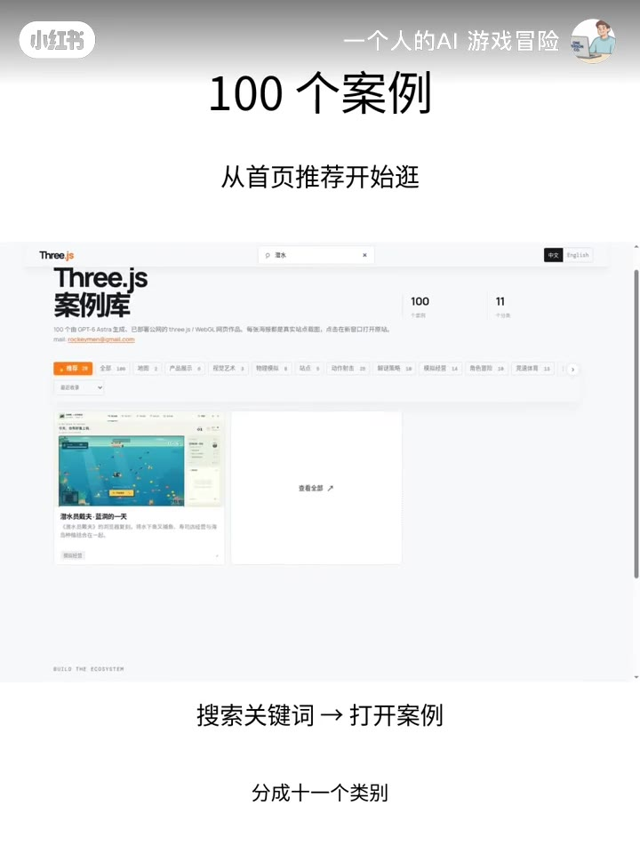

- 内容摘要：按网站介绍，目前收录一百个由astra生成的网页作品，分成十一个类别，首页有二十个推荐（00:10-00:17）
- 画面文字（OCR）：一个人的AI游戏冒险
100 个案例
从首页推荐开始逛
Three.js
Three.js
水
中文
Irglish
案例库
100
11
100个由GPT6Asra生成，已部署公的te/WL责作品，每张都是真实站点，点击在新口打开原站。
个2利
个分
维荐
全100
2图
产品报示
程复艺术
地理模
站点
动作射出
解证略
0
模经营
1
角色置险10
凭速体月14
收票
查看全部
潜水员戴夫·蓝满的一天
当种合在一起
搜索关键词→打开案例
分成十一个类别

### 7. 00:23

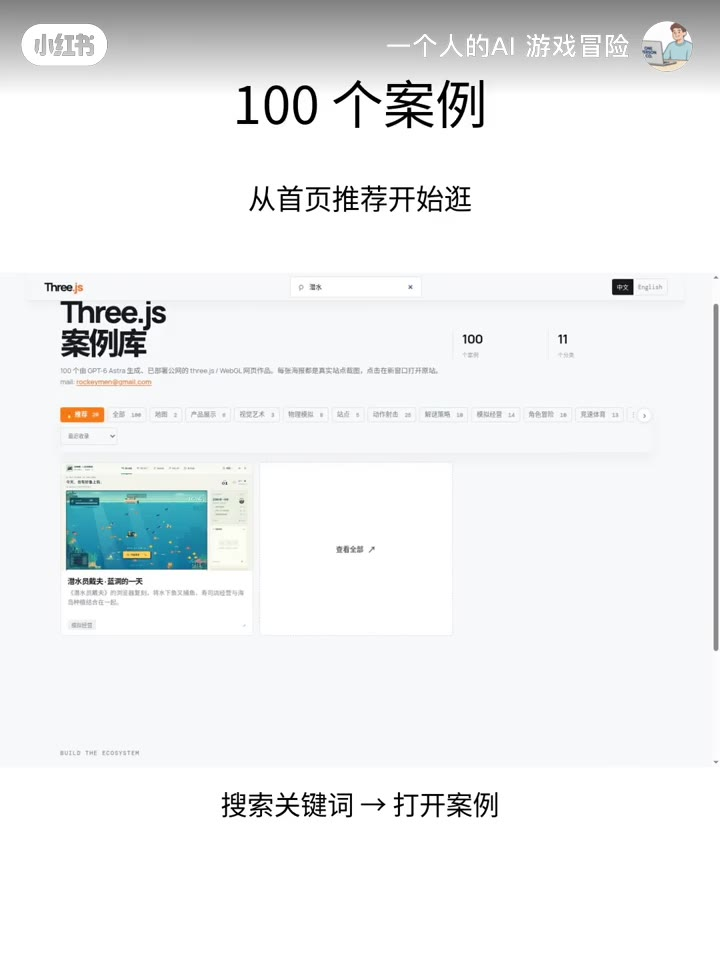

- 内容摘要：可以按分类筛选，也能搜索关键词，再点击卡片进入原站（00:17-00:23）
- 画面文字（OCR）：一个人的AI游戏冒险
福
100 个案例
从首页推荐开始逛
Three.js
Three.js
温水
中文
tnglish
案例库
100
11
中实州
个分类
维
全部100
地图2
产品屋示
视艺术
物模
站点
动作射表 20
解10
模经营4
角色冒险10
充通体育 11
收录
查看全部
潜水员戴夫·蓝洞的一天
自种植结合在一起。
《水夫》的，水下又，经与
BUILD THE ECOSYSTEM
搜索关键词→打开案例

### 8. 00:30

- 内容摘要：先看潜水员戴夫风格的网页复刻，点击开始潜水，用方向键移动空格发射鱼叉（00:24-00:31）
- 内容摘要：这次试玩已经捕到一条鱼，右侧背包也出现了收获（00:31-00:35）
- 画面文字（OCR）：小红节
一个人的AI游戏冒险
云
潜水捕鱼
案例一·蓝洞的一天
DHVEMDIVEK
水夫
的一天
温水素
班乔寿同
海岛庄园
产
装备工坊
中海洋图
⑤450
0
G
THE OCEAN IS
今天，也有好鱼上钩。
CALLING
01
识
下午·
入，
H
EE128
②今日委托
280
36
16.6
蓝洞的第一份鲜
的，
1 29
1/1
载30m深的
16/30
安通
01
①1506
收肤背包
.1
38
2
SAITE
①水指
.2858
白天潜水，
晚上开店。
的水装
空格发射鱼叉·背包反馈
空格发射鱼叉

### 9. 00:38

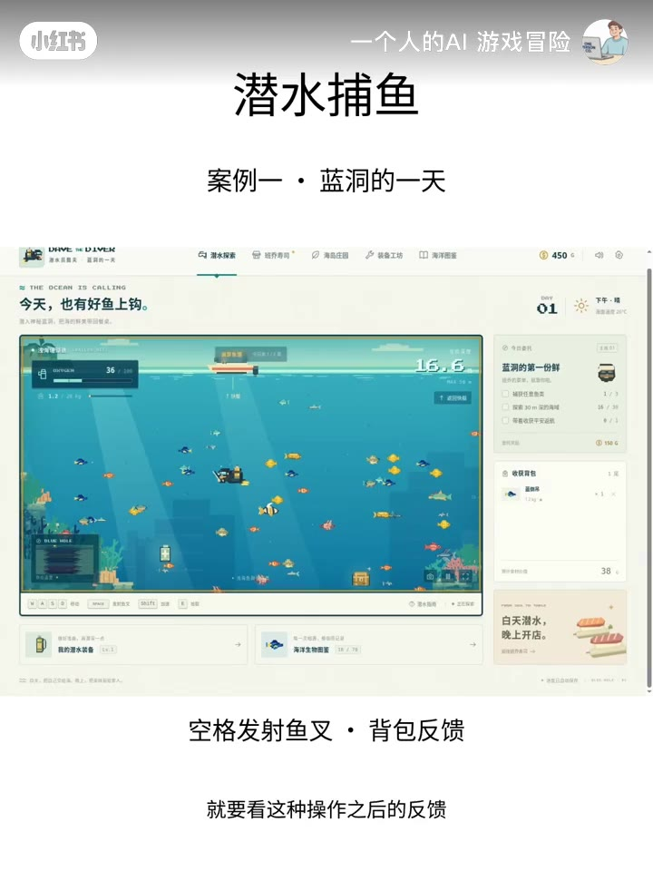

- 内容摘要：看案例时就要看这种操作之后的（00:35-00:38）
- 画面文字（OCR）：小书
一个人的AI游戏冒险
÷
潜水捕鱼
案例一·蓝洞的一天
好
DRVEMDIVEK
水品天的一天
水探索
班乔寿司
海岛庄园
4
装备工坊
中海洋图
⑤450
0
6
今天，也有好鱼上钩。
01
0
下午·
入，把有美
2度20℃
S
今日0
1401
36
16.6
蓝洞的第一份鲜
的，以作
1.2
219
T ARRU
任意
1/)
30m深的海域
16/30
收快平安道航
0/1
150G
收获包
1室
W
38
①水指
白天潜水，
晚上开店。
我的水装备
海生
1/70
空格发射鱼叉·背包反馈
就要看这种操作之后的反馈

### 10. 00:39

- 画面文字（OCR）：小红书
一个人的AI游戏冒险
3
从捕鱼到经营
观察页面之间怎样衔接
DAVEDIVER
美
的一天
水素
寿
心
海岛庄园
装务工坊
海洋图
420
0
©
FRON
SEATO
TABLE
把海的鲜美，留在今晚。
01
0
·
离了，香的不艺的好自已
度2
BANCHO
SUSHI
60
L
1OE
好食材，遇上好手艺
星的
-0
业报
0。
0
S0DFEA
2S
-0.
RE
C今日鲜货
11
武R
.1
手相
8份
BE31
开始营业
2
票托
072
食材→菜单→开始营业

### 11. 00:40

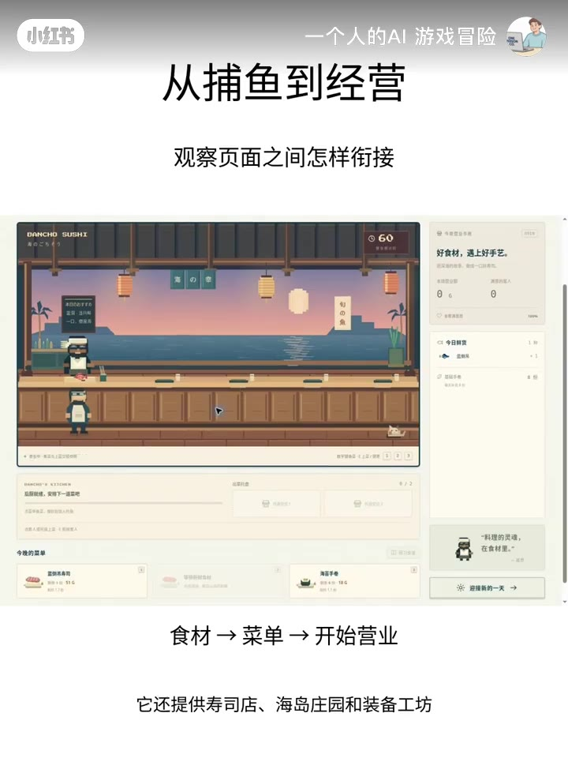

- 内容摘要：它还提供寿司店，海岛庄园和装备工坊（00:40-00:43）
- 画面文字（OCR）：小红书
一个人的AI游戏冒险
-
从捕鱼到经营
观察页面之间怎样衔接
DANCHO
SUSHI
60
0
好食材，遇上好手艺。
的，线一
本R业司
人
0
A0ETT6
日
2·3月
C今日
盘恒
85
R24
出票点
012
科理的灵难，
今晚的菜单
1
在食材里。
-10
司
海手卷
x170
sis 114
U
迎接新的一天
食材→菜单→开始营业
它还提供寿司店、海岛庄园和装备工坊

### 12. 00:45

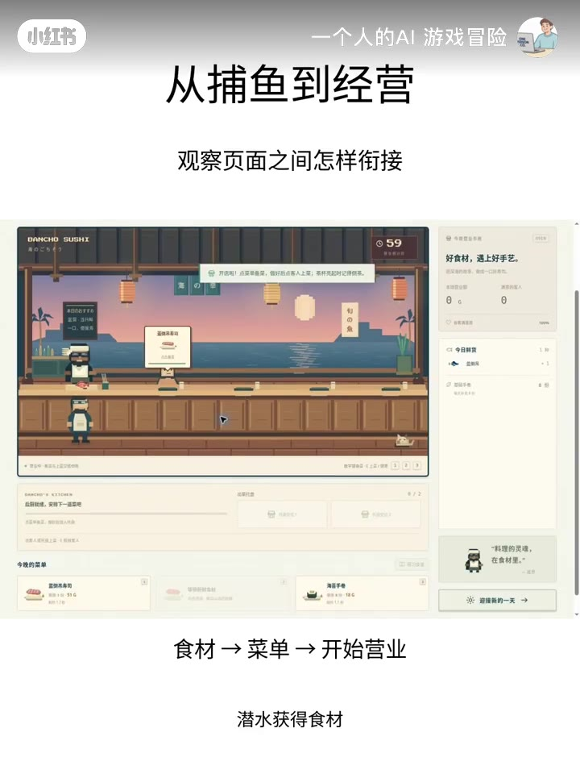

- 内容摘要：学习时可以拆解潜水获得食材，经营消耗食材升级，在影响下一次探索（00:44-00:50）
- 画面文字（OCR）：小红书
一个人的AI游戏冒险
元
从捕鱼到经营
观察页面之间怎样衔接
DANCHO SUSHI
59
N
10
好食材，遇上好手艺。
开店！点菜单菜，做好后点客人上菜，杯亮起时记得系。
面深的，一口
营业司
人
06
0
A日ETTO
21日
①
C今日
1.30
武R
.1
89
2
出票托盘
6/2
“科理的灵魂，
今晚的菜单
在食材里。
-
例
海苗手卷
10120
-186
L
0
迎接新的一天→
食材→菜单→开始营业
潜水获得食材

### 13. 00:53

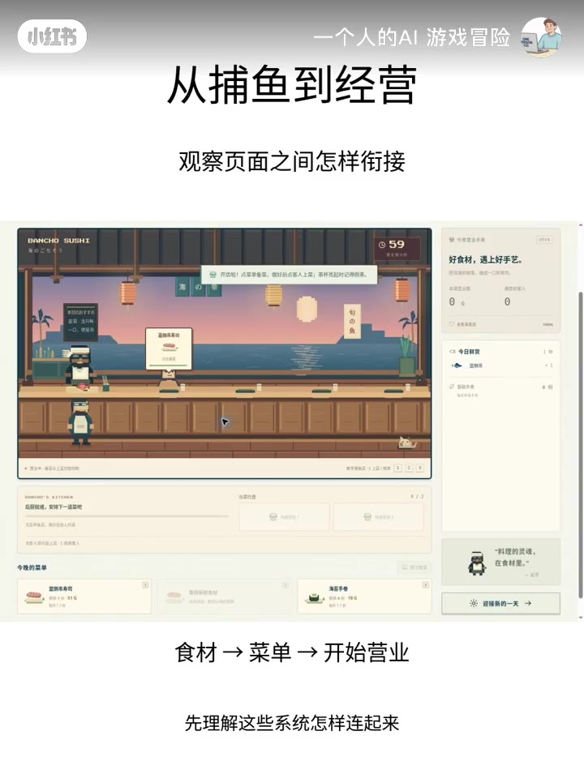

- 内容摘要：先理解这些系统怎样连起来再尝试（00:51-00:54）
- 画面文字（OCR）：小红节
一个人的AI游戏冒险
云
从捕鱼到经营
观察页面之间怎样衔接
DANCHO
SUSHI
59
营业
好食材，遇上好手艺。
开店！点备菜，好点客人上：杯亮起时记得
CSFNT
营业部
的客人
00
0
司
今日货
置组
1
U品手
89
LC
-122/8
出儿
#72
科理的灵魂，
晚的单
在食材里。
-20
监寿司
邮联社位社
海手卷
18
1E
0
迎接新的一天→
食材→菜单→开始营业
先理解这些系统怎样连起来

### 14. 00:55

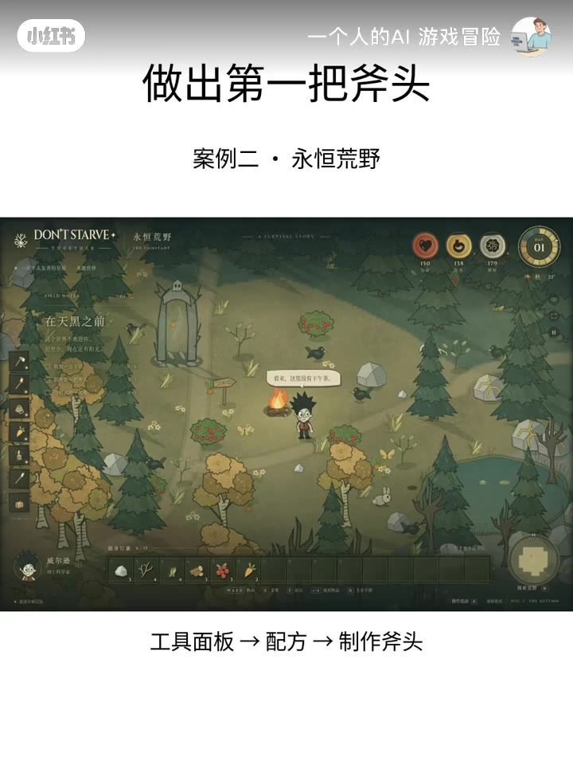

- 画面文字（OCR）：T
一个人的AI游戏冒险
云
做出第一把斧头
案例二·永恒荒野
DONTSTARVE+
永恒荒野
太发的草
系通班
150
179
FILLD NO
在天黑之前。
现在还有阳元
看来，这里没有不午。
威尔
工具面板→配方→制作斧头

### 15. 00:58

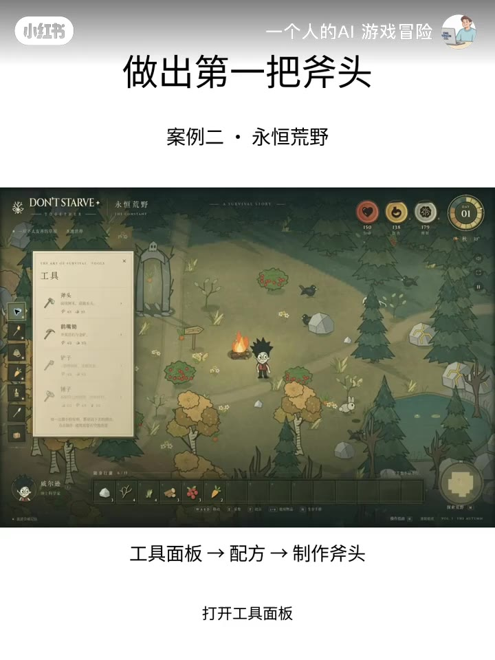

- 内容摘要：第二个是饥荒风格的生存案（00:56-00:58）
- 画面文字（OCR）：一个人的AI游戏冒险
云
做出第一把斧头
案例二·永恒荒野
DONTSTARVE+
永恒荒野
150
138
179
AL
工具
斧头
E
中心
鹤嘴
中2
护子
饿子
威尔逊
工具面板→配方→制作斧头
打开工具面板

### 16. 01:00

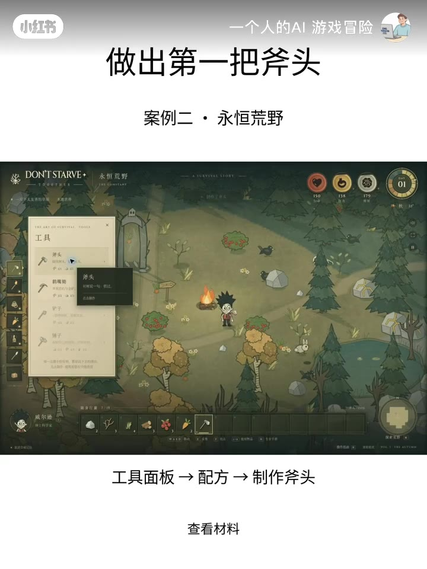

- 内容摘要：打开工具面板查看材料，再点击制作（00:59-01:03）
- 画面文字（OCR）：小红书
一个人的AI游戏冒险
÷
做出第一把斧头
案例二·永恒荒野
DONTSTARVE+
永恒荒野
I50
138
179
工具
头
X
F
韵嘴
斧头
EM
段一号：
中021
点A
子
辅子
威尔逊
工具面板→配方→制作斧头
查看材料

### 17. 01:08

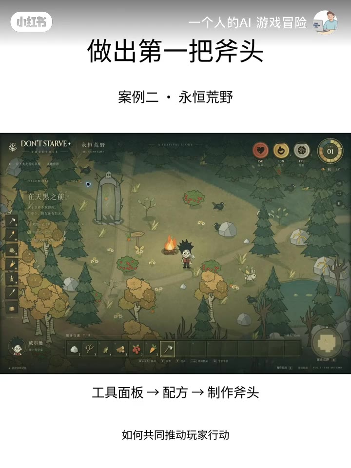

- 内容摘要：这里值得学的是资源配方背包和生存状态，如何共同推动玩家行动（01:03-01:10）

### 18. 01:10

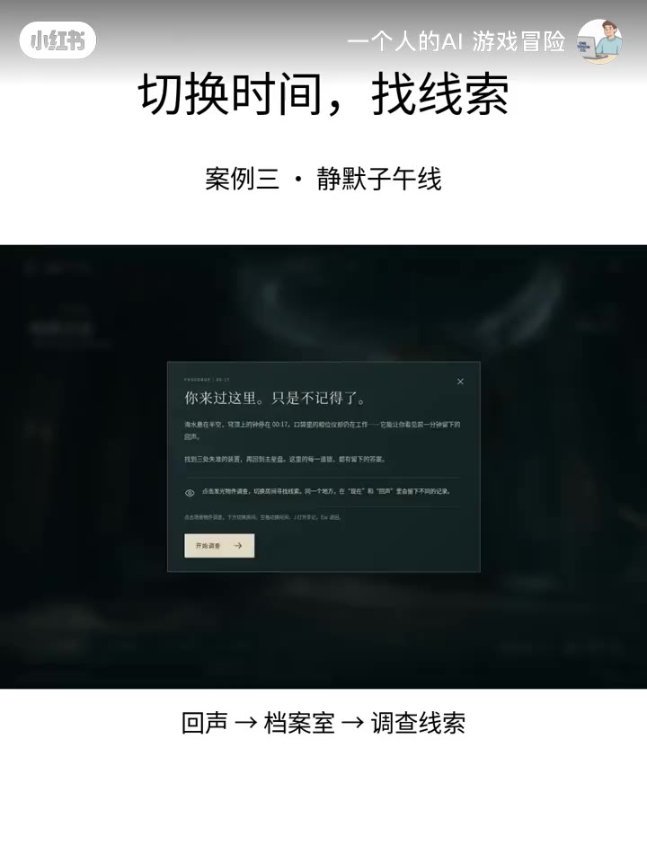

- 内容摘要：第三个是静默子午线（01:11-01:13）

### 19. 01:14

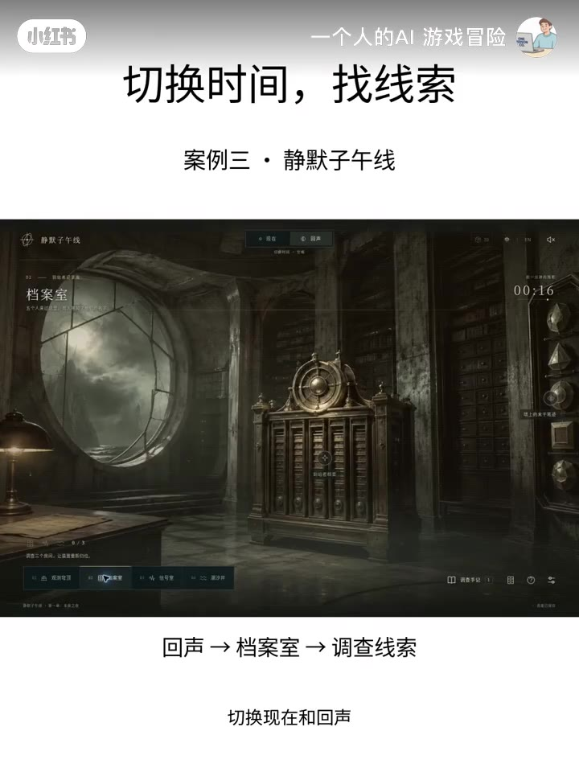

- 该时间点暂无可提取文字。

### 20. 01:15

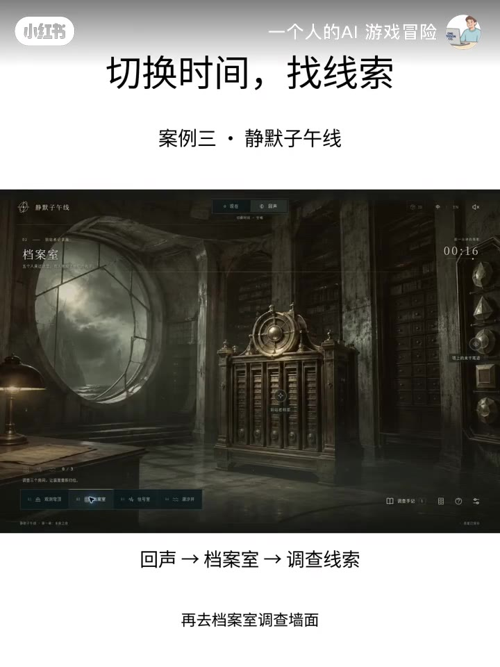

- 内容摘要：进入观测站切换现在和回声，再去档案室调查墙面，新的线索就会收入手机（01:13-01:20）

### 21. 01:22

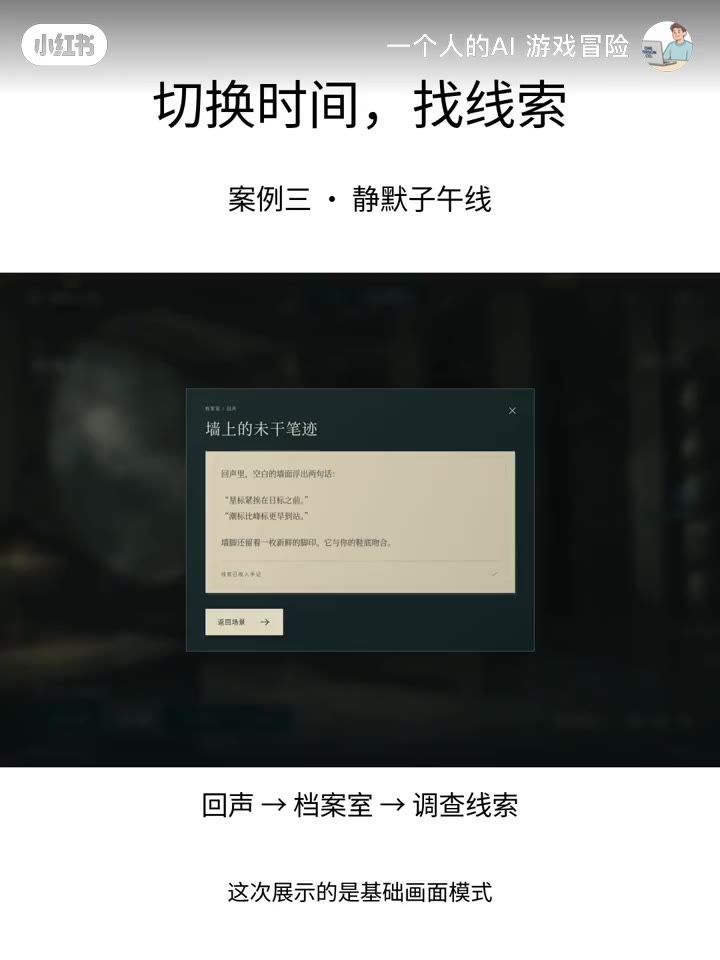

- 该时间点暂无可提取文字。

### 22. 01:23

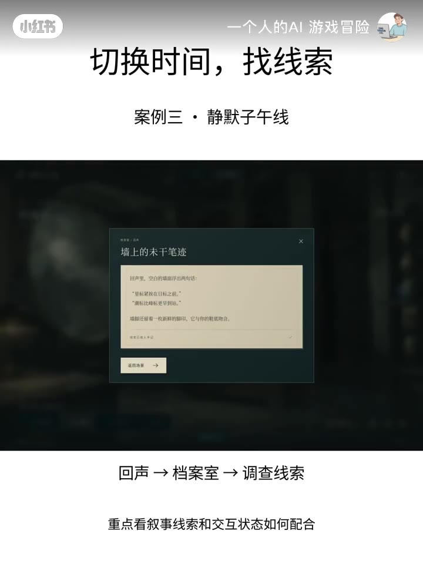

- 内容摘要：这次展示的是基础画面模式，重点看叙事线索和交互状态如何配合（01:20-01:26）

### 23. 01:26

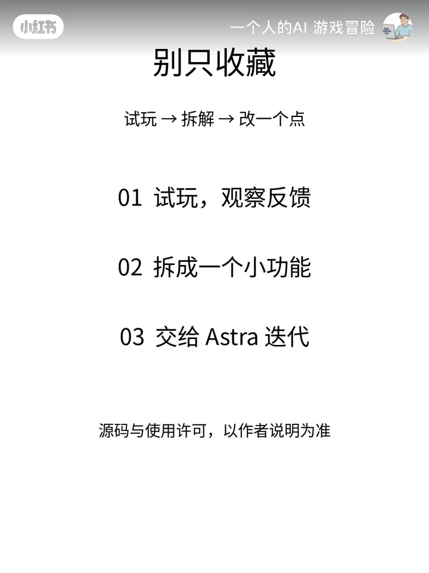

- 内容摘要：我的建议是每次只选一个作品（01:27-01:29）

### 24. 01:30

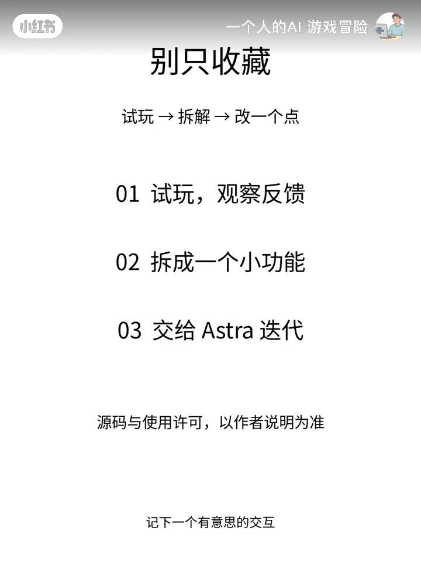

- 内容摘要：试玩五分钟，记下一个有意思的交互，再让astra帮你做一个最小版本（01:29-01:35）

### 25. 01:38

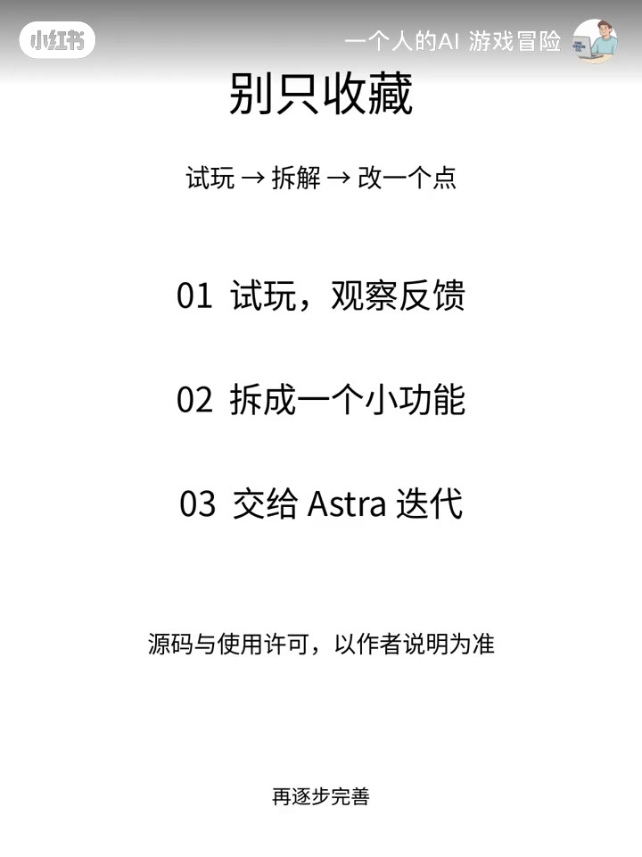

- 内容摘要：先改玩法配色或反馈中的一项，再逐步完善（01:35-01:39）

### 26. 01:43

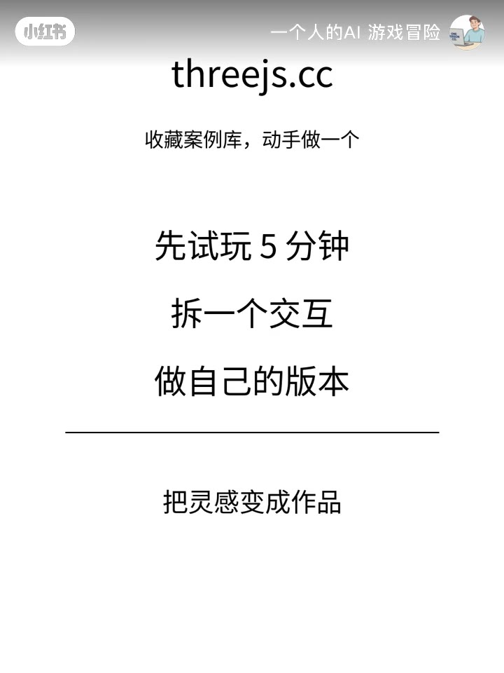

- 内容摘要：能打开原站不代表都能下载原码（01:40-01:42）

### 27. 01:46

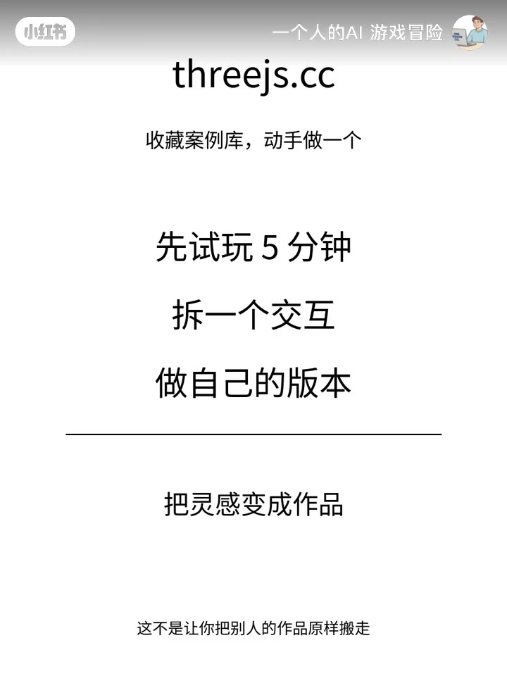

- 内容摘要：这不是让你把别人的作品原样搬走（01:44-01:46）

### 28. 01:52

- 内容摘要：而是学习他的设计思。今天就从推荐区挑一个做出你自己的小作品（01:47-01:52）

### 29. 01:53

- 该时间点暂无可提取文字。

## 视频画面文字 (OCR)

> OCR 仅供参考，可能包含识别错误；请以视频画面和转写来源为准。

### 关键帧 1 · 0.5s

先玩，再学
three.js ×Astra案例库
Three.js
搜索名称或关键词
Three.js
案例库
100
个套
100个由GPT-6Astr生成，已部公网的theejWbOL网页作品，每张海都是真实站点截图，点击在新窗口打开原站。
推
全100
地图
产品用示
视觉艺术3
物理模拟
站点
动作射击2
证简路10
模拟经营14
角色
近收
HARBOR
SKIRMISH!
ASCII街区·第一人称字符射击
港口突袭·小岛冒险
极地速降·滑雪越赛
在由ASCI学符构成的第一人控场病逝放人，用冲
在海边小推抵面一波溢免子入经，切操三种武额，利闸星预路柱.
与三名对手海雪山竞，
剧压和流行应对连绿流次。
冲到与控影周题
终点
招作附选
体育
EL
Orbital
Orbital
CLASICO
Garden.
Garden.
个人的AI游戏冒险
小红书

### 关键帧 2 · 4.3s

先玩，再学
three.js × Astra 案例库
Three.js
搜索名称或关错词
Three.js
案例库
100
个
100个由GPT6Asra生成、已部公网的tee/WebL网页作品，每张海报都是真实站点载图，点击在新窗口打开原站
维荐
全
100
地图
产品示
视觉艺术
物模拟
站点
动作射否 20
10
模拟经营：4
角色
近收票
HARBOR
SKIRMISH!
ASCII街区·第一人称字符射击
港口突袭·小岛冒险
极地速降·滑雪越野赛
在由ASC字符构成的第一人称宽技场社质查故人。
同程冲
在海边小抵强一波流免子入慢，结膜三种武器，利用座顶结挂
与三名对手山量速，穿
税滑行应对连续波次
冲到与素烈型。
点
42
s
登证体育
EL
Orbital
Orbital
CLASICO.
Garden.
Garden.
个人的AI
游戏冒险
小红书

### 关键帧 3 · 6.43s

先玩，再学
个人的AI游戏冒险
云
three.js×Astra案例库
Three.js
索名称或关错词
2
全部100
地图2
产品示
视觉艺术
物理模
站点
动作射击
解10
模经营14
收量
在由ASC字特成的一人称技场病数人，利用冲制
在海边小抵一波波兔子入慢，切换三种武路，顶路线
与三名对手泊雪山
监题检准行由到流次
冲到与约索图
格点
.42
地n出
.53
党迎体育
EL
Orbital
Orbital
CLASICO.
Garden.
Garde
球场精英·国家德比
轨道花园·光点塑
轨道花
在30球进行巴赛罗对童家马德型的11人制比赛，传球、时门
轨道花雕光影艺术培，示验手与引力交积的担学整
交互式
并期换理器
变，
BENGALURU
ORR RUSH
ORR竞速-班加罗尔
永恒荒野·饥荒
潜水员
穿行加罗尔的地道路，开坑法和外摩托，利用加向
《机》间的同页生存与略游戏：截图醒示了真林探索
物
淮水斑
摆击争超车空间。
收集。
包，
以及生命。饱食与理智状迹。
总种植结合
1.0
频经验
检经

### 关键帧 4 · 8.04s

先玩，再学
个人的AI游戏冒险
元
three.js ×Astra案例库
Three.js
接索名称或关错词
28
全部100
地图
产品展示
视觉艺术
物理根拟
站点
动作射击
略10
模据经营
收量
在由ASC字符构成的一人称技场通病放人，利用冲
在海边小抵街一波波兔子入楼，地换三种武，利用顶路线。
与三名对手雪山
路行应时续流次
冲到与的索
格点
.42
动作出
.52
党迎体育
EL
Orbital
Orbital
CLASICO.
Garden.
Garde
球场精英·国家德比
轨道花园·光点雕塑
轨道花
在3D球场进行巴赛罗对童家马德里的11人制比客，传球、门
轨花光影艺术培，示粒子引力交识的程登雕整
交互式
共切操维
变形。
BENGALURU
ORR RUSH
ORR竞速·班加罗尔
永恒荒野·饥荒
潜水员
行加罗尔的回堵道路，避开航法和外卖率托，利用进与向
《机》风格的页生存与略戏：截图解示了真林索、物资
滋水
运击争车空间
收旗、包，以及生命、饱食与理验状迹。
鸟种植结
1.0
经
检经

### 关键帧 5 · 10.17s

一个人的AI游戏冒险
100 个案例
从首页推荐开始逛
Three.js
mcc.js
Inglish
案例库
100
11
干出面
雅
全部100
地图
产品显示
程复艺术1
格理模
站点
动作射
1
解原略10
模经管1
角色置险10
见通体算11
收
查看全部
潜水员戴夫·蓝洞的一天
（国水且约，水下又色，与
当种植丝价在一起.
经管
专作
搜索关键词→打开案例
按网站介绍

### 关键帧 6 · 15.58s

一个人的AI游戏冒险
100 个案例
从首页推荐开始逛
Three.js
Three.js
水
中文
Irglish
案例库
100
11
100个由GPT6Asra生成，已部署公的te/WL责作品，每张都是真实站点，点击在新口打开原站。
个2利
个分
维荐
全100
2图
产品报示
程复艺术
地理模
站点
动作射出
解证略
0
模经营
1
角色置险10
凭速体月14
收票
查看全部
潜水员戴夫·蓝满的一天
当种合在一起
搜索关键词→打开案例
分成十一个类别

### 关键帧 7 · 23.11s

一个人的AI游戏冒险
福
100 个案例
从首页推荐开始逛
Three.js
Three.js
温水
中文
tnglish
案例库
100
11
中实州
个分类
维
全部100
地图2
产品屋示
视艺术
物模
站点
动作射表 20
解10
模经营4
角色冒险10
充通体育 11
收录
查看全部
潜水员戴夫·蓝洞的一天
自种植结合在一起。
《水夫》的，水下又，经与
BUILD THE ECOSYSTEM
搜索关键词→打开案例

### 关键帧 8 · 30.65s

小红节
一个人的AI游戏冒险
云
潜水捕鱼
案例一·蓝洞的一天
DHVEMDIVEK
水夫
的一天
温水素
班乔寿同
海岛庄园
产
装备工坊
中海洋图
⑤450
0
G
THE OCEAN IS
今天，也有好鱼上钩。
CALLING
01
识
下午·
入，
H
EE128
②今日委托
280
36
16.6
蓝洞的第一份鲜
的，
1 29
1/1
载30m深的
16/30
安通
01
①1506
收肤背包
.1
38
2
SAITE
①水指
.2858
白天潜水，
晚上开店。
的水装
空格发射鱼叉·背包反馈
空格发射鱼叉

### 关键帧 9 · 38.19s

小书
一个人的AI游戏冒险
÷
潜水捕鱼
案例一·蓝洞的一天
好
DRVEMDIVEK
水品天的一天
水探索
班乔寿司
海岛庄园
4
装备工坊
中海洋图
⑤450
0
6
今天，也有好鱼上钩。
01
0
下午·
入，把有美
2度20℃
S
今日0
1401
36
16.6
蓝洞的第一份鲜
的，以作
1.2
219
T ARRU
任意
1/)
30m深的海域
16/30
收快平安道航
0/1
150G
收获包
1室
W
38
①水指
白天潜水，
晚上开店。
我的水装备
海生
1/70
空格发射鱼叉·背包反馈
就要看这种操作之后的反馈

### 关键帧 10 · 39.53s

小红书
一个人的AI游戏冒险
3
从捕鱼到经营
观察页面之间怎样衔接
DAVEDIVER
美
的一天
水素
寿
心
海岛庄园
装务工坊
海洋图
420
0
©
FRON
SEATO
TABLE
把海的鲜美，留在今晚。
01
0
·
离了，香的不艺的好自已
度2
BANCHO
SUSHI
60
L
1OE
好食材，遇上好手艺
星的
-0
业报
0。
0
S0DFEA
2S
-0.
RE
C今日鲜货
11
武R
.1
手相
8份
BE31
开始营业
2
票托
072
食材→菜单→开始营业

### 关键帧 11 · 40.53s

小红书
一个人的AI游戏冒险
-
从捕鱼到经营
观察页面之间怎样衔接
DANCHO
SUSHI
60
0
好食材，遇上好手艺。
的，线一
本R业司
人
0
A0ETT6
日
2·3月
C今日
盘恒
85
R24
出票点
012
科理的灵难，
今晚的菜单
1
在食材里。
-10
司
海手卷
x170
sis 114
U
迎接新的一天
食材→菜单→开始营业
它还提供寿司店、海岛庄园和装备工坊

### 关键帧 12 · 45.73s

小红书
一个人的AI游戏冒险
元
从捕鱼到经营
观察页面之间怎样衔接
DANCHO SUSHI
59
N
10
好食材，遇上好手艺。
开店！点菜单菜，做好后点客人上菜，杯亮起时记得系。
面深的，一口
营业司
人
06
0
A日ETTO
21日
①
C今日
1.30
武R
.1
89
2
出票托盘
6/2
“科理的灵魂，
今晚的菜单
在食材里。
-
例
海苗手卷
10120
-186
L
0
迎接新的一天→
食材→菜单→开始营业
潜水获得食材

### 关键帧 13 · 53.27s

小红节
一个人的AI游戏冒险
云
从捕鱼到经营
观察页面之间怎样衔接
DANCHO
SUSHI
59
营业
好食材，遇上好手艺。
开店！点备菜，好点客人上：杯亮起时记得
CSFNT
营业部
的客人
00
0
司
今日货
置组
1
U品手
89
LC
-122/8
出儿
#72
科理的灵魂，
晚的单
在食材里。
-20
监寿司
邮联社位社
海手卷
18
1E
0
迎接新的一天→
食材→菜单→开始营业
先理解这些系统怎样连起来

### 关键帧 14 · 55.83s

T
一个人的AI游戏冒险
云
做出第一把斧头
案例二·永恒荒野
DONTSTARVE+
永恒荒野
太发的草
系通班
150
179
FILLD NO
在天黑之前。
现在还有阳元
看来，这里没有不午。
威尔
工具面板→配方→制作斧头

### 关键帧 15 · 58.83s

一个人的AI游戏冒险
云
做出第一把斧头
案例二·永恒荒野
DONTSTARVE+
永恒荒野
150
138
179
AL
工具
斧头
E
中心
鹤嘴
中2
护子
饿子
威尔逊
工具面板→配方→制作斧头
打开工具面板

### 关键帧 16 · 60.8s

小红书
一个人的AI游戏冒险
÷
做出第一把斧头
案例二·永恒荒野
DONTSTARVE+
永恒荒野
I50
138
179
工具
头
X
F
韵嘴
斧头
EM
段一号：
中021
点A
子
辅子
威尔逊
工具面板→配方→制作斧头
查看材料

## 字幕文件

[TXT](./transcript/video.txt) | [JSON](./transcript/video.json) | [SRT](./transcript/video.srt) | [VTT](./transcript/video.vtt)

## 转写来源

[平台字幕 TXT](./transcript/platform/video.txt) | [平台字幕 JSON](./transcript/platform/video.json) | [平台字幕 SRT](./transcript/platform/video.srt) | [平台字幕 VTT](./transcript/platform/video.vtt) | [本地 ASR TXT](./transcript/asr/video.txt) | [本地 ASR JSON](./transcript/asr/video.json) | [本地 ASR SRT](./transcript/asr/video.srt) | [本地 ASR VTT](./transcript/asr/video.vtt)

## 其他来源转写

### 本地 ASR

- **00:00-00:02** 想知道AI寫出來的網頁
- **00:02-00:04** 到底能玩到什麼程度
- **00:04-00:06** 這裡把分散在各處的作品
- **00:06-00:07** 整理成了一個
- **00:07-00:10** 可以直接打開體驗的案例庫
- **00:10-00:11** 按網站介紹
- **00:11-00:14** 目前收入100個由S-TRA生成的網頁作品
- **00:14-00:16** 分成11個類別
- **00:16-00:18** 首頁有20個推薦
- **00:18-00:19** 可以按分類篩選
- **00:19-00:20** 也能搜索關鍵詞
- **00:20-00:24** 在頂級卡片 經理挑戰
- **00:24-00:27** 先看潛水源帶覆風格的網頁復刻
- **00:27-00:28** 點擊開始潛水
- **00:28-00:29** 用方向緊移動
- **00:29-00:31** 空格發生的預查
- **00:31-00:33** 這次試玩已經補到一條魚
- **00:33-00:36** 右子背包也出現了收穫
- **00:36-00:37** 它案例時
- **00:37-00:40** 就要看這種操作之後的浮潰
- **00:40-00:41** 它還提供受私電
- **00:41-00:44** 海島莊園和莊備警方
- **00:44-00:45** 學習時可以拆解
- **00:45-00:47** 潛水獲得食材
- **00:47-00:48** 經營消耗食材
- **00:48-00:51** 升級在影響下
- **00:51-00:53** 先理解這些系統怎樣連結
- **00:53-00:56** 再嘗試做
- **00:56-00:59** 第二個是激光風格的生存案
- **00:59-01:00** 打開工具面板
- **01:00-01:03** 查看材料 帶點擊製作浮潰
- **01:03-01:05** 這裡值得學的是
- **01:05-01:08** 資源 配方 背包和生存狀態
- **01:08-01:11** 如何共同推動玩家行動
- **01:11-01:13** 第三個是經過自由線
- **01:13-01:14** 進入觀測站
- **01:14-01:16** 切換現在和回升
- **01:16-01:18** 再去檔案是調查型面
- **01:18-01:20** 新的線索就不收入手機
- **01:20-01:23** 這次展示的是基礎方面模式
- **01:23-01:24** 重點看續勢線索
- **01:24-01:27** 和交付狀態如何配合
- **01:27-01:28** 我的建議是
- **01:28-01:30** 每次只選一個作品
- **01:30-01:31** 10萬5分鐘
- **01:31-01:32** 既下一個有意思的交互
- **01:32-01:35** 再讓Astra幫你做一個最小版本
- **01:35-01:36** 先改完法
- **01:36-01:38** 配色或反饋中的一項
- **01:38-01:40** 再逐步完善
- **01:40-01:41** 能打開原站
- **01:41-01:44** 不代表都能下載原碼
- **01:44-01:45** 這不是讓你把別人的作品
- **01:45-01:47** 原要搬走
- **01:47-01:49** 而是學習他的設計思考
- **01:49-01:51** 今天就從推薦去挑一個
- **01:51-01:52** 做出你自己的小作品

## 视频转录

- **00:00-00:03** 想知道ai写出来的网页到底能玩到什么程度
- **00:03-00:09** 这里把分散在各处的作品整理成了一个可以直接打开体验的案例库
- **00:10-00:17** 按网站介绍，目前收录一百个由astra生成的网页作品，分成十一个类别，首页有二十个推荐
- **00:17-00:23** 可以按分类筛选，也能搜索关键词，再点击卡片进入原站
- **00:24-00:31** 先看潜水员戴夫风格的网页复刻，点击开始潜水，用方向键移动空格发射鱼叉
- **00:31-00:35** 这次试玩已经捕到一条鱼，右侧背包也出现了收获
- **00:35-00:38** 看案例时就要看这种操作之后的
- **00:40-00:43** 它还提供寿司店，海岛庄园和装备工坊
- **00:44-00:50** 学习时可以拆解潜水获得食材，经营消耗食材升级，在影响下一次探索
- **00:51-00:54** 先理解这些系统怎样连起来再尝试
- **00:56-00:58** 第二个是饥荒风格的生存案
- **00:59-01:03** 打开工具面板查看材料，再点击制作
- **01:03-01:10** 这里值得学的是资源配方背包和生存状态，如何共同推动玩家行动
- **01:11-01:13** 第三个是静默子午线
- **01:13-01:20** 进入观测站切换现在和回声，再去档案室调查墙面，新的线索就会收入手机
- **01:20-01:26** 这次展示的是基础画面模式，重点看叙事线索和交互状态如何配合
- **01:27-01:29** 我的建议是每次只选一个作品
- **01:29-01:35** 试玩五分钟，记下一个有意思的交互，再让astra帮你做一个最小版本
- **01:35-01:39** 先改玩法配色或反馈中的一项，再逐步完善
- **01:40-01:42** 能打开原站不代表都能下载原码
- **01:44-01:46** 这不是让你把别人的作品原样搬走
- **01:47-01:52** 而是学习他的设计思。今天就从推荐区挑一个做出你自己的小作品

## 图片

## 图片文字 (OCR)

> OCR 仅供参考，可能包含识别错误；请以原图为准。

Three.js
×
Astra
案例库
100个案例，边玩边学
threejs.cc
你
