# Three.js 游戏 skill，最大化你的 Astra

> 作者: AI 游戏冒险家 | 日期: 昨天 06:07 北京 | 原文: https://www.xiaohongshu.com/discovery/item/6aa32a170000000012035fd2?app_platform=android&ignoreEngage=true&app_version=9.45.0&share_from_user_hidden=true&xsec_source=app_share&type=video&xsec_token=CBb64OIpti4eaULU4HnNkL7OyBeACP7RLFvMgA5vMri3A%3D&author_share=1&xhsshare=CopyLink&shareRedId=N0dINjg3NUpMPko6S0EySDs0P0lFSjdL&apptime=1789183002&share_id=23193d3022b04fbe99d5957348b58dca&share_channel=copy_link&track_code=3SY2DLOQN8b

> **摘要**:本文介绍基于 Three.js 开发的一款游戏 skill，旨在帮助用户最大化利用 Astra 的效果。文章围绕如何通过该游戏 skill 提升 Astra 的表现力展开，结合 Three.js 的 3D 渲染能力，为游戏开发提供新思路。内容涉及 GPT6 等前沿技术，属于独立游戏开发领域的探索。

Three.js 游戏 skill，最大化你的 Astra
#threejs #astra #GPT6 #游戏开发 #独立游戏
昨天 06:07 北京

#Three.js #Astra

## 视频

[视频 1](./video.mp4)

<video controls width="100%"><source src="./video.mp4" type="video/mp4">您的浏览器不支持视频播放。</video>

附件: [音频](./audio/audio.wav) | [处理清单](./video_manifest.json)

## 视频图文总结

> 按关键帧关联完整视频转录；文字保留机器转写原文，时间点仅用于定位。

### 1. 00:00

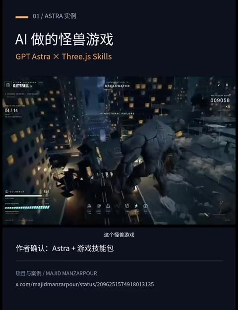

- 内容摘要：这个怪兽游戏是作者用g p（00:00-00:02）
- 画面文字（OCR）：01/ASTRA实例
AI做的怪兽游戏
GPTAstra X Three.js Skills
009058
这个怪兽游戏
作者确认：Astra+游戏技能包
项目与案例/MAJIDMANZARPOUR
x.com/majidmanzarpour/status/2096251574918013135

### 2. 00:03

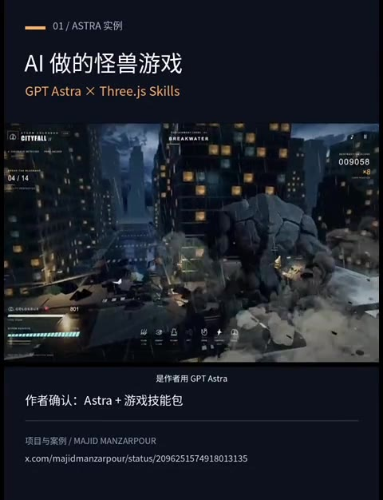

- 内容摘要：T astra配合自己开源的free j s游戏技能包做的（00:02-00:06）
- 画面文字（OCR）：01/ASTRA实例
AI做的怪兽游戏
GPT Astra X Threejs Skills
009058
是作者用GPTAstra
作者确认：Astra+游戏技能包
项目与案例/MAJIDMANZARPOUR
x.com/majidmanzarpour/status/2096251574918013135

### 3. 00:05

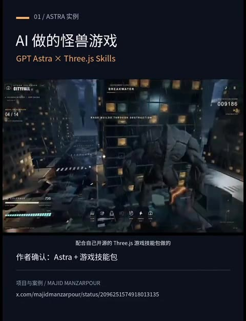

- 画面文字（OCR）：01/ASTRA实例
AI做的怪兽游戏
GPTAstra × Three.js Skills
009186
配合自己开源的Three.js游戏技能包做的
作者确认：Astra+游戏技能包
项目与案例/MAJIDMANZARPOUR
x.com/majidmanzarpour/status/2096251574918013135

### 4. 00:06

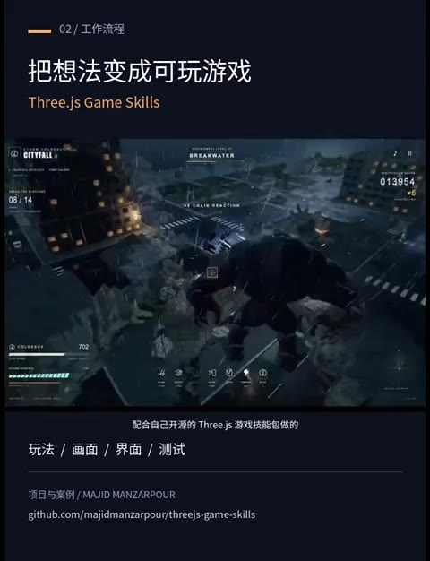

- 画面文字（OCR）：02/工作流程
把想法变成可玩游戏
Three.js Game Skills
013954
08/14
②010
702
配合自己开源的Threejs游戏技能包做的
玩法/画面/界面/测试
项目与案例/MAJIDMANZARPOUR
github.com/majidmanzarpour/threejs-gamesklls

### 5. 00:08

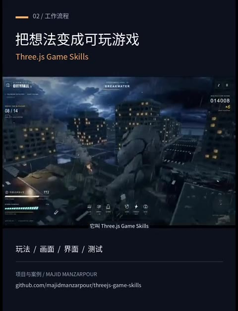

- 内容摘要：它叫free js game skills（00:06-00:10）
- 画面文字（OCR）：02/工作流程
把想法变成可玩游戏
Three.js Game Skills
CITTFALL
014008
08/14
它叫Three.js Game Skills
玩法/画面/界面/测试
项目与案例/MAJIDMANZARPOUR
github.com/majidmanzarpour/threejs-game-skills

### 6. 00:11

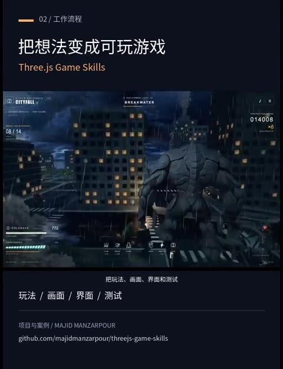

- 画面文字（OCR）：02/工作流程
把想法变成可玩游戏
Three.js Game Skills
CITYEALL
BREAKWATER
014008
08/14
把玩法、画面、界面和测试
玩法/画面/界面/测试
项目与案例/MAJIDMANZARPOUR
github.com/majidmanzarpour/threejs-game-skills

### 7. 00:13

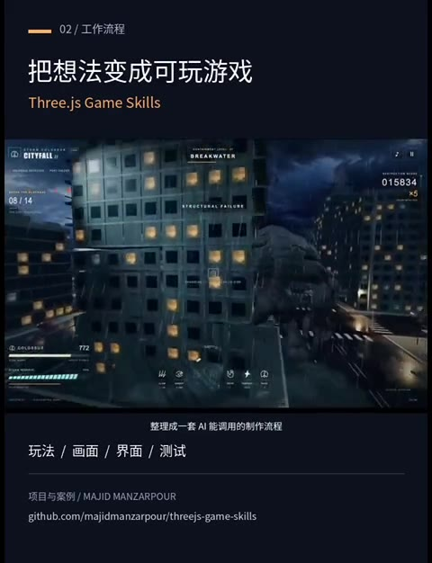

- 内容摘要：把玩法画面界面和测试整理成一套ai能调用的制作流程（00:10-00:14）
- 画面文字（OCR）：02/工作流程
把想法变成可玩游戏
Three.js Game Skills
015834
08/14
整理成一套AI能调用的制作流程
玩法/画面/界面/测试
项目与案例/MAJIDMANZARPOUR
github.com/majidmanzarpour/threejs-game-skills

### 8. 00:14

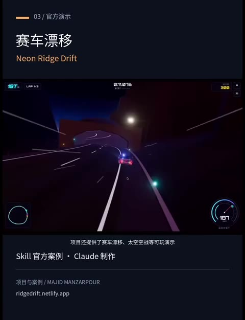

- 画面文字（OCR）：03/官方演示
赛车漂移
Neon Ridge Drift
2:11276
187
项目还提供了赛车漂移、太空空战等可玩演示
Skill官方案例·Claude制作
项目与案例/MAJIDMANZARPOUR
ridgedrift.netlify.ap

### 9. 00:16

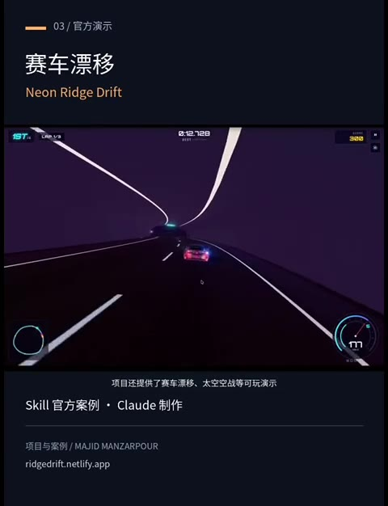

- 画面文字（OCR）：03/官方演示
赛车漂移
Neon Ridge Drift
0:12.728
项目还提供了赛车漂移、太空空战等可玩演示
Skill官方案例·Claude制作
项目与案例/MAJIDMANZARPOUR
ridgedrift.netlify.app

### 10. 00:19

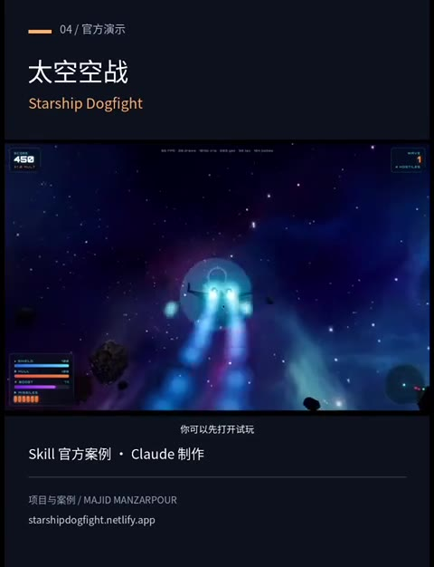

- 内容摘要：项目还提供了赛车漂移，太空空战等可玩演示，你可以先打开试玩，看看实际效果（00:14-00:21）
- 画面文字（OCR）：04/官方演示
太空空战
Starship Dogfight
00000
你可以先打开试玩
Skill官方案例·Claude制作
项目与案例/MAJIDMANZARPOUR
starshipdogfight.netlify.app

### 11. 00:21

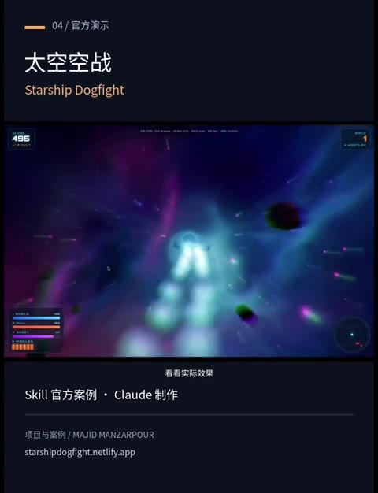

- 画面文字（OCR）：04/官方演示
太空空战
Starship Dogfight
495
看看实际效果
Skill官方案例·Claude制作
项目与案例/MAJIDMANZARPOUR
starshipdogfight.netliy.app

### 12. 00:24

- 内容摘要：安装后让编程助手调用这个导演技能，再告诉他你想做什么游戏就能开始迭代（00:21-00:28）
- 画面文字（OCR）：05/如何开始
调用游戏导演Skill
threejs-game-director
安装技能包
在编程助手中调用
threejs-game-director
↓
描述玩法，开始迭代
让编程助手调用这个导演技能
告诉AI你想做什么游戏，再逐步迭代
项目与案例/MAJIDMANZARPOUR
支持Codex/Claude Code

### 13. 00:27

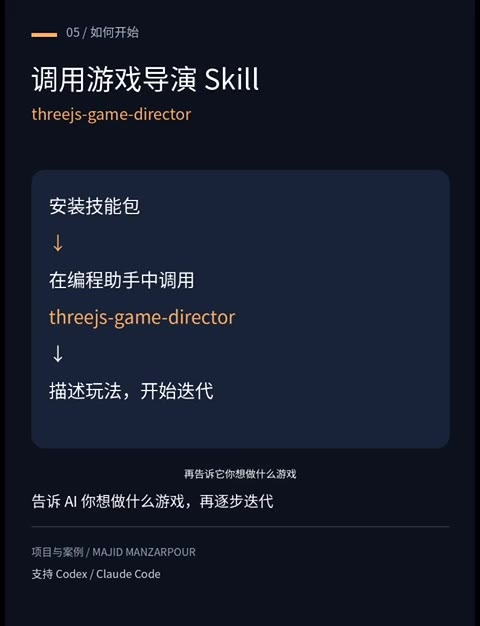

- 画面文字（OCR）：05/如何开始
调用游戏导演Skill
threejs-game-director
安装技能包
山
在编程助手中调用
threejs-game-director
↓
描述玩法，开始迭代
再告诉它你想做什么游戏
告诉AI你想做什么游戏，再逐步迭代
项目与案例/MAJIDMANZARPOUR
支持Codex/ClaudeCode

### 14. 00:29

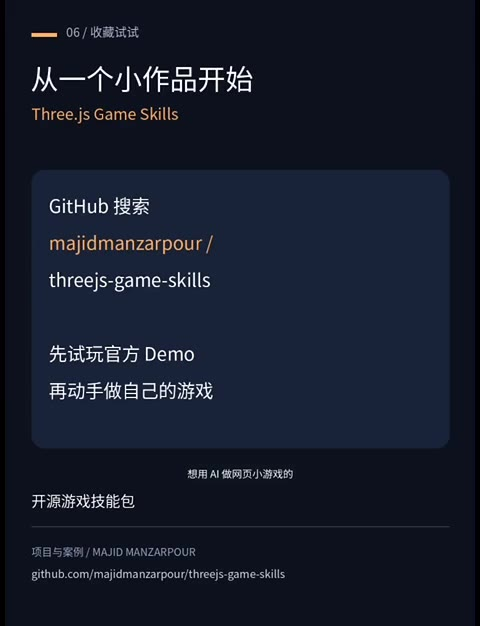

- 内容摘要：想用ai做网页小游戏的（00:28-00:31）
- 画面文字（OCR）：06/收藏试试
从一个小作品开始
Three.js Game Skills
GitHub搜索
majidmanzarpour/
threejs-game-skills
先试玩官方Demo
再动手做自己的游戏
想用AI做网页小游戏的
开源游戏技能包
项目与案例/MAJIDMANZARPOUR
github.com/majidmanzarpour/threejs-game-skills

### 15. 00:32

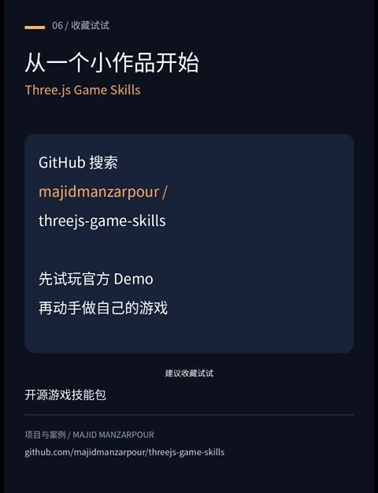

- 内容摘要：建议收藏试试，项目名和地址放在这里，先从一个小作品开始（00:31-00:36）
- 画面文字（OCR）：06/收藏试试
从一个小作品开始
Three.js Game Skills
GitHub搜索
majidmanzarpour/
threejs-game-skills
先试玩官方Demo
再动手做自己的游戏
建议收藏试试
开源游戏技能包
项目与案例/MAJIDMANZARPOUR
github.com/majidmanzarpour/threejs-game-skills

### 16. 00:35

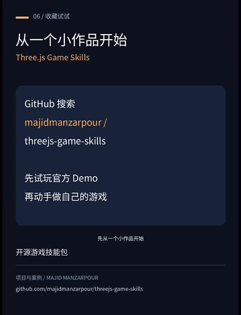

- 画面文字（OCR）：06/收藏试试
从一个小作品开始
Three.js Game Skills
GitHub搜索
majidmanzarpour/
threejs-game-skills
先试玩官方Demo
再动手做自己的游戏
先从一个小作品开始
开源游戏技能包
项目与案例/MAJIDMANZARPOUR
github.com/majidmanzarpour/threejs-game-skills

### 17. 00:37

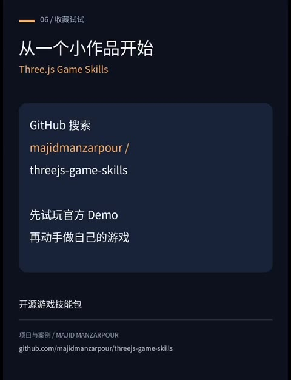

- 该时间点暂无可提取文字。

### 18. 00:40

- 该时间点暂无可提取文字。

## 视频画面文字 (OCR)

> OCR 仅供参考，可能包含识别错误；请以视频画面和转写来源为准。

### 关键帧 1 · 0.5s

01/ASTRA实例
AI做的怪兽游戏
GPTAstra X Three.js Skills
009058
这个怪兽游戏
作者确认：Astra+游戏技能包
项目与案例/MAJIDMANZARPOUR
x.com/majidmanzarpour/status/2096251574918013135

### 关键帧 2 · 3.17s

01/ASTRA实例
AI做的怪兽游戏
GPT Astra X Threejs Skills
009058
是作者用GPTAstra
作者确认：Astra+游戏技能包
项目与案例/MAJIDMANZARPOUR
x.com/majidmanzarpour/status/2096251574918013135

### 关键帧 3 · 5.84s

01/ASTRA实例
AI做的怪兽游戏
GPTAstra × Three.js Skills
009186
配合自己开源的Three.js游戏技能包做的
作者确认：Astra+游戏技能包
项目与案例/MAJIDMANZARPOUR
x.com/majidmanzarpour/status/2096251574918013135

### 关键帧 4 · 6.9s

02/工作流程
把想法变成可玩游戏
Three.js Game Skills
013954
08/14
②010
702
配合自己开源的Threejs游戏技能包做的
玩法/画面/界面/测试
项目与案例/MAJIDMANZARPOUR
github.com/majidmanzarpour/threejs-gamesklls

### 关键帧 5 · 8.51s

02/工作流程
把想法变成可玩游戏
Three.js Game Skills
CITTFALL
014008
08/14
它叫Three.js Game Skills
玩法/画面/界面/测试
项目与案例/MAJIDMANZARPOUR
github.com/majidmanzarpour/threejs-game-skills

### 关键帧 6 · 11.17s

02/工作流程
把想法变成可玩游戏
Three.js Game Skills
CITYEALL
BREAKWATER
014008
08/14
把玩法、画面、界面和测试
玩法/画面/界面/测试
项目与案例/MAJIDMANZARPOUR
github.com/majidmanzarpour/threejs-game-skills

### 关键帧 7 · 13.84s

02/工作流程
把想法变成可玩游戏
Three.js Game Skills
015834
08/14
整理成一套AI能调用的制作流程
玩法/画面/界面/测试
项目与案例/MAJIDMANZARPOUR
github.com/majidmanzarpour/threejs-game-skills

### 关键帧 8 · 14.83s

03/官方演示
赛车漂移
Neon Ridge Drift
2:11276
187
项目还提供了赛车漂移、太空空战等可玩演示
Skill官方案例·Claude制作
项目与案例/MAJIDMANZARPOUR
ridgedrift.netlify.ap

### 关键帧 9 · 16.51s

03/官方演示
赛车漂移
Neon Ridge Drift
0:12.728
项目还提供了赛车漂移、太空空战等可玩演示
Skill官方案例·Claude制作
项目与案例/MAJIDMANZARPOUR
ridgedrift.netlify.app

### 关键帧 10 · 19.18s

04/官方演示
太空空战
Starship Dogfight
00000
你可以先打开试玩
Skill官方案例·Claude制作
项目与案例/MAJIDMANZARPOUR
starshipdogfight.netlify.app

### 关键帧 11 · 21.85s

04/官方演示
太空空战
Starship Dogfight
495
看看实际效果
Skill官方案例·Claude制作
项目与案例/MAJIDMANZARPOUR
starshipdogfight.netliy.app

### 关键帧 12 · 24.52s

05/如何开始
调用游戏导演Skill
threejs-game-director
安装技能包
在编程助手中调用
threejs-game-director
↓
描述玩法，开始迭代
让编程助手调用这个导演技能
告诉AI你想做什么游戏，再逐步迭代
项目与案例/MAJIDMANZARPOUR
支持Codex/Claude Code

### 关键帧 13 · 27.19s

05/如何开始
调用游戏导演Skill
threejs-game-director
安装技能包
山
在编程助手中调用
threejs-game-director
↓
描述玩法，开始迭代
再告诉它你想做什么游戏
告诉AI你想做什么游戏，再逐步迭代
项目与案例/MAJIDMANZARPOUR
支持Codex/ClaudeCode

### 关键帧 14 · 29.86s

06/收藏试试
从一个小作品开始
Three.js Game Skills
GitHub搜索
majidmanzarpour/
threejs-game-skills
先试玩官方Demo
再动手做自己的游戏
想用AI做网页小游戏的
开源游戏技能包
项目与案例/MAJIDMANZARPOUR
github.com/majidmanzarpour/threejs-game-skills

### 关键帧 15 · 32.52s

06/收藏试试
从一个小作品开始
Three.js Game Skills
GitHub搜索
majidmanzarpour/
threejs-game-skills
先试玩官方Demo
再动手做自己的游戏
建议收藏试试
开源游戏技能包
项目与案例/MAJIDMANZARPOUR
github.com/majidmanzarpour/threejs-game-skills

### 关键帧 16 · 35.19s

06/收藏试试
从一个小作品开始
Three.js Game Skills
GitHub搜索
majidmanzarpour/
threejs-game-skills
先试玩官方Demo
再动手做自己的游戏
先从一个小作品开始
开源游戏技能包
项目与案例/MAJIDMANZARPOUR
github.com/majidmanzarpour/threejs-game-skills

## 字幕文件

[TXT](./transcript/video.txt) | [JSON](./transcript/video.json) | [SRT](./transcript/video.srt) | [VTT](./transcript/video.vtt)

## 转写来源

[平台字幕 TXT](./transcript/platform/video.txt) | [平台字幕 JSON](./transcript/platform/video.json) | [平台字幕 SRT](./transcript/platform/video.srt) | [平台字幕 VTT](./transcript/platform/video.vtt) | [本地 ASR TXT](./transcript/asr/video.txt) | [本地 ASR JSON](./transcript/asr/video.json) | [本地 ASR SRT](./transcript/asr/video.srt) | [本地 ASR VTT](./transcript/asr/video.vtt)

## 其他来源转写

### 本地 ASR

- **00:00-00:03** 这个贯售游戏是作者用GPT Astro
- **00:03-00:07** 配合自己开源的FreeJS游戏技能帮助的
- **00:07-00:10** 它叫FreeJS Game Skills 把玩法
- **00:10-00:12** 画面界面和测试整理成一套
- **00:12-00:14** AI能调用的制作流程
- **00:14-00:16** 项目还提供了赛车飘移
- **00:16-00:18** 太空空站等客外演示
- **00:18-00:20** 你可以先打开试玩
- **00:20-00:21** 看看实际效果
- **00:21-00:22** 安装后
- **00:22-00:25** 让变成处手调用这个导演技能
- **00:25-00:27** 再告诉他你想做什么游戏
- **00:27-00:28** 就能开始你带
- **00:28-00:32** 想用一爱做业小游戏的建议收藏试试
- **00:32-00:34** 项目名和地址放在这里
- **00:34-00:36** 先从一个小作品开始

## 视频转录

- **00:00-00:02** 这个怪兽游戏是作者用g p
- **00:02-00:06** T astra配合自己开源的free j s游戏技能包做的
- **00:06-00:10** 它叫free js game skills
- **00:10-00:14** 把玩法画面界面和测试整理成一套ai能调用的制作流程
- **00:14-00:21** 项目还提供了赛车漂移，太空空战等可玩演示，你可以先打开试玩，看看实际效果
- **00:21-00:28** 安装后让编程助手调用这个导演技能，再告诉他你想做什么游戏就能开始迭代
- **00:28-00:31** 想用ai做网页小游戏的
- **00:31-00:36** 建议收藏试试，项目名和地址放在这里，先从一个小作品开始

## 图片

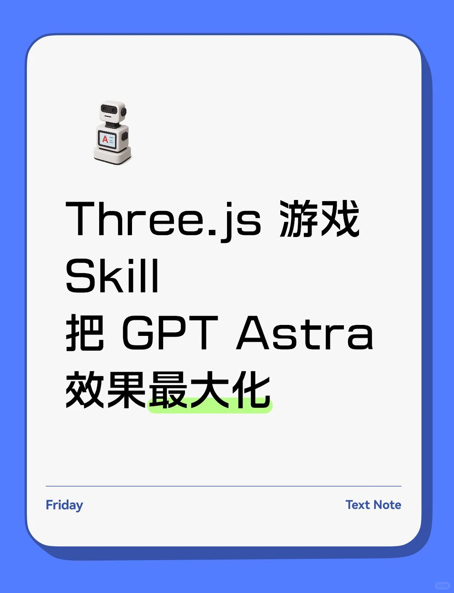

## 图片文字 (OCR)

> OCR 仅供参考，可能包含识别错误；请以原图为准。

Three.js
游戏
Skill
把
GPT
Astra
效果最大化
Friday
Text Note
