# Three.js 游戏特效天花板：看看这三个开源项目你就知道了

> 作者: 柳杉前端 | 平台: 微信公众号 | 日期: 2026-08-19 08:00 | 原文: https://mp.weixin.qq.com/s/kfq5VSDk-Qyg1Tllalp8aA

> **摘要**: 第一个从"手势绘制"出发，让玩家在地面上画出法术轨迹； 第二个贴近真正的 MOBA 动作游戏，用线性指示器、范围圈、技能槽和冷却时间组织战斗； 第三个则是完整的第三人称动作框架，集运动变形、布娃娃物理和装备系统于一身。

最近看了 achrefelouafi 的三个 Three.js 开源项目：AvatarCastingAbilitiesThreeJS 、 LinearAbiltyCastingThreeJS、SamuraiThirdPersonTemplateThreeJS。之前我们还介绍了这哥们的其他开源项目也很牛[建筑、海洋、暴雨、飞雪，这些 Three.js 效果真的太牛了](https://mp.weixin.qq.com/s?__biz=MzU3MDkwMDI0MQ==&mid=2247489662&idx=1&sn=0cdc0e8b52a3040201222c5c62e34450&scene=21#wechat_redirect)。回到主题，这三个项目做的都是角色施法，但思路完全不同。第一个从"手势绘制"出发，让玩家在地面上画出法术轨迹； 第二个贴近真正的 MOBA 动作游戏，用线性指示器、范围圈、技能槽和冷却时间组织战斗； 第三个则是完整的第三人称动作框架，集运动变形、布娃娃物理和装备系统于一身。

游戏特效的质量往往决定了玩家的沉浸感。今天要介绍三个在 GitHub 上获得广泛关注的开源项目，它们用纯代码实现了复杂而华丽的游戏魔法特效。

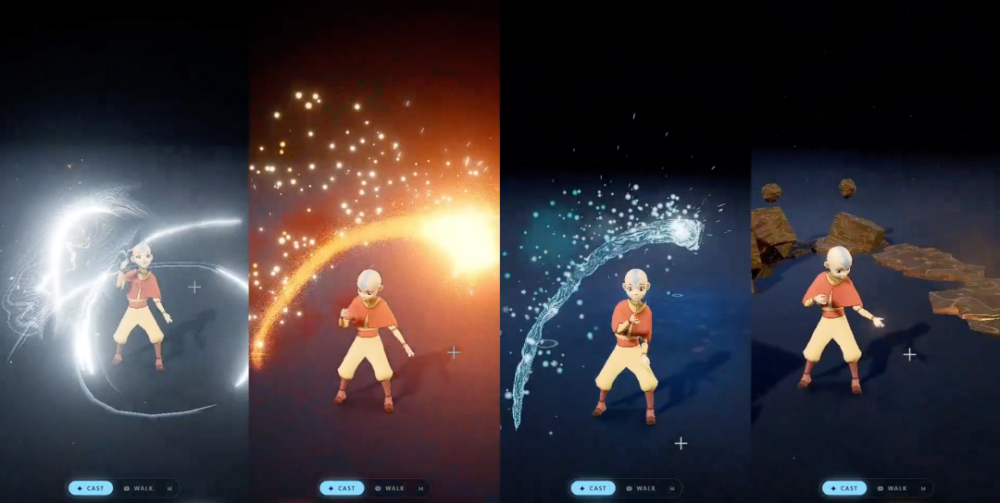

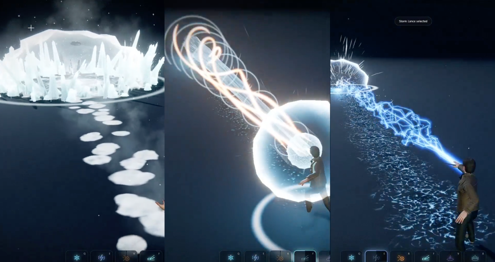

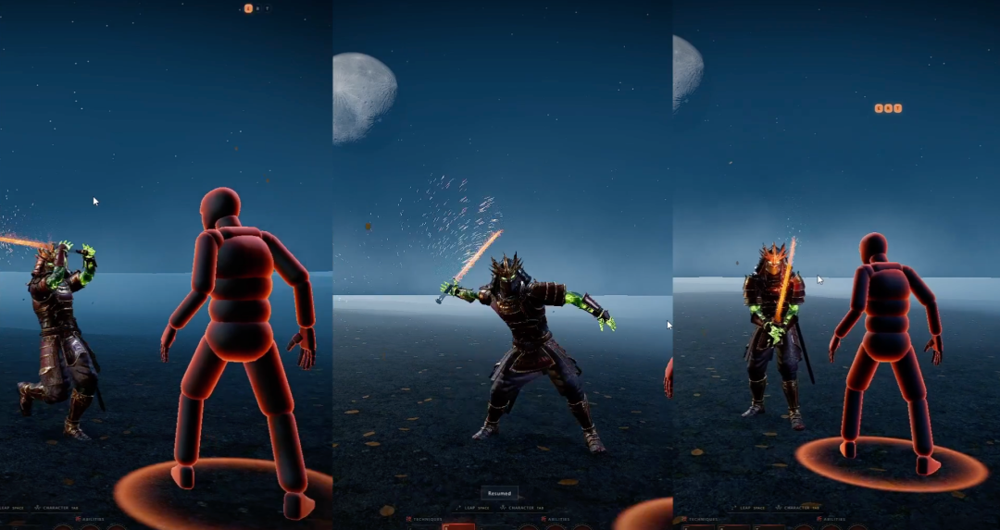

## 项目一：AvatarCastingAbilitiesThreeJS

**源码地址**：https://github.com/achrefelouafi/AvatarCastingAbilitiesThreeJS

### 项目概览

受动画《最后的气宗》启发的元素弯曲沙箱。采用了完全不同的交互设计——用鼠标在地面上绘制路径，然后释放，火、水、土、气四种能力沿着这条样条曲线传播并在终点引爆。

### 核心特效体系

**火焰**：体积渲染的火焰。在 `src/materials/VolumetricFireMaterial.js` 中实现，不是传统的纹理带状几何，而是从相机向轨迹周围的密度场发射射线。核心轴线炽热呈白色，外缘深红，产生热涨气效应。尾迹中的火舌向上舔舐，烟雾被真实的吸收处理，所以冷气真的遮挡了背景，而不只是叠加。着陆点形成热扭曲波纹。渲染质量由 `fire.volumeSteps` 控制，26 个采样点每像素在 960×540 分辨率下耗时约 1.3 毫秒。

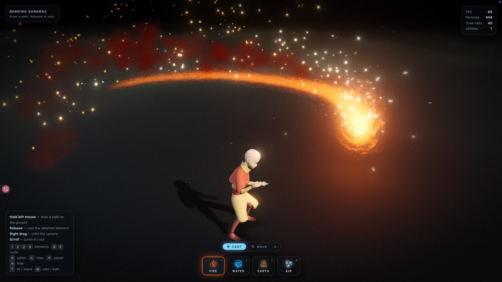

**水流**：在 `src/materials/OceanWaterMaterial.js` 中实现。同样是射线编织技术。不同之处是水有表面。着色器编织出波峰、裂缝、泡沫。它拥有动态深度着色——边缘保持青绿色，腹部深蓝。冲击处形成喷泉、起泡床单向外扩散再回流、地面涟漪扩散。Schlick 菲涅尔反射和 HDR 环境光互动，实现了逼真的水面反射。

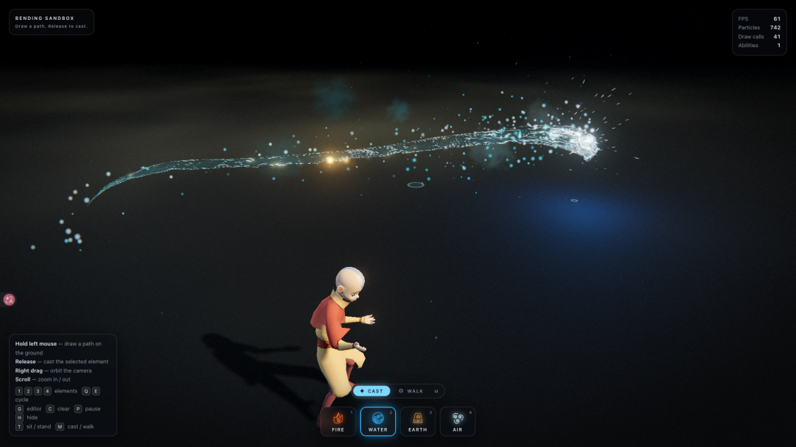

**土石**：在 `src/assets/ProceduralGeometry.js` 中定义程序化石板几何。这是唯一使用实体几何的元素。前进中铺设石板，在 `src/abilities/EarthAbility.js` 中裂纹波跟随冲击点破裂地壳。板材翘起、翻倒或下沉，喷出尘埃和碎片。施法结束时一座塔从地面上升，巨石簇拥其基座。所有石头共用 `RockMaterial`，支持苔藓、纹理和分层。

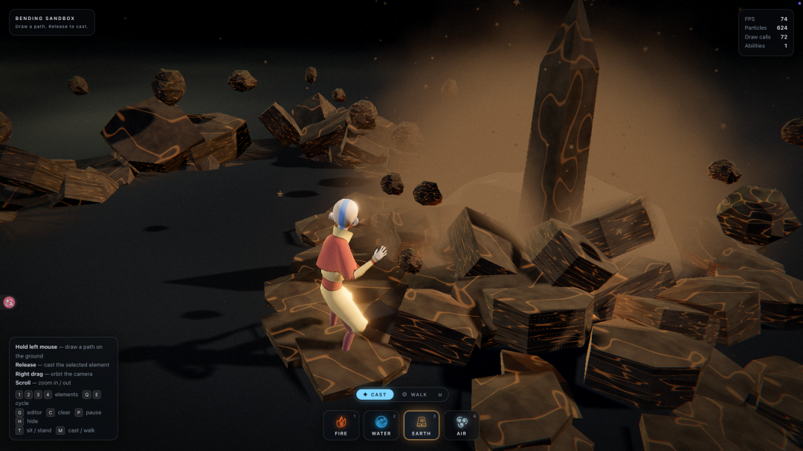

**空气**：在 `src/materials/WindMaterial.js` 中实现。螺旋管束围绕轨迹编织，用涡旋效应扭曲。在黑暗舞台上呈现为明亮的弧线加法混合。`walk.bands` 参数定义流线数量，留意保持整数以避免缝隙。

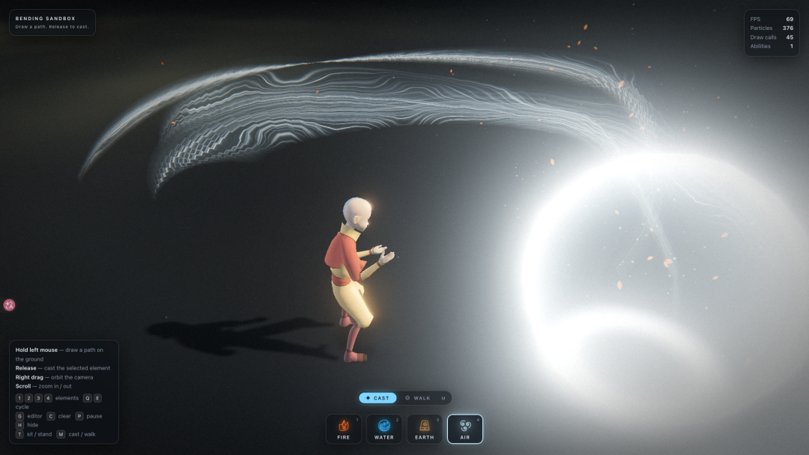

### 独特的行走模式

项目的第二层玩法是"行走模式"。同一个绘制的手势不再是投射，而是被角色所"骑乘"。在 `src/animation/WalkController.js` 中实现了四阶段序列：

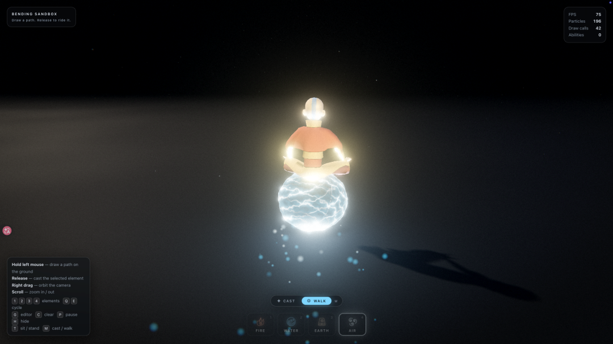

- 跳跃阶段——从立位跳向路径头部的抛物线弧，空中转身使身体对准路径方向。里程表处的 walk.tuck 时刻开始折叠进冥想姿态。
- 骑行阶段——空气球在身下膨胀。头像沿曲线以弧长参数化方式前进，初始加速 walk.accel，末尾减速 walk.brake。银行由实时的方向变化率自动计算。
- 下降阶段——空气球爆裂，头像跳下落地。
- 待命阶段——回到空闲动画。

### 技术架构

项目核心是一个"设置驱动"的架构。在 `src/config/settings.js` 中保存所有可调参数。着色器、粒子系统、灯光都只读这个对象，从不复制其值。这让编辑器无需重新编译就能生效。

路径绘制在 `src/input/PathDrawer.js` 中实现。在 `src/abilities/Ability.js` 中，基类按弧长而非曲线参数前进。这意味着旅行速度是真正的米每秒，与帧率无关。

GPU 粒子系统在 `src/particles/ParticleSystem.js` 中实现。运动、生命周期尺寸变化、颜色梯度和透明度衰减都在着色器中计算。轮廓都是程序化生成，项目中没有任何精灵纹理。

## 项目二：LinearAbiltyCastingThreeJS

**源码地址**：https://github.com/achrefelouafi/LinearAbiltyCastingThreeJS

### 项目概览

使用 Three.js、Vite 和手写 GLSL 构建的技能特效沙箱。展现了极高的社区热度。它实现了五种元素能力的完整视觉效果系统。

### 核心特效体系

项目包含六个可释放的技能：

**Q - 寒霜矛**：一条冰裂纹前沿沿着投射线奔涌而出，身后跟随密集的冰晶风暴。靠近施法者的冰晶细小密集，越往远处越壮观，击点形成刀刃般的冰晶墙。

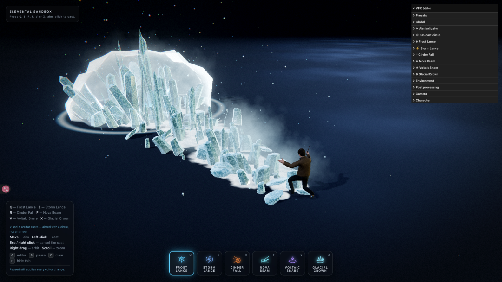

**E - 风暴矛**：闪电箭矢从施法者手中射出，身后拖着一束成撮的闪电丝，闪现闪烁。地面被烧成树枝状的焦黑印记，远端被离子化的空气所笼罩。

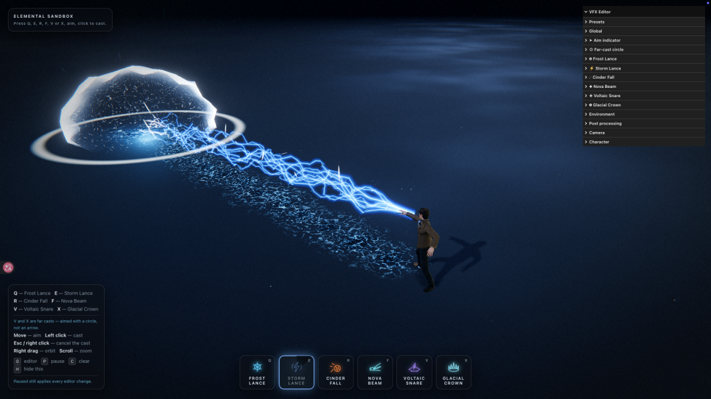

**R - 炽焰陨石**：一颗燃烧的巨石沿着抛物线坠落，留下弥漫的灼热气体尾迹。撞击时引爆碎片，地面撕裂成熔岩纹路，持续闪烁发光。

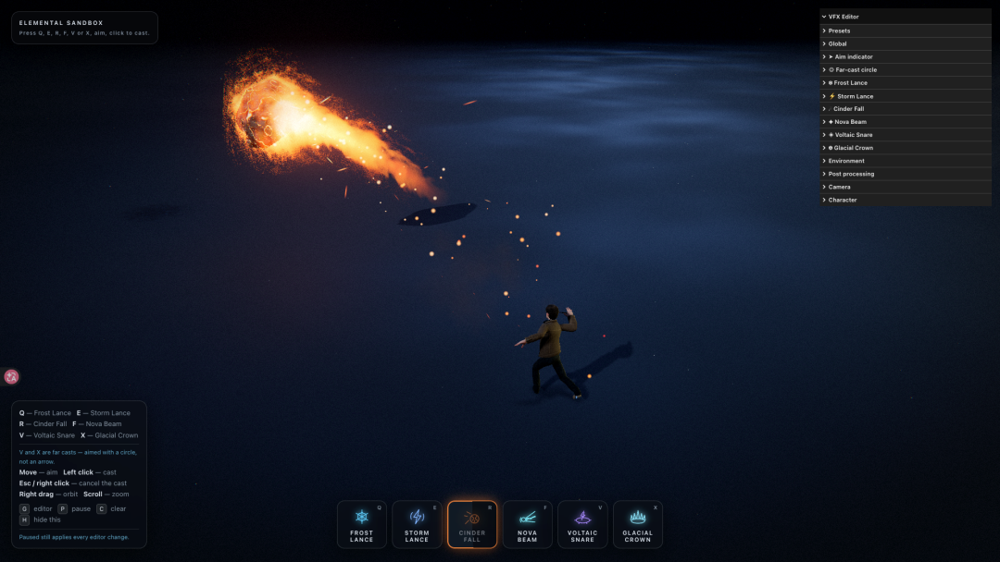

**F - 新星光束**：施法者在双手间聚集光球，吸收周围的光芒粒子。释放时射出一条耀眼的光柱——白热的核心、青色的护套、环绕的金色螺旋和沿着光束传播的冲击环。特别之处在于它会在着陆后持续燃烧长达一秒。

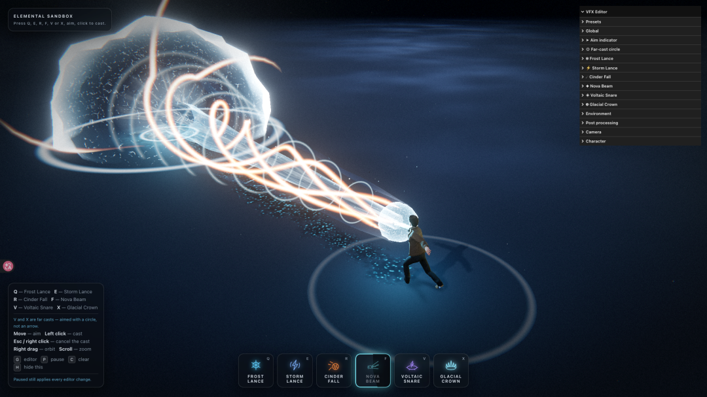

**V - 闪电陷阱**：这是唯一的"远程投射"技能。电流鞭子在地面上划出一道弧线，着陆处的圆环瞬间膨胀突破自身半径后收缩，紫色光柱从中心撕裂上升，游走的触须蔓延到边界，弧线绕着边缘燃烧。

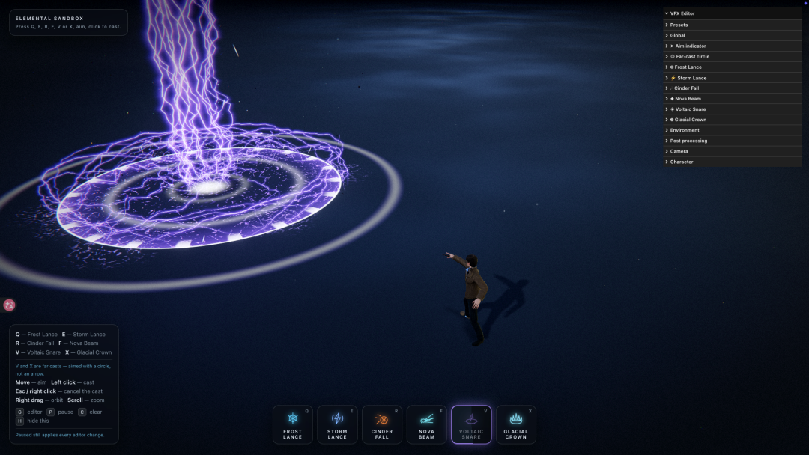

**V - 寒气侵袭**：寒气先沿地面冲向目标，随后冰面从中心铺开，一圈冰刃按波次从地下升起，形成中间留空的冰晶王冠。维持一段时间后，冰刃会从内向外破碎并沉回地面。这里的“留空”很关键：如果把圆心也塞满冰块，玩家看到的只会是一堆冰，而不是一道围住目标的冰墙。

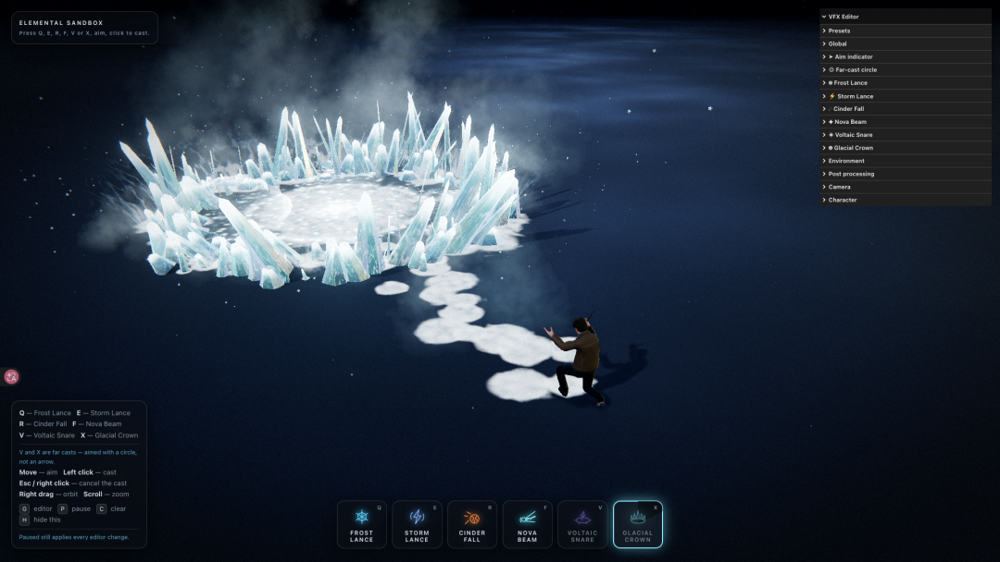

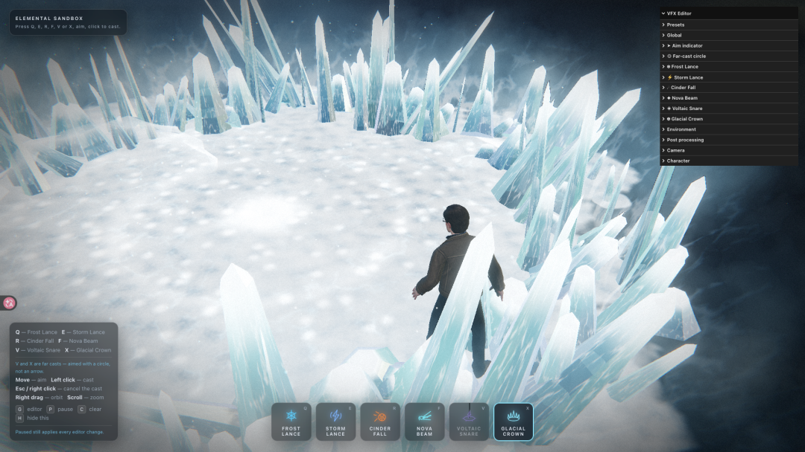

### 技术亮点

所有视觉效果都是实时生成的——没有纹理贴图，没有精灵表，只有被导入的角色模型。冰晶是程序化几何体，闪电是由顶点着色器完全放置的带状几何，陨石是由 CPU 裂纹平面分割的二十面体，光束是三层不同半径的参数管。

项目源码结构清晰。在 `src/abilities/` 中定义了能力基类。`src/materials/` 包含五个专用着色器材质类。`src/shaders/lib/` 提供了共享的 GLSL 噪声库。

### 参数系统

项目配备了 **938 个实时滑块**，最关键的是即使在暂停时这些参数仍然有效。你可以冻结一帧动画中的任何瞬间——无论是火山爆发、剑击撞击还是燃烧蔓延——然后重新塑造轮廓、调色板和时序，直到达到完美效果。

打开 `src/ui/Editor.js`，你会看到编辑界面的完整定义。每个能力都有专属的参数文件夹，从全局倍数到单个粒子的颜色梯度。预设系统保存到浏览器本地存储，可导出为 JSON 供团队共享。

### 性能设计

寒霜矛的冰晶字段由三个 `InstancedMesh` 共享一个材质，总计三个绘制调用，最多 288 个晶体。风暴矛的整个闪电只需两个绘制调用。闪电陷阱的网格、柱子、触须和边缘弧线都共用一条带状几何。这些设计让即使四个同时释放的技能也只需约 186 个绘制调用。

## 项目三：SamuraiThirdPersonTemplateThreeJS

**源码地址**：https://github.com/achrefelouafi/SamuraiThirdPersonTemplateThreeJS

### 项目概览

这是一个完整的第三人称动作游戏模板。一个绑定好的武士角色在无限的程序化夜间景观中，具备完整的移动系统、运动变形的近战攻击、召唤能力、飞行系统、布娃娃死亡、燃烧的武士刀和一个装备工作室。

### 世界系统

**地形**：采用表格驱动的程序化高度场。关键创新是使用 256×256 字节查找表而不是传统的 `snoise`，确保 GPU 和 JavaScript 中的计算完全一致，避免角色陷入地面的问题。

**天空与月亮**：单一全屏着色器渲染天空梯度和星场。月球是一个真实的三平面投影材质的球体，随光照方向自动调整位置。

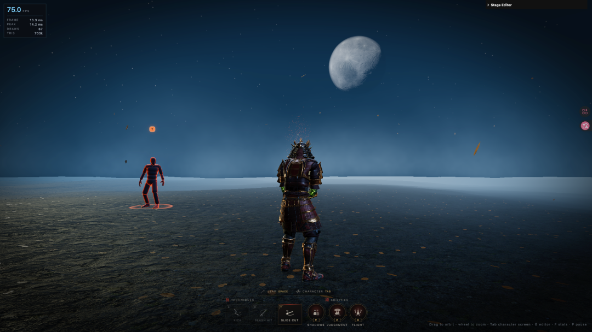

**大气**：分析高度雾积分，支持月光前向叶片。地面雾是软公告板，随风飘动，贴合地形。

**光照**：单个冷色主光源配有 4096² 阴影贴图，始终重新居中在角色上。联系阴影通过从下方捕获角色深度到 256² 目标实现。

### 角色系统

**动画系统**：角色和动作存在不同文件中。动画通过 `_retarget()` 函数绑定到骨架，自动处理：

- 单位转换：翻译轨道按绑定姿态暗示的比例重新缩放
- 根运动：冻结水平移动，保留垂直 bob，可选择记录位移供其他系统回放

**移动**：第三人称控制器集成输入到速度，身体朝向其去向而非相机。空闲、行走、奔跑始终播放，仅权重移动，完全避免帧间的混合抖动。

**跳跃**：从奔跑时提交的承诺移动。跳跃距离精确参数化为米数，较低速度下播放原地跳跃。

### 战斗系统

**目标锁定**：精确的屏幕空间瞄准系统。身体戴上光环因为按键会落在其上——不是因为它恰好站在某个锥体内。

**运动变形**：关键创新。攻击被编写为针对精确距离和角度的假想对手，但玩家永远不会站在那里。解决方案是在动画的方法中将角色运动到它需要的位置——先转身后踏入，因为这是人类真实做的顺序。到 `hitAt` 为止，身体完全在动画师假设的位置，攻击命中。

**接触反馈**：三个事情在同一帧发生——身体交接给布娃娃、世界减速到 `hitStopScale`、镜头摇晃。它们的强度来自命中的攻击——踢腿是短平推，斜切是长冻结。

### 布娃娃系统

没有物理引擎。布娃娃只是骨长不变的约束、不能反向弯曲的肢体、重力和地面碰撞。骨架变成每个关节的粒子，骨骼变成约束，每个子步长松弛几次。

关键设计：

- 质量：骨盆和胸部重，手脚轻。修正按比例分裂。
- 支撑：脊柱和胸部的额外约束保持身体形状。
- 限制：膝盖弯曲范围受限。

### 能力系统

三个主要能力都通过标记身体来瞄准：

**影子 (V)**：两个角色克隆，材质替换为黑色。从角色内部诞生在精确的姿态中，滑出标记，蹲下一拍，各自猎取一个敌人，用玩家的攻击攻击它们。

**审判 (C)**：六个节拍的华丽能力。印章在标记上逆时针写入，充能时收紧和变亮，拳头加速下落 (t²)，着陆时一切发生——身体被击倒、世界几乎停止、镜头踢起、地面撕裂。关键技巧：拳头的材质丢弃印章平面上方的每个片段，这样拳头永远是通过孔洞来的，在任何高度，在任何下降点。

**飞行 (X)**：这是唯一的模式而非移动。上升做三件事——身体离开地面、瞄准提升、所有地面东西收起。在空中，每次点击锻造一个刀片——角色的武士刀，穿着装备的材料和贴图。每个刀片锻造（扫过模型的阈值）、保持（在光晕中充能）、卷起（离开标记）、撞击（通过身体）、植入（在地面后面），在鸣鸣声后燃烧起来。

### 燃烧的武士刀

核心创新：通过 **体积** 而非骨骼瞄准。一个定向框在武器框架中，模型内的每个面都在发射。表面采样器将面展平成三角形池。

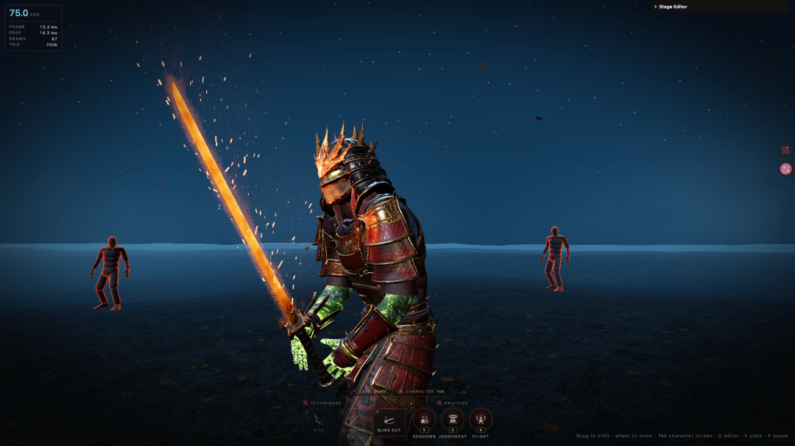

三个不同的系统从同一个池读取：

- 距离场：烤入"钢离这里有多远"，体积火焰材质 raymarches 黑体体积——这是刀在燃烧而非盒子周围的火。
- 余烬系统：按面积挑选三角形，投掷火花。
- 刀片热：使框内的钢白热，所以武器是光源而不是火焰中的深色道具。

所有三个通过相同的 `blackbody()` 辐射，温度在一个刻度上，所以冷却火花、羽流边缘和炽热脊柱在同温度时颜色相同。

### 装备工作室

按 `Tab` 将身体移出游戏场景到一个为观看和穿着设计的工作室。同一骨架、混频器和装备挂载在两个地方，所以这里调整的齿轮已经在世界上正确。

配置项在 `src/equipment/EquipmentCatalog.js` 中定义：

```
{
id: 'sword',
name: 'Katana',
category: 'weapons',
url: './models/weapons/sword.glb',
defaults: { bone: 'RightHand', position: [-0.051, 0.102, 0.052], rotation: [-168.3, 84, -0.8], scale: 1 }
}
```

添加剑是一个条目，不需要代码改动。装备材料由体库提供，零额外纹理内存。

## 学习价值

这三个项目都是学习高质量实时图形的绝佳教科书：

1. LinearAbiltyCastingThreeJS 教你如何用着色器做一切，参数系统如何设计。
2. AvatarCastingAbilitiesThreeJS 教你如何综合多种技术，样条和弧长参数化如何实现。
3. SamuraiThirdPersonTemplateThreeJS 教你如何构建完整的游戏系统，从角色动画到战斗反馈的一整套工程思想。

都提供了完整的编辑系统和预设导出。都详细注释了性能考虑。都展示了大规模参数化系统的设计模式。都证明了顶级游戏特效不是靠资源堆积，而是源于对着色器编程、几何构造、动画原理和系统架构的深刻理解。

如果你想看顶级独立开发者如何实现游戏特效与系统，这三个仓库会让你见识到相当的专业水准。它们不仅仅是展示作品，更是开放的教科书——源代码完全可读，每个决策都可以追溯。这正是开源的力量所在。
