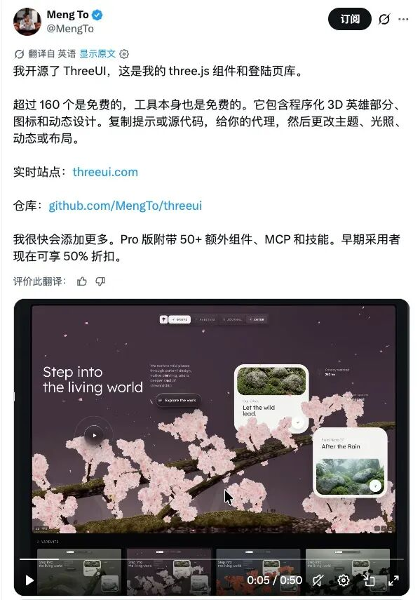
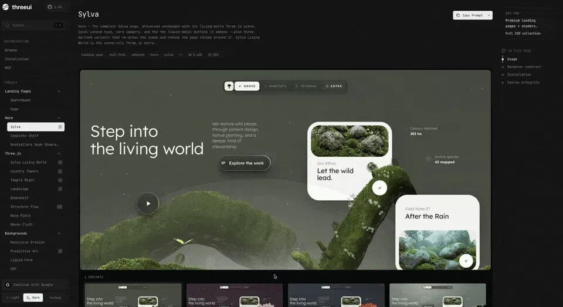
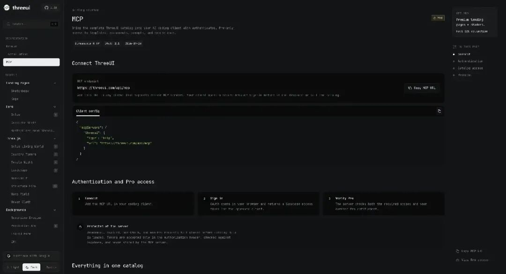

# ThreeUI 爆火！一个基于 Three.js 的160+ 3D 组件全开源！

> 作者: 认真努力的小四子 | 平台: 微信公众号 | 日期: 2026-08-25 08:33 | 原文: https://mp.weixin.qq.com/s/Gtmstp6HyXSqdK5h-3GcNQ

> **摘要**: Three.js 门槛被打穿了！

前段时间，一个叫 `Canvas UI` 的项目突然火了。

它把 `WebGL Shader` 带进真实 DOM，让普通网页也能做出非常夸张的视觉效果。

当时我就觉得，前端组件库已经开始卷到 `WebGL` 这一层了。

结果没过多久，又一个项目冲了出来。

这次更直接：

**Three.js，也被做成组件库了。**

它就是 **Meng To** 刚刚开源的 —— **ThreeUI**。

项目上线后很快突破 **1000+ GitHub Star**，目前 **Community** 版本已经开放 **164 个可浏览效果**，覆盖完整`页面`、`3D 场景`、`Shader`、`动态背景`、`按钮`、`文字动画`等大量场景。

## ThreeUI 到底是什么？

**ThreeUI 就是一套专门给 Three.js / WebGL 做的视觉组件库。**

它已经按照正常 **UI** 组件库的方式，把各种效果整理成完整目录。

官方目前划分了 **10 个分类**：

**Landing Pages、Hero、Three.js、Motion Design、Sections、Backgrounds、Buttons、Text Animation、UI Elements、CSS。**

使用方式也很熟悉：

**找到效果 → 在线预览 → 调参数 → 查看源码 → 拿到项目里改。**

有点像 `shadcn/ui`，只不过这次组件从普通 UI，升级成了 `Three.js + WebGL`。

## ThreeUI 六大核心组件类型

目前 **ThreeUI** 的内容非常多，这里挑几个比较有代表性的类型来看。

#### 1. Landing Page / Hero

ThreeUI 里最吸睛的，就是完整页面和 Hero。

比如：

`Kage`、`Complete Shelf`、`Bestsellers Book Showcase`

这些已经包含完整布局、滚动、交互甚至 Three.js 场景。

其中 `Kage` 是一套日式寺庙主题的完整交互页面，包含夜景、灯笼、樱花和 3D 场景，还保留了鼠标、键盘、滚动和导航交互。

以前看到这种网站，第一反应可能是：

**这得写多久？**

现在可以直接从一个完整效果开始改。

#### 2. Three.js 3D 场景

这部分就是 **ThreeUI** 的核心。

目前能看到：

`Temple Night`、`Japanese Tower`、`Bookshelf`、`Globe`、`Orbital Sphere`、`Landscape`

等大量 3D 场景。

Camera、Light、Material、Animation 这些基础工作，很多已经封装好了。

如果你正在做：

**AI 官网、SaaS、作品集、Web3、开发者工具**

这类产品，很多 Hero 区域都可以直接从这里找灵感。

#### 3. Shader / 动态背景

如果你喜欢现在 AI 产品官网那种炫酷背景，这一类基本够玩了。

比如：

`Liquid Form`、`Dot Matrix`、`Warp Field`、`Nebula Background`、`Particle Network`、`Flux Vortex`

流体、粒子、星云、点阵、空间扭曲，全都有。

很多效果直接放到首屏背景，就能明显提升页面质感。

#### 4. Buttons

连按钮都开始卷 Shader 了。

ThreeUI 提供了：

`Liquid Metal Button`、`Plasma Button`、`Thinking Button`、`Glassmorphism CTA`、`Gradient Beam CTA`

等等。

已经远远超过传统 CSS Hover 的感觉。

流体、金属、玻璃、光效、渐变、粒子，全塞进一个按钮里。

#### 5. Text Animation

文字动画也很丰富。

比如：

`Typography Vortex`、`Morphing Glyph Cloud`、`Particle Wordmark`、`Neon Typography`

文字可以粒子化、变形、沿路径运动，特别适合做：

**产品 Logo、Hero 标题、品牌展示。**

以前这种效果大概率要自己折腾 `GSAP + Canvas + Shader`，现在可以直接拿现成实现。

#### 6. UI Elements

另外还有很多更适合直接塞进业务页面的小组件：

`Genie Dock`

`Animated Top Dock`

`Gallery`

`Uplink Loader`

`Performance Gauges`

`Skeuomorphic Toggle`

`Dock、Loading、Gallery、Toggle、仪表盘`这些常见 UI，也开始加入 Three.js 和 Motion 效果。

整体看下来，**ThreeUI** 已经覆盖：

**完整页面、3D 场景、背景、按钮、文字、UI 元素**

这一整套视觉开发场景。

## Community 版本就有 164 个效果

官方 README 给出的数据非常直接。

目前开源 Community 版本包含：

- 50 个 Community 父组件
- 111 个 Community Routes
- 141 个免费 Variant
- 23 个独立组件
- 最终形成 164 个可浏览效果

而且 Community 组件的**实现源码和相关资源都一起开放**。

这点很重要。

**ThreeUI** 并没有把效果封成一个黑盒 **npm** 包，让你只能调用几个 API。

## 更有意思的是：它开始直接给 AI 用了

ThreeUI 这次还有一个很明显的方向：

**AI Coding。**

官方除了支持直接看源码，还提供了和 Prompt 相关的能力。

你可以找到一个喜欢的效果，然后把源码或者 Prompt 直接丢给：

`Codex`

`Claude Code`

`Cursor`

这类 AI Agent。

比如告诉它：

**“整体改成深蓝色科技风。”**

**“减少粒子数量。”**

**“把灯光调柔和一点。”**

**“动画速度降低 30%。”**

AI 直接基于现有 Three.js 代码继续修改。

以前很多人最大的问题是：

**看得懂效果，但改不动。**

**Three.js** 里面随便涉及几个 `Camera`、`Material`、`Shader` 参数，就很容易劝退。

现在流程变得简单很多：

**先找一个接近目标的效果 → 再让 AI 改。**

这个变化很实际。

## 连 MCP 都已经准备好了

**ThreeUI** 甚至已经提供了自己的 `MCP`。

它可以让支持 MCP 的 AI Coding Client 直接访问 ThreeUI Catalog。

官方已经提供了几个能力：

`search_catalog`搜索组件和模板。

`get_catalog_item`获取组件信息、资源和使用方式。

`get_item_source`直接读取完整源码。

`get_item_prompt`获取组件对应的实现 Prompt。

这意味着以后甚至可以直接告诉 AI：

**“给我找一个适合 AI 产品首页的粒子背景。”**

**Agent** 自己搜索 **ThreeUI**，找到合适的组件，再读取源码继续修改。

整个过程会变成：

**需求 → AI Agent → ThreeUI → 组件源码 → 页面**

目前 **MCP** 属于 **Pro** 能力，不过这个方向已经非常清晰了。

## 写在最后

前段时间 `Canvas UI` 火的时候，WebGL 已经开始进入普通 UI 开发。

现在 **ThreeUI** 又往前推了一步。

从`按钮`、`文字`、`背景`，到完整 `3D 场景`和 `Landing Page`，越来越多以前需要手搓的视觉效果，正在变成可以直接拿来用的组件。

再加上 **AI Agent**：

**找效果 → 拿源码 → 描述需求 → AI 修改**

**Three.js** 的门槛确实正在快速下降。

以后想做一个看起来很贵的 3D 官网，可能真没以前那么难了。

- ThreeUI 官网：https://threeui.com
- GitHub 地址：https://github.com/MengTo/threeui
