# 用AI给儿子运动上强度，手搓游泳体感游戏

> 作者: 像素老爸 | 日期: 2026/08/27 | 原文: https://www.xiaohongshu.com/discovery/item/6a8fd4ce000000002a03d395?app_platform=android&ignoreEngage=true&app_version=9.43.1&share_from_user_hidden=true&xsec_source=app_share&type=video&xsec_token=CBmZv8YOnNdg2taBMlQMgCp2fEkSoSxgI8A9knpkOTckI%3D&author_share=1&xhsshare=CopyLink&shareRedId=N0dINjg3NUpMPko6S0EySDs0P0lFSjdL&apptime=1787919034&share_id=65b5182a561c459f94a315b6ffa04750&share_channel=copy_link

> **摘要**:作者利用AI技术为儿子打造了一款游泳体感互动游戏,通过游戏化方式提升孩子运动训练的强度和趣味性。游戏界面实时显示泳道编号、比赛用时、挑战者距离(26/100米)、实时心率(158次/分)、实时速度(2.5)及划水次数(128次)和划水频率(14次/分)等运动数据。整体体现了AI技术与亲子运动场景的巧

#howto玩坏AI #AI教育 #亲子教育 #AI搞学习howto #手搓万物 #手搓游戏 #我在小红书做游戏 #AI进化生活howto #redparents #AI体感游戏 #亲子运动 #游泳训练

## 视频

[视频 1](./video.mp4)

<video controls width="100%"><source src="./video.mp4" type="video/mp4">您的浏览器不支持视频播放。</video>

附件: [音频](./audio/audio.wav) | [处理清单](./video_manifest.json)

## 视频图文总结

> 按关键帧关联完整视频转录；文字保留机器转写原文，时间点仅用于定位。

### 1. 00:00

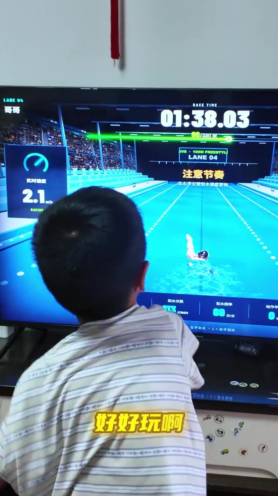

- 画面文字（OCR）：哥哥
01:38.03
RACE TINE
00米
·100MFREESTYL
LANE04
实时速度
注意节奏
2.1
左右手交替划水速度更快
RACINR
划水次数
划水频率
STIOKES
次/分
左手划水·L=右手划水
薪彩
到
好好玩啊

### 2. 00:01

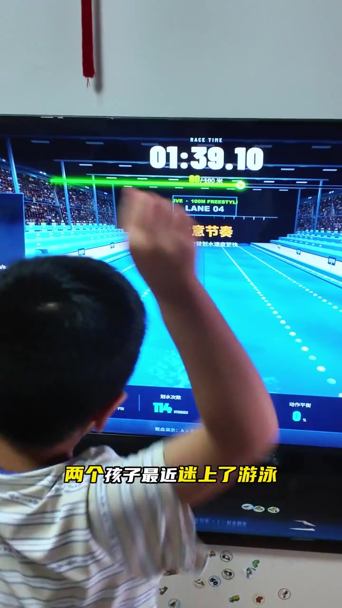

- 内容摘要：有啊有啊，两个孩子最近迷上了游泳（00:00-00:02）
- 画面文字（OCR）：01:39.10
RACE TINE
A00米
IVE
·100M FREESTYI
LANE 04
意节奏
替划水速度更快
划水次数
K
动作平衡
盘演示：A=
两个孩子最近迷上了游泳

### 3. 00:02

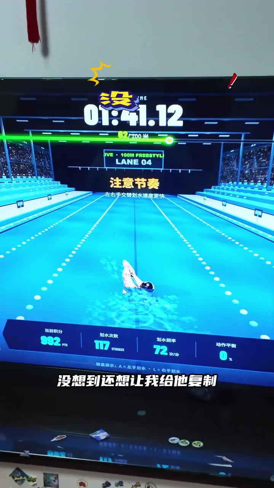

- 画面文字（OCR）：常
ME
01:41.12
100米
IVE
·100M FREESTYL
LANE 04
注意节奏
左右手交替划水速度更快
当前积分
划水次数
划水频率
动作平衡
992
72
STROKES
次/分
键盘演示：A=左手划水·L=右手划水
没想到还想让我给他复制

### 4. 00:03

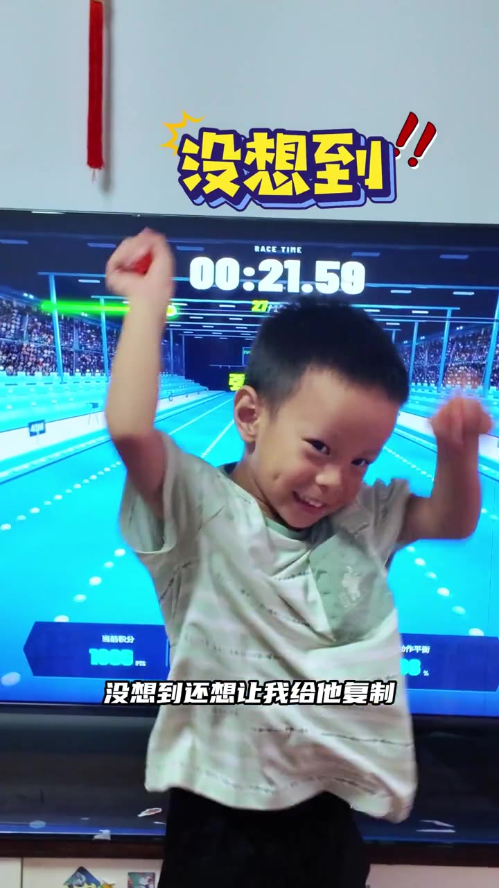

- 画面文字（OCR）：没想到
RACE TINE
00:21.59
韵积分
作平街
没想到还想让我给他复制

### 5. 00:04

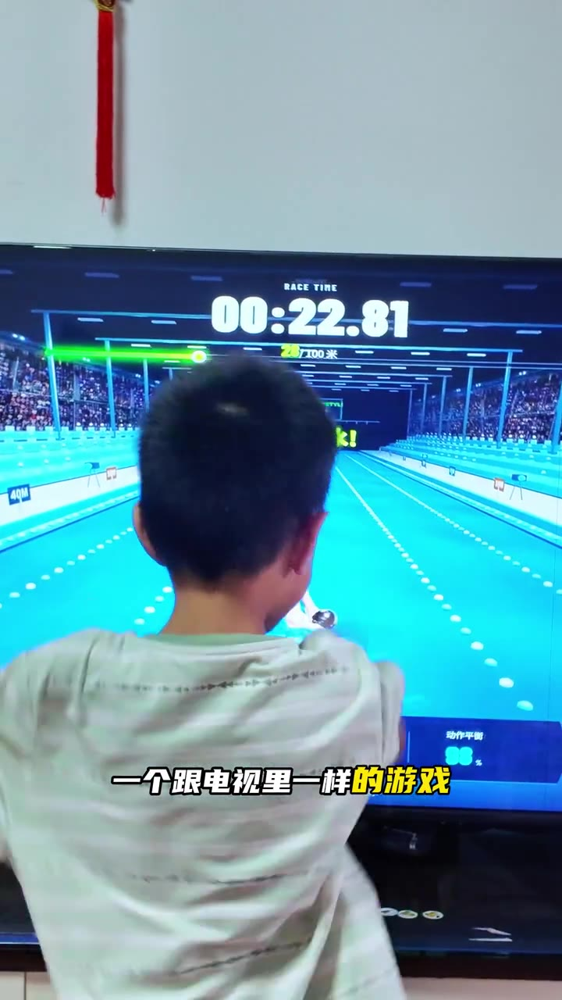

- 画面文字（OCR）：一个跟电视里一样的游戏
动作平衡
米00
00:22.81
TEEEEEAE

### 6. 00:05

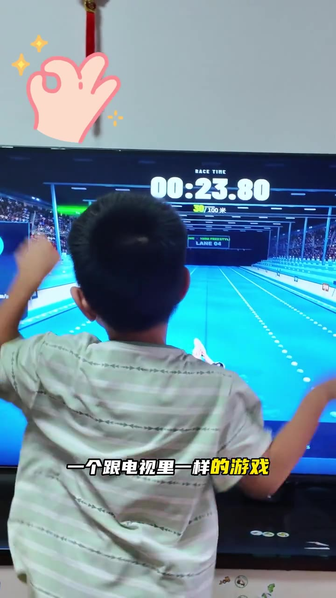

- 内容摘要：没想到还想让我给他布置一个跟电视里一样的游戏，当然没有问题喽，爸爸可是超人（00:02-00:08）
- 画面文字（OCR）：RACE TINE
00:23.80
30/100米
LANE04
FREEST
一个跟电视里一样的游戏

### 7. 00:06

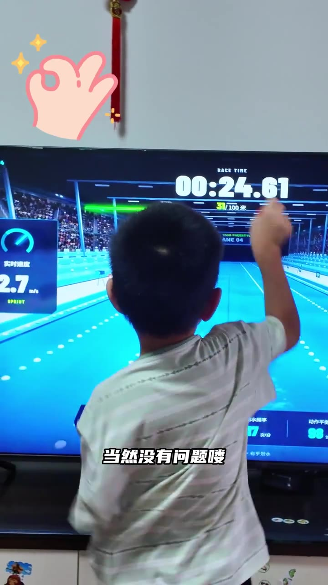

- 画面文字（OCR）：发
金写
当然没有问题喽
4602
SOEEG
001/0
00:24.61
CEEEEAE

### 8. 00:09

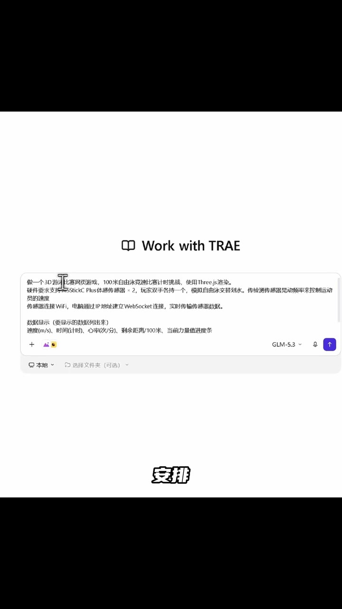

- 内容摘要：安排打开a i工具（00:09-00:10）
- 画面文字（OCR）：WorkwithTRAE
做一个3D游比赛网页游戏，100米自由泳竞速比赛计时挑战，使用Three.js渲染。
硬件要求支持StickCPlus体感传感器×2，玩家双手各持一个，模拟自由泳交替划水。传检测传感器晃动频率来控制运动
员的速度
传感器连接WiFi，电脑通过IP地址建立WebSocket连接，实时传输传感器数据。
数据显示 (要显示的数据列出来)
速度(m/s）、时间(计时)、心率(次/分)、剩余距离/100米、当前力量值进度条
GLM-5.3
0
↑
+
本地选择文件夹(可选)
安排

### 9. 00:10

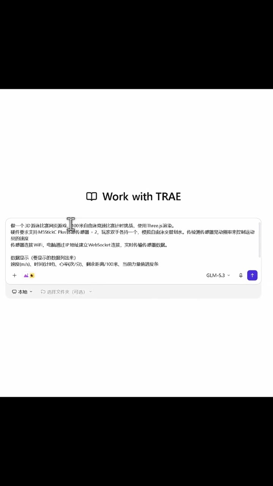

- 内容摘要：做游戏的第一步就是写提示词，我是做过游泳游戏，是一百米竞速比赛（00:10-00:15）
- 画面文字（OCR）：WorkwithTRAE
T
做一个3D游泳比塞网页游戏，100米自由泳竞速比赛计时挑战，使用Thee.js渲染。
硬件要求支持M5StickCPlus体感传感器×2，玩家双手各持一个，模拟自由泳交替划水。传检测传感器晃动频率来控制运动
员的速度
传感器连接WiFi，电脑通过IP地址建立WebSocket连接，实时传输传感器数据。
数据显示（要显示的数据列出来）
速度（m/s）、时间（计时)、心率(次/分）、剩余距离/100米、当前力量值进度条
GLM-5.3
0
↑
+△
本地选择文件夹(可选)

### 10. 00:15

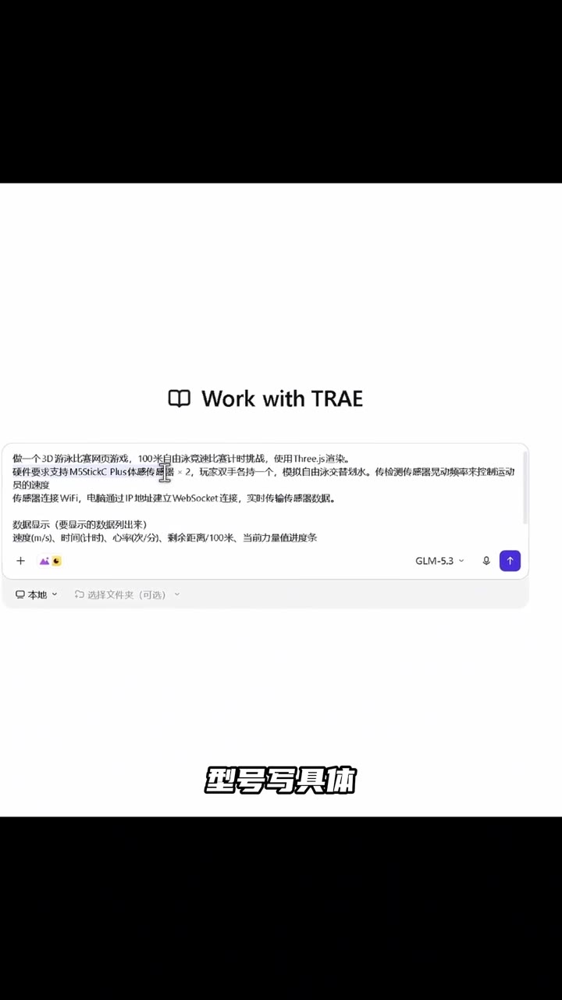

- 内容摘要：型号写具体ai才会按照这个传感器进行设计（00:15-00:18）
- 画面文字（OCR）：WorkwithTRAE
做一个3D游泳比赛网页游戏，100米自由泳竞速比赛计时挑战，使用Threejs渲染。
硬件要求支持M5StickCPlus体感传感器×2，玩家双手各持一个，模拟自由泳交替划水。传检测传感器见动频率来控制运动
员的速度
传感器连接WiFi，电脑通过IP地址建立WebSocket连接，实时传输传感器数据。
数据显示（要显示的数据列出来）
速度（m/s)、时间(计时)、心率（次/分）、剩余距离/100米、当前力量值进度条
+
G
GLM-5.3
0
↑
本地选择文件夹（可选）
型号写具体

### 11. 00:21

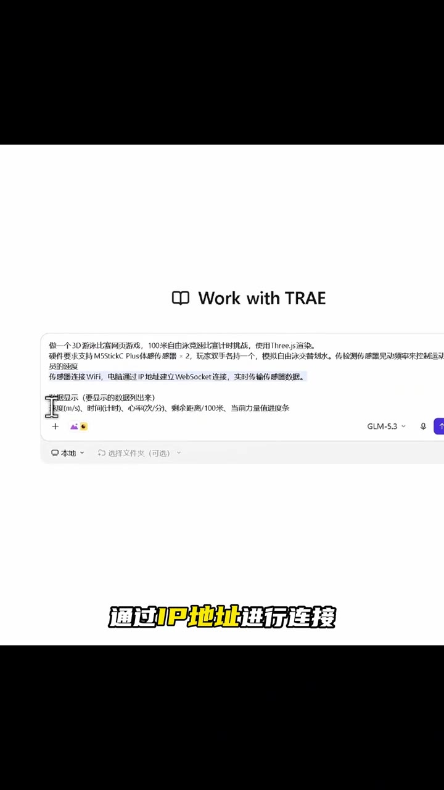

- 内容摘要：但连接方式要写明白，通过ip地址进行连接（00:18-00:21）
- 内容摘要：要显示的数据必须要列出来（00:21-00:23）
- 画面文字（OCR）：中WorkwithTRAE
做一个3D游泳比赛网页游戏，100米自由泳竞速比赛计时挑战，使用Three.js渲染。
硬件要求支持M5StickCPlus体感传感器×2，玩家双手各持一个，模拟自由泳交替划水。传检测传感器晃动频率来控制
员的速度
传感器连接WiFi，电脑通过IP地址建立WebSocket连接，实时传输传感器数据。
据显示（要显示的数据列出来）
厦（m/s）、时间（计时）、心率(次/分)、剩余距离/100米、当前力量值进度条
+
GLM-5.3
0
本地选择文件夹(可选
通过IP地址进行连接

### 12. 00:24

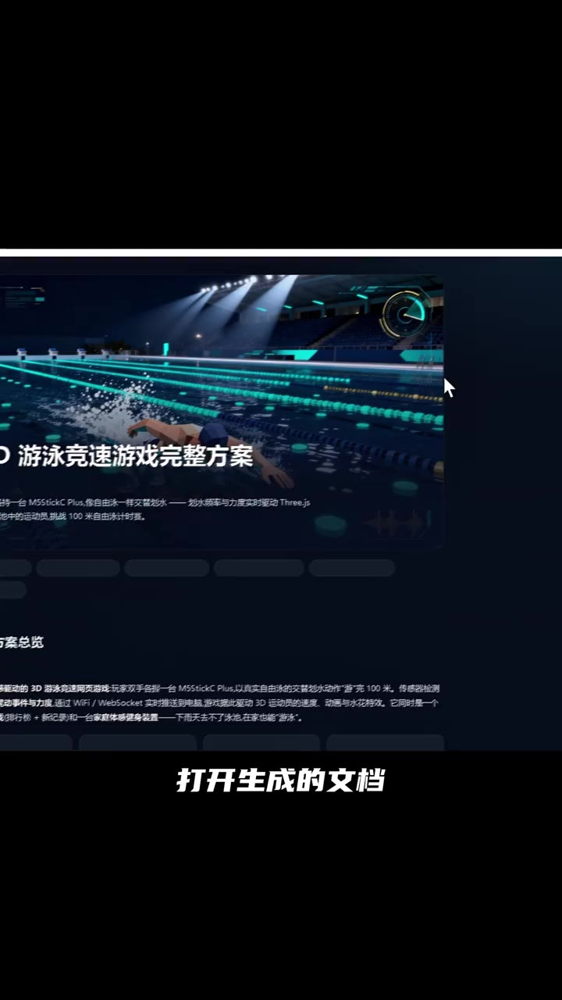

- 画面文字（OCR）：游泳竞速游戏完整方案
动员挑战100米自由泳计时费。
览
下雨天去不了泳池，在家也能游泳。
+新纪录和一台家庭体感健身装置
打开生成的文档

### 13. 00:26

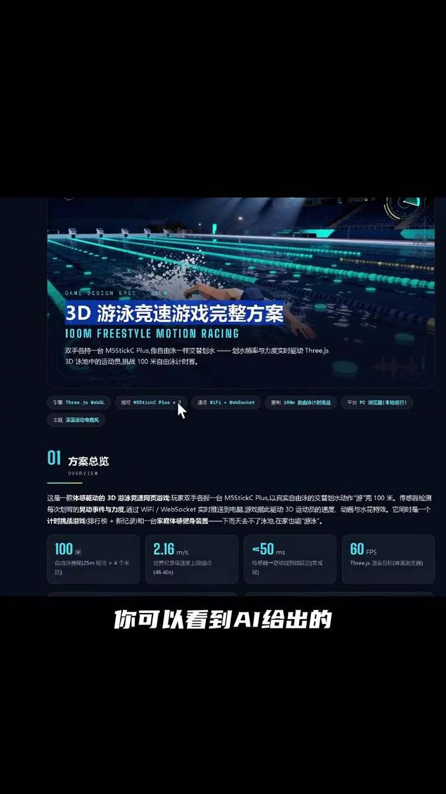

- 内容摘要：打开生成的文档，你可以看到a，I给出的方案非常的完整（00:23-00:27）
- 画面文字（OCR）：GANE DESIGN
SPEC
3D游泳竞速游戏完整方案
IOOMFREESTYLEMOTION RACING
双手各持台M5StickCPlus，像自由泳一样交普划水——划水频率与力度实时驱动Three.js
3D泳池中的运动员，挑战100米自由泳计时赛。
引擎Three.s WebGL
操控K5StsckC Plusx
通信WiF1+WebSocket
赛制100m自由泳计时挑战
平台PC测范（本地道行）
主题
深蓝退动电竞风
01
方案总览
OVERVIEW
这是一款体感驱动的3D游泳竞速网页游戏：玩家双手各握一台M5StickCPlus，以真实自由泳的交替划水动作游完100米，传感器检测
每次划臂的晃动事件与力度，通过WiFi/WebSocket实时推送到电脑，游戏据此驱动3D运动员的速度、动画与水花特效，它同时是一个
计时挑战游戏（排行榜+新纪录）和一台家庭体感健身装置
一下雨天去不了泳池，在家也能游泳。
100
2.16
-50
60
米
m/s
ms
FPS
自由永赛程（25m短池x4个来
世界纪级速上限点
传一游观到延迟（网城
Three.js染目标（面浏）
回
(46.40s)
网
你可以看到AI给出的

### 14. 00:29

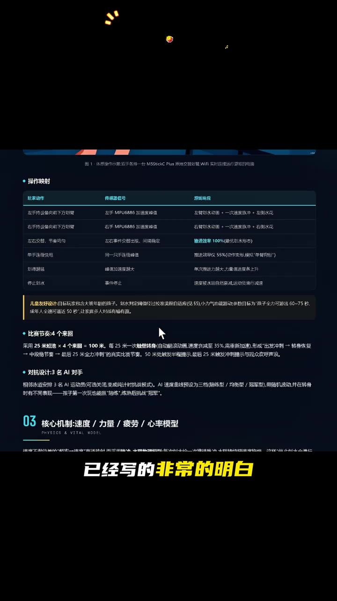

- 内容摘要：所有该有的东西都已经写得非常的明白，方案有了再让ai生成喜欢的界面（00:27-00:32）
- 画面文字（OCR）：图1·体感操作示意：双手各持一台M5StickCPlus原地交替划管，WiFi实时连接运行游戏的电脑
操作映射
玩家动作
传感器信号
游戏响应
左手持设备向前下方划背
左手MPU6886加速度峰值
左臂划水动面+一次速度脉冲+左测水花
右手持设备向前下方划臂
右手MPU6886加速度峰值
右臂划水动面+一次速度脉冲+右侧水花
左右交替、节奏均匀
左右事件交替出现、间隔稳定
推进效率100%（最优划水形态）
单手连续快甩
同一只手连续峰值
推进效率仅55%（动作变形，模拟单臂狗创）
划得越话
峰值加速度越大
单次推进力越大，力量值进度条上升
停止划水
事件停止
速度被水阻自然衰减运动员滑行减速
儿童友好设计：目标玩家包含大班年龄的孩子。划水判定阔值经过校准流程自适应（见5）小力气也能游动参数目标为孩子全力可游出60~75秒
成年人全速可逼近50秒让家庭多人对战有输有赢。
比赛节奏：4个来回
采用25米短池×4个来回=100米。每25米一次触壁转身（自动酮滚动画，速度衰减至35%，需重新加速），形成出发冲刺→转身恢复
中段稳节套→最后25米全力冲刺的真实比赛节奏。50米处触发半程提示，最后25米触发冲刺提示与观众欢呼声浪。
对抗设计：3名AI对手
相邻泳道安排3名AI运动员（可选关闭变成纯计时挑战模式）。AI速度曲线预设为三档（陪练型/均衡型/冠军型），带随机波动，并在转身
时有不同表现——孩子第一次玩也能赢“陪练，练熟后挑战“冠军
03
核心机制：速度/力量/疲劳/心率模型
PHYSICS & VITAL MODEL
已经写的非常的明白

### 15. 00:30

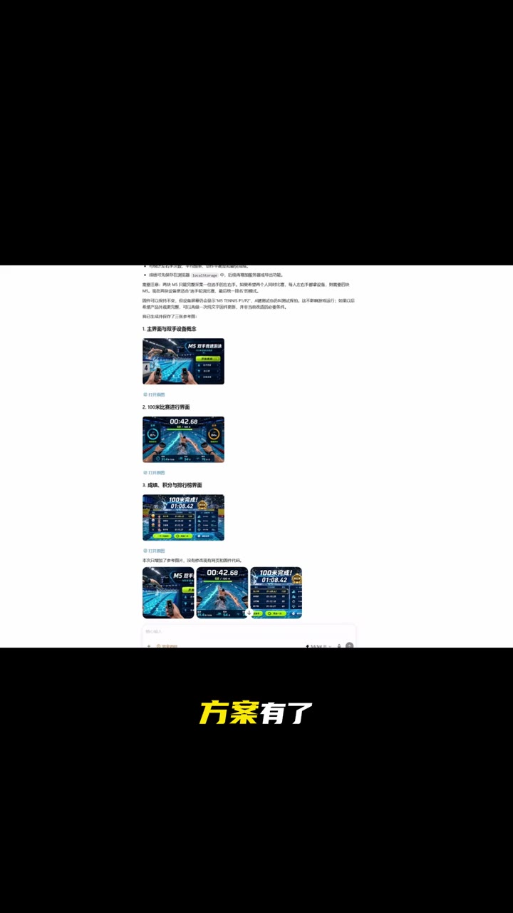

- 画面文字（OCR）：可中，续导
要注章：两5只案一位选手的左右手，如希两个人间比，每人左右手都拿，到需要回
，在两要“比，最一的式
可，A不
产品外定型，可以高一次用文字国新，开改的要条件。
8已生07三参：
1.主界面与双手设备概念
M5双手费
©打R
2.100米比赛进行面
00:42.68
3.成，积分与排行棉界面
100米完成
本次只理加7专片，有改现有网和国件代
00:42.68
100米完成！
M5双手
01:08.42
方案有了

### 16. 00:31

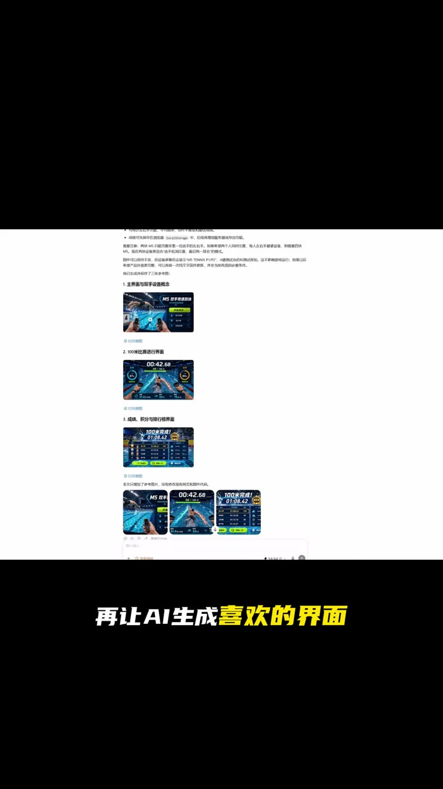

- 画面文字（OCR）：可中，续能
M，面在两要“子比，最统一绿模式
产，可以一次文中国要，开改的要。
8日207三0参
1.主界面与双手设备概念
MS双手费速油
2.100米比赛进行面
00:42.68
巴IRI
3.成，积分与排行棉界面
100米完
1
次只7，有有网要
00:42.68
100米完成！
M5
01:08.42
再让AI生成喜欢的界面

### 17. 00:33

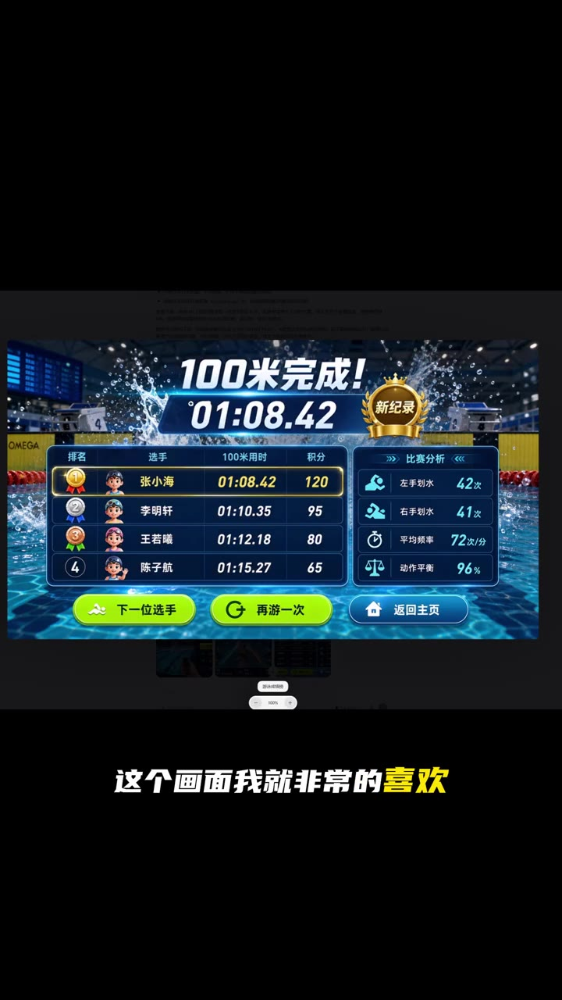

- 内容摘要：这个画面我就非常的喜欢（00:32-00:34）

### 18. 00:35

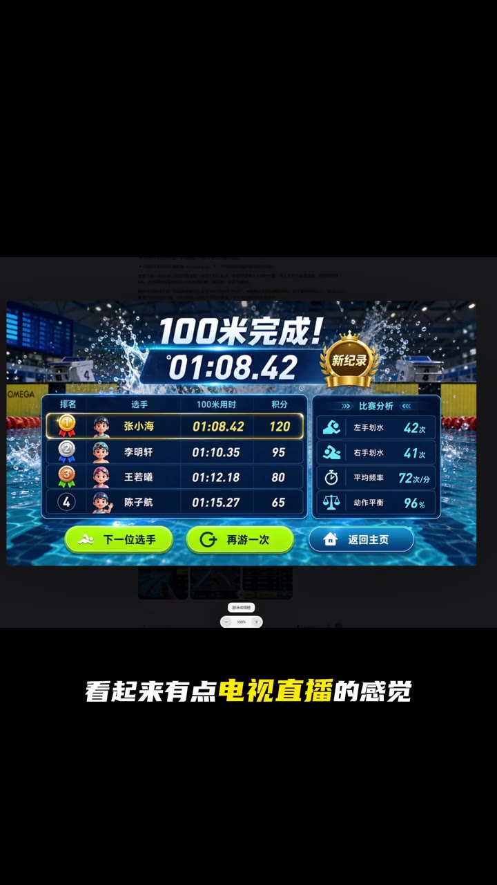

- 该时间点暂无可提取文字。

### 19. 00:36

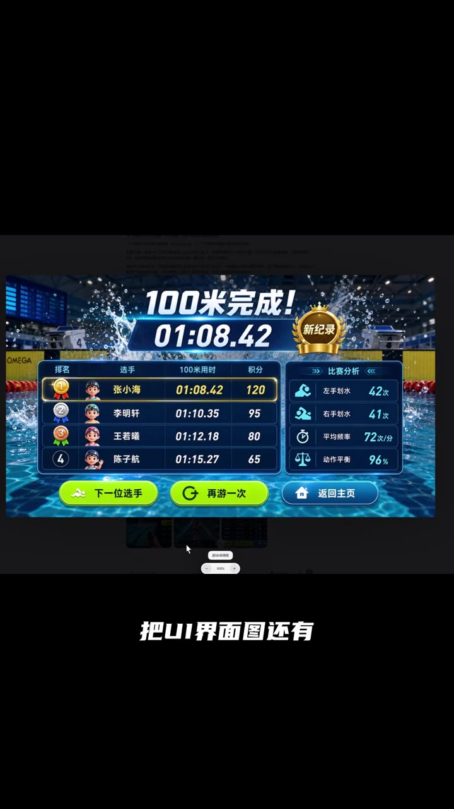

- 该时间点暂无可提取文字。

### 20. 00:38

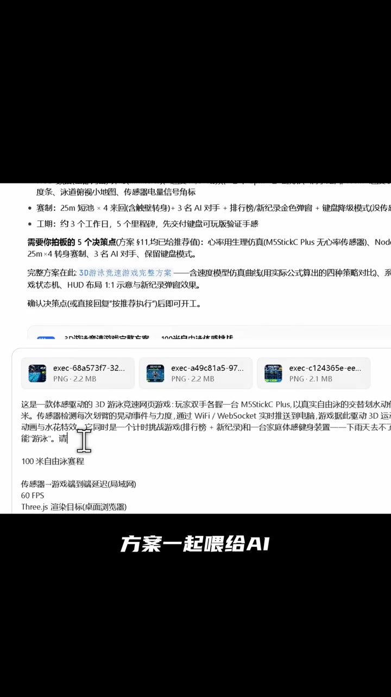

- 内容摘要：看起来有点电视直播的感觉，把ui界面图还有方案一起喂给ai，别忘了加上这句话（00:34-00:40）

### 21. 00:39

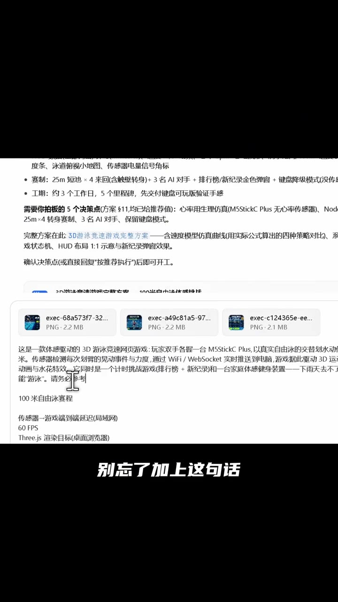

- 该时间点暂无可提取文字。

### 22. 00:40

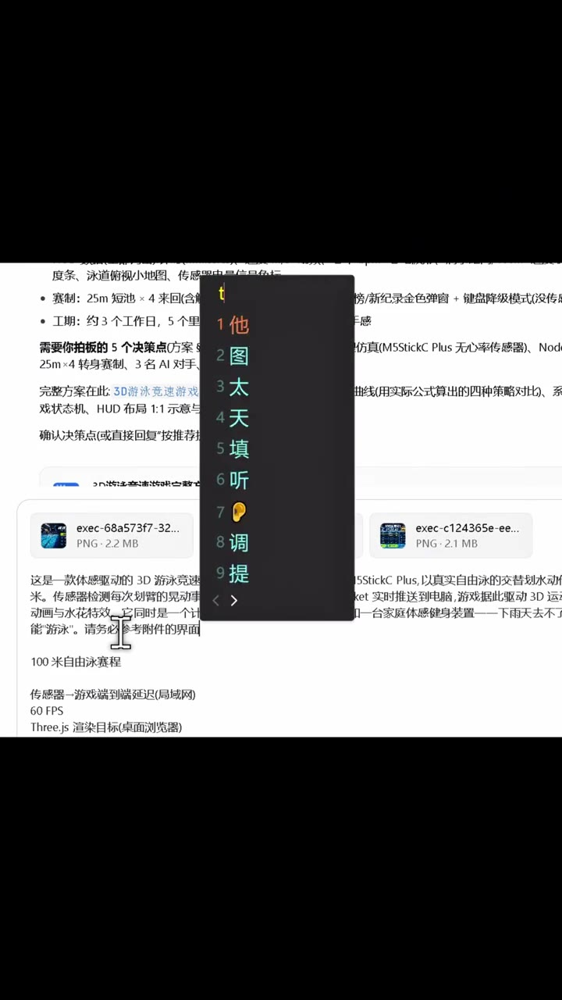

- 该时间点暂无可提取文字。

### 23. 00:41

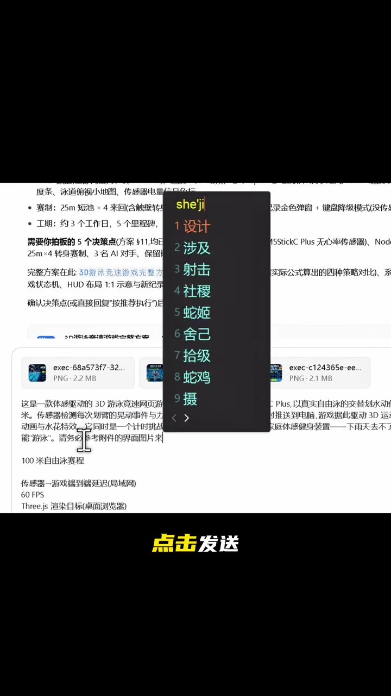

- 内容摘要：点击发送等待结果，唉，我们是不是忘了一件事情，对了还要让ai生成硬件固件（00:40-00:46）

### 24. 00:46

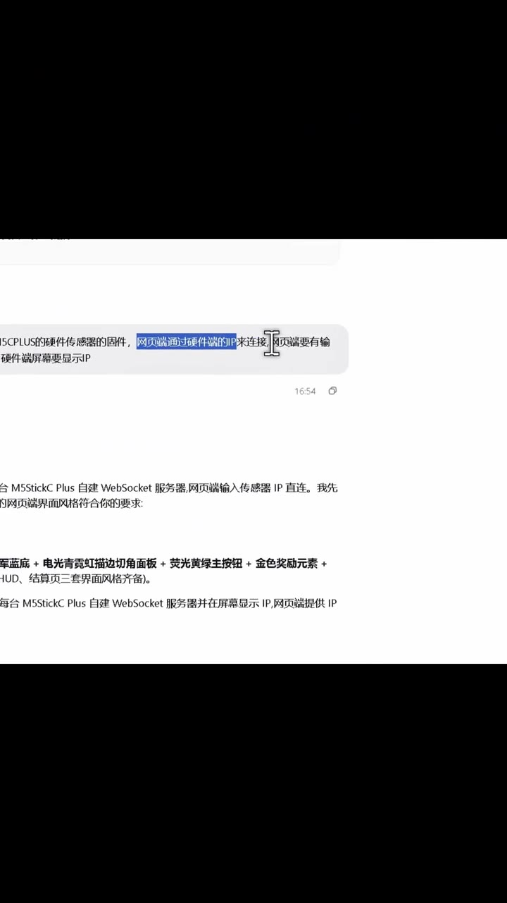

- 内容摘要：烧到这两个小方块里面（00:46-00:48）

### 25. 00:52

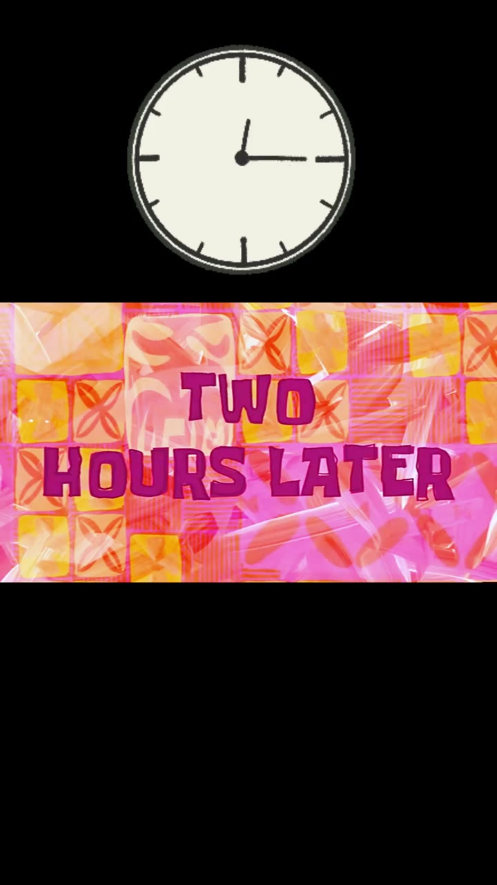

- 内容摘要：现在他们就是滑水控制器了（00:48-00:50）
- 内容摘要：Two hours later打开游戏，这个画面还原的挺好（00:50-00:55）

### 26. 00:57

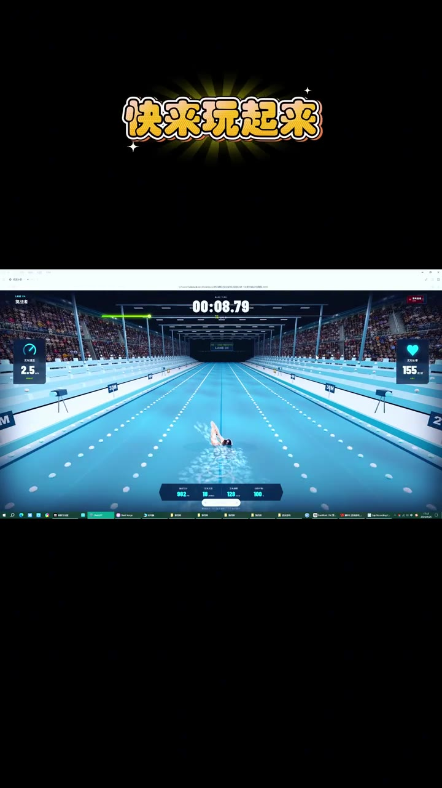

- 内容摘要：这场地动画数据看起来一切正常，赶快叫上我那两个小孩子吧（00:55-01:00）

### 27. 01:02

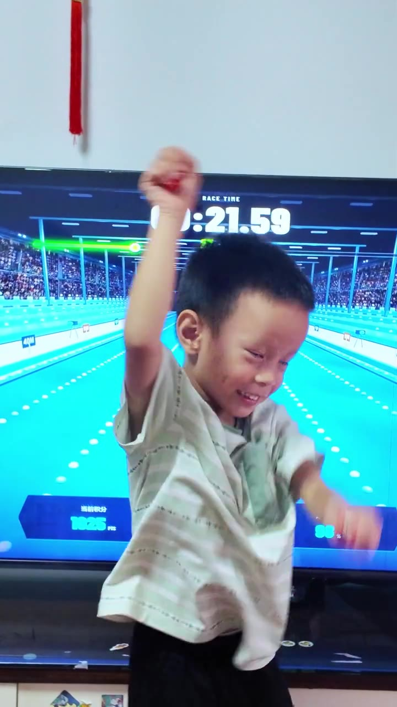

- 该时间点暂无可提取文字。

### 28. 01:07

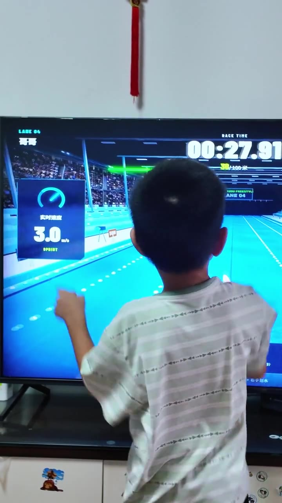

- 该时间点暂无可提取文字。

### 29. 01:12

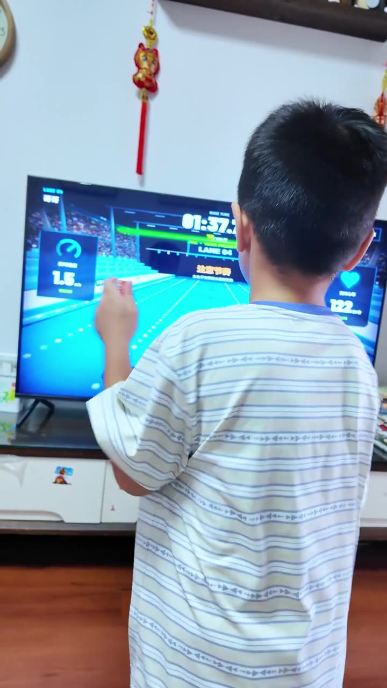

- 该时间点暂无可提取文字。

### 30. 01:17

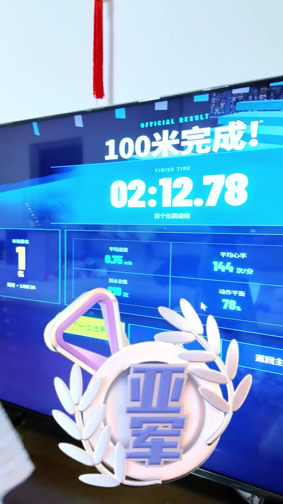

- 该时间点暂无可提取文字。

## 视频画面文字 (OCR)

> OCR 仅供参考，可能包含识别错误；请以视频画面和转写来源为准。

### 关键帧 1 · 0.5s

哥哥
01:38.03
RACE TINE
00米
·100MFREESTYL
LANE04
实时速度
注意节奏
2.1
左右手交替划水速度更快
RACINR
划水次数
划水频率
STIOKES
次/分
左手划水·L=右手划水
薪彩
到
好好玩啊

### 关键帧 2 · 1.33s

01:39.10
RACE TINE
A00米
IVE
·100M FREESTYI
LANE 04
意节奏
替划水速度更快
划水次数
K
动作平衡
盘演示：A=
两个孩子最近迷上了游泳

### 关键帧 3 · 2.8s

常
ME
01:41.12
100米
IVE
·100M FREESTYL
LANE 04
注意节奏
左右手交替划水速度更快
当前积分
划水次数
划水频率
动作平衡
992
72
STROKES
次/分
键盘演示：A=左手划水·L=右手划水
没想到还想让我给他复制

### 关键帧 4 · 3.8s

没想到
RACE TINE
00:21.59
韵积分
作平街
没想到还想让我给他复制

### 关键帧 5 · 4.83s

一个跟电视里一样的游戏
动作平衡
米00
00:22.81
TEEEEEAE

### 关键帧 6 · 5.66s

RACE TINE
00:23.80
30/100米
LANE04
FREEST
一个跟电视里一样的游戏

### 关键帧 7 · 6.5s

发
金写
当然没有问题喽
4602
SOEEG
001/0
00:24.61
CEEEEAE

### 关键帧 8 · 9.63s

WorkwithTRAE
做一个3D游比赛网页游戏，100米自由泳竞速比赛计时挑战，使用Three.js渲染。
硬件要求支持StickCPlus体感传感器×2，玩家双手各持一个，模拟自由泳交替划水。传检测传感器晃动频率来控制运动
员的速度
传感器连接WiFi，电脑通过IP地址建立WebSocket连接，实时传输传感器数据。
数据显示 (要显示的数据列出来)
速度(m/s）、时间(计时)、心率(次/分)、剩余距离/100米、当前力量值进度条
GLM-5.3
0
↑
+
本地选择文件夹(可选)
安排

### 关键帧 9 · 10.83s

WorkwithTRAE
T
做一个3D游泳比塞网页游戏，100米自由泳竞速比赛计时挑战，使用Thee.js渲染。
硬件要求支持M5StickCPlus体感传感器×2，玩家双手各持一个，模拟自由泳交替划水。传检测传感器晃动频率来控制运动
员的速度
传感器连接WiFi，电脑通过IP地址建立WebSocket连接，实时传输传感器数据。
数据显示（要显示的数据列出来）
速度（m/s）、时间（计时)、心率(次/分）、剩余距离/100米、当前力量值进度条
GLM-5.3
0
↑
+△
本地选择文件夹(可选)

### 关键帧 10 · 15.99s

WorkwithTRAE
做一个3D游泳比赛网页游戏，100米自由泳竞速比赛计时挑战，使用Threejs渲染。
硬件要求支持M5StickCPlus体感传感器×2，玩家双手各持一个，模拟自由泳交替划水。传检测传感器见动频率来控制运动
员的速度
传感器连接WiFi，电脑通过IP地址建立WebSocket连接，实时传输传感器数据。
数据显示（要显示的数据列出来）
速度（m/s)、时间(计时)、心率（次/分）、剩余距离/100米、当前力量值进度条
+
G
GLM-5.3
0
↑
本地选择文件夹（可选）
型号写具体

### 关键帧 11 · 21.15s

中WorkwithTRAE
做一个3D游泳比赛网页游戏，100米自由泳竞速比赛计时挑战，使用Three.js渲染。
硬件要求支持M5StickCPlus体感传感器×2，玩家双手各持一个，模拟自由泳交替划水。传检测传感器晃动频率来控制
员的速度
传感器连接WiFi，电脑通过IP地址建立WebSocket连接，实时传输传感器数据。
据显示（要显示的数据列出来）
厦（m/s）、时间（计时）、心率(次/分)、剩余距离/100米、当前力量值进度条
+
GLM-5.3
0
本地选择文件夹(可选
通过IP地址进行连接

### 关键帧 12 · 24.5s

游泳竞速游戏完整方案
动员挑战100米自由泳计时费。
览
下雨天去不了泳池，在家也能游泳。
+新纪录和一台家庭体感健身装置
打开生成的文档

### 关键帧 13 · 26.31s

GANE DESIGN
SPEC
3D游泳竞速游戏完整方案
IOOMFREESTYLEMOTION RACING
双手各持台M5StickCPlus，像自由泳一样交普划水——划水频率与力度实时驱动Three.js
3D泳池中的运动员，挑战100米自由泳计时赛。
引擎Three.s WebGL
操控K5StsckC Plusx
通信WiF1+WebSocket
赛制100m自由泳计时挑战
平台PC测范（本地道行）
主题
深蓝退动电竞风
01
方案总览
OVERVIEW
这是一款体感驱动的3D游泳竞速网页游戏：玩家双手各握一台M5StickCPlus，以真实自由泳的交替划水动作游完100米，传感器检测
每次划臂的晃动事件与力度，通过WiFi/WebSocket实时推送到电脑，游戏据此驱动3D运动员的速度、动画与水花特效，它同时是一个
计时挑战游戏（排行榜+新纪录）和一台家庭体感健身装置
一下雨天去不了泳池，在家也能游泳。
100
2.16
-50
60
米
m/s
ms
FPS
自由永赛程（25m短池x4个来
世界纪级速上限点
传一游观到延迟（网城
Three.js染目标（面浏）
回
(46.40s)
网
你可以看到AI给出的

### 关键帧 14 · 29.73s

图1·体感操作示意：双手各持一台M5StickCPlus原地交替划管，WiFi实时连接运行游戏的电脑
操作映射
玩家动作
传感器信号
游戏响应
左手持设备向前下方划背
左手MPU6886加速度峰值
左臂划水动面+一次速度脉冲+左测水花
右手持设备向前下方划臂
右手MPU6886加速度峰值
右臂划水动面+一次速度脉冲+右侧水花
左右交替、节奏均匀
左右事件交替出现、间隔稳定
推进效率100%（最优划水形态）
单手连续快甩
同一只手连续峰值
推进效率仅55%（动作变形，模拟单臂狗创）
划得越话
峰值加速度越大
单次推进力越大，力量值进度条上升
停止划水
事件停止
速度被水阻自然衰减运动员滑行减速
儿童友好设计：目标玩家包含大班年龄的孩子。划水判定阔值经过校准流程自适应（见5）小力气也能游动参数目标为孩子全力可游出60~75秒
成年人全速可逼近50秒让家庭多人对战有输有赢。
比赛节奏：4个来回
采用25米短池×4个来回=100米。每25米一次触壁转身（自动酮滚动画，速度衰减至35%，需重新加速），形成出发冲刺→转身恢复
中段稳节套→最后25米全力冲刺的真实比赛节奏。50米处触发半程提示，最后25米触发冲刺提示与观众欢呼声浪。
对抗设计：3名AI对手
相邻泳道安排3名AI运动员（可选关闭变成纯计时挑战模式）。AI速度曲线预设为三档（陪练型/均衡型/冠军型），带随机波动，并在转身
时有不同表现——孩子第一次玩也能赢“陪练，练熟后挑战“冠军
03
核心机制：速度/力量/疲劳/心率模型
PHYSICS & VITAL MODEL
已经写的非常的明白

### 关键帧 15 · 30.57s

可中，续导
要注章：两5只案一位选手的左右手，如希两个人间比，每人左右手都拿，到需要回
，在两要“比，最一的式
可，A不
产品外定型，可以高一次用文字国新，开改的要条件。
8已生07三参：
1.主界面与双手设备概念
M5双手费
©打R
2.100米比赛进行面
00:42.68
3.成，积分与排行棉界面
100米完成
本次只理加7专片，有改现有网和国件代
00:42.68
100米完成！
M5双手
01:08.42
方案有了

### 关键帧 16 · 31.48s

可中，续能
M，面在两要“子比，最统一绿模式
产，可以一次文中国要，开改的要。
8日207三0参
1.主界面与双手设备概念
MS双手费速油
2.100米比赛进行面
00:42.68
巴IRI
3.成，积分与排行棉界面
100米完
1
次只7，有有网要
00:42.68
100米完成！
M5
01:08.42
再让AI生成喜欢的界面

## 字幕文件

[TXT](./transcript/video.txt) | [JSON](./transcript/video.json) | [SRT](./transcript/video.srt) | [VTT](./transcript/video.vtt)

## 转写来源

[平台字幕 TXT](./transcript/platform/video.txt) | [平台字幕 JSON](./transcript/platform/video.json) | [平台字幕 SRT](./transcript/platform/video.srt) | [平台字幕 VTT](./transcript/platform/video.vtt) | [本地 ASR TXT](./transcript/asr/video.txt) | [本地 ASR JSON](./transcript/asr/video.json) | [本地 ASR SRT](./transcript/asr/video.srt) | [本地 ASR VTT](./transcript/asr/video.vtt)

## 其他来源转写

### 本地 ASR

- **00:00-00:02** 你們就還是最近迷上的游泳
- **00:02-00:04** 沒想到還想讓我給他
- **00:04-00:06** 不自己的跟電視理一樣的遊戲
- **00:06-00:07** 當然沒問題囉
- **00:07-00:08** 爸爸不是超人
- **00:08-00:09** 掰掰
- **00:09-00:10** 打開AI工具
- **00:10-00:12** 做遊戲的第一步就是寫提示詞
- **00:12-00:14** 不是做過游泳遊戲
- **00:14-00:15** 是100名競技舞比賽
- **00:15-00:16** 型號的解體
- **00:16-00:18** AI才會按到這個床上去進行設計
- **00:18-00:19** 連接方式要寫平板
- **00:19-00:21** 通過IPD值進行連接
- **00:21-00:23** 要寫試著數據必須要列出來
- **00:23-00:24** 打開深層的文檔
- **00:24-00:25** 你可以看到
- **00:25-00:27** AI給出的方案非常的完整
- **00:27-00:29** 所有該有的東西都已經寫得非常的平板
- **00:30-00:32** 方案有的再讓AI深層喜歡的接邊
- **00:32-00:34** 這個畫面我就非常的喜歡
- **00:34-00:36** 看起來有點電視直播的感覺
- **00:36-00:37** 以外接邊圖還有方案
- **00:37-00:38** 一起餵給AI
- **00:38-00:41** 別忘了加上這句話
- **00:41-00:42** 點擊發送
- **00:42-00:43** 等不待結果
- **00:43-00:44** 欸我們是不是忘了一件事情
- **00:44-00:45** 對了
- **00:45-00:47** 要讓AI深層硬件孤間
- **00:47-00:49** 稍到這兩個小方塊裡面
- **00:49-00:51** 現在他們就是把他水控制器了
- **00:53-00:54** 打開遊戲
- **00:54-00:55** 這個畫面還練得挺好
- **00:55-00:57** 這場地動畫
- **00:57-00:58** 數據看起來一切正常
- **00:58-01:00** 剛快 叫上我六點個小S吧

## 视频转录

- **00:00-00:02** 有啊有啊，两个孩子最近迷上了游泳
- **00:02-00:08** 没想到还想让我给他布置一个跟电视里一样的游戏，当然没有问题喽，爸爸可是超人
- **00:09-00:10** 安排打开a i工具
- **00:10-00:15** 做游戏的第一步就是写提示词，我是做过游泳游戏，是一百米竞速比赛
- **00:15-00:18** 型号写具体ai才会按照这个传感器进行设计
- **00:18-00:21** 但连接方式要写明白，通过ip地址进行连接
- **00:21-00:23** 要显示的数据必须要列出来
- **00:23-00:27** 打开生成的文档，你可以看到a，I给出的方案非常的完整
- **00:27-00:32** 所有该有的东西都已经写得非常的明白，方案有了再让ai生成喜欢的界面
- **00:32-00:34** 这个画面我就非常的喜欢
- **00:34-00:40** 看起来有点电视直播的感觉，把ui界面图还有方案一起喂给ai，别忘了加上这句话
- **00:40-00:46** 点击发送等待结果，唉，我们是不是忘了一件事情，对了还要让ai生成硬件固件
- **00:46-00:48** 烧到这两个小方块里面
- **00:48-00:50** 现在他们就是滑水控制器了
- **00:50-00:55** Two hours later打开游戏，这个画面还原的挺好
- **00:55-01:00** 这场地动画数据看起来一切正常，赶快叫上我那两个小孩子吧

## 图片

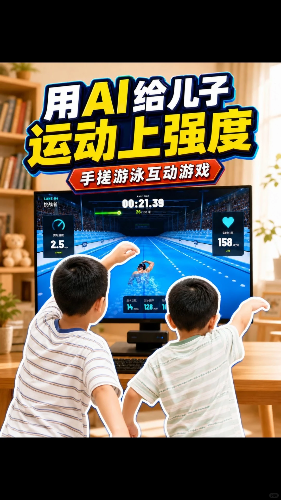

## 图片文字 (OCR)

> OCR 仅供参考，可能包含识别错误；请以原图为准。

用AI给儿子
运动上强度
手搓游泳互动游戏
LANE 04
RACE TIME
00:21.39
挑战者
26/100米
实时心率
158
实时速度
次/分
2.5
LIVE
SPEINT
划水次数
划水频率
路
128
10
14
次/分
