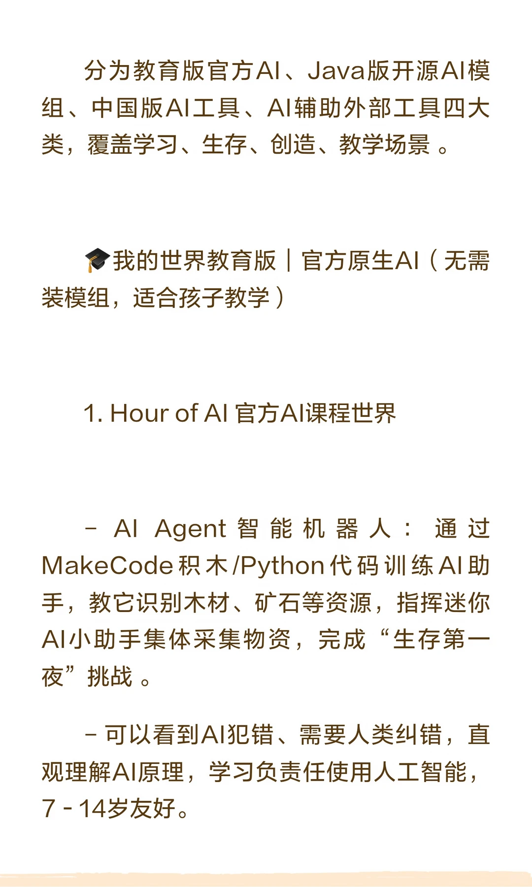
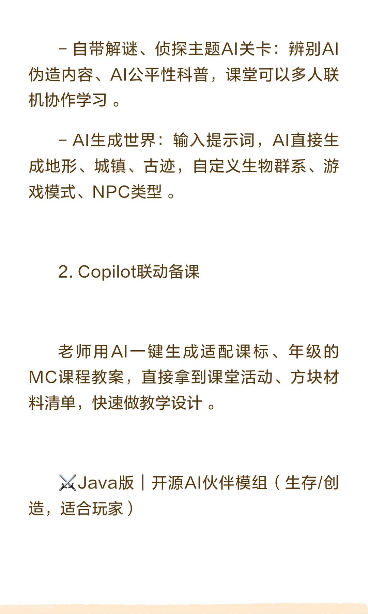
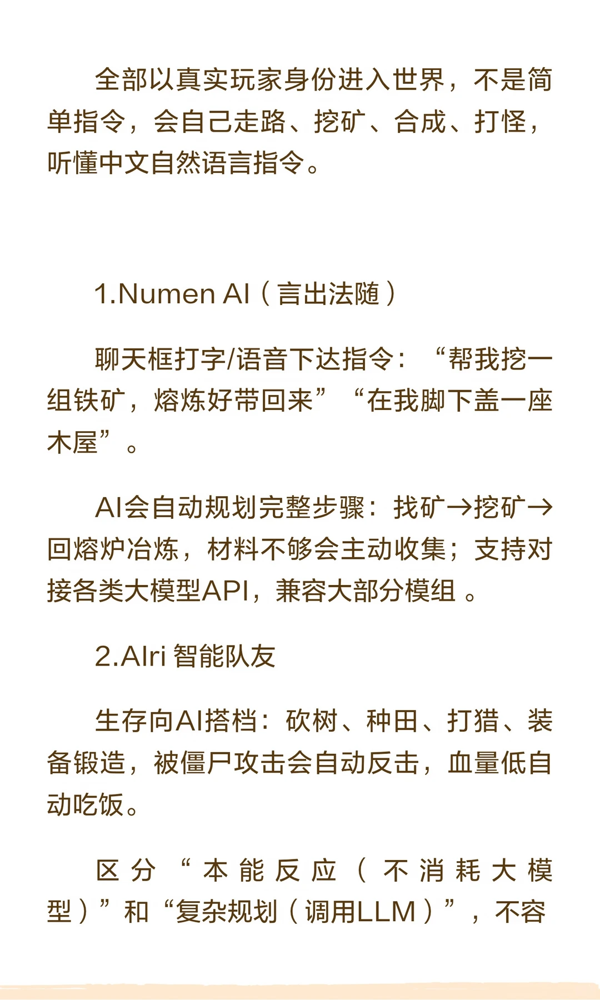
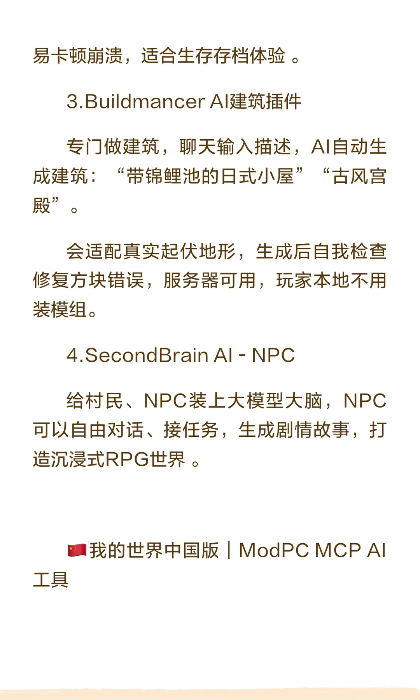
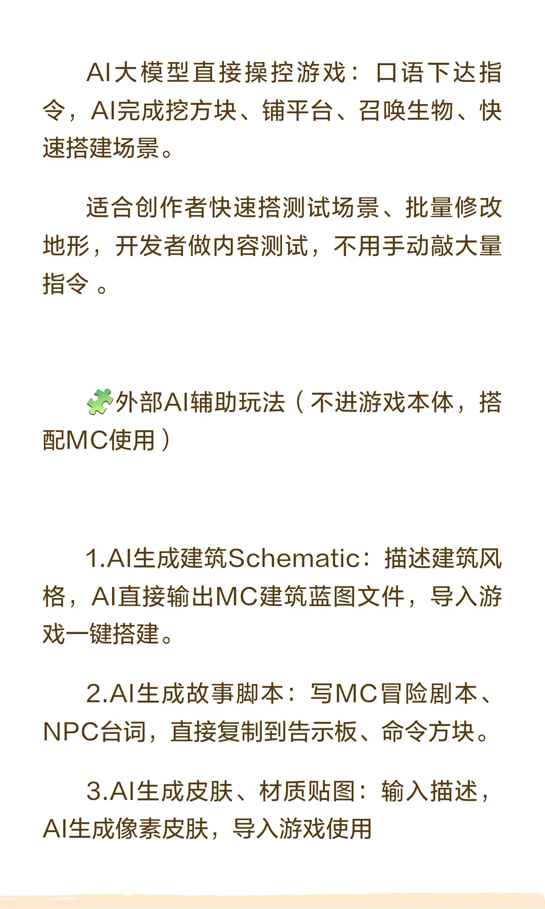

# 《我的世界》×AI｜最新玩法完整总结✨

> 作者: 《我的世界》爱好者 | 日期: 昨天 22:26 浙江 | 原文: https://www.xiaohongshu.com/discovery/item/6aa40f780000000011033d41?app_platform=android&ignoreEngage=true&app_version=9.45.0&share_from_user_hidden=true&xsec_source=app_share&type=normal&xsec_token=CBxLtoocRnxdhQv6ff5jfLaCXjwLyg3zVYAJl2RMc-83o%3D&author_share=1&xhsshare=CopyLink&shareRedId=N0dINjg3NUpMPko6S0EySDs0P0lFSjdL&apptime=1789138208&share_id=e1dac746073b4949aeb5d668735294a3&share_channel=copy_link&track_code=4nb9f0TSplF

> **摘要**:本文汇总了《我的世界》与AI结合的最新玩法，分为教育版官方AI、Java版开源AI模组、中国版AI工具及外部AI辅助工具四大类。教育版提供AI课程和Copilot备课功能；Java版开源模组如Numen、AI智能队友、Buildmancer等，可实现自然语言指令控制、NPC对话和AI自动建筑；中国版

《我的世界》×AI｜最新玩法完整总结✨
《我的世界》AI玩法汇总，还有你知道但没讲到的玩法吗？#游戏 #我的世界 #ai大模型
昨天 22:26 浙江

#AI玩法 #教育版 #开源模组 #AI辅助工具

## 图片

## 图片文字 (OCR)

> OCR 仅供参考，可能包含识别错误；请以原图为准。

66
《我的世界》
×AI最新玩法
完整总结
右划查看全文

分为教育版官方AI、Java版开源AI模
组、中国版AI工具、AI辅助外部工具四大
类，覆盖学习、生存、创造、教学场景。
我的世界教育版官方原生AI（无需
装模组，适合孩子教学）
1.HourofAI官方AI课程世界
-AIAgent智能机器人：通过
MakeCode积木/Python代码训练AI助
手，教它识别木材、矿石等资源，指挥迷你
AI小助手集体采集物资，完成“生存第一
夜”挑战。
-可以看到AI犯错、需要人类纠错，直
观理解AI原理，学习负责任使用人工智能，
7－14岁友好。

-自带解谜、侦探主题AI关卡：辨别AI
伪造内容、AI公平性科普，课堂可以多人联
机协作学习。
- AI生成世界：输入提示词，AI直接生
成地形、城镇、古迹，自定义生物群系、游
戏模式、NPC类型。
2.Copilot联动备课
老师用AI一键生成适配课标、年级的
MC课程教案，直接拿到课堂活动、方块材
料清单，快速做教学设计。
XJava版开源AI伙伴模组（生存/创
造，适合玩家）

全部以真实玩家身份进入世界，不是简
单指令，会自己走路、挖矿、合成、打怪，
听懂中文自然语言指令。
1.NumenAl（言出法随）
聊天框打字/语音下达指令：“帮我挖一
组铁矿，熔炼好带回来”“在我脚下盖一座
木屋”。
AI会自动规划完整步骤：找矿→挖矿→
回熔炉冶炼，材料不够会主动收集；支持对
接各类大模型API，兼容大部分模组。
2.Alri 智能队友
生存向AI搭档：砍树、种田、打猎、装
备锻造，
被僵尸攻击会自动反击，血量低自
动吃饭。
区分
“本能反应（不消耗大模
型）”
和
“复杂规划（调用LLM）”，不容

易卡顿崩溃，适合生存存档体验。
3.BuildmancerAl建筑插件
专门做建筑，聊天输入描述，AI自动生
成建筑：
“带锦鲤池的日式小屋”
“古风宫
殿”。
会适配真实起伏地形，生成后自我检查
修复方块错误，服务器可用，玩家本地不用
装模组。
4.SecondBrainAl - NPC
给村民、NPC装上大模型大脑，NPC
可以自由对话、接任务，生成剧情故事，打
造沉浸式RPG世界。
我的世界中国版
ModPCMCP AI
工具

AI大模型直接操控游戏：口语下达指
令，AI完成挖方块、铺平台、召唤生物、快
速搭建场景。
适合创作者快速搭测试场景、批量修改
地形，
开发者做内容测试，不用手动敲大量
指令。
外部AI辅助玩法（不进游戏本体，搭
配MC使用）
1.AI生成建筑Schematic：描述建筑风
格，AI直接输出MC建筑蓝图文件，导入游
戏一键搭建。
2.AI生成故事脚本：写MC冒险剧本、
NPC台词，直接复制到告示板、命令方块。
3.AI生成皮肤、材质贴图：输入描述，
AI生成像素皮肤，导入游戏使用
