# 「游戏化学习系统」｜技术美术篇

> 作者: 蛋卷儿 | 日期: 编辑于 6小时前 广东 | 原文: https://www.xiaohongshu.com/discovery/item/6a8a984d0000000035026e5f?app_platform=android&ignoreEngage=true&app_version=9.43.0&share_from_user_hidden=true&xsec_source=app_share&type=video&xsec_token=CBE5hjLJyJFfeQDQJ6CZ_Bw75rVtXGEahLkKsiXiQrGyo%3D&author_share=1&xhsshare=CopyLink&shareRedId=N0dINjg3NUpMPko6S0EySDs0P0lFSjdL&apptime=1787483251&share_id=dd2e67c541654ed098d487d0338cf2af&share_channel=copy_link

> **摘要**:「游戏化学习系统」｜技术美术篇

「游戏化学习系统」｜技术美术篇
再不端出来就快忘了自己之前是干什么的了
等我人工校验完，会尽快把html和skill传GitHub，可以加急我，夸赞和交流都会使我更有动力
再一次更正我说错了溯源的溯字，但是懒得重新录
有时候剪辑会很烦躁，所以赤巨资开了剪映会员
钱都花了，就要大用特用
#我在小红书做游戏 #学习工具 #技术美术 #游戏 #网页设计
编辑于 6小时前 广东

## 视频

[视频 1](./video.mp4)

<video controls width="100%"><source src="./video.mp4" type="video/mp4">您的浏览器不支持视频播放。</video>

附件: [音频](./audio/audio.wav) | [处理清单](./video_manifest.json)

## 视频图文总结

> 按关键帧关联完整视频转录；文字保留机器转写原文，时间点仅用于定位。

### 1. 00:00

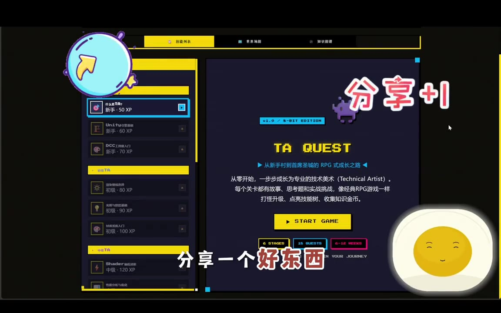

- 内容摘要：分享一个好东西，这个东西其实我几个月之前就把框架搭完了，也就是现在这个样子（00:00-00:05）
- 画面文字（OCR）：~~ -
A (A J
本 Ug Jin 8
£ 0
Unitus - 4 N
ob TA QUEST
[an je* 从新手村到首席圣城的 RPG 式成长之路是从零开始，一步步成长为专业的技术美术 (Technical Artist) 。每个关卡都有故事、甩考题和实战挑战，像经典 RPG 游戏一样打怪升级、点亮技能树、收集知识金币。
:
Eee LL JR |
BN | = A —
Shaderas —-_ 1
— |

### 2. 00:05

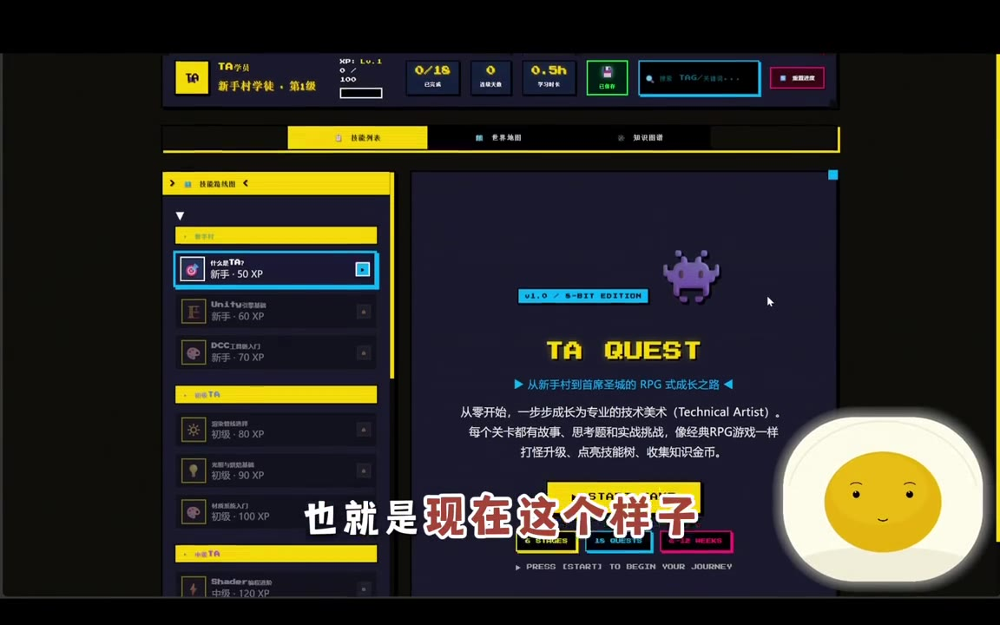

- 画面文字（OCR）：Tarn or =a 0/18 o 0.5Sh
- Jor <A A ce
> nennm < 图，
[ww |
Af
pa TA GUEST
ERREEEEEEEEES |* 从新手村到首席圣城的 RPG 式成长之路 4
= 从零开始，一步步成长为专业的技术美术 (Technical Artist) 。六每个关卡都有故事、思考题和实战挑战，像经典 RPG 游戏一样
_ 打怪升级、点亮技能树、收集知识金币。
= =] ;
th si 2 BENG
ET

### 3. 00:11

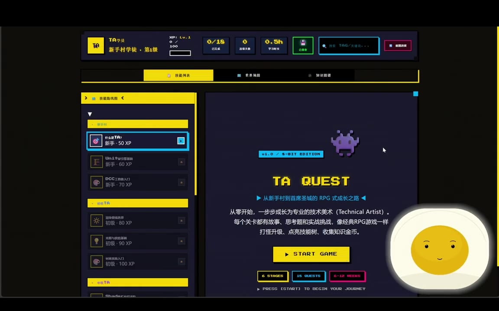

- 内容摘要：毕竟也是知识类的分享嘛，就是本着不要误人子弟的这个心态（00:05-00:11）
- 内容摘要：所以就一直拖到了现在，然后因为我想的是就是对于里面生成的一些内容（00:11-00:17）
- 画面文字（OCR）：SE LC] ee
[Jari 人 em
> o umnmm < L]
v
(ww |
Hy
x x
rim] TA QUEST
| > 从新手村到首席圣城的 RPG 式成长之路 4
i 从零开始，一步步成长为专业的技术美术 (Technical Artist) 。一"Box 每个关卡都有故事、思考题和实战挑战，像经典 RPG 游戏一样打怪升级、点亮技能树、收集知识金币。
EEC re

### 4. 00:22

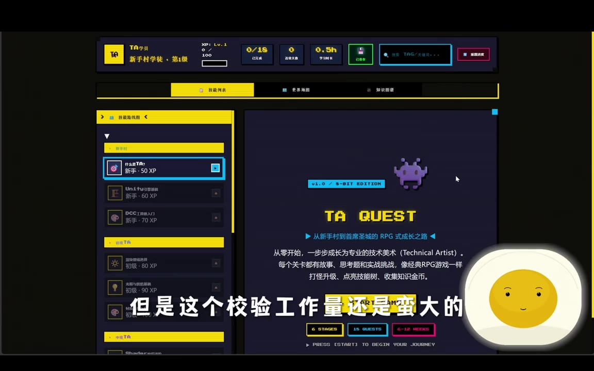

- 内容摘要：我还是要去做一次这个教验的（00:17-00:20）
- 内容摘要：但是这个教验工作量还是蛮大的，所以迟迟都没有分享出来（00:20-00:26）
- 内容摘要：但是我想着这个东西吧（00:26-00:28）
- 内容摘要：如果再不分享它就可能就就烂烂掉了，烂尾了，我也不太想这样（00:28-00:33）
- 画面文字（OCR）：学员 Opts o/18 ° 0.5h
Bl en ne = 8 (8 |=]
> nenmm < LJ
v
[一
= wv,
局
| 5。 s-ezr sozrzon |
= TA QUEST
Ee > 从新手村到首席圣城的 RPG 式成长之路十从零开始，一步步成长为专业的技术美术 (Technical Artist) 。级，每个关卡都有故事、思考题和实战挑战，像经典 RPG 游戏一样
5 打怪升级、点亮技能树、收集知识金币。
®R RA 0% TF EEREA

### 5. 00:44

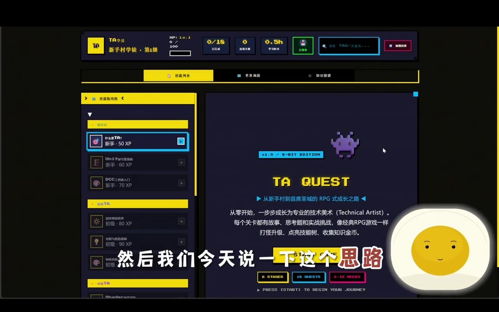

- 内容摘要：就先来分享一下思路吧，然后里面的内容我还是会去再去校验的（00:33-00:39）
- 内容摘要：持续更新可能对我来说是一个比较好的一个状态（00:39-00:43）
- 内容摘要：完成可能比完美更重要，然后我们今天说一下（00:43-00:46）
- 内容摘要：这个思路它其实是把一个知识领域的一个东西呢（00:46-00:51）
- 画面文字（OCR）：Bless = BE BB =
> nen < -
iY
EEC 二
= .
a
:
Te TA GUEST
[Er > 从新手村到首席圣城的 RPG 式成长之路 4
从零开始，一步步成长为专业的技术美术 (Technical Artist) 。 _
交每个关卡都有故事、甩考题和实战挑战，像经典 RPG 游戏一样打怪升级、点亮技能树、收集知识金币。
rm ANT Tay AN
RB RNS Xi REE
ET— EE |

### 6. 00:53

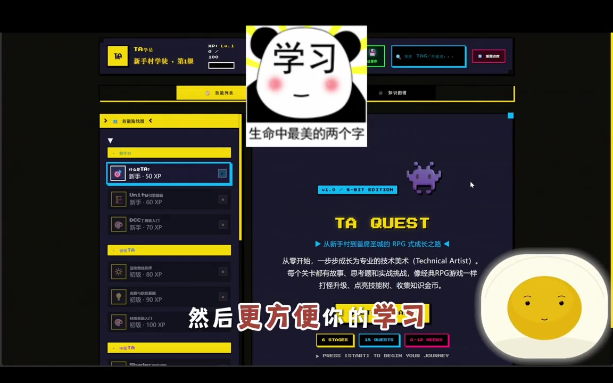

- 内容摘要：转换成一个游戏化的一个系统，然后更方便你的学习（00:51-00:56）
- 画面文字（OCR）：CE EAI 三 HEME mm Z + -
> nennm < 图
B 生命中最美的两个字
[Lv |
“a
pr
ty
X
= TA GUEST
Err » 从新手村到首席圣城的 RPG 式成长之路 4
从零开始，一步步成长为专业的技术美术 (Technical Artist) 。每个关卡都有故事、思考题和实战挑战，像经典 RPG 游戏一样打怪升级、点亮技能树、收集知识金币。
2 然后时方个十将各
5 LE [一

### 7. 01:03

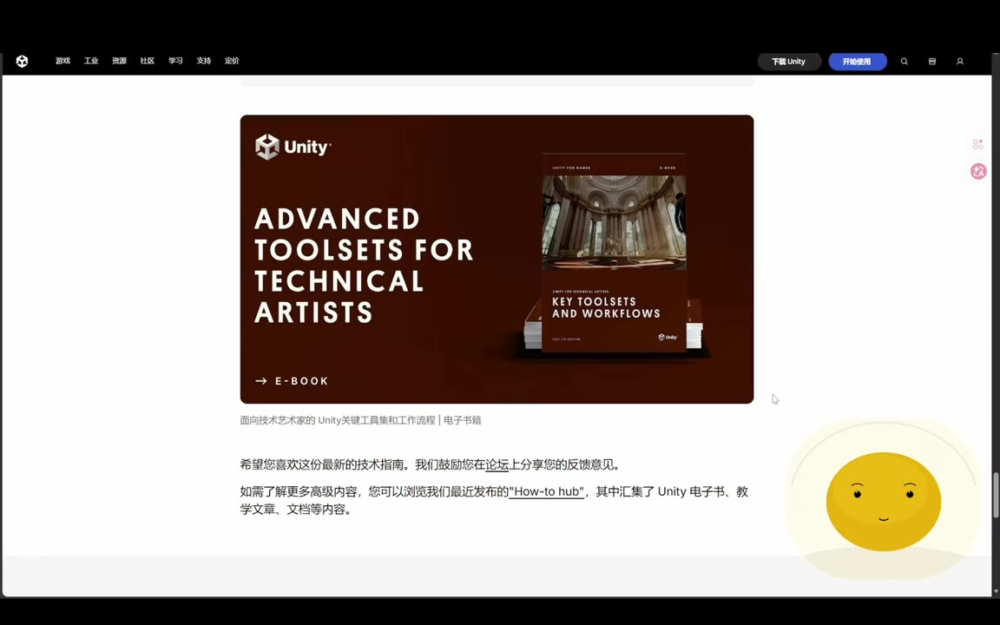

- 内容摘要：然后就拿我自己之前的老本行来说，就是我是技术美术嘛（00:56-01:03）
- 画面文字（OCR）：@ mm Iv om ou ow wm ae SS
Ld Unity
ADVANCED / I 3 |
TOOLSETS FOR ~~ / JLB
TECHNICAL i
ARTISTS A AND WoRKrLoWs 一 E-Book 希望您喜欢这份最新的技术指南。我们鼓励您在论坛上分享您的反馈意见。如需了解更多高级内容，您可以浏览我们最近发布的"How-to hub"，其中汇集了 Unity 电子书、教四 5 |
学文章、文档等内容 .

### 8. 01:07

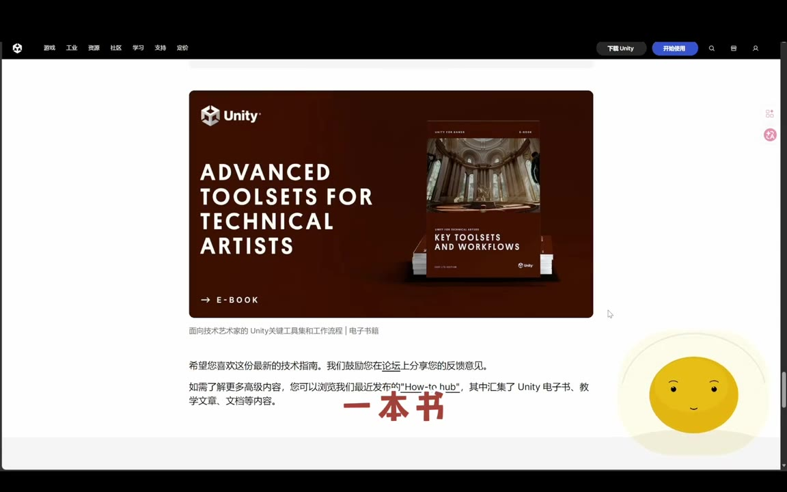

- 内容摘要：起因是unite官方出了一本面向技术美术的一本书（01:03-01:07）
- 画面文字（OCR）：RQ unity:

ADVANCED 1 TY \

TOOLSETS FOR 7 ALM

TECHNICAL i”

ARTISTS LR 希望您喜欢这份最新的技术指南。我们鼓励您在论坛上分享您的反馈意见。如需了解更多高级内容，您可以浏览我们最近发布的"How-te hub"，其中汇集了 Unity 电子书、教四 0 |
学文章、文档等内容。一木 Ei xf _

### 9. 01:09

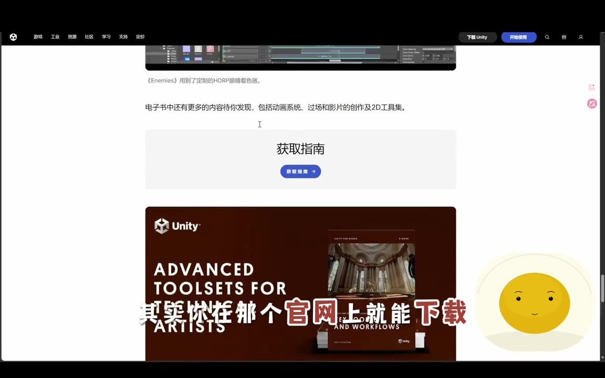

- 内容摘要：一本电子书，然后这个其实你在那个官网上就能下载（01:07-01:12）
- 画面文字（OCR）：HH ———— —
电子书中还有更多的内容待你发现，包括动画系统、过场和影片的创作及 2D 工具集。获取指南 CD 全 unity:
ADVANCED xe
TOOLSETS FOR [ rh Bh |
= BE, Sk for _
[EREN + BR 上上其能 TE

### 10. 01:11

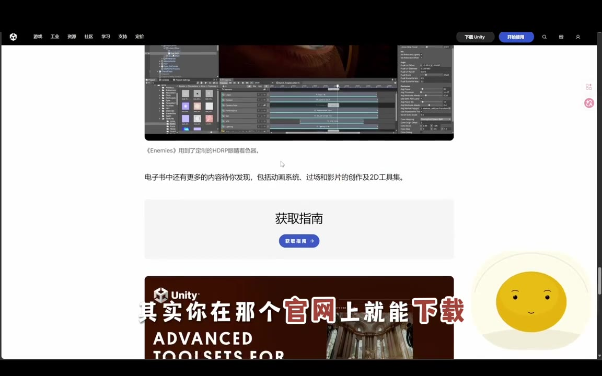

- 画面文字（OCR）：电子书中还有更多的内容待你发现，包括动画系统、过场和影片的创作及 2D 工具集。获取指南下 unity er ~ 5 8 |
LS 1 75 AR 4 BD (EL dh ak TRE ’
ADVANCED FTI
TmmISFTS ENR / BIE 3 :

### 11. 01:12

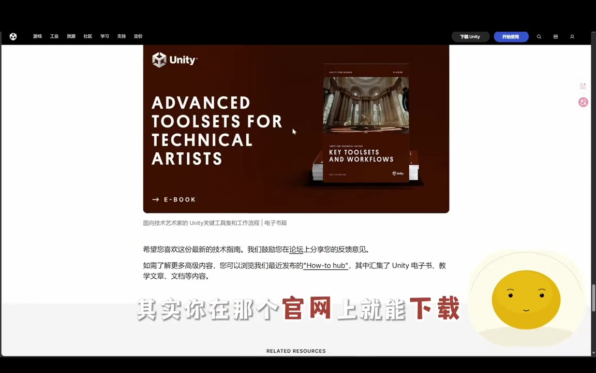

- 画面文字（OCR）：全 unity:

ADVANCED J i 上 TOOLSETS FOR 、 F JEW

TECHNICAL i=

希望您喜欢这份最新的技术指南。我们鼓励您在论坛上分享您的反馈意见。如需了解更多高级内容，您可以浏览我们最近发布的"How-to hub"，其中汇集了 Unity 电子书、教学文章、文档等内容 .。

a = 5

HE: | 人 SBD ER fr i 下 =Y 一 |

doa ups Ba ™M _C gl iE £2

### 12. 01:14

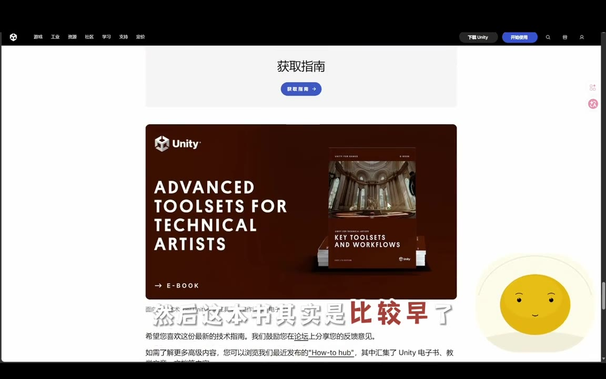

- 画面文字（OCR）：获取指南
[EEE
RQ Unity:
ADVANCED / Ti 和 TOOLSETS FOR |
TECHNICAL 本二 ARTISTS ANDWSNFLows |
| ~ 1
ET VT — = cc
13 02] X25 4 PAIS IVER J 0 Shy ll =
希望您喜欢这份最新的技术指南。我们鼓励您在论坛上分享您的反馈意见。如须了解更多高级内容 , 您可以浏览我们最近发布的"How-to hub"，其中汇集了 Unity 电子书、教

### 13. 01:15

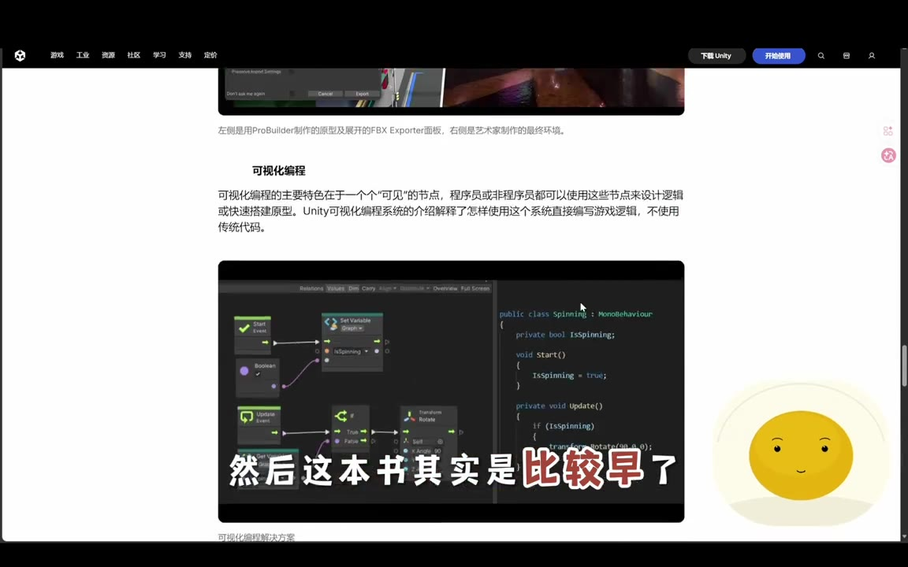

- 画面文字（OCR）：as. =
i 1 x
可视化编程可视化编程的主要特色在于一个个 “可见'的节点，程序员或非程序员都可以使用这些节点来设计逻辑或快速搭建原型。Unity 可视化编程系统的介绍解释了怎样使用这个系统直接编写游戏逃辑，不使用传统代码。
»
v= Fr (
和 °E Tsspinning |
o= < I Ca g :
— oy J WaS 5 5
J la L585 本然后这本书其实是化能时了

### 14. 01:16

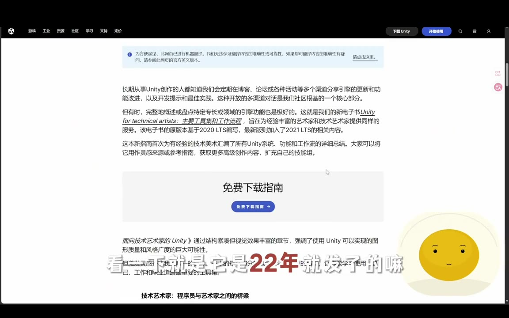

- 内容摘要：是一个pdf。然后这本书其实是比较早了，我看一下就是它是二二年就发了的嘛（01:12-01:20）
- 画面文字（OCR）：© mu oIe mm ous ow om owe Taw (FED - = 2
© PHIL. ITE IRIE. RAEAGTRIASIO TON. MRSRARTARIOE |
i HEIST SR Lo] |
长期从事 Unity 创作的人都知道我们会定期在博客、论坛或各种活动等多个渠道分享引擎的更新和功能改进，以及开发提示和最佳实践。这种开放的多渠道对话是我们社区根基的一个核心部分，但有时，完整地概述或盘点特定专长或领域的引擎功能也是极好的。这就是我们的新电子书 Unily
for technical artists: 主要工具儒天工作流理，旨在为经验丰富的艺术家和技术艺术家提供同样的服务。该电子书的原版本基于 2020 LTS 编写，最新版则加入了 2021 LTS 的相关内容。这本新指南首次为有经验的技术美术汇编了所有 Unity 系统、功能和工作流的详细总结。大家可以将它用作灵感来源或参考指南，获取更多高级创作内容，扩充自己的技能组 .。
re 免费下载指南面向花术艺术过的 Unity 》通过结构紧凑但视觉效果和丰富的章节，强调了使用 Unity 可以实现的图形质量和风格广度的巨大可能性。
"ERE RE [TH TI w= DEF wi TIRES ERA
©. TF sre 4 4
技术艺术家 : 程序员与艺术家之间的桥梁日

### 15. 01:17

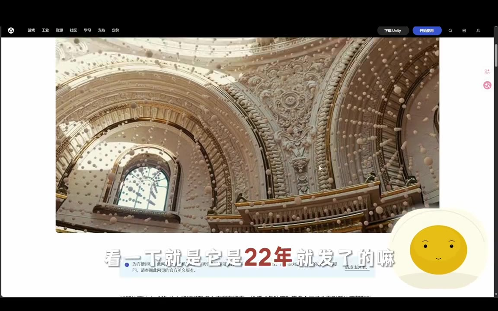

- 画面文字（OCR）：© mov oam mows owe we Ty QE oe a
\ Ey Se =e.
RE rte i 29/9
p= Eg rs ny 4
5 ENT leary els [F
Ge NN 2 HE
2 ZN C i=
pas NZ eZ)
2 i TL ma ONE By £7 1 J
SIKAO 全区 MY = AST fk
AAA 一到人 AL RAR 你性 CR. XR 2 x
Sy RS SC2> - =
by ae =
- We, +, 2
: AN id
reef |
EEE oT = “1225 at Ie Bari of Wikis
=| o rome Jitad J bpm Te Fy ny tb 201 LSC BL BF) RP
AM a

### 16. 01:19

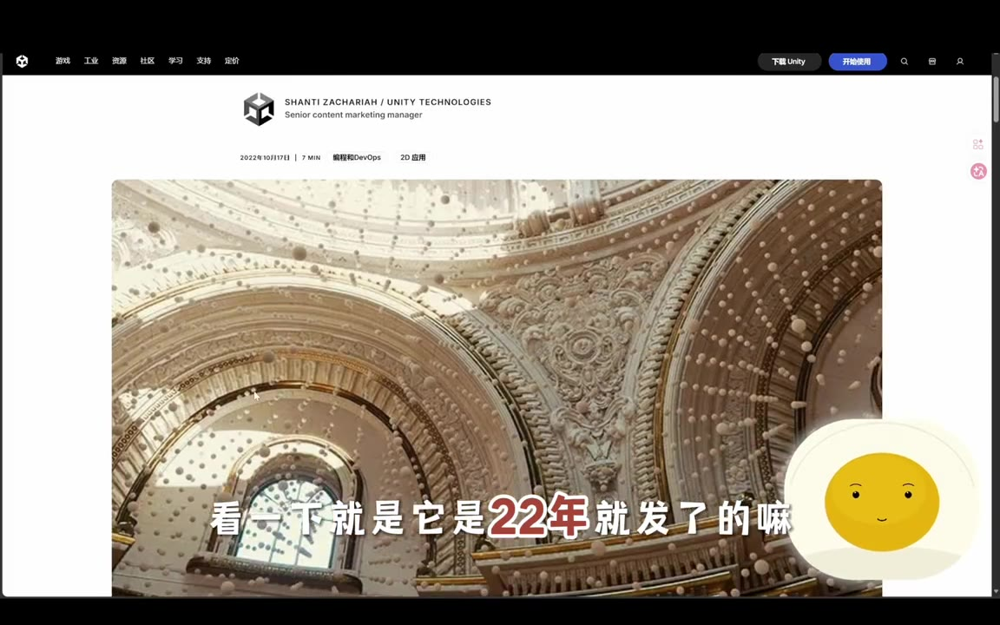

- 画面文字（OCR）：Vd] SHANTI ZACHARIAH / UNITY TECHNOLOGIES |
= Ap ei
ee aa Ee
e SN 7 [i SLRS
2 2 ry | TRIE
I = fe).
EE CC Fars “m7 oS
pre ee ANTE od WE lc pt
gg Na
SG a Es TONS oN ENS page, cet. e
ZE lg oN "ls PIAS 7
HA AAA \ le Te AN NE. SC i= Fe. «A
| @ Zhe REC Up, ar Nee = Erie Jl © eer,
[SZ 3 NG NYE XA] (P a
B 3 DONS ES ATA Ee
i SMEAR NC (a
AYA RAR
NF Ls Ne PRR WE | ZO (RE
) Ce ERA) AAT PEE RE 2 REE =
VAR Ee 生和是了 OA 就和 Io {I pr
Epil RE RL CARLA TH I 和人后 | hy ZT rs 0 ET
pe eR 了

### 17. 01:26

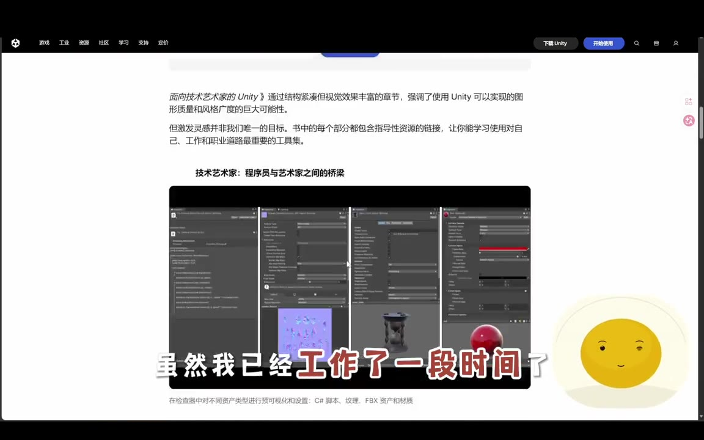

- 内容摘要：然后这本书我其实一直想想系统的看一下，虽然我已经工作了一段时间了（01:20-01:26）
- 内容摘要：但一直都没有看（01:26-01:27）

### 18. 01:29

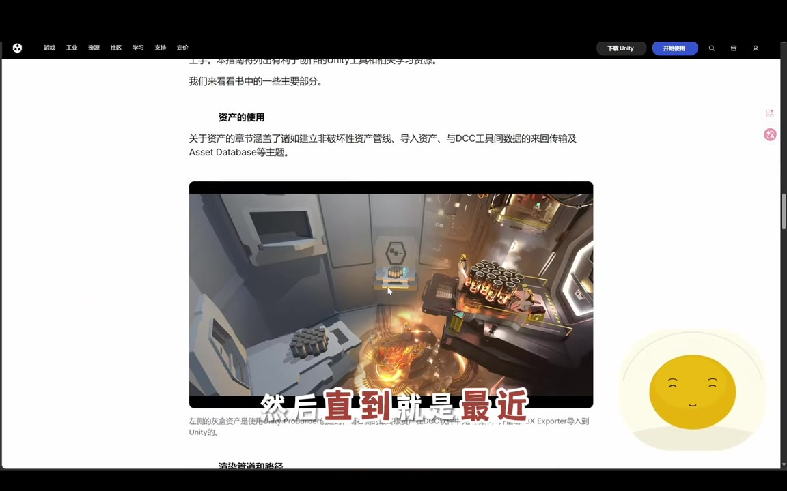

- 内容摘要：然后直到就是最近（01:27-01:29）
- 内容摘要：诶，我想着就是一本书，如果我直接看不想看的话，是不是可以通过ai来（01:29-01:35）

### 19. 01:38

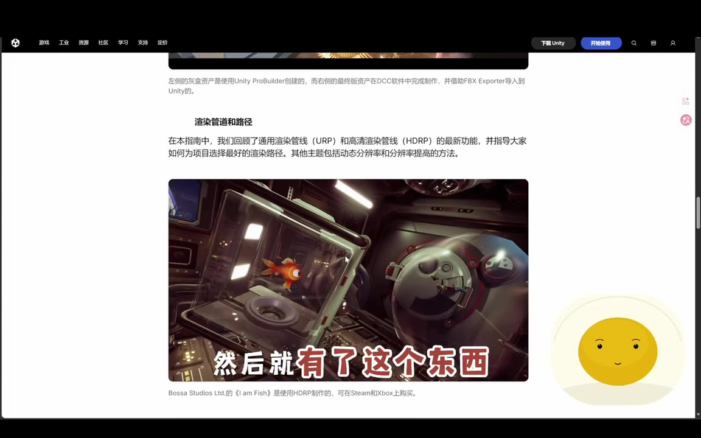

- 内容摘要：做一些事情来帮助我去读这本书，嗯，然后就有了这个东西（01:35-01:40）
- 内容摘要：因为我很喜欢打游戏嘛，然后所以说就是可不可以我在阅读的过程就是像玩游戏一样（01:40-01:47）

### 20. 01:51

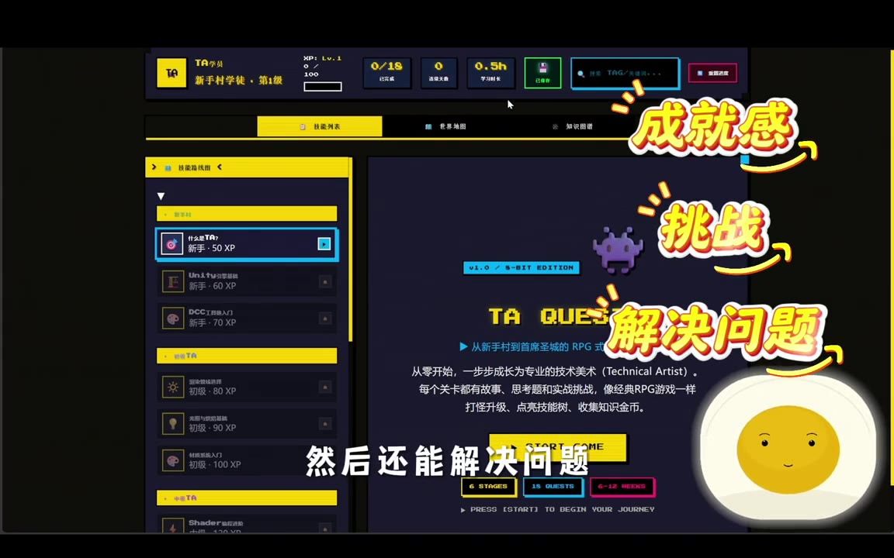

- 内容摘要：呃，有成就感，然后呃有挑战，然后还能解决问题这样（01:47-01:52）
- 内容摘要：一个思路，嗯，然后我们可以看到，嗯，它本身就是设计成一个r p g游戏（01:53-01:59）
- 内容摘要：就是你可以从零开始（02:00-02:01）

### 21. 02:13

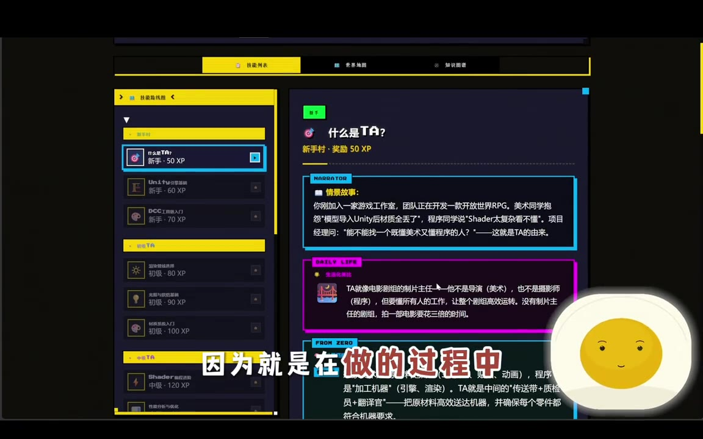

- 内容摘要：一步步成长为专业的技术美术，然后每个关卡都有故事，还有思考题，还有实战的挑战（02:01-02:08）
- 内容摘要：像经典的rpg游戏一样（02:08-02:10）
- 内容摘要：然后啊，我们可以直接开始啊（02:10-02:13）
- 内容摘要：因为就是在做的过程中也看到了很多别人的分享嘛（02:13-02:17）
- 内容摘要：然后融了一些有利于学习的这个方法（02:17-02:20）
- 内容摘要：就是学习肯定是有方法（02:20-02:22）
- 内容摘要：那有的人就学的很轻松啊（02:22-02:24）

### 22. 02:35

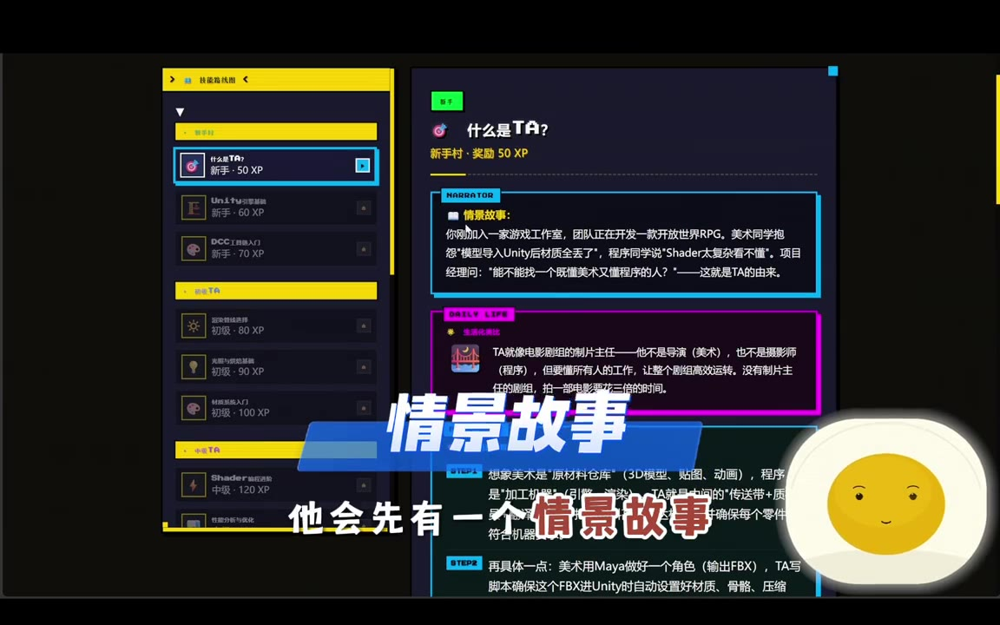

- 内容摘要：然后有的人就学的很困难哦，那我们找对方法，那么就是事事半功倍（02:24-02:29）
- 内容摘要：让我们看看它都有都有些什么（02:29-02:32）
- 内容摘要：首先就是你要先了解什么是ta啊，它会先有一个情景故事，然后做一个生活化的类比（02:32-02:39）
- 内容摘要：然后再从零搭建心智模型，然后它会总结核心的知识点（02:39-02:44）

### 23. 02:57

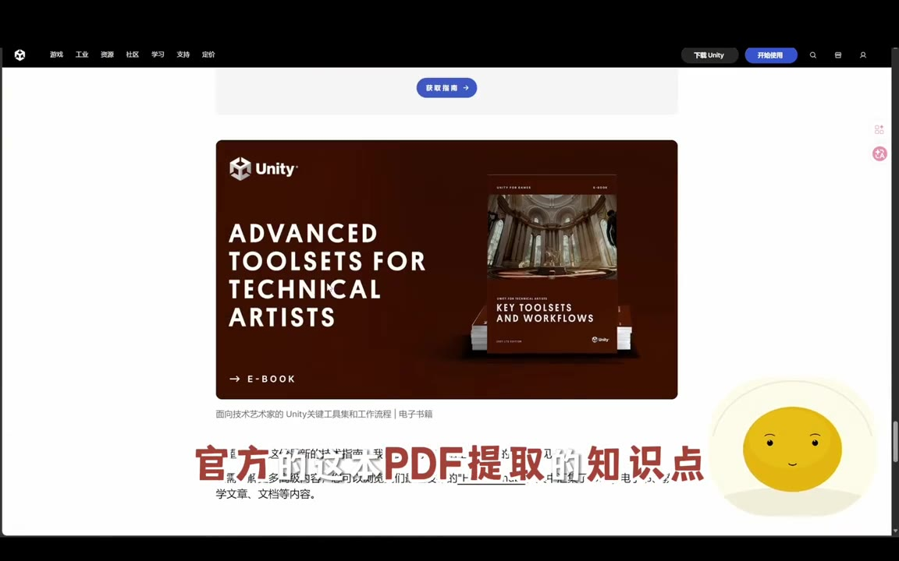

- 内容摘要：然后它会有一个苏格拉底的提问，还有费曼学习法中的费曼数元（02:44-02:51）
- 内容摘要：呃，因为这个所有的这个网页的内容是通过呃官方的这本p，D,F提取的知识点（02:51-02:59）
- 内容摘要：啊，所以会有一个溯源（02:59-03:00）
- 内容摘要：因为ai做东西它它经常会产生幻觉，呃这个溯源还是蛮蛮重要的，能够消除（03:00-03:07）

### 24. 03:20

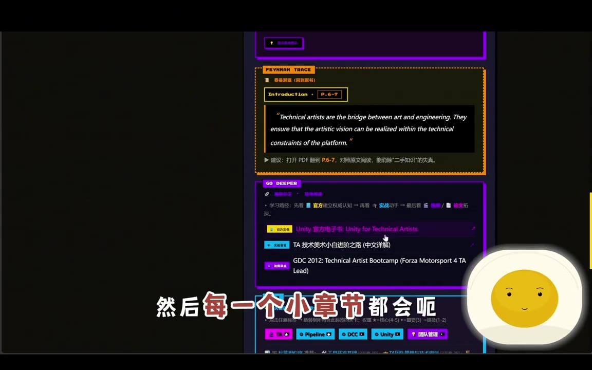

- 内容摘要：二手知识的失真，呃，读完这个书，那很多人可能就是需要一些抛砖引玉（03:07-03:13）
- 内容摘要：可能会有一些呃相关的gdc的的这个资料啊，或者是别人的一些博客啊（03:13-03:19）
- 内容摘要：嗯，然后每一个小章节都会呃列一些这个延伸的阅读，感兴趣的可以再继续学习（03:19-03:26）
- 内容摘要：嗯，然后还有一个很关键的就是给这些知识打一些标签（03:27-03:31）

### 25. 03:42

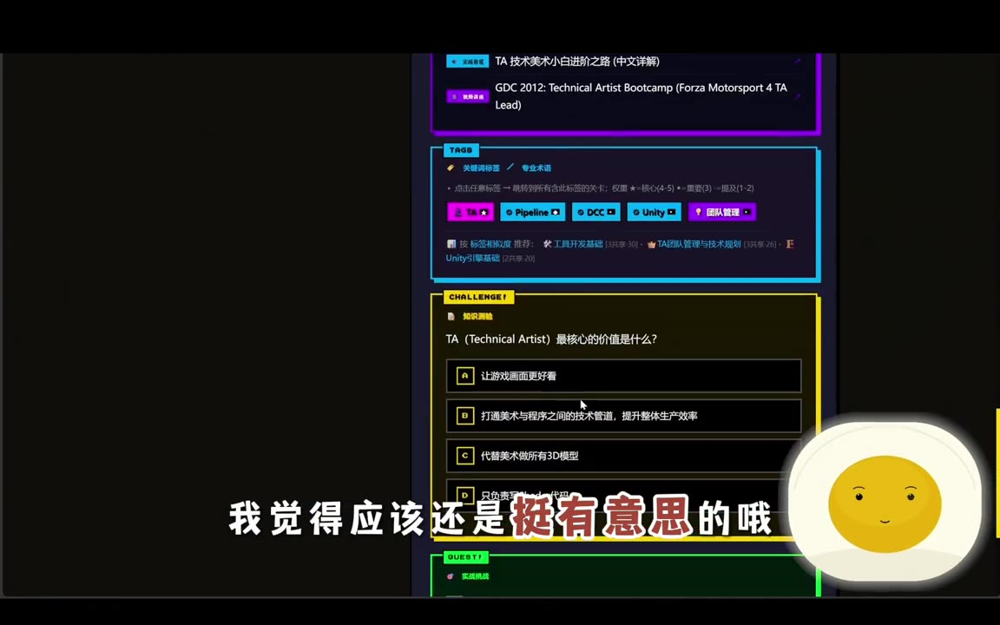

- 内容摘要：然后这个标签的作用其实是为了方便检索（03:31-03:33）
- 内容摘要：然后学完之后会有一个知识测验以及一个实战挑战（03:33-03:38）
- 内容摘要：如果你按照这个流程理下来的话，我觉得应该还是挺有意思的（03:38-03:43）
- 内容摘要：呃，然后再展示一下这个网页呢（03:43-03:45）
- 内容摘要：有三个板块，一个是你正常的学习闯关，呃，这样一套流程下来一个知识点（03:45-03:51）

### 26. 04:04

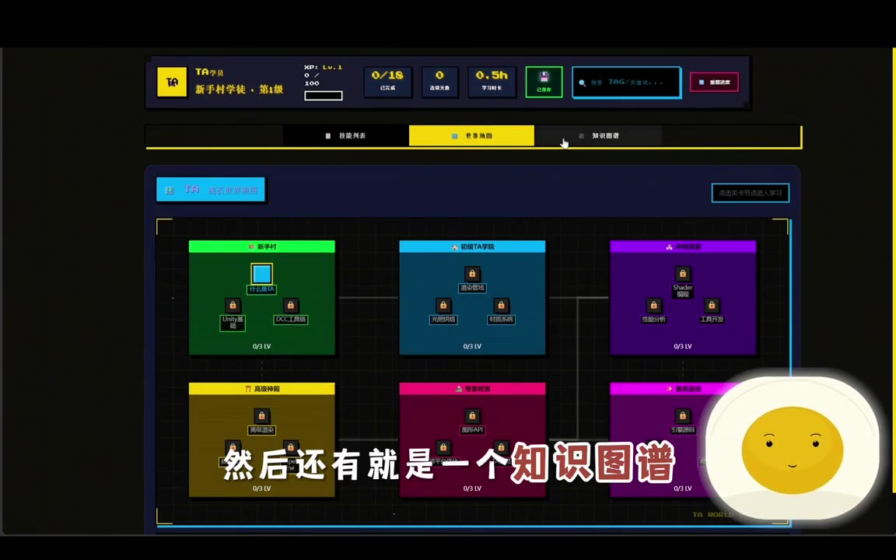

- 内容摘要：然后还会有一个世界地图，就是你从新手到专家，然后你整个大概要涉及的哪些内容（03:52-04:01）
- 内容摘要：会有一个大的总览，嗯（04:01-04:03）
- 内容摘要：然后还有就是一个知识图谱，然后这个知识图谱就是根据每一章节它涉及到的一些内容（04:03-04:11）
- 内容摘要：提炼的一些关键字要做一些双链（04:11-04:14）

### 27. 04:26

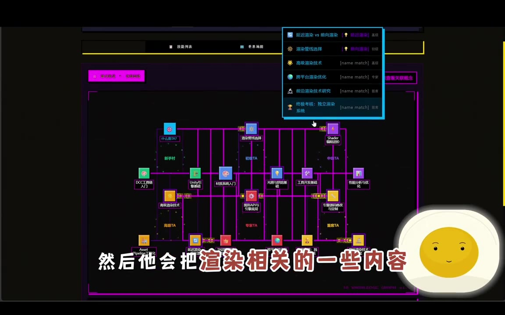

- 内容摘要：就是把这个知识网络连接起来，呃，做了一个小动画，还挺有意思的（04:14-04:20）
- 内容摘要：嗯，包括你可以通过tag去搜索（04:20-04:23）
- 内容摘要：比如说搜索渲染，然后它会把渲染相关的一些内容嗯提炼出来（04:23-04:29）
- 内容摘要：呃，像延迟渲染啊（04:29-04:30）
- 内容摘要：渲染管线啊，跨平台渲染优化，就是跟渲染相关的一些内容，它会筛出来（04:30-04:36）

### 28. 04:48

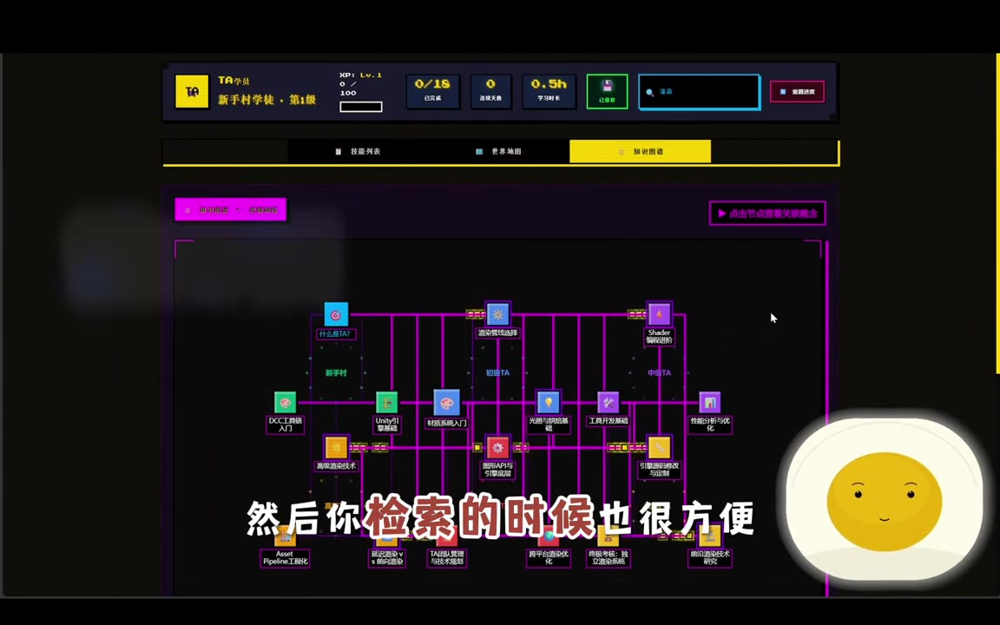

- 内容摘要：就是这个比传统的纸质书也好，比传统的电子书也好，它这个（04:36-04:42）
- 内容摘要：优势就在于它能够像一个知识网络一样的把所有的知识串起来（04:42-04:47）
- 内容摘要：然后你检索的时候也很方便（04:47-04:50）
- 内容摘要：就是你输入一个关键词（04:50-04:52）
- 内容摘要：你就可以跳到相关的所有的章节，然后你以一种非线性的方式去学习（04:52-04:58）

### 29. 05:10

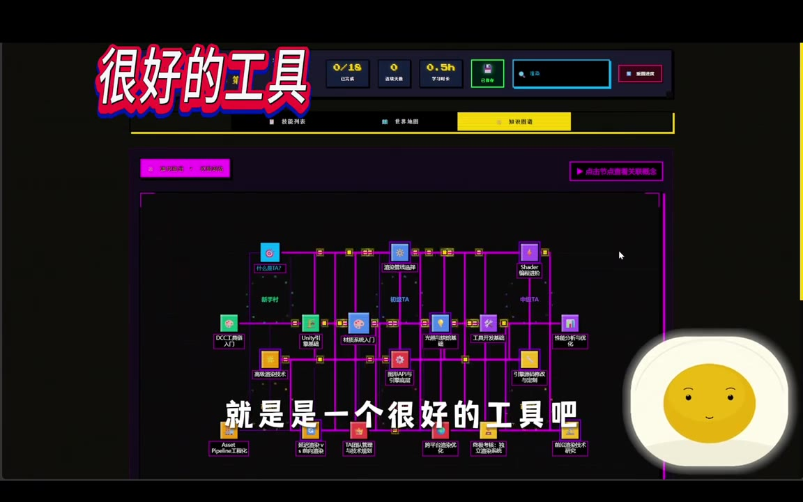

- 内容摘要：就是我觉得工具书这样子去使用的话（04:59-05:02）
- 内容摘要：会比你去一页页翻一页页找，或者是看目录下去找（05:02-05:06）
- 内容摘要：或者你可能哪些东西就漏了（05:06-05:08）
- 内容摘要：就是是一个很好的工具吧（05:08-05:10）
- 内容摘要：今天就先把这盘菜端出来，然后也是一个思路嘛，就是不只是（05:10-05:15）
- 内容摘要：技术美术这一块的知识（05:15-05:17）
- 内容摘要：任何知识都其实都可以通过这种游戏性的方式去，嗯让自己更好的学习（05:17-05:23）

### 30. 05:33

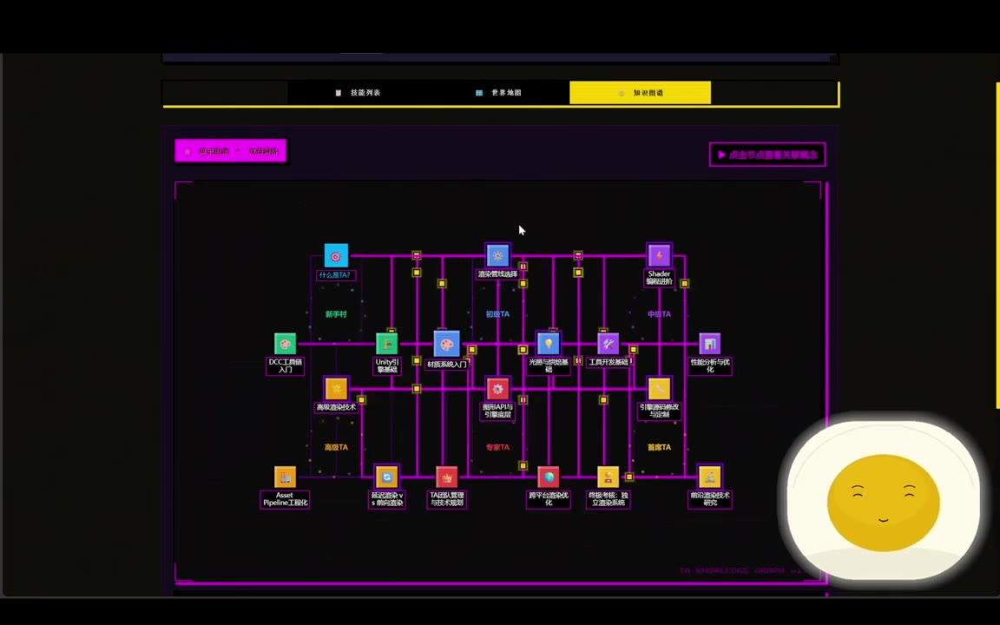

- 内容摘要：嗯，然后我会尽快把这个东西分享出来（05:23-05:26）
- 内容摘要：因为呃它本身就是一个简单的静态的一个网页，没什么技术含量，就先这样吧（05:26-05:32）

## 视频画面文字 (OCR)

> OCR 仅供参考，可能包含识别错误；请以视频画面和转写来源为准。

### 关键帧 1 · 0.5s

~~ -
A (A J
本 Ug Jin 8
£ 0
Unitus - 4 N
ob TA QUEST
[an je* 从新手村到首席圣城的 RPG 式成长之路是从零开始，一步步成长为专业的技术美术 (Technical Artist) 。每个关卡都有故事、甩考题和实战挑战，像经典 RPG 游戏一样打怪升级、点亮技能树、收集知识金币。
:
Eee LL JR |
BN | = A —
Shaderas —-_ 1
— |

### 关键帧 2 · 5.77s

Tarn or =a 0/18 o 0.5Sh
- Jor <A A ce
> nennm < 图，
[ww |
Af
pa TA GUEST
ERREEEEEEEEES |* 从新手村到首席圣城的 RPG 式成长之路 4
= 从零开始，一步步成长为专业的技术美术 (Technical Artist) 。六每个关卡都有故事、思考题和实战挑战，像经典 RPG 游戏一样
_ 打怪升级、点亮技能树、收集知识金币。
= =] ;
th si 2 BENG
ET

### 关键帧 3 · 11.07s

SE LC] ee
[Jari 人 em
> o umnmm < L]
v
(ww |
Hy
x x
rim] TA QUEST
| > 从新手村到首席圣城的 RPG 式成长之路 4
i 从零开始，一步步成长为专业的技术美术 (Technical Artist) 。一"Box 每个关卡都有故事、思考题和实战挑战，像经典 RPG 游戏一样打怪升级、点亮技能树、收集知识金币。
EEC re

### 关键帧 4 · 22.67s

学员 Opts o/18 ° 0.5h
Bl en ne = 8 (8 |=]
> nenmm < LJ
v
[一
= wv,
局
| 5。 s-ezr sozrzon |
= TA QUEST
Ee > 从新手村到首席圣城的 RPG 式成长之路十从零开始，一步步成长为专业的技术美术 (Technical Artist) 。级，每个关卡都有故事、思考题和实战挑战，像经典 RPG 游戏一样
5 打怪升级、点亮技能树、收集知识金币。
®R RA 0% TF EEREA

### 关键帧 5 · 44.84s

Bless = BE BB =
> nen < -
iY
EEC 二
= .
a
:
Te TA GUEST
[Er > 从新手村到首席圣城的 RPG 式成长之路 4
从零开始，一步步成长为专业的技术美术 (Technical Artist) 。 _
交每个关卡都有故事、甩考题和实战挑战，像经典 RPG 游戏一样打怪升级、点亮技能树、收集知识金币。
rm ANT Tay AN
RB RNS Xi REE
ET— EE |

### 关键帧 6 · 53.6s

CE EAI 三 HEME mm Z + -
> nennm < 图
B 生命中最美的两个字
[Lv |
“a
pr
ty
X
= TA GUEST
Err » 从新手村到首席圣城的 RPG 式成长之路 4
从零开始，一步步成长为专业的技术美术 (Technical Artist) 。每个关卡都有故事、思考题和实战挑战，像经典 RPG 游戏一样打怪升级、点亮技能树、收集知识金币。
2 然后时方个十将各
5 LE [一

### 关键帧 7 · 63.53s

@ mm Iv om ou ow wm ae SS
Ld Unity
ADVANCED / I 3 |
TOOLSETS FOR ~~ / JLB
TECHNICAL i
ARTISTS A AND WoRKrLoWs 一 E-Book 希望您喜欢这份最新的技术指南。我们鼓励您在论坛上分享您的反馈意见。如需了解更多高级内容，您可以浏览我们最近发布的"How-to hub"，其中汇集了 Unity 电子书、教四 5 |
学文章、文档等内容 .

### 关键帧 8 · 67.01s

RQ unity:

ADVANCED 1 TY \

TOOLSETS FOR 7 ALM

TECHNICAL i”

ARTISTS LR 希望您喜欢这份最新的技术指南。我们鼓励您在论坛上分享您的反馈意见。如需了解更多高级内容，您可以浏览我们最近发布的"How-te hub"，其中汇集了 Unity 电子书、教四 0 |
学文章、文档等内容。一木 Ei xf _

### 关键帧 9 · 69.73s

HH ———— —
电子书中还有更多的内容待你发现，包括动画系统、过场和影片的创作及 2D 工具集。获取指南 CD 全 unity:
ADVANCED xe
TOOLSETS FOR [ rh Bh |
= BE, Sk for _
[EREN + BR 上上其能 TE

### 关键帧 10 · 71.33s

电子书中还有更多的内容待你发现，包括动画系统、过场和影片的创作及 2D 工具集。获取指南下 unity er ~ 5 8 |
LS 1 75 AR 4 BD (EL dh ak TRE ’
ADVANCED FTI
TmmISFTS ENR / BIE 3 :

### 关键帧 11 · 72.4s

全 unity:

ADVANCED J i 上 TOOLSETS FOR 、 F JEW

TECHNICAL i=

希望您喜欢这份最新的技术指南。我们鼓励您在论坛上分享您的反馈意见。如需了解更多高级内容，您可以浏览我们最近发布的"How-to hub"，其中汇集了 Unity 电子书、教学文章、文档等内容 .。

a = 5

HE: | 人 SBD ER fr i 下 =Y 一 |

doa ups Ba ™M _C gl iE £2

### 关键帧 12 · 74.8s

获取指南
[EEE
RQ Unity:
ADVANCED / Ti 和 TOOLSETS FOR |
TECHNICAL 本二 ARTISTS ANDWSNFLows |
| ~ 1
ET VT — = cc
13 02] X25 4 PAIS IVER J 0 Shy ll =
希望您喜欢这份最新的技术指南。我们鼓励您在论坛上分享您的反馈意见。如须了解更多高级内容 , 您可以浏览我们最近发布的"How-to hub"，其中汇集了 Unity 电子书、教

### 关键帧 13 · 75.57s

as. =
i 1 x
可视化编程可视化编程的主要特色在于一个个 “可见'的节点，程序员或非程序员都可以使用这些节点来设计逻辑或快速搭建原型。Unity 可视化编程系统的介绍解释了怎样使用这个系统直接编写游戏逃辑，不使用传统代码。
»
v= Fr (
和 °E Tsspinning |
o= < I Ca g :
— oy J WaS 5 5
J la L585 本然后这本书其实是化能时了

### 关键帧 14 · 76.67s

© mu oIe mm ous ow om owe Taw (FED - = 2
© PHIL. ITE IRIE. RAEAGTRIASIO TON. MRSRARTARIOE |
i HEIST SR Lo] |
长期从事 Unity 创作的人都知道我们会定期在博客、论坛或各种活动等多个渠道分享引擎的更新和功能改进，以及开发提示和最佳实践。这种开放的多渠道对话是我们社区根基的一个核心部分，但有时，完整地概述或盘点特定专长或领域的引擎功能也是极好的。这就是我们的新电子书 Unily
for technical artists: 主要工具儒天工作流理，旨在为经验丰富的艺术家和技术艺术家提供同样的服务。该电子书的原版本基于 2020 LTS 编写，最新版则加入了 2021 LTS 的相关内容。这本新指南首次为有经验的技术美术汇编了所有 Unity 系统、功能和工作流的详细总结。大家可以将它用作灵感来源或参考指南，获取更多高级创作内容，扩充自己的技能组 .。
re 免费下载指南面向花术艺术过的 Unity 》通过结构紧凑但视觉效果和丰富的章节，强调了使用 Unity 可以实现的图形质量和风格广度的巨大可能性。
"ERE RE [TH TI w= DEF wi TIRES ERA
©. TF sre 4 4
技术艺术家 : 程序员与艺术家之间的桥梁日

### 关键帧 15 · 77.8s

© mov oam mows owe we Ty QE oe a
\ Ey Se =e.
RE rte i 29/9
p= Eg rs ny 4
5 ENT leary els [F
Ge NN 2 HE
2 ZN C i=
pas NZ eZ)
2 i TL ma ONE By £7 1 J
SIKAO 全区 MY = AST fk
AAA 一到人 AL RAR 你性 CR. XR 2 x
Sy RS SC2> - =
by ae =
- We, +, 2
: AN id
reef |
EEE oT = “1225 at Ie Bari of Wikis
=| o rome Jitad J bpm Te Fy ny tb 201 LSC BL BF) RP
AM a

### 关键帧 16 · 79.9s

Vd] SHANTI ZACHARIAH / UNITY TECHNOLOGIES |
= Ap ei
ee aa Ee
e SN 7 [i SLRS
2 2 ry | TRIE
I = fe).
EE CC Fars “m7 oS
pre ee ANTE od WE lc pt
gg Na
SG a Es TONS oN ENS page, cet. e
ZE lg oN "ls PIAS 7
HA AAA \ le Te AN NE. SC i= Fe. «A
| @ Zhe REC Up, ar Nee = Erie Jl © eer,
[SZ 3 NG NYE XA] (P a
B 3 DONS ES ATA Ee
i SMEAR NC (a
AYA RAR
NF Ls Ne PRR WE | ZO (RE
) Ce ERA) AAT PEE RE 2 REE =
VAR Ee 生和是了 OA 就和 Io {I pr
Epil RE RL CARLA TH I 和人后 | hy ZT rs 0 ET
pe eR 了

## 字幕文件

[TXT](./transcript/video.txt) | [JSON](./transcript/video.json) | [SRT](./transcript/video.srt) | [VTT](./transcript/video.vtt)

## 转写来源

[平台字幕 TXT](./transcript/platform/video.txt) | [平台字幕 JSON](./transcript/platform/video.json) | [平台字幕 SRT](./transcript/platform/video.srt) | [平台字幕 VTT](./transcript/platform/video.vtt) | [本地 ASR TXT](./transcript/asr/video.txt) | [本地 ASR JSON](./transcript/asr/video.json) | [本地 ASR SRT](./transcript/asr/video.srt) | [本地 ASR VTT](./transcript/asr/video.vtt)

## 其他来源转写

### 本地 ASR

- **00:00-00:01** 分享一个好东西
- **00:01-00:03** 这个东西其实我几个月之前
- **00:03-00:04** 就把框架打完了
- **00:04-00:05** 就是现在这个样子
- **00:05-00:07** 毕竟也是知识类的分享
- **00:07-00:09** 就是本周不要误人子
- **00:09-00:11** 第一的这个心态
- **00:11-00:13** 所以就一直妥到了现在
- **00:13-00:15** 然后因为我想的是
- **00:15-00:17** 就是对于里面生成的一些内容
- **00:17-00:20** 我还是要去做一次教验的
- **00:20-00:23** 但是这个教验工作量还是蛮大的
- **00:23-00:26** 所以持织都没有分享出来
- **00:26-00:28** 但是我想着这个东西
- **00:28-00:29** 如果再不分享
- **00:29-00:31** 它就就烂掉了
- **00:31-00:32** 烂尾了
- **00:32-00:34** 我也不太想这样
- **00:34-00:36** 就先来分享一下思路吧
- **00:36-00:39** 然后里面那种我还是会去自在去教验的
- **00:39-00:40** 持续更新肯对我来说
- **00:40-00:42** 是一个比较好的一个状态
- **00:42-00:44** 完成可能比外卖更重要
- **00:44-00:48** 然后我们今天说一下思路
- **00:48-00:51** 它其实是把一个知识领域的一个东西
- **00:51-00:53** 转换成一个游戏化的一个系统
- **00:53-00:56** 然后更方便你的学习
- **00:57-01:01** 然后就拿我自己之前的老本行来说
- **01:01-01:03** 就是我是技术美术嘛
- **01:03-01:05** 其实因为你得官方出了本面
- **01:05-01:07** 像技术美术的一本书
- **01:07-01:08** 一本电子书
- **01:08-01:11** 然后这个其实你在那个官网上
- **01:11-01:14** 就能下载是一个PDF
- **01:14-01:16** 然后这本书其实是比较早了
- **01:16-01:20** 看一下就是他12年就发了的嘛
- **01:20-01:22** 然后这本书其实一直想
- **01:22-01:23** 希望系统的看一下
- **01:23-01:25** 虽然我已经工作了
- **01:25-01:26** 段时间了
- **01:26-01:27** 但一直都没有看
- **01:27-01:29** 然后直到就是最近
- **01:29-01:31** 我想着就是一本书
- **01:31-01:33** 如果我直接看不想看的话
- **01:33-01:36** 是不是可以通过AI来做一些事情
- **01:36-01:38** 来帮助我去读这本书
- **01:38-01:40** 然后就有了这个东西
- **01:40-01:42** 因为我很喜欢打游戏嘛
- **01:42-01:44** 然后所以说就是可不可以
- **01:44-01:45** 我在阅读的过程
- **01:45-01:48** 就是像玩游戏一样有成就感
- **01:48-01:50** 然后有挑战
- **01:50-01:54** 然后还能解决问题这样一个思路
- **01:54-01:56** 然后我们可以看到
- **01:56-01:58** 他本身就是设计成一个
- **01:58-02:00** 把批证游戏
- **02:00-02:01** 就是你可以从您开始
- **02:01-02:04** 因为我成长为专业的技术面数
- **02:04-02:06** 然后每个观察都有故事
- **02:06-02:06** 还有思考题
- **02:06-02:08** 还有实战的挑战
- **02:08-02:10** 像今天拿批证游戏一样
- **02:10-02:12** 然后我们可以直接开始
- **02:12-02:14** 因为就是在做过程中
- **02:14-02:16** 也看到了很多别人的分享嘛
- **02:16-02:20** 然后容了一些有利于学习的这个方法
- **02:20-02:22** 就是学习肯定是有方法
- **02:22-02:23** 有的人是学得很轻松啊
- **02:23-02:26** 然后有的人就学得很困难
- **02:26-02:29** 那我们找对方法那么就是试办公备
- **02:29-02:32** 让我们看看他都有些什么
- **02:32-02:35** 首先就是要先了解什么试题
- **02:35-02:36** 他会先有一个情境故事
- **02:36-02:39** 然后做一个生活化的类比
- **02:39-02:42** 然后再从零搭建新制模型
- **02:42-02:44** 然后他会总结核心的知识点
- **02:44-02:48** 然后他会有一个蘇拉底的提问
- **02:48-02:51** 还有非卖学习法中的非卖数据
- **02:51-02:54** 因为这个所有的这个网页的内容
- **02:54-02:57** 是通过官方的这本 PDF
- **02:57-02:59** 符合提取的知识点
- **02:59-03:00** 所以会有一个数据
- **03:00-03:01** 因为AI做东西
- **03:01-03:03** 它经常会产生换据
- **03:03-03:06** 这个数据还是蛮重要的
- **03:06-03:09** 能够消除二手之之之之的时间
- **03:09-03:09** 读完这个数据
- **03:09-03:13** 那很多人可能就是需要一些泡软隐狱
- **03:13-03:17** 可能会有一些相关GTC的资料
- **03:17-03:20** 或者是别人的一些博客
- **03:20-03:24** 每一个小章节都会略一些延伸的阅读
- **03:24-03:26** 感兴趣的可以再继续学习
- **03:27-03:28** 然后还有一个很关键
- **03:28-03:31** 就是给这些知识打一些标签
- **03:31-03:34** 然后这个标签的作用其实是为了方面减锁
- **03:34-03:36** 然后学完之后会有一个知识词验
- **03:36-03:39** 已经一个试战挑战
- **03:39-03:41** 如果你要留成李小蕾的话
- **03:41-03:43** 我觉得应该还是挺有意思的
- **03:43-03:45** 然后再展示一下
- **03:45-03:46** 这个网页的有三个版块
- **03:46-03:49** 一个是你正常的学习创观
- **03:49-03:52** 这样一套流程下来一个知识点
- **03:52-03:54** 然后还会有一个世界地图
- **03:54-03:58** 就是你从新手到专家
- **03:58-04:02** 然后你整个大概要设计的哪些内容
- **04:02-04:03** 会有一个大的总乱
- **04:03-04:06** 然后还要就是一个知识图幅
- **04:06-04:07** 然后这个知识图幅
- **04:07-04:09** 就是根据每一章节
- **04:09-04:11** 它设计到的一些内容
- **04:11-04:13** 体练的一些关键字
- **04:13-04:15** 要做一些双链
- **04:15-04:18** 就是把这个知识网络连接起来
- **04:18-04:19** 做了一个小童话
- **04:19-04:20** 还挺有意思的
- **04:20-04:23** 包括你可以通过Type去搜索
- **04:23-04:25** 比如说说选
- **04:25-04:28** 然后它会把选项相关的一些内容
- **04:28-04:29** 体练出来
- **04:29-04:31** 像演出选让选项选的管线
- **04:31-04:33** 快频它选了优化
- **04:33-04:35** 就是跟选项相关的一些内容
- **04:35-04:36** 它会拆出来
- **04:36-04:39** 就是这个比传统的指致书业号
- **04:39-04:41** 比传统的电子书业号
- **04:41-04:44** 它这个优势就在于它能够
- **04:44-04:47** 像一个知识网络一样的把所有知识串起来
- **04:47-04:50** 然后你减错的时候也很方便
- **04:50-04:51** 就是你输入一个关键词
- **04:51-04:54** 你就可以跳到相关的所有的章节
- **04:54-04:59** 然后你一种非现性的方式去学习
- **04:59-05:02** 就是我觉得工具书这样子去使用的话
- **05:02-05:04** 会比你去业业发业业找
- **05:04-05:06** 或是看目楼菜就找
- **05:06-05:08** 或者你可能拿去东西就漏了
- **05:08-05:10** 就是试一个很好的工具吧
- **05:10-05:12** 今天就先把这盘菜端出来
- **05:12-05:14** 然后也是一个思路嘛
- **05:14-05:17** 就是不只是技术美术这一块的知识
- **05:17-05:20** 任何知识都其实都可以通过这种有些性的方式
- **05:20-05:23** 去让自己更好的学习
- **05:23-05:27** 然后我会尽快把这个东西分享出来
- **05:27-05:30** 因为它本身就是一个简单的静态的一个网业
- **05:30-05:31** 没什么技术含量
- **05:31-05:33** 就先这样吧

## 视频转录

- **00:00-00:05** 分享一个好东西，这个东西其实我几个月之前就把框架搭完了，也就是现在这个样子
- **00:05-00:11** 毕竟也是知识类的分享嘛，就是本着不要误人子弟的这个心态
- **00:11-00:17** 所以就一直拖到了现在，然后因为我想的是就是对于里面生成的一些内容
- **00:17-00:20** 我还是要去做一次这个教验的
- **00:20-00:26** 但是这个教验工作量还是蛮大的，所以迟迟都没有分享出来
- **00:26-00:28** 但是我想着这个东西吧
- **00:28-00:33** 如果再不分享它就可能就就烂烂掉了，烂尾了，我也不太想这样
- **00:33-00:39** 就先来分享一下思路吧，然后里面的内容我还是会去再去校验的
- **00:39-00:43** 持续更新可能对我来说是一个比较好的一个状态
- **00:43-00:46** 完成可能比完美更重要，然后我们今天说一下
- **00:46-00:51** 这个思路它其实是把一个知识领域的一个东西呢
- **00:51-00:56** 转换成一个游戏化的一个系统，然后更方便你的学习
- **00:56-01:03** 然后就拿我自己之前的老本行来说，就是我是技术美术嘛
- **01:03-01:07** 起因是unite官方出了一本面向技术美术的一本书
- **01:07-01:12** 一本电子书，然后这个其实你在那个官网上就能下载
- **01:12-01:20** 是一个pdf。然后这本书其实是比较早了，我看一下就是它是二二年就发了的嘛
- **01:20-01:26** 然后这本书我其实一直想想系统的看一下，虽然我已经工作了一段时间了
- **01:26-01:27** 但一直都没有看
- **01:27-01:29** 然后直到就是最近
- **01:29-01:35** 诶，我想着就是一本书，如果我直接看不想看的话，是不是可以通过ai来
- **01:35-01:40** 做一些事情来帮助我去读这本书，嗯，然后就有了这个东西
- **01:40-01:47** 因为我很喜欢打游戏嘛，然后所以说就是可不可以我在阅读的过程就是像玩游戏一样
- **01:47-01:52** 呃，有成就感，然后呃有挑战，然后还能解决问题这样
- **01:53-01:59** 一个思路，嗯，然后我们可以看到，嗯，它本身就是设计成一个r p g游戏
- **02:00-02:01** 就是你可以从零开始
- **02:01-02:08** 一步步成长为专业的技术美术，然后每个关卡都有故事，还有思考题，还有实战的挑战
- **02:08-02:10** 像经典的rpg游戏一样
- **02:10-02:13** 然后啊，我们可以直接开始啊
- **02:13-02:17** 因为就是在做的过程中也看到了很多别人的分享嘛
- **02:17-02:20** 然后融了一些有利于学习的这个方法
- **02:20-02:22** 就是学习肯定是有方法
- **02:22-02:24** 那有的人就学的很轻松啊
- **02:24-02:29** 然后有的人就学的很困难哦，那我们找对方法，那么就是事事半功倍
- **02:29-02:32** 让我们看看它都有都有些什么
- **02:32-02:39** 首先就是你要先了解什么是ta啊，它会先有一个情景故事，然后做一个生活化的类比
- **02:39-02:44** 然后再从零搭建心智模型，然后它会总结核心的知识点
- **02:44-02:51** 然后它会有一个苏格拉底的提问，还有费曼学习法中的费曼数元
- **02:51-02:59** 呃，因为这个所有的这个网页的内容是通过呃官方的这本p，D,F提取的知识点
- **02:59-03:00** 啊，所以会有一个溯源
- **03:00-03:07** 因为ai做东西它它经常会产生幻觉，呃这个溯源还是蛮蛮重要的，能够消除
- **03:07-03:13** 二手知识的失真，呃，读完这个书，那很多人可能就是需要一些抛砖引玉
- **03:13-03:19** 可能会有一些呃相关的gdc的的这个资料啊，或者是别人的一些博客啊
- **03:19-03:26** 嗯，然后每一个小章节都会呃列一些这个延伸的阅读，感兴趣的可以再继续学习
- **03:27-03:31** 嗯，然后还有一个很关键的就是给这些知识打一些标签
- **03:31-03:33** 然后这个标签的作用其实是为了方便检索
- **03:33-03:38** 然后学完之后会有一个知识测验以及一个实战挑战
- **03:38-03:43** 如果你按照这个流程理下来的话，我觉得应该还是挺有意思的
- **03:43-03:45** 呃，然后再展示一下这个网页呢
- **03:45-03:51** 有三个板块，一个是你正常的学习闯关，呃，这样一套流程下来一个知识点
- **03:52-04:01** 然后还会有一个世界地图，就是你从新手到专家，然后你整个大概要涉及的哪些内容
- **04:01-04:03** 会有一个大的总览，嗯
- **04:03-04:11** 然后还有就是一个知识图谱，然后这个知识图谱就是根据每一章节它涉及到的一些内容
- **04:11-04:14** 提炼的一些关键字要做一些双链
- **04:14-04:20** 就是把这个知识网络连接起来，呃，做了一个小动画，还挺有意思的
- **04:20-04:23** 嗯，包括你可以通过tag去搜索
- **04:23-04:29** 比如说搜索渲染，然后它会把渲染相关的一些内容嗯提炼出来
- **04:29-04:30** 呃，像延迟渲染啊
- **04:30-04:36** 渲染管线啊，跨平台渲染优化，就是跟渲染相关的一些内容，它会筛出来
- **04:36-04:42** 就是这个比传统的纸质书也好，比传统的电子书也好，它这个
- **04:42-04:47** 优势就在于它能够像一个知识网络一样的把所有的知识串起来
- **04:47-04:50** 然后你检索的时候也很方便
- **04:50-04:52** 就是你输入一个关键词
- **04:52-04:58** 你就可以跳到相关的所有的章节，然后你以一种非线性的方式去学习
- **04:59-05:02** 就是我觉得工具书这样子去使用的话
- **05:02-05:06** 会比你去一页页翻一页页找，或者是看目录下去找
- **05:06-05:08** 或者你可能哪些东西就漏了
- **05:08-05:10** 就是是一个很好的工具吧
- **05:10-05:15** 今天就先把这盘菜端出来，然后也是一个思路嘛，就是不只是
- **05:15-05:17** 技术美术这一块的知识
- **05:17-05:23** 任何知识都其实都可以通过这种游戏性的方式去，嗯让自己更好的学习
- **05:23-05:26** 嗯，然后我会尽快把这个东西分享出来
- **05:26-05:32** 因为呃它本身就是一个简单的静态的一个网页，没什么技术含量，就先这样吧

## 图片

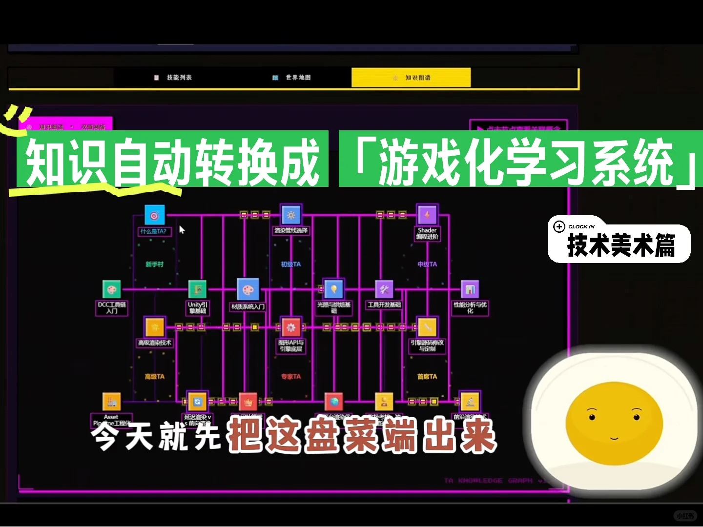

## 图片文字 (OCR)

> OCR 仅供参考，可能包含识别错误；请以原图为准。

技能列表
世界地图
知识图谱
知识相语
双品网络
知识自动转换成
「游戏化学习系统
京
CLOCK IN
什么是TA？
渣染管线选择
Shader
编程进阶
技术美术篇
新手村
初级TA
中级TA
DCC工具链
Unitysl
材质系统入门
光照
与烘焙基
工具开发基础
性能分析与优
入门
擎基础
化
O电口电
高级染技术
图形API与
引擎源码修改
引擎底层
与定制
高级TA
专家TA
首席TA
8
Asset
把这盘菜端出来
前沿清染
今天就先
e工程化
TA
KNORLEDGE
RAPU
