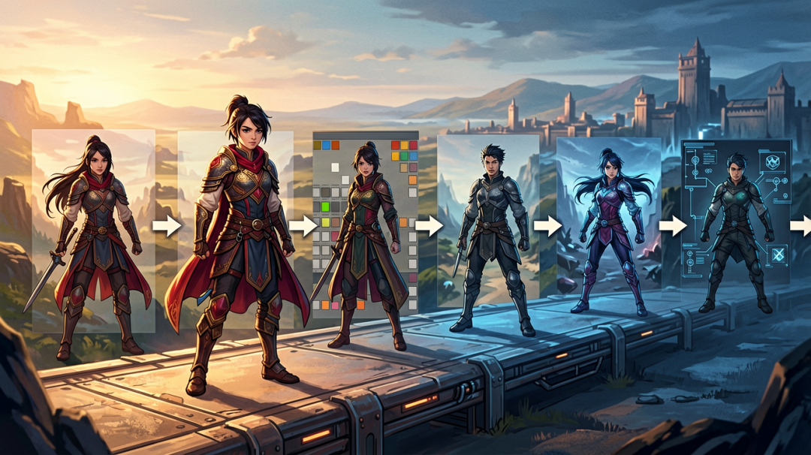
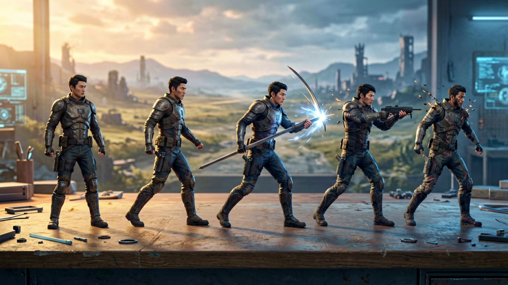
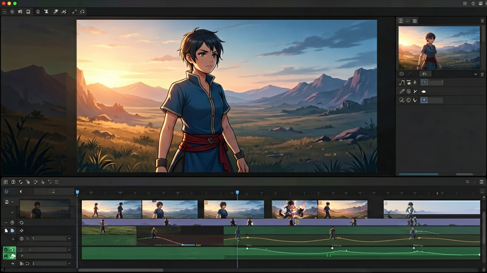
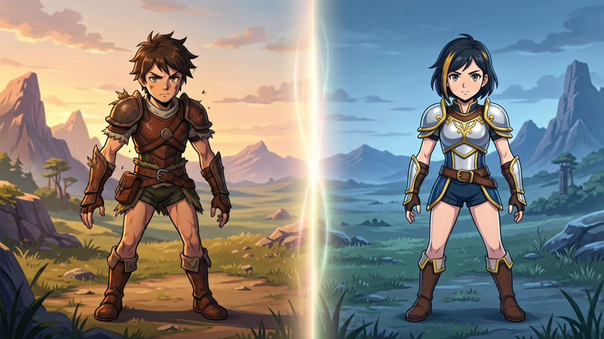

# 【AI独立游戏·03】Godot角色动画：AI出图到引擎落地

> 作者: DD熊 | 平台: 微信公众号 | 日期: 2026-08-29 07:34 | 原文: https://mp.weixin.qq.com/s/J9WiWyscFYHkBPMATgr03A

> **摘要**: 【AI独立游戏·03】Godot角色动画：AI出图到引擎落地

DD熊
原创出品 · 一切落地为核心

很多 Godot 新手都会卡在同一个地方：AI 画好了角色，不知道怎么变成可动的游戏动画。网上教程大多断层——要么只教 AI 出图、要么只教引擎简单拖拽，没有人打通「AI 出图 → 修图切片 → 导入引擎 → AnimationPlayer 成套动画落地」的完整闭环。

这篇文章把我个人一直在用的标准化 Godot 角色 Sprite 全流程管线公开出来，从 AI 绘图到最终可运行动画，一步不漏、全踩坑实录、可直接复用。全文分四步：先看管线总览，再讲 AI 出图标准化，接着拆引擎落地核心关键，最后点新手最容易翻车的 3 个点。

## 完整管线总览

一套标准可落地的流程，一共 7 步：

1. AI 批量生成角色动作帧（站立 / 行走 / 攻击 / 待机）

2. 统一画风、统一尺寸、修除 AI 畸形

3. 统一透明底、规整帧尺寸

4. SpriteSheet 规整切片

5. Godot 导入设置优化

6. AnimationPlayer 创建动画、调速、循环、过渡

7. 绑定状态机、实现正常游戏可调用动画

这套流程的关键在于：每一步都在为下一步铺路。AI 出图时锁死风格，后面切片才不崩；切片规整了，引擎导入才顺畅。任何一步偷懒，都会在后面的环节加倍还回来。

## AI出图标准化

做游戏角色动画，绝对不能一张张随便出图。这是整条管线里决定后续会不会崩的一步。

必须固定五件事：统一分辨率、统一光源方向、统一线条粗细、统一配色体系、统一人体比例。否则导入引擎后，每帧画风不一样、光影跳变，动画极其廉价、闪烁严重。

同时需要批量产出：待机、行走、攻击、受伤、死亡成套帧图。不要只出一张站立图——动画需要的是"一套动作的连续帧"，不是单张立绘。

批量出图时有个技巧：把角色描述块（脸型、发型、服装、配色）固定放在每个 prompt 开头，让 AI 把角色当固定参考。这样哪怕分多次生成，角色一致率也能保持在高位，不会出个"换人"的尴尬。

## 引擎落地核心关键

进入 Godot 后，有 4 个高频踩坑点，直接决定动画质量：

**1. 导入必须关闭自动压缩。** 否则移动端模糊、帧形变严重。Godot 默认会对纹理做压缩，2D 像素风角色一压缩就糊，必须在导入设置里关掉或改成无损。

**2. 切片必须精准对齐。** 错位 1 像素，动画就会抖动、位移。SpriteSheet 切片时，每个动作帧的锚点、尺寸必须严格一致，否则播放起来角色会"跳"。

**3. 帧率不要盲目拉高。** 2D 小游戏常规 8–12 帧足够流畅，多帧只会增加负担。别被"60 帧动画"忽悠，像素风角色 8 帧就能很顺滑，还能省包体。

**4. AnimationPlayer 过渡一定要加淡入淡出。** 解决帧切换生硬、跳帧问题。动作之间直接硬切会显得很廉价，加一点交叉淡入淡出，观感立刻提升。

## 新手最容易翻车的3个点

以下 3 个点，几乎每个新手都会踩，提前知道能省大量返工：

**1. AI 肢体崩坏不修复就直接导入。** 结果角色畸形抖动。AI 出的帧偶尔会有手指、肢体畸形，导入前必须逐帧检查，崩坏的帧要么修要么重出。

**2. 帧尺寸不统一。** 结果角色忽大忽小。每帧的尺寸、锚点必须一致，否则播放时角色像在呼吸，忽大忽小非常明显。

**3. 不做动画状态机。** 结果动作无法正常切换、卡死。待机、行走、攻击之间要用状态机管理，否则角色只能播一个动作，切换时直接卡住。

这套管线的优势很直接：高度标准化，以后所有角色直接套用模板；零散操作全流程工业化；产出动画干净、统一、适配微信小游戏发布标准。Godot 做 2D 游戏，角色动画是门面，也是最大的新手壁垒。只要打通这套「AI 出图到引擎动画落地」完整管线，你所有后续角色开发效率直接翻倍。

这是 AI 独立游戏开发系列的第三篇。上一篇讲了 0 成本做游戏 PV，下一篇讲 AI 生成 TileMap 瓦片、让 Agent 自动配碰撞体——想第一时间收到更新，点个关注。你用 Godot 做角色动画卡在哪一步？评论区聊聊。

🐻 关注DD熊，AI·游戏·美学，一起折腾点有意思的

本文由 **DD熊** 原创出品

👇 关注DD熊，AI·游戏·美学，一起折腾点有意思的
