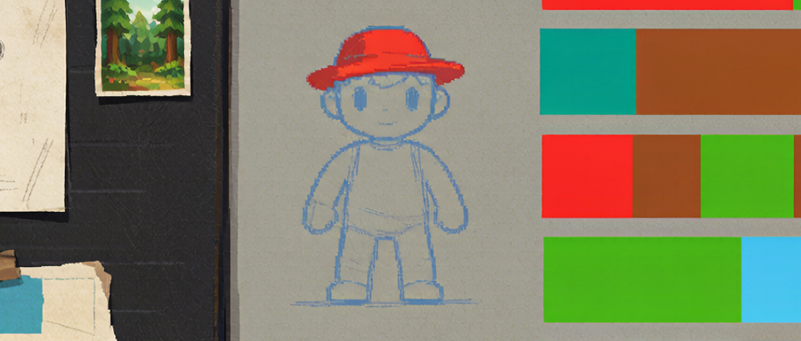
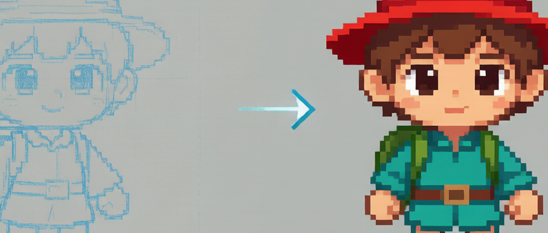
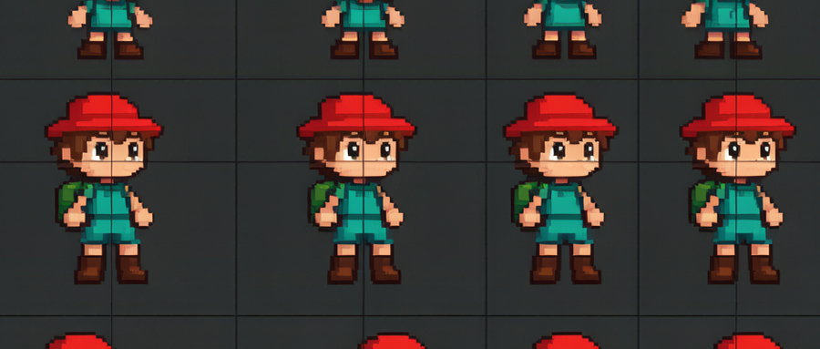
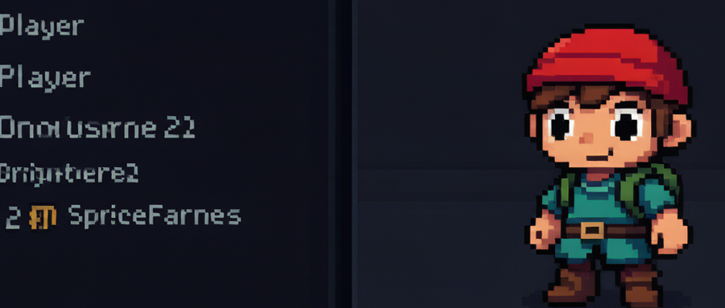
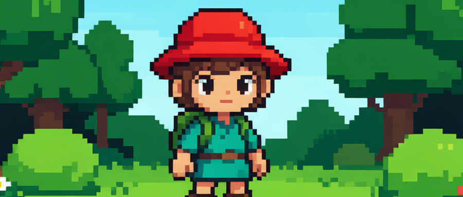
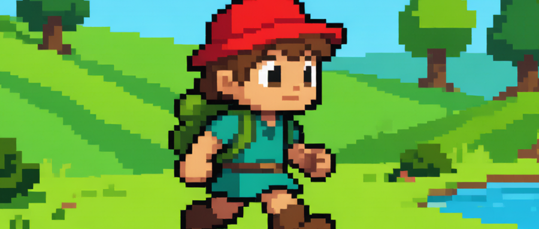

# 【AiGodot·01】不碰PS！AI做像素角色

> 作者: DD熊 | 平台: 微信公众号 | 日期: 2026-07-30 09:01 | 原文: https://mp.weixin.qq.com/s/heMQ8QoAP0b1qSNQtg4gNg

> **摘要**: 【AiGodot·01】不碰PS！AI做像素角色

DD熊
原创出品 · 一切落地为核心

做独立游戏的人，十有八九卡在美术。

脑子里角色、场景、剧情全都活了，一打开绘图软件，手就不知道往哪放。招美术招不起，外包贵得离谱，自己学画又像条没尽头的路。于是很多好点子，就死在了“第一张角色图都画不出来”这一步。

其实今天这条路已经被改写了。AI 出图 + Godot 这种轻量引擎，让一个不会画画的人也能把游戏里“活的角色”做出来。本篇不教一步步点哪个按钮，而是先帮你把**美术资产这条路的地图理清**——方向对了，后面每一步才不会白费。

## 一条能走通的主线

AI+Godot 做独立游戏，美术资产可以走一条清晰的主线：**AI 出概念定调 → AI 生像素资产 → 引擎里装配成动画**。手绘不再是必选项，你真正的活儿，从“画”变成了“定方向”和“做决策”。

先把这张规划板立起来：收集想要的参考图，定下整体是像素风还是扁平风，配色往哪个色系走。这一步看着虚，却决定了后面所有资产是不是“同一款游戏”。

## 角色资产从哪来

第一道决策：**角色用 AI 生图，还是自己手绘？**

如果美术底子薄、又要统一风格（尤其像素风），AI 生图是更省力的起点。思路不是“让 AI 一次出成品”，而是让它帮你**批量生成可挑选的概念稿**：同一角色不同角度、不同表情，从中挑出最对味的那张当“主视觉基准”。

关键不是生成得多，是生成得**可约束**：锁定角色特征（比如“红帽探险家”），用固定提示词前缀保证每次出来的脸和体型一致。手绘党的优势在可控性——本身就画得动的话，AI 更适合当辅助上色、加细节的工具，而不是甩手掌柜。

## 像素风一致性怎么保

像素风最怕的坑叫**风格漂移**：今天生成的偏卡通，明天生成的偏写实，拼一起像三款游戏。三个抓手：

- **调色板锁定**：先定一套有限配色（比如 16 色或 32 色板），所有资产只从这板里取色。颜色一多，风格就散。

- **像素尺寸约定**：角色统一 32×32 还是 48×48 的“画布格”，场景物件按同倍率缩放，别出现一个角色比房子还大的荒诞。

- **生成参数收口**：固定采样步数、固定模型/lora，把“随机性”压到最低。AI 每次都像同一个人画的，一致性才有保障。

## 进引擎前要想清楚什么

很多人栽在“资产都出了，才发现朝向和帧数没定”。**进引擎前的约定，比出图本身更重要**：

- **帧率先定**：idle、跑、跳各几帧？统一节奏，后面动画才不打架。

- **朝向先定**：只做左右（镜像翻转）就够，还是四向八向？这直接决定你要出几套资产。

- **切片规则先定**：一张 sprite sheet 横排几帧、每帧多大，工具导出时按这个切，别等导入 Godot 再手调。

把这三件事写在一张纸上，再让 AI 按规则出序列帧，返工率能砍掉一大半。

## Godot 装配的大方向

进了 Godot，思路很清晰：把 sprite sheet 切好，交给 **SpriteFrames** 管理成“动画片段”（idle、walk 各一段），再用 **AnimationPlayer** 串起来控制播放时机。你不用记点击步骤，只要明白一件事——**引擎负责“播”，你负责“喂对的资产”**。

角色节点挂上 SpriteFrames 资源，场景里就有了会动的自己人。

## 三个坑别踩

- **风格漂移**：没锁调色板和尺寸就开搞，越出越乱。

- **尺寸混乱**：资产单位不统一，放进场景比例全崩。

- **帧率没定就开搞**：动画节奏对不上，后期改到怀疑人生。

## 下篇预告

这期我们把“角色从 0 到站在场景里”的方向和坑点理了一遍。但角色现在还是站着不动——**下篇【AiGodot·02】，我们讲怎么让角色真正走起来**：行走循环（walk cycle）怎么规划帧、怎么在 Godot 里接成能跑能停的动画。关注 DD熊，别让角色卡在原地。

🐻 关注DD熊，AI·游戏·美学，一起折腾点有意思的

本文由 **DD熊** 原创出品

👇 关注DD熊，AI·游戏·美学，一起折腾点有意思的
