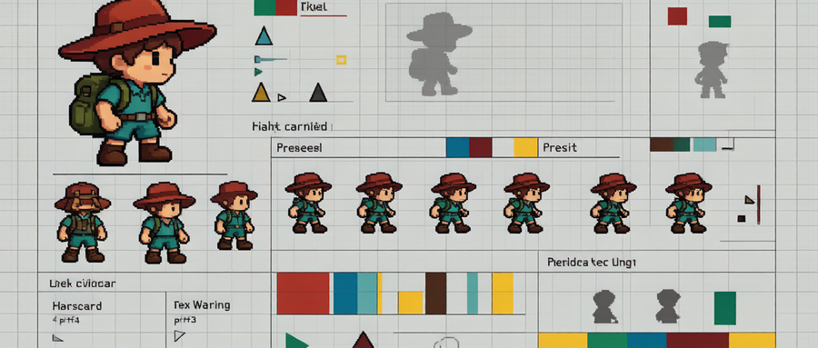
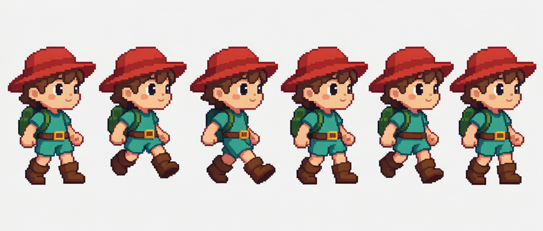
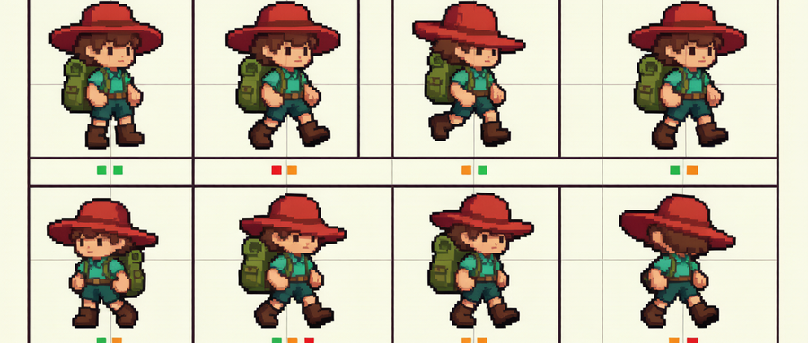
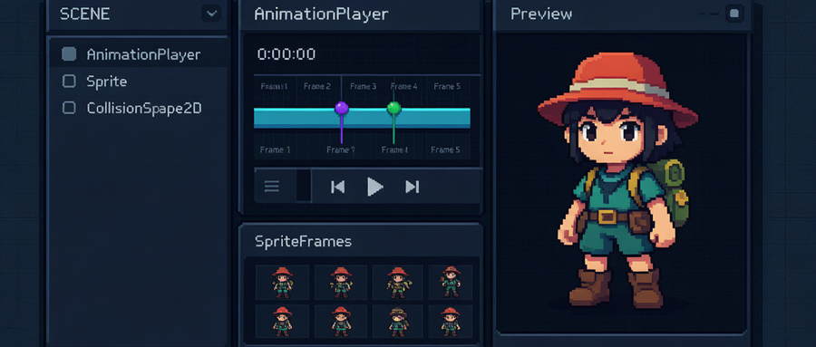
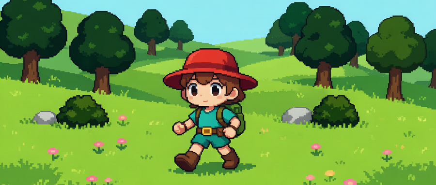
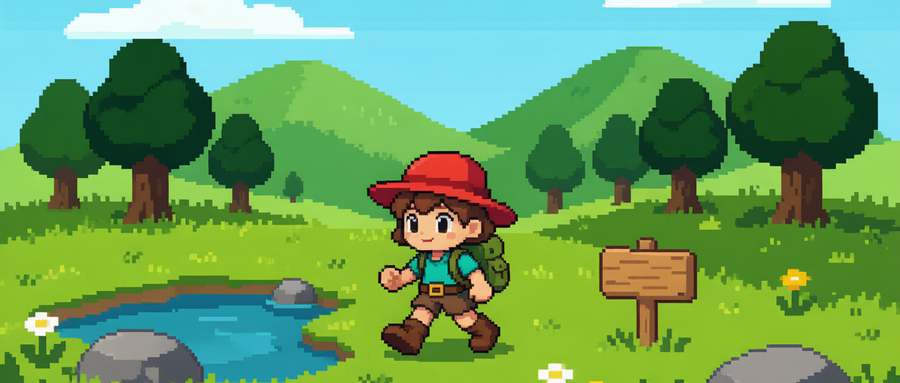

# 【AiGodot·02】不手K！AI生成行走循环

> 作者: DD熊 | 平台: 微信公众号 | 日期: 2026-07-31 10:14 | 原文: https://mp.weixin.qq.com/s/CUonoMYntws4E39dSRqt5w

> **摘要**: 【AiGodot·02】不手K！AI生成行走循环

DD熊
原创出品 · 一切落地为核心

## 角色不动，游戏就像 PPT

你辛辛苦苦画好了主角，拖进 Godot 场景，一运行——他站在那里一动不动。

风在吹，草在摇，唯独你的红帽探险家像个立拍得照片。这就是大多数独立游戏 demo 翻车的第一关：**行走循环（walk cycle）**没做。

传统做法是什么？打开 Aseprite，**手K八帧**：抬起左脚、踩下、抬起右脚、踩下……一个循环调半天，节奏还容易鬼畜。对新手来说，光这一步就能把人劝退。

但今天这条路可以绕开。

## 大方向：让 AI 出帧，让引擎接动画

核心思路其实一句话就够：**AI 负责把"走动的样子"批量画出来，Godot 负责把这些画好的帧按节奏播出来。**

你不需要会手K，也不需要当动画师。你要做的是两件事——先想清楚"要什么样的行走"，再把"画好的帧"交给引擎连成可玩的动画。下面拆成四块，把方向给你理清楚。

## 一、行走循环怎么规划：先数帧，再谈丝滑

别一上来追求电影级顺滑。先定**最小可用循环**。

一条基础 walk cycle，常见做法是 **8 帧一个循环**：左脚踩下、左抬、右踩、右抬各占两帧过渡。如果你求稳，也可以从 **4 帧**起步（抬-踩-抬-踩），虽略显机械，但足够让角色"活过来"。而 **idle（待机）姿态**一般不需要循环动画，1~2 帧轻微起伏即可，甚至单帧也行。

节奏上记住两个动作点：**踩下**要有"落地感"，**抬起**要有"离地感"。描述帧与帧之间的姿态差，比喊一句"走路"有用得多。

另外提前想好**帧率（FPS）**：2D 像素风走路常用 **8~12 FPS**，太低像幻灯片，太高又丢复古味。还有**循环接缝**——最后一帧的姿态要能无缝接回第一帧，否则走起来会"咯噔"一下。

## 二、朝向怎么定：这步想不清，后面全返工

朝向直接决定你的**资产量**，是前期最该拍板的事。

- **左右镜像**：最简单。只做一套向右走的帧，向左时引擎用 **flip_h** 水平翻转。2D 横版够用，成本最低。

- **四向 / 八向**：俯视或斜45度游戏才需要。上、下、左、右各一套，八向更细。资产量直接翻几倍。

一句话建议：**横版平台游戏用左右镜像就够，别自找麻烦做四向。** 等真要做俯视探索，再补也不迟。

## 三、AI 出行走帧的思路：喂"中间姿态"，挑连贯序列

AI 出图最大的坑是"它给你八张好看的图，但连不起来"。

解题思路是：**不要让它直接画"走路"，而是按"从站立到迈步的中间姿态"逐帧喂提示词。** 比如第1帧微抬左膝、第2帧左腿前伸、第3帧左脚将落……每一帧只描述"和上一帧差多少"，相邻帧姿态差越小，接起来越顺。

为了不"换脸"，出图时**锁定角色一致性**：固定角色描述、固定画风关键词，必要时用同一 reference / seed 约束红帽探险家的外形。sprite sheet 的**比例和尺寸**也先约定好（每帧等宽等高），后面切片才不歪。

出图后，把这些帧**横排成一张 sprite sheet**，肉眼扫一遍脚步节奏对不对：脚有没有穿模、有没有"瞬移"般的跳变。挑出连贯的那条序列，删掉跳戏的废帧。

## 四、Godot 接动画的大方向：SpriteFrames 管片段，AnimationPlayer 管时机

进引擎后，分工要清楚：

- **SpriteFrames** 管"素材片段"。你把一个角色的 idle、walk 等动作，分别存成不同的帧集合。它只负责"这一段时间播哪几张图"。

- **AnimationPlayer** 管"什么时候播什么"。它是一条时间轴，挂在你角色的节点下，通过**帧轨道（track）**指向 SpriteFrames 里的片段，控制播放、循环、停止。

大方向就是：**SpriteFrames 是素材库，AnimationPlayer 是导演。** 你给它一个"播放 walk 动画"的指令，角色就走；给"停止"指令，就回到 idle。能跑能停，靠的是这两个节点的配合，而不是你去手动翻图。后续想做"走/停/跳"状态切换，也是在这条时间轴上加轨道、加过渡，方向一致。

落到场景里，红帽探险家站在草地森林中，按一下方向键，他就迈开腿——那一刻你才会真正觉得：游戏活了。

## 三个坑，踩了就返工

**坑一：帧数没定就出图。** AI 一通生成，回来发现是 6 张、你要的是 8 张，节奏对不上，白费一遍算力。先定帧数，再出图。

**坑二：朝向想不清就开工。** 做到一半发现需要俯视四向，前面左右镜像白做。前期拍板，省下成倍返工。

**坑三：动画节奏对不上。** 帧有了，但 AnimationPlayer 的播放速度（FPS）和你的脚步节奏不匹配，走起来像踩棉花。帧率和脚步感要一起调。

## 下篇预告

角色能走了，但游戏还差点"灵魂"——**打击感、技能光效、环境特效**怎么来？

下篇【AiGodot·03】我们聊：**AI 视频转像素特效**。不写 shader、不调粒子参数，把一段 AI 生成的动态视频，变成能塞进 Godot 的像素特效素材。敬请期待。

🐻 关注DD熊，AI·游戏·美学，一起折腾点有意思的

本文由 **DD熊** 原创出品

👇 关注DD熊，AI·游戏·美学，一起折腾点有意思的
