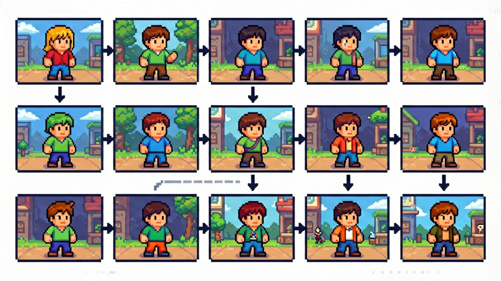
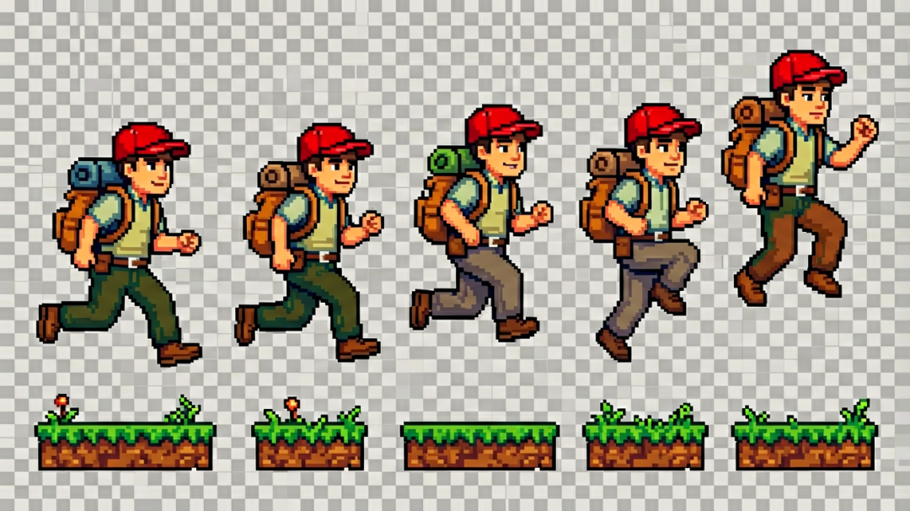
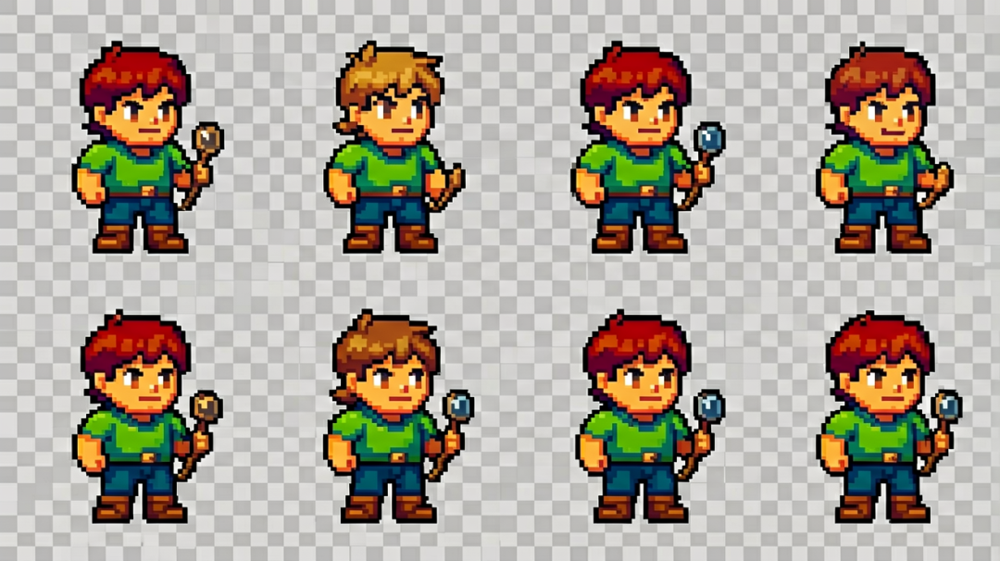
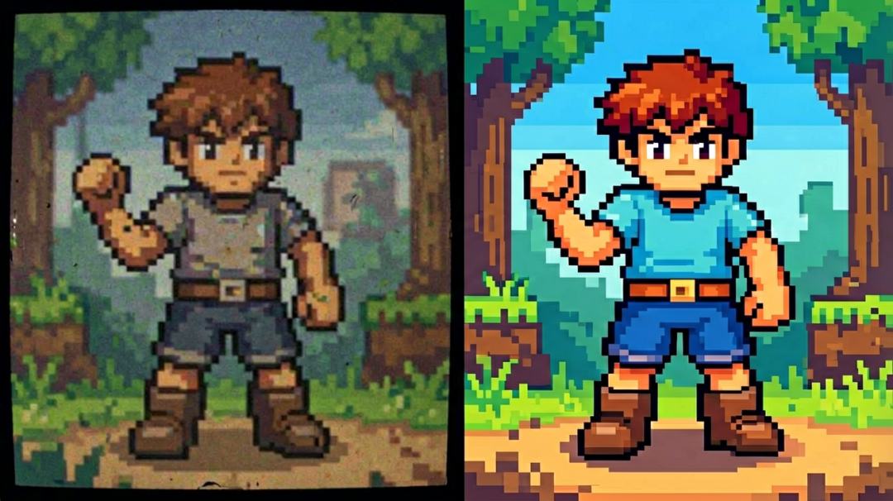
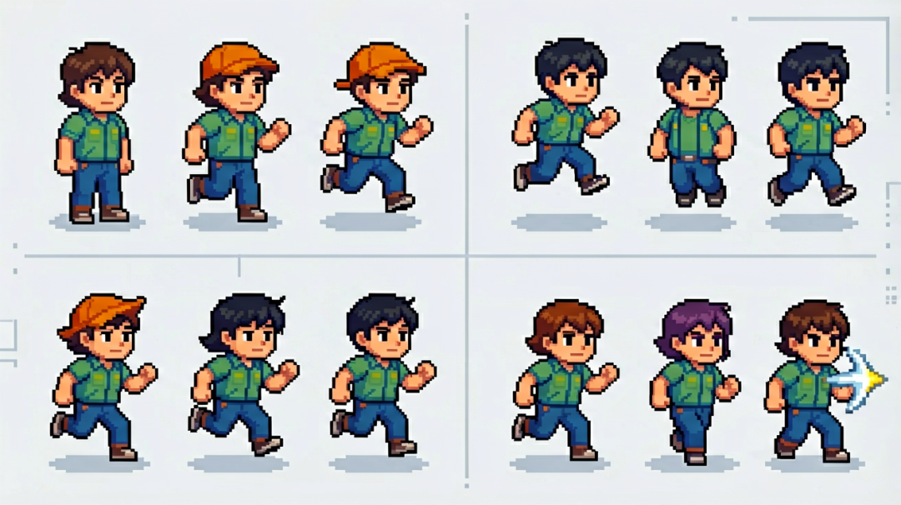

# 【AiGodot·03】Godot Sprite Sheet：用 AI 视频生成像素动画特效

> 作者: DD熊 | 平台: 微信公众号 | 日期: 2026-08-06 08:40 | 原文: https://mp.weixin.qq.com/s/U7uaoTWixtvgsGx-h5AKMg

> **摘要**: 【AiGodot·03】Godot Sprite Sheet：用 AI 视频生成像素动画特效

DD熊
原创出品 · 一切落地为核心

想给角色加个火球，一查骨骼动画蒙了——特效这关看着高深，其实可以走"视频转帧"的野路子

你刚调完角色移动，想给红帽探险家加一个火球术。点开教程，满屏**骨骼、骨骼网格、动画曲线、Blend Tree**……特效一瞬间成了全项目最劝退的环节。但真相是：绝大多数**攻击、爆炸、受击闪光**这类"播完即消失"的特效，根本不需要骨骼动画。它们的本质是一段**按序播放的序列帧**——谁先谁后无所谓，只要画面连贯就行。这正好给 AI 视频留了道缝：用 AI 生成一段带动态的视频，再把视频**抽帧成像素序列、拼成 Sprite Sheet**，直接塞进 Godot 播。整条**"视频→帧→Sheet→引擎"**路线，能把特效开发从"学一套骨骼系统"降级成"导一张图"。

## 大方向：一条绕开骨骼的流水线

先看清整条线长什么样，后面逐个拆：

1. **规划**：先定要哪些特效、什么风格、播多久

2. **AI 出视频**：用文字/参考图生成带动态的视频

3. **抽帧**：按节奏把视频抽成连贯像素帧

4. **拆条拼 Sheet**：帧排进一张图、标好单元格

5. **进引擎**：作为 Sprite / AnimationPlayer 挂上去播

这条线的核心判断：**骨骼动画适合"可反向、可混合、可受参数控制"的角色动作**（走路、挥砍），而**序列帧特效适合"播完即焚、风格自由"的瞬间表现**。别为了一个爆炸去学一套蒙皮。

## 特效需求怎么规划

动手前先把需求钉死，否则 AI 生成会无限返工。

- **列清单**：火球、爆炸、受击闪光，各列出来。别混着想，一次只生成一种。

- **定风格**：像素风？你的游戏是 16×16 还是 32×32 一格？特效要和角色**同分辨率档位**，否则一放出来就像贴了张高清贴纸。

- **定时长与节奏**：爆炸 0.4 秒够不够？受击闪光 0.15 秒点到为止。先定**总帧数**（比如 12 帧），后面抽帧才有锚点。

规划阶段输出一张"需求板"即可，把类型、风格方向、时长标清楚——这张图就是后面所有环节的验收标准。

## AI 视频生成特效的思路

这一步的目标是拿到一段**动态正确、风格统一**的视频，而不是逐帧手绘。

思路是给 AI 视频工具喂**明确提示词 + 角色参考图**：提示词写清"红帽探险家抬手释放火球，火焰向前喷射、带火星拖尾"，参考图用你已有的角色立绘锁定外观，避免生成出另一个人。要点：

- **锁主体**：用角色参考图做图生视频，保证红帽形象不漂移。

- **控动态**：提示词强调"喷射方向、膨胀再消散"，爆炸才有层次。

- **留余量**：生成比最终需要**多几帧**，抽帧时才有的取舍。

注意：AI 视频默认 24/30 帧率、电影感，这是后面要"降"的，不是直接进引擎的。

## 视频转帧：把动态压回游戏节奏

这是最容易翻车的一步。AI 视频是连续高帧率，游戏里通常 **8~12 帧/秒**就够了，直接整段丢进去会快成闪光。

- **降帧率抽帧**：按目标帧率（如 12fps）从视频里**等间隔取帧**，而不是全取。1 秒视频抽 12 张，不是 30 张。

- **保连贯**：抽之前先看动态曲线，爆炸的"膨胀—顶点—消散"三阶段都要有代表帧，别抽丢关键姿态。

- **转像素**：抽出的帧过一道**像素化/调色**，统一到游戏调色板，避免出现 AI 常见的杂色渐变。

抽完得到一串**连贯的像素序列帧**，这就是后面拼 Sheet 的原料。

## Sprite Sheet 拆条：把帧收进一张图

单张帧不好管，引擎也更爱一张整图。做法是把序列帧**按固定网格排进一张大图**，每个单元格一张帧，从左到右、从上到下即播放顺序。

- **定单元格尺寸**：比如每格 48×48 或 64×64，必须统一，且**比角色大一圈**留出特效溢出空间。

- **标索引**：Godot 的 SpriteFrames 按网格切片，行列数一对就能用帧索引播放。

- **留透明**：特效四周留透明通道，叠在角色上才不会糊成方块。

拼好后这张 Sheet 就是素材资产，丢进项目当贴图用。

## 进引擎的大方向

只讲方向，不展开操作：在 Godot 里，特效通常作为 **Sprite 节点 + AnimationPlayer**（或 AnimatedSprite2D）挂在角色节点下，或作为一个独立场景挂在受击位置。播放时由代码/信号触发，播完 `queue_free()` 销毁，不占常驻资源。关键是**锚点对齐**——特效原点要对到角色手部/命中点，否则火球会从脚底冒出来。

## 三个坑先记牢

- **帧率没降**：直接拿 30fps 视频全帧进引擎，特效快成闪光，节奏全乱。先定游戏 fps 再抽。

- **抽帧不连贯**：等间隔硬抽漏了关键姿态，播放时糊成一片跳变。按动态阶段补抽代表帧。

- **尺寸不匹配**：特效格比角色小一大圈，爆炸像个小火花。单元格按"角色的一倍半"起留。

## 下篇预告

特效有了，角色也有了，但场景太空——一张能跑能探索的**超大背景**怎么来？下篇【AiGodot·04】讲**Godot ParallaxBackground 视差背景系统**：怎么用 AI 扩图做无缝大地图、怎么分层铺景、怎么避免接缝穿帮。记得来看。

🐻 关注DD熊，AI·游戏·美学，一起折腾点有意思的

本文由 **DD熊** 原创出品

👇 关注DD熊，AI·游戏·美学，一起折腾点有意思的
