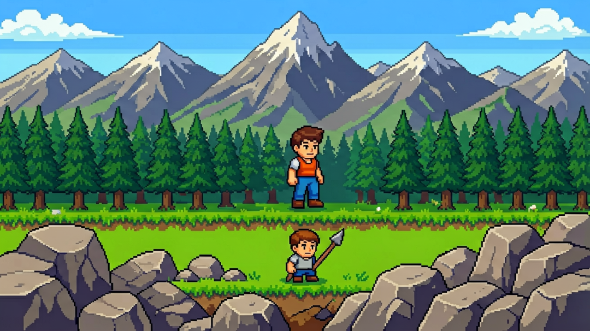
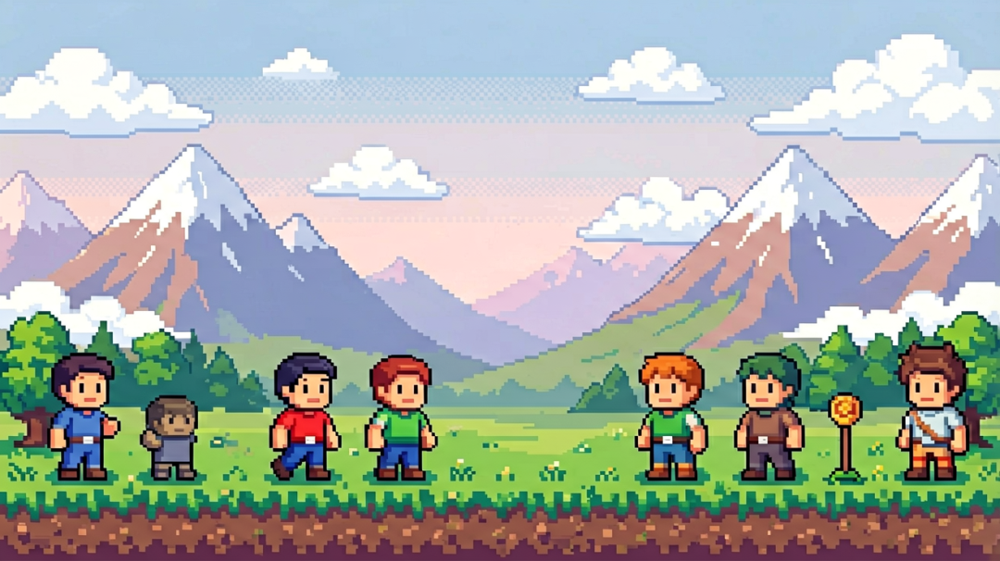
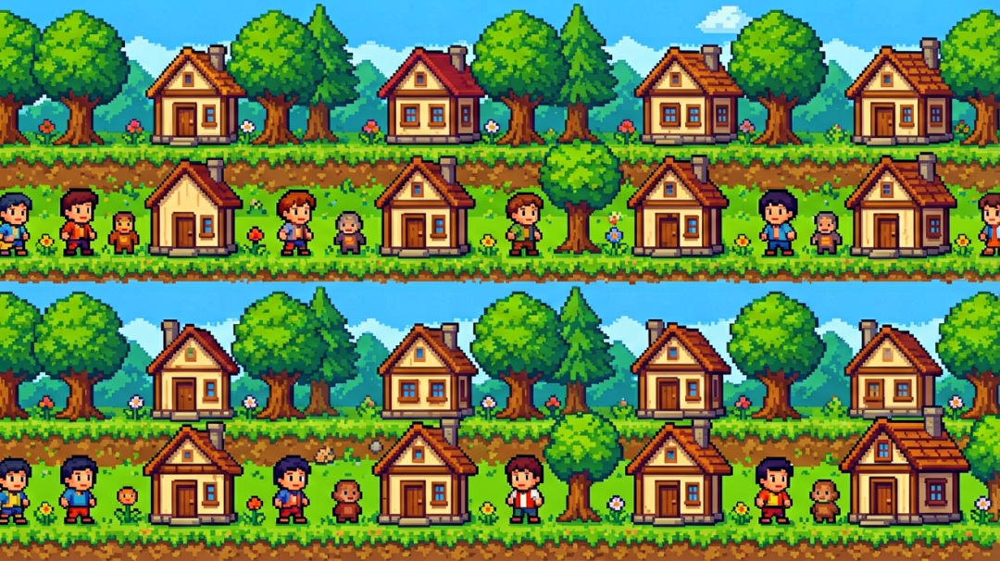
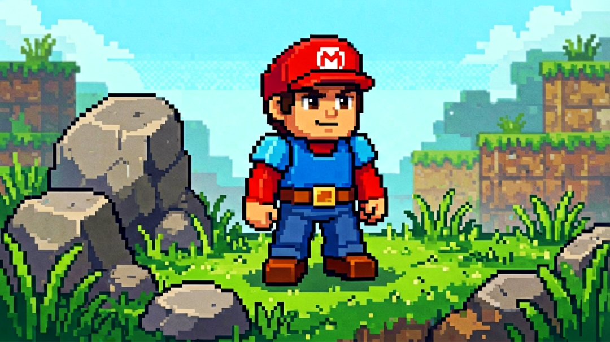
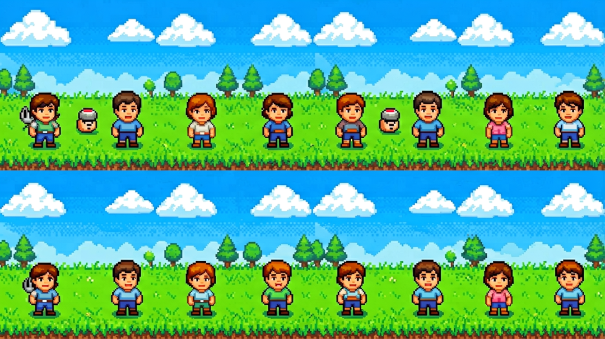
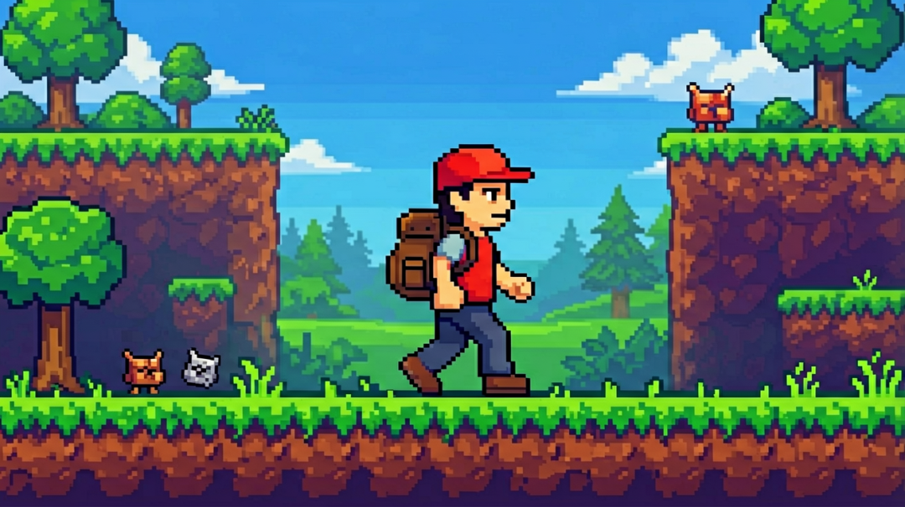

# 【AiGodot·04】Godot ParallaxBackground：搭建2D游戏视差背景系统

> 作者: DD熊 | 平台: 微信公众号 | 日期: 2026-08-07 08:58 | 原文: https://mp.weixin.qq.com/s/dAYATXL7Zn9XJ30hTgicMA

> **摘要**: 【AiGodot·04】Godot ParallaxBackground：搭建2D游戏视差背景系统

DD熊
原创出品 · 一切落地为核心

做独立游戏最容易被忽视、也最容易翻车的地方，往往不是角色和玩法，而是**背景**。

很多新手的第一张背景，是从 AI 绘图工具里随手导出的 9:16 竖图——构图好看、光影到位。可一旦铺进场景，问题马上来了：角色往右走两步，图就到头了；强行拉伸成宽屏，山变成歪斜的斜坡，树被压成纸片。玩家一眼就能看出"背景是假的"。

大世界需要**大背景**，可手绘一张 4096×2048 的超宽场景，对独立开发者是体力活里的体力活。好消息是：这条路现在有更省力的走法——用 **AI 扩图（Outpainting）** 把一张小图长成超大场景，再拼成无缝地图，最后拆成视差层滚起来。

下面这条"**扩图 → 拼接 → 分层 → Parallax**"的路线，带你把方向一次理清。

## 背景需求怎么规划

动手扩图前，先把需求钉死，否则后面每一步都会返工。

**定场景尺寸**：先想清楚关卡横向要走多远，是 2000 像素的小场景，还是 8000 像素以上的长卷？尺寸直接决定要扩几块图、每块多大。

**定视差层**：背景不是一张平图，而是**远、中、近三层**的嵌套。远层是天际线和远山，几乎不动；中层是森林云团，慢速移动；近层是 foreground 的草丛树枝，跟着镜头快速掠过。三层速度差，就是纵深感的来源。

**定美术方向**：像素风还是水彩风？冷调还是暖调？存一份参考图，后面每块扩图都对着它干活——这是避免风格漂移的命根子。

## AI 扩图的思路

核心动作是 **Outpainting（外绘/扩图）**：你先有一张"种子图"——比如一座山的山脚、一片森林的边缘——再让 AI 沿着它的边缘**往四周补全**缺失画面。

思路不是"一次生成一张完整大图"，而是**以小块为种子，向四周生长**：左边扩出连绵山脉，右边扩出森林断崖，上边补天空和云，下边接地面和路径。每一刀扩图都"咬"住上一块边缘，风格就被锁在一条线上。

关键是**控制变量**：固定同一个模型、同一套提示词底色、同一个种子区间。你每次扩图，都是在逼 AI 重复上一次的笔触，而不是凭空发挥。

## 无缝拼接

单块扩图再大也有边界，要铺长卷就得拼。难点不是"放一起"，而是**拼缝**。

最易露馅的是两块的**色调、地平线高度、笔触密度**对不上。大方向是：扩图时让相邻两块刻意**重叠一截**（各留 200 像素过渡带），拼的时候用图像工具做**羽化/蒙版融合**，让重叠区自然过渡，而不是硬切一条线。

拼完别急着进引擎，先在静态预览里把整张长图卷一遍，确认**地平线全程水平、天际线连续、没有突兀色块跳变**——这些在引擎里动起来会被放大十倍。

## 视差分层

拼好的大图，下一步是"拆"。按**远、中、近**重新切成三层独立图：

- **远层**：只留天空、远山轮廓，元素最少最干净；

- **中层**：森林、云、远处建筑，是视觉主体；

- **近层**：前景草石树枝，可以比角色还大，制造"掠过感"。

拆层时有个常被忽略的点：**每层之间要留透明通道**，尤其近层——角色要从近层景物后走过去，近层必须是带透明底的 PNG，否则会被挡死或穿模。

## 进引擎的大方向

到了 Godot，路线收口。用 **ParallaxBackground** 节点作容器，下面挂多个 **ParallaxLayer**，每个 Layer 对应拆好的一层图。

方向很简单：**远层挂在 scroll 系数最小的 Layer，近层挂在系数最大的 Layer**。镜头移动时，ParallaxBackground 按各层系数自动算出不同位移速度——远山几乎不动，近草飞速掠过，纵深感就这么来了。背景图用 **TextureRect 或 Sprite** 铺在 Layer 下，超宽图记得设 `repeat` 或靠多段拼接覆盖整条关卡。

只讲方向，不替你点每一个按钮：你真正要做的，是把规划好的三层图和系数，一一映射到节点树上。

## 三个最容易踩的坑

**坑一：扩图风格漂移，拼不拢。** 最高频翻车。每块都"好看"，放一起却像三个画师画的。根因是没锁种子和提示词底色——务必全程钉死同一套参数。

**坑二：视差层顺序反了。** 远层系数比近层还大，山比草动得快，眼睛立刻报警。铁律：**越近，动得越快，系数越大**。

**坑三：背景和角色比例失调。** 山画得巍峨，红帽探险家一放进去小得像蚂蚁，玩家找不到自己。规划阶段就该在种子图里**先摆一个角色比例参照**，扩图时始终对照它。

## 下篇预告

【AiGodot·05】解决"地面怎么走"——**Godot TileMap 关卡地图系统**：用 AI 生成一套风格统一的瓦片，自动配好碰撞体，铺路铺墙铺地板一气呵成。

🐻 关注DD熊，AI·游戏·美学，一起折腾点有意思的

本文由 **DD熊** 原创出品

👇 关注DD熊，AI·游戏·美学，一起折腾点有意思的
