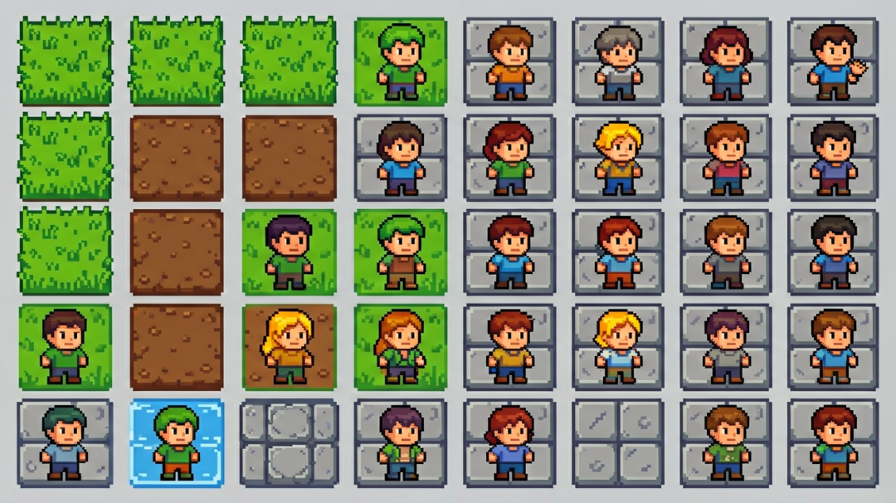
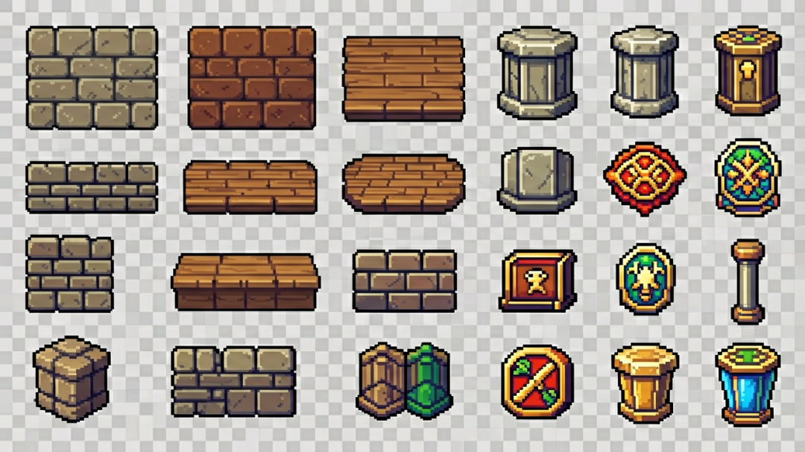
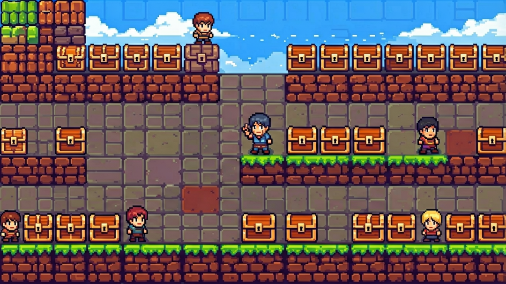
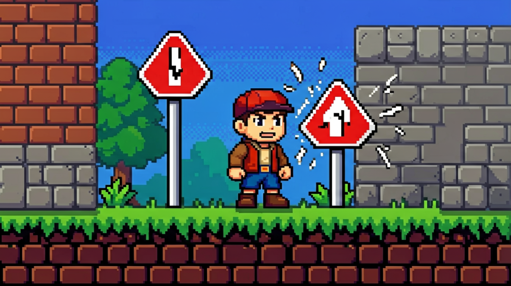

# 【AiGodot·05】Godot TileMap：搭建2D关卡地图系统

> 作者: DD熊 | 平台: 微信公众号 | 日期: 2026-08-08 07:21 | 原文: https://mp.weixin.qq.com/s/x86oIWu3VtfTZ0twKHLXaw

> **摘要**: 【AiGodot·05】Godot TileMap：搭建2D关卡地图系统

DD熊
原创出品 · 一切落地为核心

角色能走能跑，但地面像贴纸——石头、草地、地板风格混乱，一会儿像 RPG，一会儿像平台跳跃，玩家根本找不到代入感。

很多新手的第一个关卡，是死在"地面怎么铺"。传统做法：打开 Aseprite，手绘一堆瓦片，一张张配碰撞体，最后在 Godot 里一点点拼出来。这不仅累，还极其容易出问题——风格不统一、瓦片边缘对不上、碰撞体像僵尸一样不贴地、走两步就掉下去。

好消息是，这条路现在有了更省力的走法——用 **AI 批量生成风格统一的瓦片**，自动配好碰撞体，再铺成 TileMap，铺路、铺墙、铺地板一气呵成。

下面这条"**规划→AI生瓦片→配置碰撞→Godot TileMapLayer铺设**"的路线，帮你把方向理清楚。

## 一条"AI→瓦片→引擎"流水线

先看清整条线长什么样，后面逐个拆：

1. **规划**：先定要哪些瓦片类型（石头/草地/地板/墙壁），定尺寸（16/32/64px），定风格锚定词

2. **AI 生瓦片**：用固定模型+提示词批量生成，锁定参考图避免风格漂移

3. **配置碰撞**：Godot 的 TileSet 如何给瓦片配 StaticBody2D 碰撞

4. **进引擎**：TileMapLayer 节点树铺设，Layer 管理

这条线的核心判断：**AI 生瓦片适合快速原型，复杂关卡可能需要后期手调**。别指望一次生成就完美，瓦片地图这东西，后期微调才是常态。

## 瓦片怎么规划：别一上来就画

动手前先把需求钉死，否则后面每一步都会返工。

**定类型**：一块地图至少要哪几种瓦片？石头路面、草地、地板、墙壁、楼梯、斜坡……列出来，别漏。

**定尺寸**：像素风瓦片常用的格数是 **16×16、32×32、64×64**。尺寸直接决定你画多少张图、拼起来像什么分辨率。建议新手从 **32×32** 起步，够用又不至于太碎。

**定风格锚定词**：定一套"风格母题"。比如"像素风、16 色板、冷暖对比、硬边阴影、金属质感"。这套词你每次 AI 生成都喂进去，风格就被锁死了。最忌讳的是每块瓦片单独想提示词，最后风格像不同画师画的。

还有**采样步数、固定种子**这些参数，也要和之前角色/背景那篇一样，全程钉死，别临时改。

## AI 生瓦片的思路：批量而非单张

核心动作是**批量生成可挑选的瓦片集**，不是一次性生成一张完美的瓦片。

思路是按**类别分批喂提示词**：第一次出石头、第二次出草地、第三次出地板……每次提示词里都带上你定好的"风格锚定词"和"像素尺寸约定"。比如：

- 提示词 1："32×32 像素风石头瓦片，铺路用，带硬边阴影，16色板"

- 提示词 2："32×32 像素风草地瓦片，浅绿底色，均匀分布"

- 提示词 3："32×32 像素风木板地板，木纹纹理，暖色调"

关键不是"生成得多"，是**生成得可约束**：用同一模型、同一 seed、同一提示词前缀，保证所有瓦片"同一人画的"。出图后，把每一类的瓦片都挑出 5~10 张，肉眼扫一遍风格对不对，边缘顺不顺，再决定哪些能进正式集。

## 配置碰撞：Godot 的 TileSet 大方向

AI 只管出好看的图，碰撞还得你自己配。Godot 的 TileSet 是管理瓦片和碰撞的核心，关键方向有两块：

**给瓦片配物理碰撞**：TileSet 里每个 Cell 都能配一个 **StaticBody2D** 或 **TileMapLayer** 的碰撞。你需要在 TileSet 里画好碰撞形状——矩形、多边形、圆形，甚至是一组像素级的网格碰撞。传统做法是"先出图，再对着图描边画碰撞"，现在可以变一下思路：在 TileSet 里**先把碰撞画出来，再把图贴上去**，或者反过来，出图时预留碰撞边界，减少后期描边工作量。

**碰撞格式选择**：常见有两种：

- **像素网格碰撞**（Pixel Perfect）：适合精细的平台跳跃，每格都是可碰撞的实体。Godot 的 TileSet 支持按单元格自动生成。

- **矢量碰撞**（Vector2 polygon）：适合大面积路面，碰撞形状简化，节省性能。注意这种碰撞和视觉瓦片不一定对得上，容易穿模。

方向很简单：**路径用网格碰撞，墙壁/障碍物用矢量碰撞**。

## 进引擎：TileMap 铺设的大方向

到了 Godot，路线收口。把 TileSet 资源挂到 **TileMapLayer** 节点下，剩下的就是铺。

**Layer 管理**是 TileMap 的核心。建议按功能分层：

- Layer 1：底层路面（石头/草地）

- Layer 2：顶层地板（木板/砖石）

- Layer 3：墙壁/障碍物层（给后面铺墙壁用）

每个 Layer 可以单独控制显示/隐藏，方便调试。铺的时候用**按住 Shift 画框**的方式，一次性铺一大块，比单个点按快十倍。铺完后记得保存场景，TileMap 的拓扑结构会被 Godot 自动记录。

## 三个最容易踩的坑

**坑一：瓦片风格漂移，铺出来像三个画师画的。** 最高频翻车。每块都"好看"，铺一起却风格不对。根因是没锁种子和提示词底色——务必全程钉死同一套参数。

**坑二：碰撞体没配对。** 碰撞形状比瓦片小一圈，或者比瓦片大一圈，走两步就掉下去。铁律：**碰撞边界要和瓦片边缘对齐**，建议用网格碰撞自动生成。

**坑三：Layer 顺序反了。** 墙壁铺在地板下面，或者地板铺在墙壁下面，都会穿模。铁律：**底层→顶层→障碍物，Layer 从下到上依次叠加**。

## 下篇预告

【AiGodot·06】音效与音乐怎么配？——**Godot 音频系统**：AI 生成音效和背景乐，用 AudioStreamPlayer 和 AudioListener2D 在引擎中统一调度，解决"游戏像默片"的问题。

🐻 关注DD熊，AI·游戏·美学，一起折腾点有意思的

本文由 **DD熊** 原创出品

👇 关注DD熊，AI·游戏·美学，一起折腾点有意思
