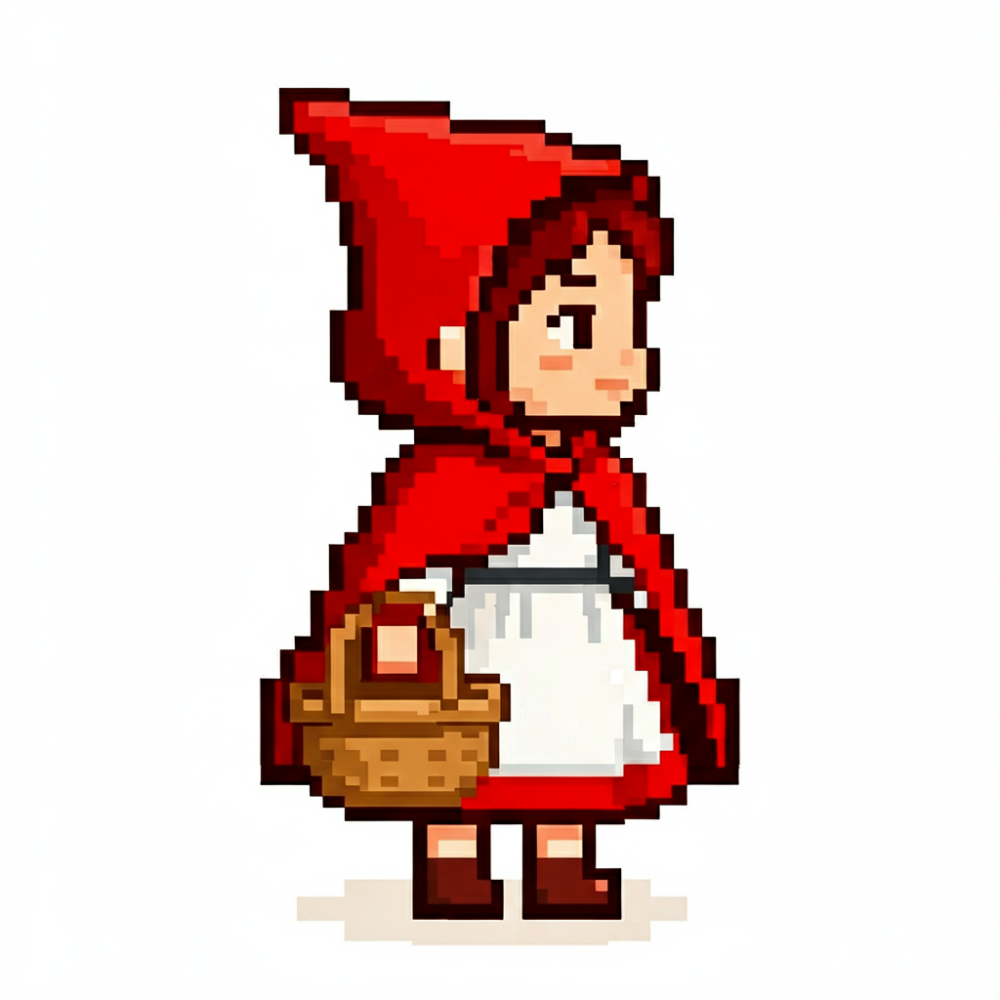
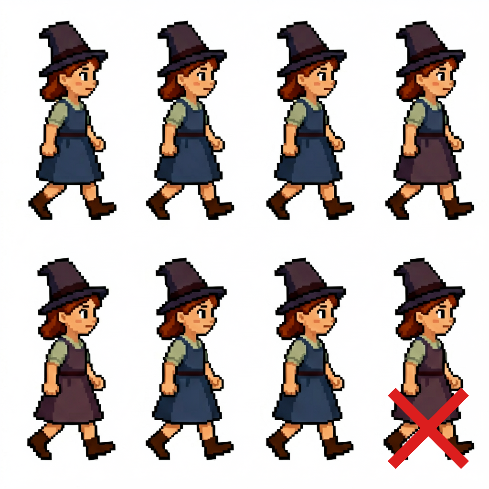
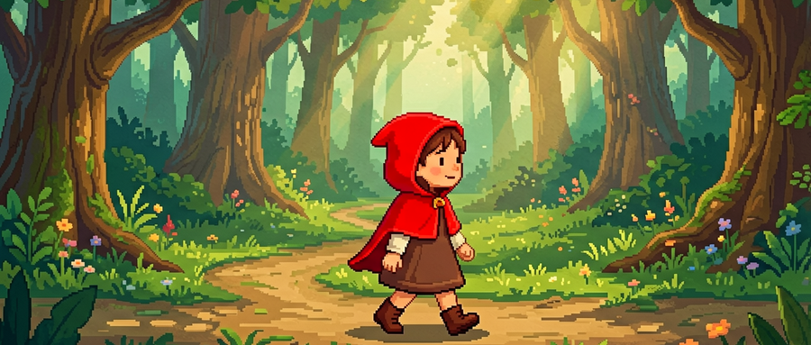
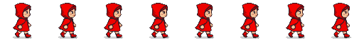

# 【实操】2Dsprite角色-真像素

> 作者: DD熊-AI笔记 | 平台: 微信公众号 | 日期: 2026-08-07 17:07 | 原文: https://mp.weixin.qq.com/s/zDnHArlfHFwDH1jHaROl5A

> **摘要**: 【干货】2D游戏角色探索

DD熊
原创出品 · 一切落地为核心

做独立游戏，最卡人的不是玩法，是美术资产。尤其是像素游戏——你以为像素画很简单，其实手绘一帧就要半天，一个走路循环四帧起步，十个敌人就是四十帧。

这篇文章不讲虚的，直接给你一条**AI生成像素游戏资产的完整流水线**：从AI出大图，到缩小成真像素，再到生成行走动画、切片对齐、导入引擎。全程实测，踩过的坑都写在里面。

## 第一步：AI 出大图

像素资产的起点，是用 AI 生成角色设计图。我用的是 Agnes AI 的图片模型，提示词要写清楚风格关键词：

```
pixel art character, Little Red Riding Hood girl, red hood cape,  holding basket, facing right, side view, 16-bit style,  limited color palette, NES aesthetic, clean lines, white background
```

关键在几个词：**16-bit style**（风格）、**limited color palette**（限色）、**white background**（白底，方便后续抠图）、**side view**（侧面，游戏精灵需要）。

生成出来是一张 1024×1024 的大图，这时候它还不是像素画——只是一个"像素风格"的插画。



## 第二步：缩小成真像素

这一步最容易踩坑。很多人直接拿图缩小，结果糊成一团。**因为平滑缩放（LANCZOS/bilinear）会把边缘颜色混合成过渡色，像素画要的是硬边缘。**

正确流程是四步：

1. **预处理**：增强对比度 20-30%，压平过渡色

2. **最近邻下采样**：缩到 64×64，这一步用 `NEAREST` 而不是平滑缩放

3. **颜色量化**：压到 16-32 色，像素画的特征就是有限调色板

4. **整数倍放大**：4× 放大到显示尺寸，永远用最近邻

用 Python Pillow 实现：

```
from PIL import Image, ImageEnhance  img = Image.open("input.png").convert("RGB") enh = ImageEnhance.Contrast(img).enhance(1.3)        # ① 对比度 down = enh.resize((64, 64), Image.NEAREST)           # ② 最近邻缩小 quant = down.quantize(colors=32).convert("RGB")      # ③ 量化32色 final = quant.resize((256, 256), Image.NEAREST)      # ④ 整数倍放大 final.save("output_64px.png")
```

缩小后得到 64×64 的真像素网格，每个像素都是独立色块，边缘硬朗——这才是能进游戏的真像素，而不是放大后糊成一团的"伪像素"。


## 第三步：生成行走动画

角色有了，接下来是动画。这里有个**重大路线选择**，我两条都实测了：

**路线一：直接生成 Sprite Sheet（推荐）**

让 AI 一次画好多帧排列的静态图，提示词里写清楚"原地踏步、每帧居中、同一角色"：

```
Pixel art sprite sheet, 4 frames of Little Red Riding Hood walking in place,  side view facing right, feet stepping WITHOUT moving forward,  body stays centered in every frame, same character all frames
```

一次得到一张 4 帧排列的图，**无运动模糊、白底好抠图**，质量最高。

**路线二：图生视频再抽帧（备选）**

用视频模型生成 5 秒走路动画，然后 ffmpeg 抽帧：

```
ffmpeg -i video.mp4 -vf "fps=6" frames/w_%02d.png
```

这条路视频天然连贯，但有运动模糊，抽帧后抠图会有残影——**所以能走路线一就别走路线二**。下面这张就是视频路线的翻车现场，AI 擅自加了草地场景，抠图根本抠不干净：



## 第四步：切片对齐（关键中的关键）

动画帧切出来，最怕**抖动**——就是播放时角色上下左右飘。这是新手最容易忽略的。

抖动的根源：AI 生成的每帧里，角色位置不完全一致。直接切片拼起来就抖。

**解法是游戏精灵的标准做法：脚底对齐 + 中心对齐。**

1. 按列扫描非白像素密度，找到每帧边界

2. 每帧抠图（白底变透明）

3. **脚底对齐**：所有帧的脚底（主体最低点）对齐到同一行

4. **中心对齐**：每帧角色水平居中

```
foot_ref = sorted(b[3] for b in bounds)[len(bounds)//2]  # 脚底中位数 paste_y = 56 - nh   # 64px画布, 脚底固定第56行 paste_x = (64 - nw) // 2  # 水平居中
```

对齐前后差别巨大：不对齐的 GIF 角色上下跳，对齐后稳稳地原地踏步，位移完全交给引擎控制。

## 效果：原地踏步循环

最终成果：4 帧原地踏步循环。放进引擎后，移动时叠加水平位移就行，脚部动画和位移完全解耦——这就是游戏里行走动画的标准做法。

最终用到的素材就是开头那张小红帽图，走完全流程变成 64×64 的真像素精灵，再放进游戏场景里跑起来：



如果是视频抽帧路线，5秒视频按 6fps 抽 30 帧，均匀取 8 帧排成一排，就是一张标准的 8 帧行走序列——直接作为游戏的行走动画帧：



## 踩坑清单（全实测）

最后把这次踩的坑都列出来，帮你省掉几天排查时间：

| 坑 | 现象 | 解决 |
| --- | --- | --- |
| 平滑缩放 | 缩小后边缘脏糊 | 用最近邻 + 量化 |
| 颜色太多 | 不像像素画 | 量化到 16-32 色 |
| 视频带场景 | 抠不干净 | prompt 强制纯白背景 |
| 视频残影 | GIF 有拖影 | 用静态 sprite sheet |
| 泛洪抠图 | 删掉角色白色部分 | 用全局阈值 |
| 帧间抖动 | 播放时上下飘 | 脚底对齐 + 中心对齐 |

做像素游戏，AI 不是让你躺平的，是让你把省下的时间花在更值得的地方——比如关卡、手感、叙事。资产这块，按这条流水线走，一天出几十个角色不是梦。

**核心一句话**：AI 出大图 → 最近邻缩小+量化成真像素 → 直接生成 sprite sheet → 脚底对齐切片 → 进引擎配位移。

你踩过像素资产生成的坑吗？评论区聊聊，人多的话下期出一篇「AI 生成 tileset 无缝拼接」。

🐻 关注DD熊，AI·游戏·美学，一起折腾点有意思的

本文由 **DD熊** 原创出品

👇 关注DD熊，AI·游戏·美学，一起折腾点有意思的
