# 不花钱，给孩子手搓体感骑行互动游戏

> 作者: 像素老爸 | 日期: 2026/08/22 | 原文: https://www.xiaohongshu.com/discovery/item/6a887c03000000003a02018f?app_platform=android&ignoreEngage=true&app_version=9.43.1&share_from_user_hidden=true&xsec_source=app_share&type=video&xsec_token=CB30Jbnkd2ifKCiRRr4YoAo51CCd5nxrYEvpoYF0q8Qo0%3D&author_share=1&xhsshare=CopyLink&shareRedId=N0dINjg3NUpMPko6S0EySDs0P0lFSjdL&apptime=1787671737&share_id=03a73eec89f94214b5416961d6df3bd3&share_channel=copy_link

> **摘要**:作者利用AI技术和传感器,自制了一款体感骑行互动游戏,让孩子在客厅就能体验环法自行车赛的乐趣。游戏通过AI生成动态赛道,结合体感和键盘操控,显示地图进度、速度、心跳、里程等数据,让运动变得有趣。相比电子产品,这种方式让孩子主动动起来,锻炼效果远胜强迫下楼运动。

用AI加传感器做了体感骑行 儿子在客厅骑出了环法的感觉
AI生成赛道 不用出门，客厅就是赛道 孩子骑得满头大汗追着我要玩
比逼他下楼运动管用一百倍
不是让孩子玩电子产品 是用科技让他动起来
评论区找我要完整提示词

#howto玩坏AI #AI搞学习howto #我在小红书做游戏 #AI教育 #人工智能未来 #游戏开发 #挑战人工智能 #AI工具 #游戏创想行动 #好视频扶持计划 #体感骑行 #AI亲子游戏

## 视频

[视频 1](./video.mp4)

<video controls width="100%"><source src="./video.mp4" type="video/mp4">您的浏览器不支持视频播放。</video>

附件: [音频](./audio/audio.wav) | [处理清单](./video_manifest.json)

## 视频图文总结

> 按关键帧关联完整视频转录；文字保留机器转写原文，时间点仅用于定位。

### 1. 00:00

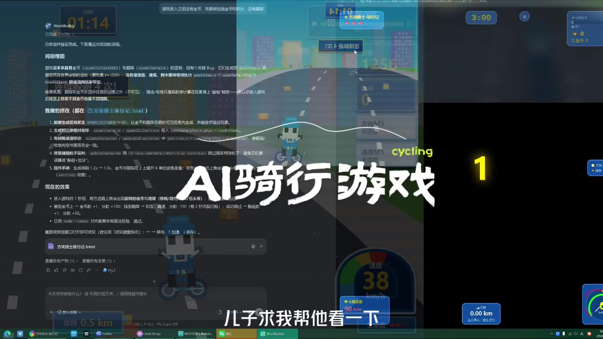

- 内容摘要：儿子请我帮他看一下他用ai做的骑行游戏（00:00-00:02）
- 画面文字（OCR）：01:14
41:F0
WorkBu
*方块士·行记
3:00
已完成7m38
已修复并验证完成，下面是这次改动的说明
染
问题根因
里本来就有金币（octible）和路障（pCbace）的逻辑，但有个关键Bug：它们生成ptn：
roadoffant端向玩家移动.
选续躲避4
结果就是：路障和途币承远停在雾的边缘之外（不可见），描击/收集只是数学计算在玩家身上偷价发
所以你进入游戏
后视觉上既看不到金币也看不到路障。
我做的修改（都在方块骑士骑行记html）
1.新增生成离常量
PAC9，让金币和路在需的可见范围内生成，并能自然遇近玩家
2.生时记录相对偏移：pCe/apolele写入Datao-f.
方向M5
3.每移动：/中
收集判定与医面完全一致
4.修复描粒子误判：upan用（cc过车特效粒子，免它们被
速度M5
cycling
误算成“躲避+加分。
AI骑行游戏
L
5.提升手：生成同隔1.2s一1.0s，金币与路隔在z上错开6单位避免重叠：收
（soinpp动图）
现在的效果
·进入游戏约1秒后，前方道路上就会出现转的金币和跑障（维/
·劳到金币上一金币数+1、分数+100：描到路降一扣血减速，分数-100（有2秒无数闪烁）：成功过一数
+1、分数+50
已用nodeche对内联脚本法校验，通过
直接用预览窗口打开可试玩（建议用[试玩键盘模式]：一一转向，1加速，刹车）
方块骑士骑行记.html
查看所有产物（1））查看所有变更（1）
DP0C
e
Hy3
速度
.
38
今天帮你阅些什么？@引用对话文件，/调用能指令
心监
默认权限
儿子求我帮他看
90bpm
下
0.00km
二
里程
0.5km
模点健生控

### 2. 00:02

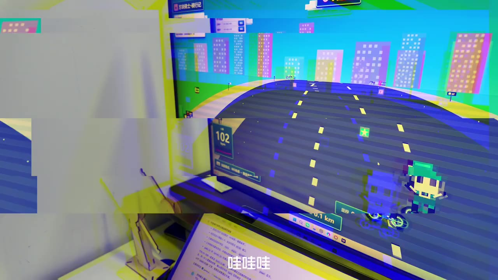

- 画面文字（OCR）：1
全金法
1
E
M
1219
1412
1
0
B
.
EEs
102
T
km

### 3. 00:06

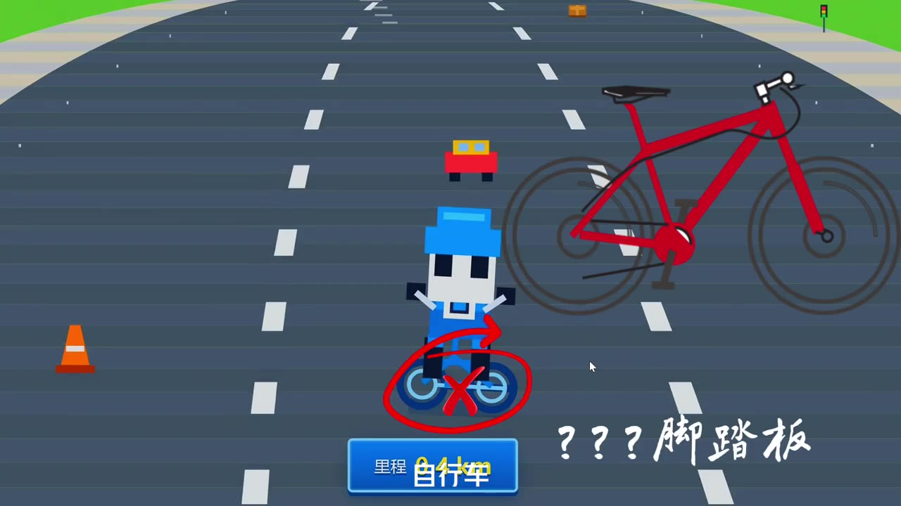

- 内容摘要：哇哇哇哇哇，没想到第一个被训练的是我，谁家的自行车不踩踏板还侧着身骑（00:02-00:08）
- 画面文字（OCR）：自行车
里程
？？？脚踏板

### 4. 00:09

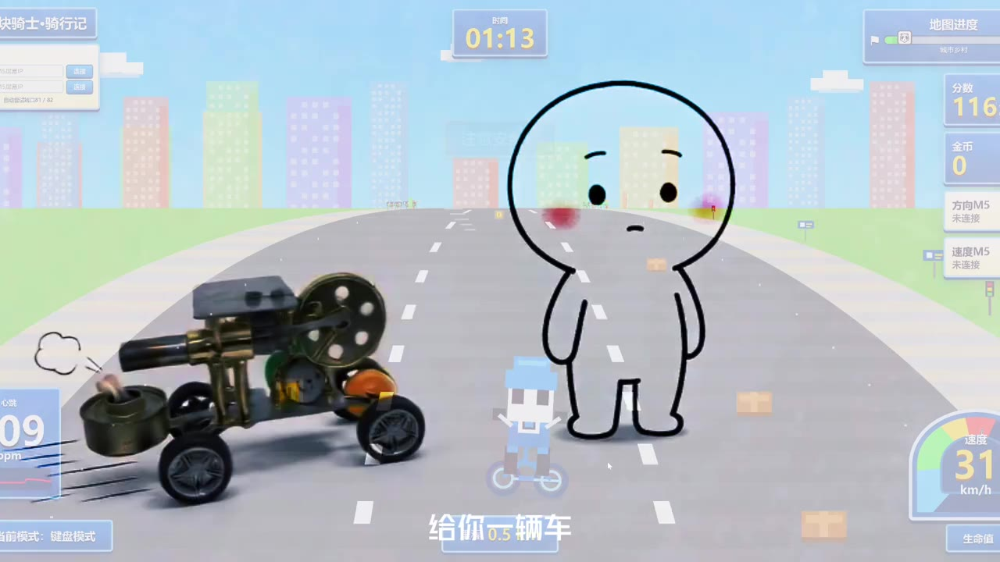

- 画面文字（OCR）：时间
01:13
给你0.5辆车

### 5. 00:10

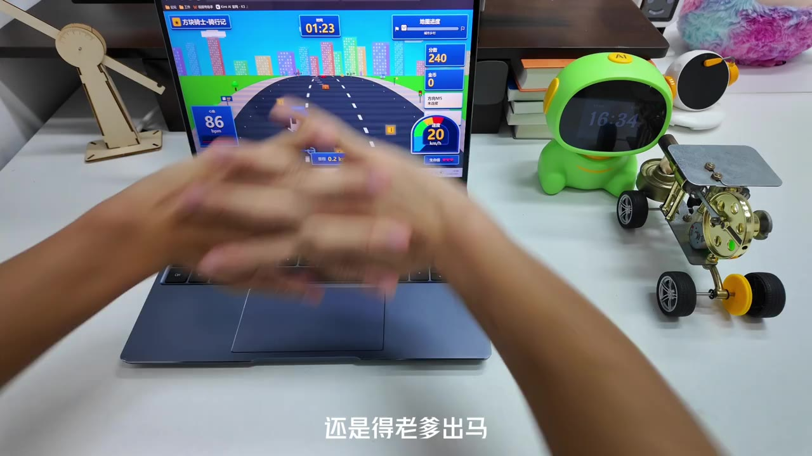

- 内容摘要：回答我烦死了，给你一辆车自己玩去，还是得老爹出马教你两招，第一步要给ai下一道指令（00:08-00:14）
- 画面文字（OCR）：方块骑士·骑行记
01:23
地图进度
M
240
分
金币
方向M5
16:34
86
20
km/h
0.2 k
还是得老爹出马

### 6. 00:12

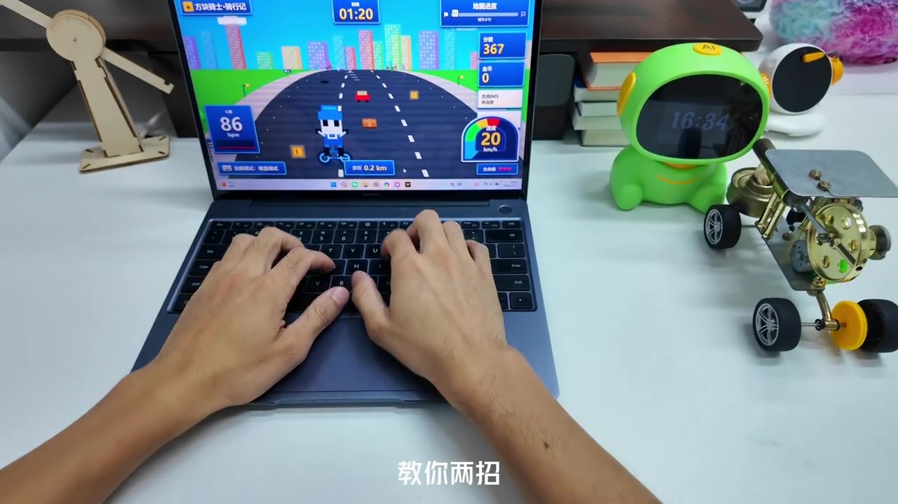

- 画面文字（OCR）：367
金币
方向MS
R2
16:34
86
20
盘模式
0.2km
教你两招

### 7. 00:14

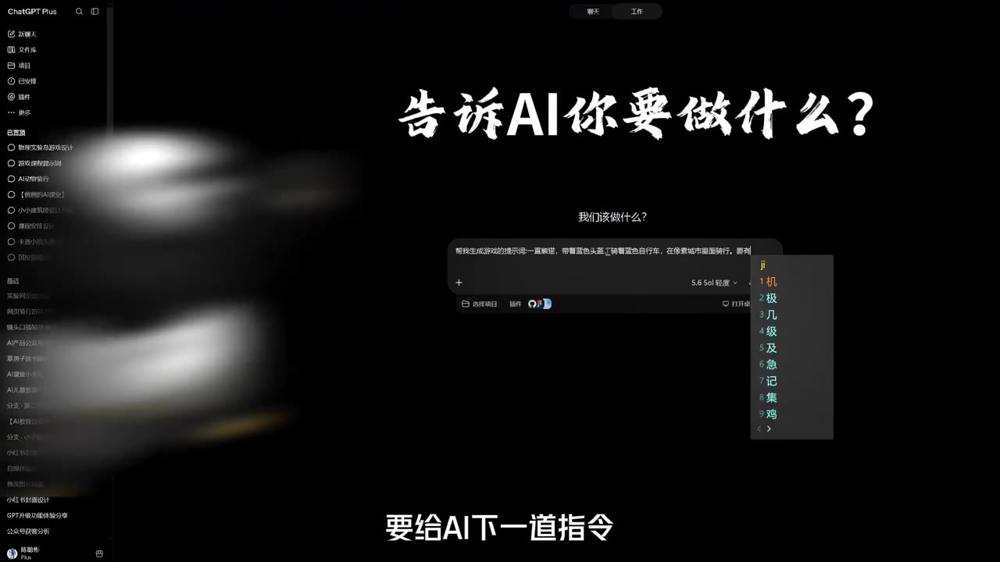

- 内容摘要：告诉他一只熊猫戴着蓝色头盔（00:14-00:16）
- 画面文字（OCR）：告诉AI你要做什么
设计
河
我们该做什么？
帮我生成游戏的提示词：一直眼猫，带着蓝色头盔工骑着蓝色自行车，在像素城市里面骑行。要有
5.6Sol轻度
1机
2极
选择项目
插件
打开桌
3几
4级
5及
6急
7
记
8
集
9鸡
体验分享
要给AI下一道指令

### 8. 00:18

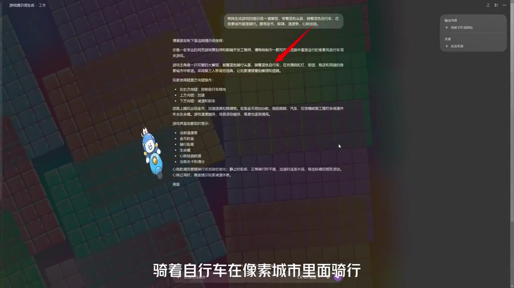

- 内容摘要：骑着自行车在像素城市里面骑行（00:16-00:19）
- 画面文字（OCR）：帮我生成游戏的提示词：一直能猫，带着蓝色头面，骑着蓝色自行车，在
输出内容
像素城市里面骑行，要有金币，障碍，速度表，心跳检测
十创建文件或网站
请直接复制下面这段提示词使用：
来源
你是一名专业的网页游戏策划师和前端开发工程师，请帮我制作一款可览圈中直接运行的像素风自行车间
十添加来源
关游戏。
游戏主角是一只可爱的大能道，着蓝色骑行头蓝，骑着蓝色自行车，在充滑双虹灯、街道，商店和高楼的像
素城市中前进，采用第三人称背后视角，让玩家清楚看到猫和道路。
玩家使用健盘方向键操作：
左右方向键：控制自行车转向
上方向键：加速
下方向键：减速和别车
道路上随机出现金币、加速道具和障碍物，收集金币增加分数，撞到路障、汽车、垃圾桶或施工围栏会减速井
失去生命值。游戏速度越快，场景滚动越快，难度也逐渐提高。
游戏界面需要实时显示：
当前速度表
金币数量
骑行距离
生命值
心跳检测数据
当前关卡和得分
心跳数据需要随骑行状态动态变化：静止时较低，正常骑行时平稳，加速时逐渐升高，接击降碍后短暂波动。
心跳过高时，面提示玩家减速休息。
画面
骑着自行车在像素城市里面骑行

### 9. 00:22

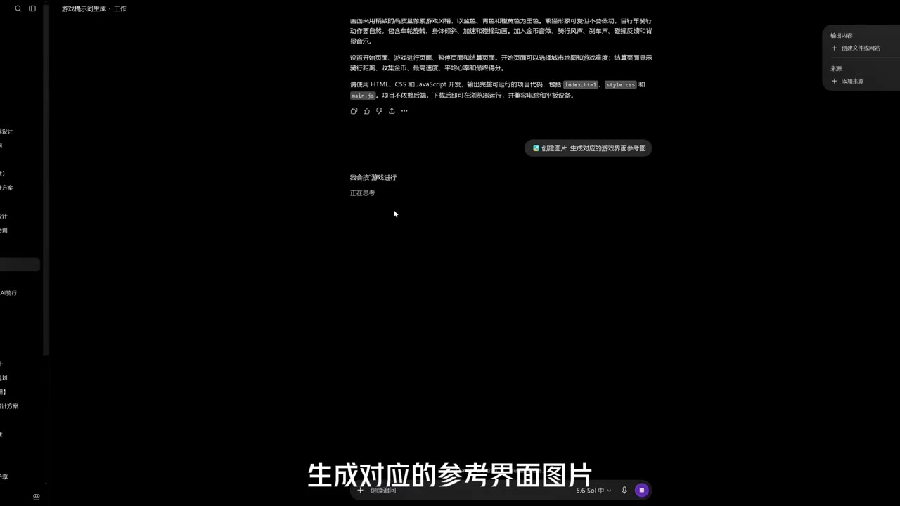

- 内容摘要：要有金币障碍速度表，还有心跳检测，然后生成对应的参考界面图片（00:19-00:24）
- 画面文字（OCR）：动作要自然，包含车轮旋转、身体倾斜、加速和碰撞动画。加入金币音效、骑行风声、到车声、碰描反馈和背
西面来用精蚁的高质量像紧游戏风格，以监色，肯色和橙黄色为王色，形骤可爱但个要低，目行车骑行
景音乐。
设置开始页面、游戏进行页面、暂停页面和结算页面。开始页面可以选择城市地图和游观难度：结算页面量示
骑行距离、收集金币、最高速度、平均心率和最终得分。
请使用HTML、CSS和JavaScript开发，输出完整可运行的项目代码，包括index.htm1
style.css和
main.s，项目不依赖后端，下载后即可在浏览墨运行，并兼容电脑和平板设备。
0
门
国
创建图片生成对应的游戏界面参考图
我会按游戏进行
正在思考
生成对应的参考界面图片

### 10. 00:24

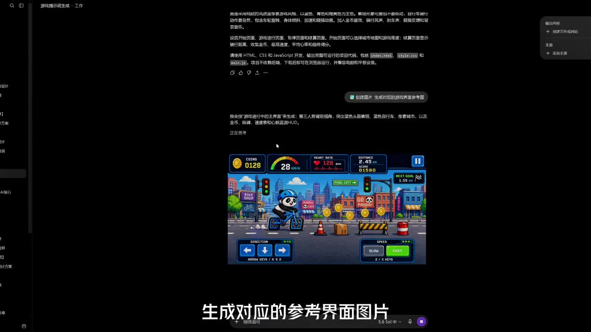

- 画面文字（OCR）：动作要自然，包含车轮旋转、身体倾斜、加速和碰撞动画。加入金币音效、骑行风声、别车声、碰描反馈和背
雪面米用的质量像索游戏风格，以监色肯色机程黄色力王色，形可发但个要低动，行车行
景音乐。
设置开始页面、游戏进行页面、智停页面和结算页面，开始页面可以选择城市地图和游观难度：结算页面显示
骑行距离、收集金币、最高速度、平均心率和最终得分。
请使用HTML、CSS和JavaScript开发，输出完整可运行的项目代码，包括Index.htm2
sty20.css
和
main.j，项目不依赖后端，下载后即可在浏览运行，并兼容电脑和平板设备。
0
创建图片生成对应的游界面参考图
我会按游戏进行中的主界面来生成：第三人称背后视角，突出蓝色头蓝猫
蓝色自行车、像素城市，以及
金币、障碍、速度表和心跳监测HUD
正在思考
COINS
HEART RATE
128
DISTANCE
2.45
II
0128
28
KH/H
BPH
.
01580
SCORE
NEXTGOAL
1.55M
3
POELCITYH
:
SHOP
BIKE
GO
0
V
PANDA!
DIRECTION
SPEED
SLOW
ARROWKEYS/ASO
生成对应的参考界面图片
继续追问
5.6Sol中
0

### 11. 00:24

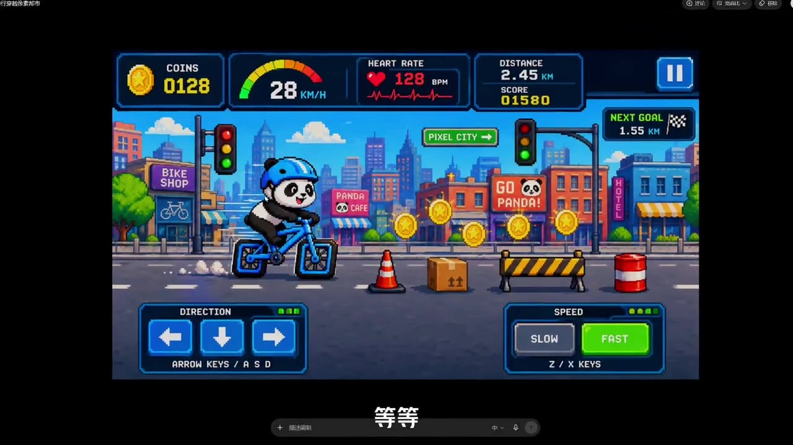

- 画面文字（OCR）：COINS
HEARTRATE
DISTANCE
0128
28
128
2.45
I
BPM
KM
KM/H
M
SCORE
01580
NEXT GOAL
1.55
PIXEL
CITY
KM
BIKE
SHOP
GO
HOTE
PANDA
CAFE
PANDA!
灶
DIRECTION
SPEED
SLOW
FAST
ARROW KEYS/ASD
Z/XKEYS
等等

### 12. 00:26

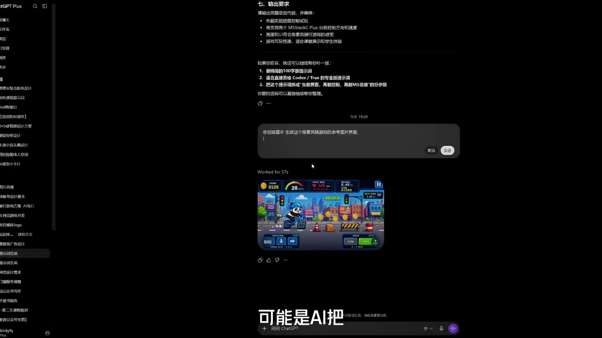

- 画面文字（OCR）：请输出完整项目代码，并确保：
先能实现键盘控制试玩
再支持两个M5StackCPlus分别控制方向和速度
画面和U符合素风骑行游的感觉
游戏可玩性强，适合课量展示和学生体验
如果你意，我还可以继续帮你叶一版：
1.更精简的100字版提示词
2.适合直接丢给Codex/Trae的专业版提示词
3.把这个提示词拆成”先做界面、再做控制、再做M5连接的分步版
你要的话我可以直接继续帮你整理
今天19:20
@创建图片生成这个你素风格游戏的参考图片界面
WA
发送
Worked for 57s
0128
28
1O
编
可能是AI把
可能会纪，海点重要惠
+问问ChatGPT

### 13. 00:27

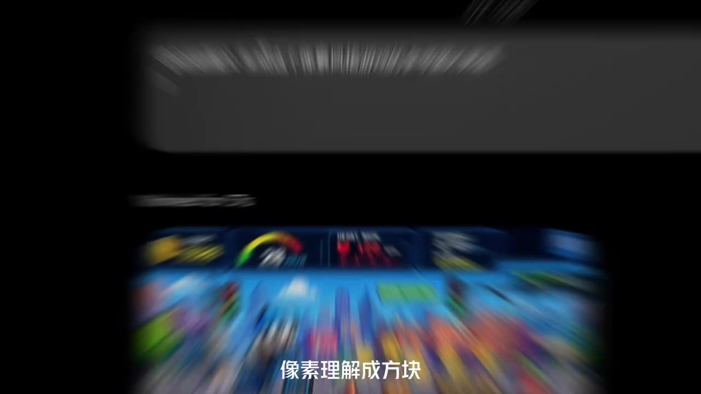

- 内容摘要：等等，这自行车的轮子怎么是方的，可能是b i把像素理解成方块，这还怎么骑啊，改（00:24-00:30）
- 画面文字（OCR）：像素理解成方块

### 14. 00:30

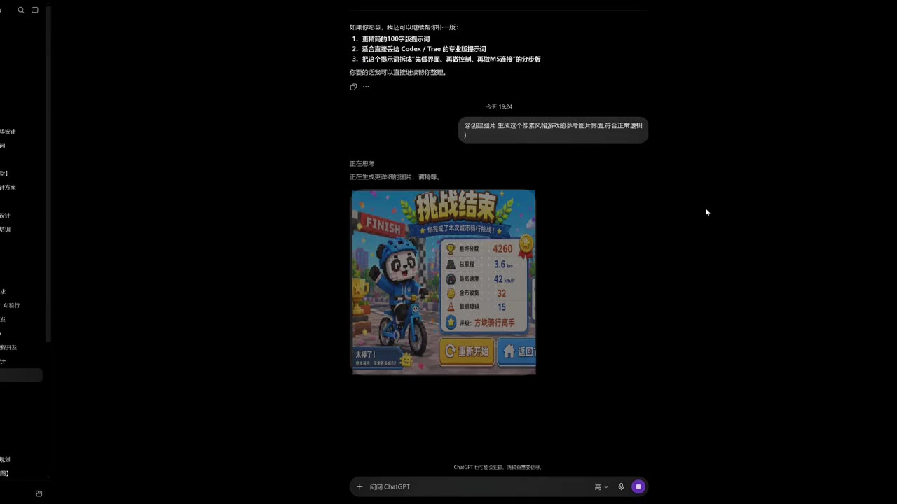

- 画面文字（OCR）：如果你愿意，我还可以继续帮你补一版：
1.更精简的100字版提示调
2.适合直接丢给Codex/Trae的专业版提示词
3.把这个提示词拆成先做界面、再做控制、再做M5连接的分步版
你要的话我可以直接继续帮你整理
今天19:24
创建图片生成这个像素风格游观的参考面片界面符合正常逻辑
正在思考
正在生成更详细的圆片，请稍等。
挑战结束
FINISH
★你完成了本次城市辆行挑战！
享
最终分数
4260
0-9
总里程
3.6km
最高速度
42km/h
金币收集
32
迎陆
15
评级：方块骑行高手
太棒了！
重新开始
返回
电持，更多！
ChatGPT也能会，查票要信息
0

### 15. 00:33

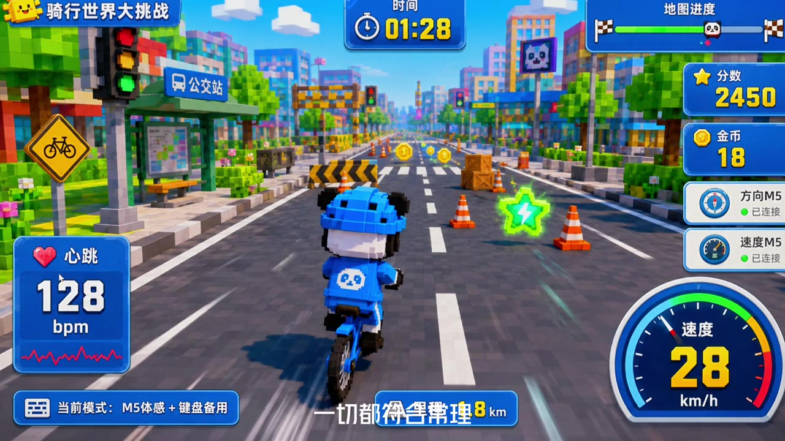

- 内容摘要：哇，这次生成出来就顺眼多了，车轮是圆的，一切都符合常理，还加入两个体感控制设备（00:30-00:36）
- 画面文字（OCR）：01:28
公交站
N
心跳
128
bpm
速度
28
当前模式：
km/h
M5体感+键盘备用
一切都得售常理8
km

### 16. 00:34

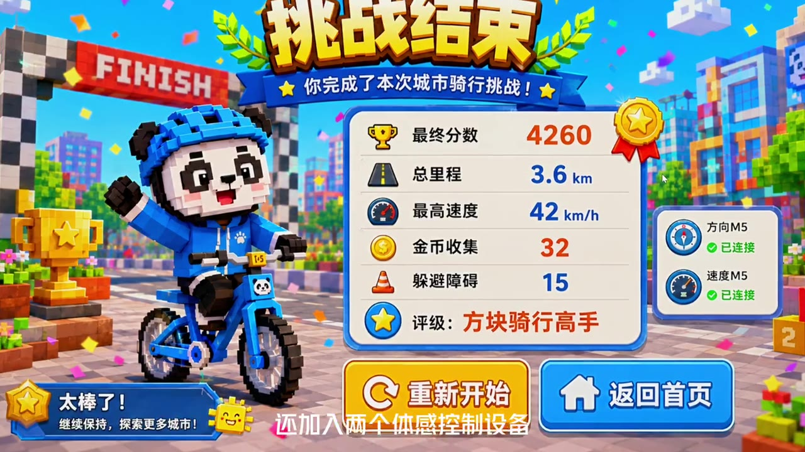

- 画面文字（OCR）：FINISH
你完成了本次城市骑行挑战！
最终分数
4260
总里程
3.6
km
最高速度
42
km/h
方向M5
金币收集
32
已连接
T·5
躲避障碍
15
速度M5
已连接
评级：
方块骑行高手
重新开始
返回首页
太棒了！
继续保持，探索更多城市！
还加入两个体感控制设备

### 17. 00:35

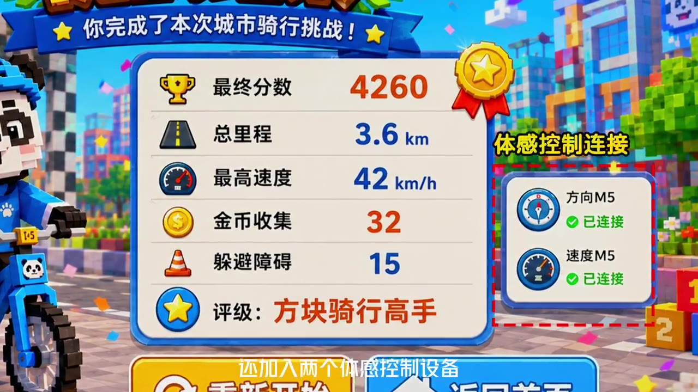

- 该时间点暂无可提取文字。

### 18. 00:37

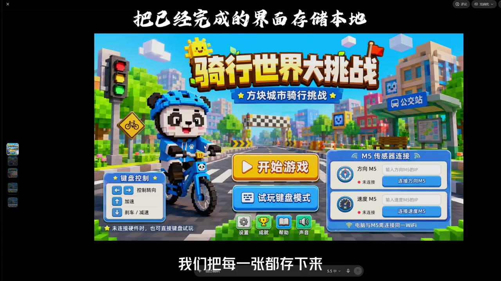

- 该时间点暂无可提取文字。

### 19. 00:38

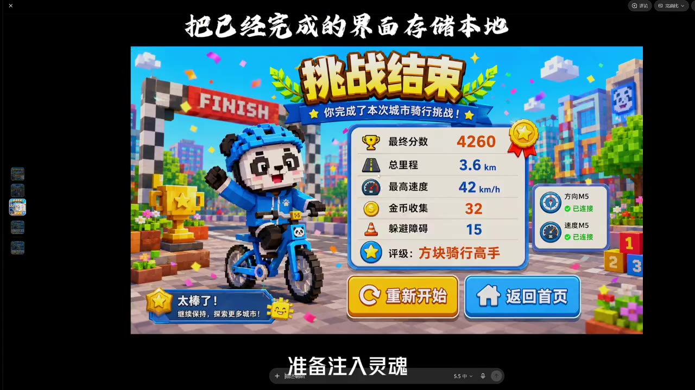

- 内容摘要：我们把每一张都存下来，准备注入灵魂，把提示词和参考图片喂给a，I（00:36-00:41）

### 20. 00:40

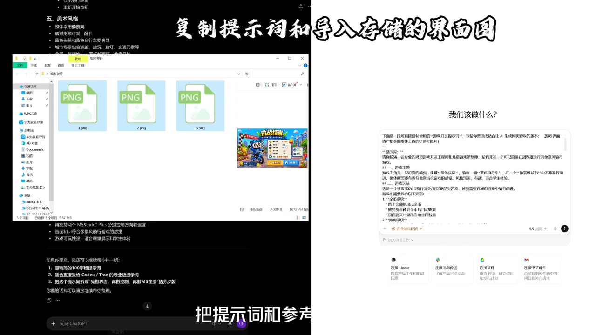

- 该时间点暂无可提取文字。

### 21. 00:41

- 该时间点暂无可提取文字。

### 22. 00:42

- 内容摘要：让它把转线加速，刹车碰撞数据全部都联动上（00:41-00:44）

### 23. 00:47

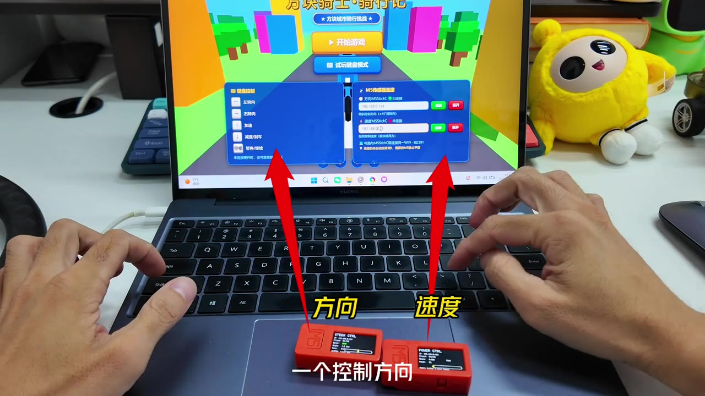

- 内容摘要：真正的体感控制要靠这两个传感设备，一个控制方向，一个控制速度（00:44-00:48）
- 内容摘要：运行代码也让ai赶快安排上，打开骚扰设备（00:48-00:51）

### 24. 00:53

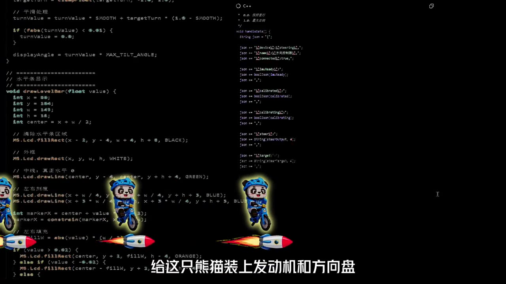

- 内容摘要：直接骚扰固件，给这只熊猫装上，发动机和方向盘连接成功，体感通道就打通了，诶（00:51-00:57）

### 25. 00:59

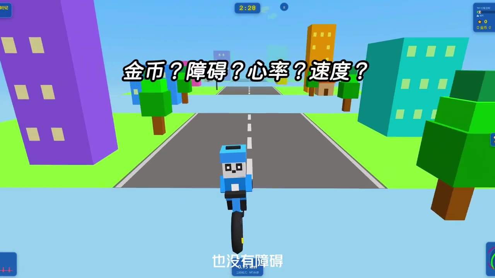

- 内容摘要：路口怎么空空的，金币都没有啊，也没有障碍，还是有问题（00:57-01:01）

### 26. 01:05

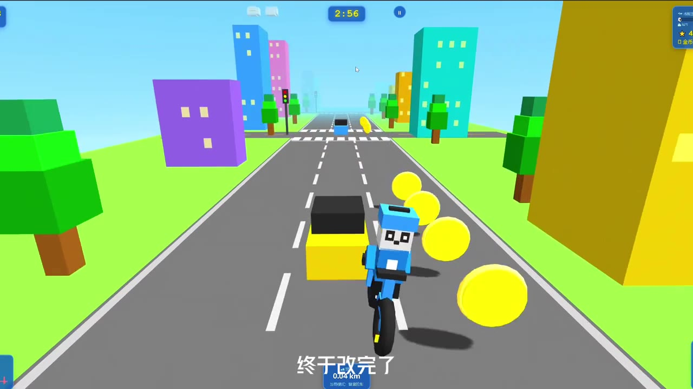

- 内容摘要：改用ai做体感游戏，学物理蹬着蹬着就懂了，这才叫学着玩，终于改完了金币障碍（01:01-01:06）
- 内容摘要：还有十字路口都正常了（01:06-01:08）

### 27. 01:11

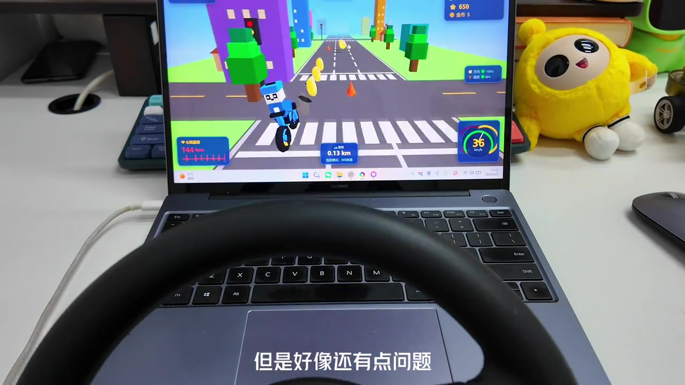

- 内容摘要：连上方向和速度两个传感器（01:08-01:10）
- 内容摘要：但是好像还有点问题（01:10-01:11）
- 内容摘要：这个方向控制太灵敏了，不符合正常操作逻辑，该这下应该没问题了吧（01:11-01:16）

### 28. 01:17

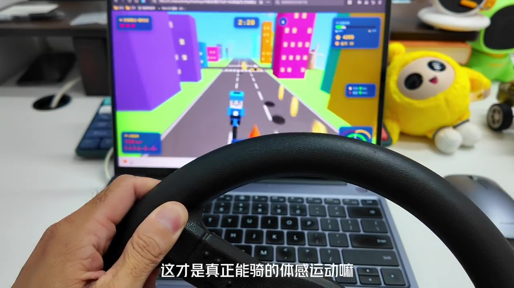

- 内容摘要：这才是真正能骑的体感运动嘛（01:16-01:18）

### 29. 01:23

- 内容摘要：爽是爽，但太幼稚了，能不能搞点真人比赛，诶，我有想法来个真人版的速度与激情（01:18-01:26）

### 30. 01:29

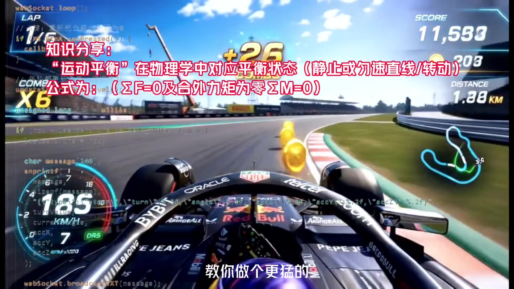

- 内容摘要：爽不爽？下一期用ai教你做个更猛的（01:26-01:29）

## 视频画面文字 (OCR)

> OCR 仅供参考，可能包含识别错误；请以视频画面和转写来源为准。

### 关键帧 1 · 0.5s

01:14
41:F0
WorkBu
*方块士·行记
3:00
已完成7m38
已修复并验证完成，下面是这次改动的说明
染
问题根因
里本来就有金币（octible）和路障（pCbace）的逻辑，但有个关键Bug：它们生成ptn：
roadoffant端向玩家移动.
选续躲避4
结果就是：路障和途币承远停在雾的边缘之外（不可见），描击/收集只是数学计算在玩家身上偷价发
所以你进入游戏
后视觉上既看不到金币也看不到路障。
我做的修改（都在方块骑士骑行记html）
1.新增生成离常量
PAC9，让金币和路在需的可见范围内生成，并能自然遇近玩家
2.生时记录相对偏移：pCe/apolele写入Datao-f.
方向M5
3.每移动：/中
收集判定与医面完全一致
4.修复描粒子误判：upan用（cc过车特效粒子，免它们被
速度M5
cycling
误算成“躲避+加分。
AI骑行游戏
L
5.提升手：生成同隔1.2s一1.0s，金币与路隔在z上错开6单位避免重叠：收
（soinpp动图）
现在的效果
·进入游戏约1秒后，前方道路上就会出现转的金币和跑障（维/
·劳到金币上一金币数+1、分数+100：描到路降一扣血减速，分数-100（有2秒无数闪烁）：成功过一数
+1、分数+50
已用nodeche对内联脚本法校验，通过
直接用预览窗口打开可试玩（建议用[试玩键盘模式]：一一转向，1加速，刹车）
方块骑士骑行记.html
查看所有产物（1））查看所有变更（1）
DP0C
e
Hy3
速度
.
38
今天帮你阅些什么？@引用对话文件，/调用能指令
心监
默认权限
儿子求我帮他看
90bpm
下
0.00km
二
里程
0.5km
模点健生控

### 关键帧 2 · 2.83s

1
全金法
1
E
M
1219
1412
1
0
B
.
EEs
102
T
km

### 关键帧 3 · 6.4s

自行车
里程
？？？脚踏板

### 关键帧 4 · 9.7s

时间
01:13
给你0.5辆车

### 关键帧 5 · 10.6s

方块骑士·骑行记
01:23
地图进度
M
240
分
金币
方向M5
16:34
86
20
km/h
0.2 k
还是得老爹出马

### 关键帧 6 · 12.31s

367
金币
方向MS
R2
16:34
86
20
盘模式
0.2km
教你两招

### 关键帧 7 · 14.17s

告诉AI你要做什么
设计
河
我们该做什么？
帮我生成游戏的提示词：一直眼猫，带着蓝色头盔工骑着蓝色自行车，在像素城市里面骑行。要有
5.6Sol轻度
1机
2极
选择项目
插件
打开桌
3几
4级
5及
6急
7
记
8
集
9鸡
体验分享
要给AI下一道指令

### 关键帧 8 · 18.21s

帮我生成游戏的提示词：一直能猫，带着蓝色头面，骑着蓝色自行车，在
输出内容
像素城市里面骑行，要有金币，障碍，速度表，心跳检测
十创建文件或网站
请直接复制下面这段提示词使用：
来源
你是一名专业的网页游戏策划师和前端开发工程师，请帮我制作一款可览圈中直接运行的像素风自行车间
十添加来源
关游戏。
游戏主角是一只可爱的大能道，着蓝色骑行头蓝，骑着蓝色自行车，在充滑双虹灯、街道，商店和高楼的像
素城市中前进，采用第三人称背后视角，让玩家清楚看到猫和道路。
玩家使用健盘方向键操作：
左右方向键：控制自行车转向
上方向键：加速
下方向键：减速和别车
道路上随机出现金币、加速道具和障碍物，收集金币增加分数，撞到路障、汽车、垃圾桶或施工围栏会减速井
失去生命值。游戏速度越快，场景滚动越快，难度也逐渐提高。
游戏界面需要实时显示：
当前速度表
金币数量
骑行距离
生命值
心跳检测数据
当前关卡和得分
心跳数据需要随骑行状态动态变化：静止时较低，正常骑行时平稳，加速时逐渐升高，接击降碍后短暂波动。
心跳过高时，面提示玩家减速休息。
画面
骑着自行车在像素城市里面骑行

### 关键帧 9 · 22.77s

动作要自然，包含车轮旋转、身体倾斜、加速和碰撞动画。加入金币音效、骑行风声、到车声、碰描反馈和背
西面来用精蚁的高质量像紧游戏风格，以监色，肯色和橙黄色为王色，形骤可爱但个要低，目行车骑行
景音乐。
设置开始页面、游戏进行页面、暂停页面和结算页面。开始页面可以选择城市地图和游观难度：结算页面量示
骑行距离、收集金币、最高速度、平均心率和最终得分。
请使用HTML、CSS和JavaScript开发，输出完整可运行的项目代码，包括index.htm1
style.css和
main.s，项目不依赖后端，下载后即可在浏览墨运行，并兼容电脑和平板设备。
0
门
国
创建图片生成对应的游戏界面参考图
我会按游戏进行
正在思考
生成对应的参考界面图片

### 关键帧 10 · 24.12s

动作要自然，包含车轮旋转、身体倾斜、加速和碰撞动画。加入金币音效、骑行风声、别车声、碰描反馈和背
雪面米用的质量像索游戏风格，以监色肯色机程黄色力王色，形可发但个要低动，行车行
景音乐。
设置开始页面、游戏进行页面、智停页面和结算页面，开始页面可以选择城市地图和游观难度：结算页面显示
骑行距离、收集金币、最高速度、平均心率和最终得分。
请使用HTML、CSS和JavaScript开发，输出完整可运行的项目代码，包括Index.htm2
sty20.css
和
main.j，项目不依赖后端，下载后即可在浏览运行，并兼容电脑和平板设备。
0
创建图片生成对应的游界面参考图
我会按游戏进行中的主界面来生成：第三人称背后视角，突出蓝色头蓝猫
蓝色自行车、像素城市，以及
金币、障碍、速度表和心跳监测HUD
正在思考
COINS
HEART RATE
128
DISTANCE
2.45
II
0128
28
KH/H
BPH
.
01580
SCORE
NEXTGOAL
1.55M
3
POELCITYH
:
SHOP
BIKE
GO
0
V
PANDA!
DIRECTION
SPEED
SLOW
ARROWKEYS/ASO
生成对应的参考界面图片
继续追问
5.6Sol中
0

### 关键帧 11 · 24.87s

COINS
HEARTRATE
DISTANCE
0128
28
128
2.45
I
BPM
KM
KM/H
M
SCORE
01580
NEXT GOAL
1.55
PIXEL
CITY
KM
BIKE
SHOP
GO
HOTE
PANDA
CAFE
PANDA!
灶
DIRECTION
SPEED
SLOW
FAST
ARROW KEYS/ASD
Z/XKEYS
等等

### 关键帧 12 · 26.63s

请输出完整项目代码，并确保：
先能实现键盘控制试玩
再支持两个M5StackCPlus分别控制方向和速度
画面和U符合素风骑行游的感觉
游戏可玩性强，适合课量展示和学生体验
如果你意，我还可以继续帮你叶一版：
1.更精简的100字版提示词
2.适合直接丢给Codex/Trae的专业版提示词
3.把这个提示词拆成”先做界面、再做控制、再做M5连接的分步版
你要的话我可以直接继续帮你整理
今天19:20
@创建图片生成这个你素风格游戏的参考图片界面
WA
发送
Worked for 57s
0128
28
1O
编
可能是AI把
可能会纪，海点重要惠
+问问ChatGPT

### 关键帧 13 · 27.7s

像素理解成方块

### 关键帧 14 · 30.02s

如果你愿意，我还可以继续帮你补一版：
1.更精简的100字版提示调
2.适合直接丢给Codex/Trae的专业版提示词
3.把这个提示词拆成先做界面、再做控制、再做M5连接的分步版
你要的话我可以直接继续帮你整理
今天19:24
创建图片生成这个像素风格游观的参考面片界面符合正常逻辑
正在思考
正在生成更详细的圆片，请稍等。
挑战结束
FINISH
★你完成了本次城市辆行挑战！
享
最终分数
4260
0-9
总里程
3.6km
最高速度
42km/h
金币收集
32
迎陆
15
评级：方块骑行高手
太棒了！
重新开始
返回
电持，更多！
ChatGPT也能会，查票要信息
0

### 关键帧 15 · 33.37s

01:28
公交站
N
心跳
128
bpm
速度
28
当前模式：
km/h
M5体感+键盘备用
一切都得售常理8
km

### 关键帧 16 · 34.9s

FINISH
你完成了本次城市骑行挑战！
最终分数
4260
总里程
3.6
km
最高速度
42
km/h
方向M5
金币收集
32
已连接
T·5
躲避障碍
15
速度M5
已连接
评级：
方块骑行高手
重新开始
返回首页
太棒了！
继续保持，探索更多城市！
还加入两个体感控制设备

## 字幕文件

[TXT](./transcript/video.txt) | [JSON](./transcript/video.json) | [SRT](./transcript/video.srt) | [VTT](./transcript/video.vtt)

## 转写来源

[平台字幕 TXT](./transcript/platform/video.txt) | [平台字幕 JSON](./transcript/platform/video.json) | [平台字幕 SRT](./transcript/platform/video.srt) | [平台字幕 VTT](./transcript/platform/video.vtt) | [本地 ASR TXT](./transcript/asr/video.txt) | [本地 ASR JSON](./transcript/asr/video.json) | [本地 ASR SRT](./transcript/asr/video.srt) | [本地 ASR VTT](./transcript/asr/video.vtt)

## 其他来源转写

### 本地 ASR

- **00:00-00:02** 而這請我幫他看一下他用AI做的旗行遊戲
- **00:02-00:03** 哇哇哇哇
- **00:03-00:05** 沒想到第一個必須念的是我
- **00:05-00:07** 隨意加的這行車不才踏板
- **00:07-00:08** 還一撤著升旗
- **00:08-00:08** 回答我
- **00:08-00:09** 反正呢
- **00:09-00:10** 給你一樣車最完略
- **00:10-00:11** 還是這一輛跌出嗎
- **00:11-00:12** 剛剛你講不到
- **00:12-00:14** 第一步要給AI下一道直鏈
- **00:14-00:15** 告訴他一隻熊貓
- **00:15-00:17** 帶著藍色頭盔旗幟這行車
- **00:17-00:18** 在項速城市裡面旗行
- **00:18-00:20** 要有金幣、障礙、速度表
- **00:20-00:21** 還有先跳檢測
- **00:21-00:24** 然後聲稱對應的參考階邊突變
- **00:24-00:25** 等等
- **00:25-00:26** 這行車的輪子怎麼是放的
- **00:26-00:29** 可能是AI把項速理解成放快
- **00:29-00:30** 這還怎麼啟案
- **00:30-00:30** 該
- **00:30-00:30** 哇
- **00:30-00:32** 這次聲稱出來就順連多了
- **00:32-00:33** 車輪是圓的
- **00:33-00:34** 一切都符合常理
- **00:34-00:36** 還加入兩個提感控制設備
- **00:36-00:38** 我們把每一張都存下來
- **00:38-00:39** 準備注入靈魂
- **00:39-00:41** 把提示時和參考突變為給AI
- **00:41-00:43** 讓他把轉線加速、殺車、碰撞數據
- **00:43-00:44** 全部都連動上
- **00:44-00:47** 真正的提感控制要靠這兩個傳染設備
- **00:47-00:48** 一個控制方向、一個控制速度
- **00:48-00:50** 應行代碼也讓AI改快、安排上
- **00:50-00:51** 打開燒入設備
- **00:51-00:52** 直接燒入顧鍵
- **00:52-00:55** 給這隻熊貓裝上的發動機和方向盤
- **00:55-00:55** 連接成功
- **00:55-00:57** 提感通道就打通了
- **00:57-00:58** 路口怎麼空空的
- **00:58-00:59** 金幣都沒有
- **00:59-00:59** 也沒有障礙
- **00:59-01:00** 還是有問題
- **01:00-01:00** 該
- **01:00-01:02** 用了一台做提感遊戲、學物理
- **01:02-01:03** 跟著等著就懂了
- **01:03-01:04** 這才叫學者玩
- **01:04-01:05** 終於改完了
- **01:05-01:06** 金幣障礙
- **01:06-01:08** 還有十字路口都正常
- **01:08-01:10** 連上方向和速度兩個傳染器
- **01:10-01:11** 但是好像有點問題
- **01:11-01:12** 這個方向控制太零點了
- **01:12-01:14** 不符合正常的操作路級
- **01:14-01:14** 該
- **01:14-01:16** 這下應該沒問題了吧
- **01:16-01:18** 這才是真正能奇的提感運動嘛
- **01:18-01:19** 爽是爽
- **01:19-01:20** 但太幼稚了
- **01:20-01:22** 能不能搞點真正比賽
- **01:22-01:24** 我也想辦法
- **01:24-01:25** 來個真人版的速度
- **01:26-01:26** 爽不爽
- **01:26-01:29** 下一期用AI交你做個更盟的

## 视频转录

- **00:00-00:02** 儿子请我帮他看一下他用ai做的骑行游戏
- **00:02-00:08** 哇哇哇哇哇，没想到第一个被训练的是我，谁家的自行车不踩踏板还侧着身骑
- **00:08-00:14** 回答我烦死了，给你一辆车自己玩去，还是得老爹出马教你两招，第一步要给ai下一道指令
- **00:14-00:16** 告诉他一只熊猫戴着蓝色头盔
- **00:16-00:19** 骑着自行车在像素城市里面骑行
- **00:19-00:24** 要有金币障碍速度表，还有心跳检测，然后生成对应的参考界面图片
- **00:24-00:30** 等等，这自行车的轮子怎么是方的，可能是b i把像素理解成方块，这还怎么骑啊，改
- **00:30-00:36** 哇，这次生成出来就顺眼多了，车轮是圆的，一切都符合常理，还加入两个体感控制设备
- **00:36-00:41** 我们把每一张都存下来，准备注入灵魂，把提示词和参考图片喂给a，I
- **00:41-00:44** 让它把转线加速，刹车碰撞数据全部都联动上
- **00:44-00:48** 真正的体感控制要靠这两个传感设备，一个控制方向，一个控制速度
- **00:48-00:51** 运行代码也让ai赶快安排上，打开骚扰设备
- **00:51-00:57** 直接骚扰固件，给这只熊猫装上，发动机和方向盘连接成功，体感通道就打通了，诶
- **00:57-01:01** 路口怎么空空的，金币都没有啊，也没有障碍，还是有问题
- **01:01-01:06** 改用ai做体感游戏，学物理蹬着蹬着就懂了，这才叫学着玩，终于改完了金币障碍
- **01:06-01:08** 还有十字路口都正常了
- **01:08-01:10** 连上方向和速度两个传感器
- **01:10-01:11** 但是好像还有点问题
- **01:11-01:16** 这个方向控制太灵敏了，不符合正常操作逻辑，该这下应该没问题了吧
- **01:16-01:18** 这才是真正能骑的体感运动嘛
- **01:18-01:26** 爽是爽，但太幼稚了，能不能搞点真人比赛，诶，我有想法来个真人版的速度与激情
- **01:26-01:29** 爽不爽？下一期用ai教你做个更猛的

## 图片

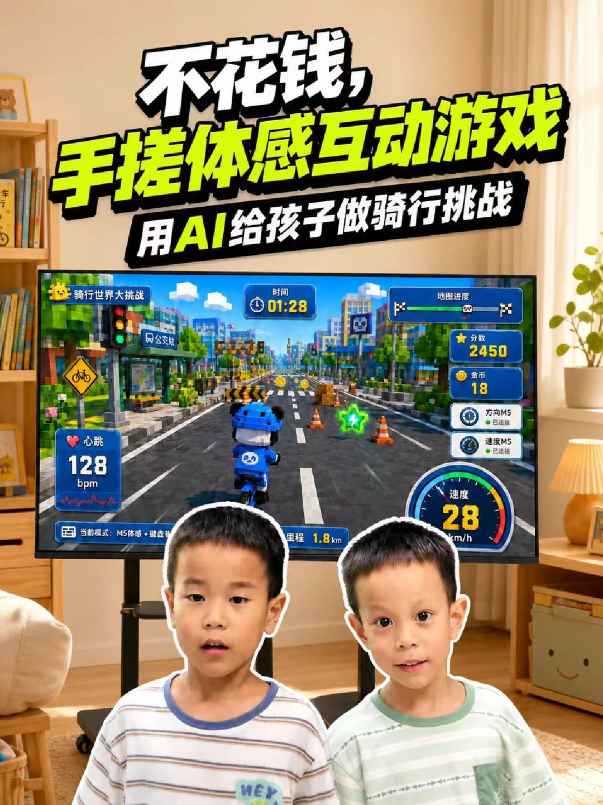

## 图片文字 (OCR)

> OCR 仅供参考，可能包含识别错误；请以原图为准。

不花钱，
手搓体感互动游戏
用AI给孩子做骑行挑战
骑行世界大挑战
时间
01:28
地图进度
公交贴
分数
2450
金币
18
方向M5
已退接
速度M5
心跳
已超接
128
bpm
速度
28
里程
1.8km
km/h
当前模式：
M5体感+键盘
