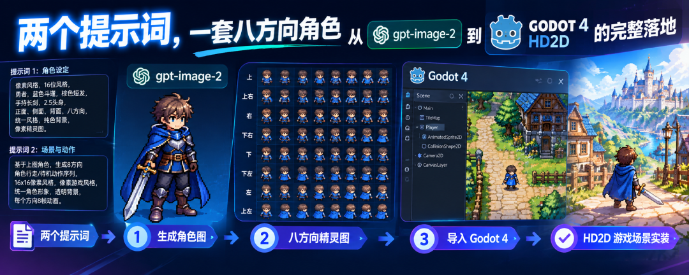
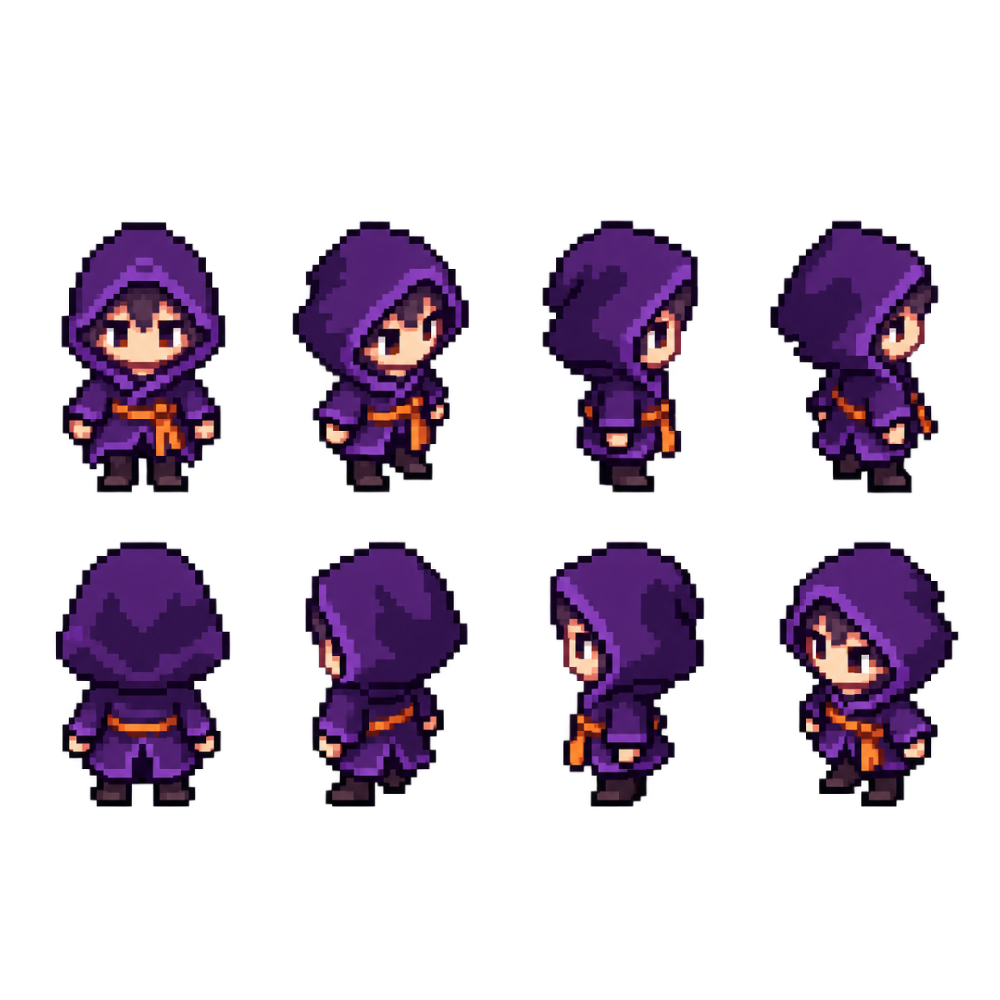
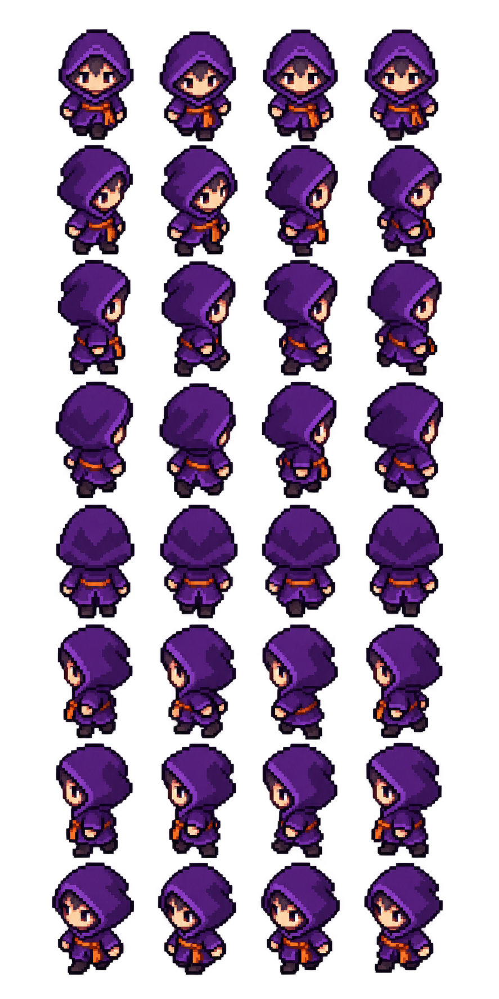
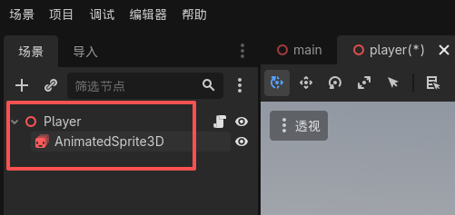
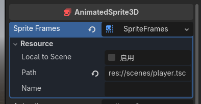
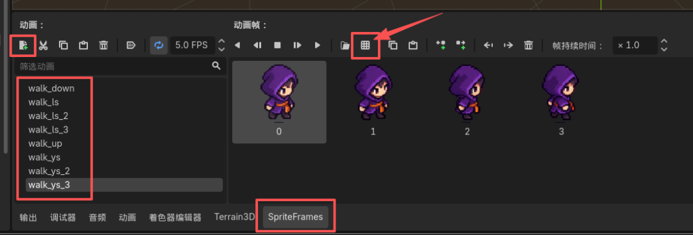
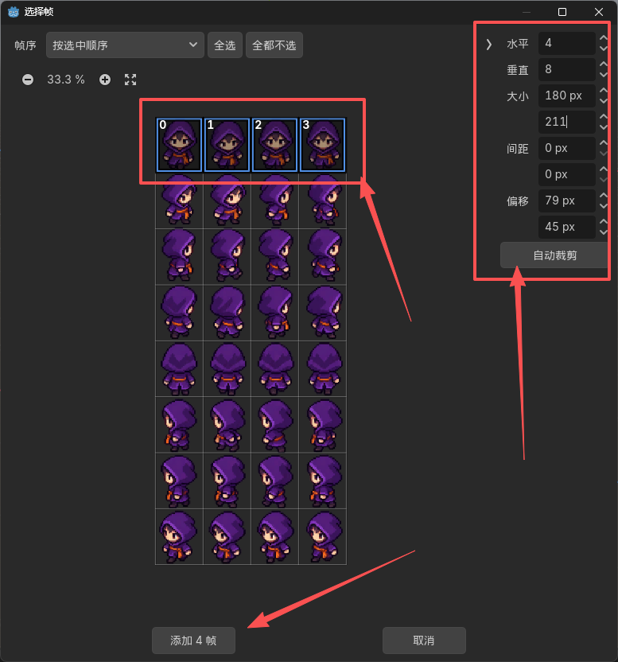
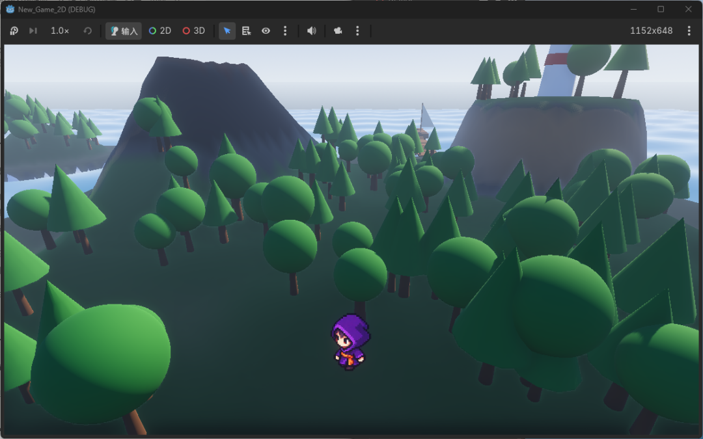

# 两个提示词，一套八方向角色从 gpt-image-2 到 Godot 4 HD2D 的完整落地

> 作者: Cokar | 平台: 微信公众号 | 日期: 2026-09-13 13:58 | 原文: https://mp.weixin.qq.com/s/iLXBqs5x-NqIsbBOlvZFLg

> **摘要**: AI GAME ASSETS★★★★★两个提示词，一套八方向角色从 gpt-image-2 到 Godot 4

AI GAME ASSETS
★★★★★

两个提示词，一套八方向角色
从 gpt-image-2 到 Godot 4 HD2D 的完整落地

AI愚人众
AIGC / AI Coding 内容创作者

先说结论。八方向角色用两个提示词就能出，但第一次大概率会失败，模型会偷懒把八个方向都画成正脸。
#gpt-image-2
#Godot4
#像素美术

NO.
001

实操教程
GRADE
A

✂

VALID FOR ONE READ
ADMIT ONE 🎫

我第一次跑出来的结果就是这样：一张 32 格 的图，32 个小人全在正面对着你。提示词里明明写了八个方向，模型只挑最省事的那个画。

问题出在提示词没有把「八个方向必须各不相同」写成硬约束。补上这一句，再配合一张八方向的角色设定图当参考，第二次才拿到能用的图。

拿到透明背景的序列帧整图之后，剩下的工作在 Godot 里就能全部做完：建节点、切格子、挂上动画状态，最后写一个 HD2D 相机脚本。下面把提示词、导入步骤和相机脚本都写出来，可以直接拿去用。

01
WHAT & WHY

八方向是什么，为什么值得多做这一步

八方向指的是角色面朝的八个角度，覆盖俯视视角下角色能移动的全部方向：

01
down ：正面朝向观者，能看到完整正脸

02
down_right ：面朝右下方 45 度

03
right ：面朝正右方，只看到右侧脸

04
up_right ：面朝右上方 45 度

05
up ：背面朝向观者，看到后脑勺与后背

06
up_left ：面朝左上方 45 度

07
left ：面朝正左方，只看到左侧脸

08
down_left ：面朝左下方 45 度

从上到下按这个顺序排，角色相当于原地顺时针转了一圈，角度均匀递进。这个顺序后面要原封不动地搬进提示词，因为它是模型理解「绕角色一圈」这件事的唯一线索。

四方向（正、背、左、右）是基础款，多数小体量游戏的起点。八方向的差别在斜向：玩家按住右上方向移动时，四方向游戏里角色会先朝右、再朝上，中间有个不自然的切换；八方向里角色直接朝右上，动作是连续的。

对俯视视角的动作游戏来说，这个差别在手感上很明显。代价是工作量：同一套行走循环，四方向是 16 帧，八方向是 32 帧，翻一倍。

一句话总结：八方向多花的帧数，买的是斜向移动不跳变的手感。

02
PIPELINE

方案：两阶段流水线

这条链路的可靠性来自一个结构上的决定：把「定角色」和「做动作」拆成两步。

01
阶段一：定角色 ：输入是一段角色提示词，输出是八方向朝向表（8 格）。要解决的问题是把八个角度的角色长相全部锁死。

02
阶段二：做动作 ：输入是朝向表加一段动作提示词，输出是八方向行走序列帧（32 格）。要解决的问题是在一个画布内产出八个方向的连续帧。

阶段一必须是八方向朝向表，不能还是老三视图。三视图只锁正面、侧面、背面，四个斜向全靠模型现场想象，出来的结果每次都不一样。朝向表把八个角度都画了一遍，模型在阶段二就有据可依。

这两个阶段之间是一次参考图传递：阶段一的输出文件，作为 images.edit 的 image 参数送进阶段二。

03
PROMPT 1

阶段一：出八方向朝向表

提示词

...prompt
请生成一张像素风格游戏角色的八方向朝向表，用于后续制作动画序列帧。

【角色设定】

一名小型像素风冒险者。深紫色带兜帽的短袍，腰间橙色束带，

深色短靴，兜帽下露出浅肤色面部。整体约 2.5 头身。

【画面布局】这是俯视视角游戏的八方向朝向表

严格的 4 列 2 行网格，共 8 格，每格画同一个角色的一个面朝方向。

格子尺寸完全一致，角色在每一格中水平居中、脚底对齐同一条水平线，

角色高度占每格高度约 70%。

八格的方向顺序（第一行从左到右，接着第二行从左到右）：

第 1 格：正面朝向观者，能看到完整正脸

第 2 格：面朝右下方 45 度

第 3 格：面朝正右方，只看到右侧脸

第 4 格：面朝右上方 45 度

第 5 格：背面朝向观者，看到后脑勺与后背，没有五官

第 6 格：面朝左上方 45 度

第 7 格：面朝正左方，只看到左侧脸

第 8 格：面朝左下方 45 度

从第 1 格到第 8 格，角色相当于原地顺时针旋转一周，角度均匀递进。

【八格必须各不相同】

八个方向的身体朝向必须有明确区别，不允许都画成正脸。

正面看到完整五官；背面完全看不到五官，只有后脑勺与后背；

正侧面只能看到一只眼睛，身体轮廓明显变窄；

四个斜向介于正面与侧面之间，脸和身体都带一定的透视压缩。

【技术要求】

像素艺术风格，硬边缘，不使用抗锯齿、不使用渐变、不使用动态模糊。

限制调色板，颜色数量控制在 16 色以内。

【一致性要求】

八格中的角色必须是同一个角色：相同的配色、相同的身高比例、

相同的服装剪裁、相同的像素画风格。只有面朝方向不同，

不要改变发型、服装、配色或体型。

【背景要求】

整张图使用透明背景。

背景上不要出现阴影、光晕、投影、地面线或任何装饰元素。

【禁止项】

不要画网格线、不要画边框、不要画分隔线。

不要出现文字、标签、数字、方向标注、水印。

画幅比例：正方形 1:1

验收标准

拿到朝向表之后，逐格检查四件事：

01
八个角度是不是真的不一样 ：这是最常出问题的地方，发现有两格都是正脸就直接重跑，不要试图让模型修。

02
背面那一格有没有五官 ：模型习惯给每个角度都画脸，背面必须完全没有眼睛和鼻子。

03
左右两个侧面是不是镜像关系 ：第 3 格和第 7 格应该是同一张脸的左右翻转。

04
背景是不是干净的透明或纯色 ：边缘没有半透明的灰边，角色轮廓外面的像素是干净的。

四条都过了，这张朝向表就是后面所有动作的唯一身份来源。定下来之后不要中途换图，换图等于换了角色。

04
PROMPT 2

阶段二：出八方向行走序列帧

提示词

...prompt
以我上传的八方向角色设定图作为唯一角色参考，生成一张像素风游戏角色的

八方向行走序列帧精灵图。

【角色一致性】最高优先级

角色必须与参考图完全一致：相同的深紫色兜帽短袍、相同的橙色束带、

相同的配色方案、相同的 2.5 头身比例、相同的像素画风格、

相同的兜帽与面部处理。

不要重新设计角色，不要改变服装、配色、发型或身高。

设定图里的八个面朝方向是唯一标准，本图每个方向的画法必须与

设定图对应方向一致。

【画面布局】

严格的 4 列 8 行网格，共 32 格。

每一行是一个面朝方向的完整行走循环，行内从左到右是行走的时间顺序，

依次为触地、下沉、过渡、抬起。

所有格子尺寸完全一致，角色在每一格中水平居中，

脚底对齐同一条水平线，角色高度占每格高度约 70%。

八行的方向顺序（从上到下）：

第 1 行：正面朝向观者

第 2 行：面朝右下方 45 度

第 3 行：面朝正右方

第 4 行：面朝右上方 45 度

第 5 行：背面朝向观者

第 6 行：面朝左上方 45 度

第 7 行：面朝正左方

第 8 行：面朝左下方 45 度

从上到下，角色相当于原地顺时针旋转一周，角度均匀递进。

【八个方向必须各不相同】这是本次生成最关键的要求

八个方向的行走姿态必须有明确区别：

正面行走能看到完整五官和正面轮廓；

背面行走完全看不到五官，只有后脑勺与后背，双腿同样前后交替；

左右侧向行走只看到一只眼睛，身体轮廓明显变窄，前后腿有清晰的前后间距；

四个斜向行走介于正面与侧面之间，身形带透视压缩。

绝对不允许把八个方向都画成正脸，绝对不允许复用同一个姿态，

绝对不允许所有行看起来一样。

【技术要求】

纯像素艺术风格，硬边缘，不使用抗锯齿、不使用渐变、不使用动态模糊。

限制调色板，与参考图保持一致。

【背景要求】

每一格背景透明。

背景上不要出现阴影、光晕、投影、地面线或任何装饰元素。

【禁止项】

不要画网格线、不要画格子边框、不要画任何分隔线。

不要出现文字、标签、数字、帧号、方向标注、水印。

画幅比例：竖版 1:2

那段「八个方向必须各不相同」是整篇提示词里最不能省的部分。第一版提示词里我只写了方向顺序，没写禁止复用，结果就是 32 个正脸。

出图之后对照下面这张示意检查：4 列 8 行，每一行一个方向，行与行之间能明显看出脸朝向在转。

（八方向序列帧整图的目标形态示意。这张示意素材刻意画了格线，用来提醒你检查自己的出图有没有多画格线，不是 gpt-image-2 的实际输出）

尺寸和网格的对应表

每格必须保持正方形，一旦是长方形，角色会被拉伸，这种变形后期修不回来。

| 用途 | 网格 | size | 每格 |
| --- | --- | --- | --- |
| 八方向朝向表（阶段一） | 4 列 × 2 行 | 1024x1024 | 256×256 |
| 八方向行走，4 帧/方向 | 4 列 × 8 行 | 1024x2048 | 256×256 |
| 八方向行走，6 帧/方向 | 6 列 × 8 行 | 1536x2048 | 256×256 |
| 四方向行走，4 帧/方向 | 4 列 × 4 行 | 1024x1024 | 256×256 |
| 单方向六动作，4 帧/动作 | 4 列 × 6 行 | 1024x1536 | 256×256 |

第一次跑建议先用 4 帧/方向打底。32 格的图是这条链路里一致性压力最大的一张，帧数再往上加，成功率会掉得很快。

其它动作要不要也做八方向

不必要，而且通常会亏。

| 动作 | 建议方向数 | 原因 |
| --- | --- | --- |
| 行走 | 8 | 玩家全程都在移动，方向感直接决定手感 |
| 奔跑 | 8 | 同上 |
| 待机 | 4 或 8 | 待机朝向应该跟随最后一次移动方向 |
| 攻击 | 1 或 4 | 帧数多、动作幅度大，做满八方向成本翻两倍以上 |
| 受击 | 1 | 通用表现，方向感不重要 |
| 死亡 | 1 | 同上 |
| 施法 | 1 或 4 | 同上 |

八方向行走跑通之后，其它动作另开一张图，用同一张朝向表当参考图，把网格改成 4 列 × 6 行（六个动作各一行）即可，提示词结构完全一样，只换动作描述那一段。

调用代码

...python
import base64

from openai import OpenAI

client = OpenAI(timeout=300) # 图像接口超过 170 秒是常态，超时别用默认值

# 第一步：出八方向朝向表

ref = client.images.generate(

　　model="gpt-image-2",

　　prompt=DIRECTION_SHEET_PROMPT, # 阶段一提示词

　　size="1024x1024",

　　quality="high",

　　n=2,

)

with open("character_8dir.png", "wb") as f:

　　f.write(base64.b64decode(ref.data[0].b64_json))

# 第二步：把朝向表当参考图传进去，出八方向行走序列帧

with open("character_8dir.png", "rb") as f:

　　sheet = client.images.edit(

　　　　model="gpt-image-2",

　　　　image=f,

　　　　prompt=WALK_8DIR_PROMPT, # 阶段二提示词

　　　　size="1024x2048",

　　　　quality="high",

　　　　n=2,

　　)

for i, item in enumerate(sheet.data):

　　with open("walk_8dir_%d.png" % i, "wb") as fp:

　　　　fp.write(base64.b64decode(item.b64_json))

n 的可用范围跟账户权限和接入渠道有关，有的渠道单次只返回一张。n 没生效就多跑几次，把结果都留着再挑。

05
CHECKLIST

可靠性清单

按重要性排，前三条是八方向方案特有的。

01
明写「八个方向必须各不相同」 ：这是本次踩到的最大的坑。模型对「八方向」的默认理解是「画八个方向」，但它会选成本最低的实现方式，也就是把八个格子都画成正脸。必须在提示词里把每个方向的画面特征逐条写死，并显式禁止复用姿态。禁止的话术要写重：「绝对不允许」「不允许复用」「不允许所有行看起来一样」，比「请尽量区分」有效得多。

02
阶段一必须是八方向朝向表 ：朝向表的作用是给阶段二提供八个角度的依据。如果这一步只出三视图，阶段二的斜向就没有参照，模型只能自己编，八行里有四行会跑偏。

03
方向顺序在两张图里必须完全一致 ：阶段一是 正面 → 右下 → 右 → 右上 → 背面 → 左上 → 左 → 左下，阶段二的行顺序也必须是这个。位次对上，模型才有得对照；顺序一变，参考关系就断了。顺带说一句，方向名称不要写进图里。让模型在图上标注「down」「up_right」这类文字，它大概率渲染成乱码或拼错。用「第几格是什么方向」在提示词里约定就够。

04
参考图要真的传进去 ：要让参考图起作用，得用 images.edit 的 image 参数把文件传过去。提示词里写再多描述都替代不了这一步，做了它，那句「必须与参考图完全一致」才有落点。

05
尺寸和网格必须凑成正方形格子 ：照上面那张表选，别自己估一个「大概是 4 列」再随手挑尺寸。除不尽的时候格子大小不一致，切出来的帧就一帧大一帧小。

06
背景要求写清楚 ：提示词里必须明确背景。生成管线支持透明输出就直接写「每一格背景透明」；只出实色底就写「纯品红单色背景 #FF00FF」，导出后去掉底色即可。两种写法都能用，不能省的是那句「不要出现阴影、光晕、投影、地面线」。模型很爱在角色脚下加一圈投影，那会破坏像素画的干净感，而且在 3D 场景里会和地面穿帮。

07
明写「不要网格线」 ：不写这句，模型有相当概率给你画上格线。格线在整图里看着不碍事，切进 SpriteFrames 之后就变成每一帧边缘的脏边，得回去重出。

08
一致性约束逐项点名 ：「保持一致」太笼统，模型不知道要对齐哪些东西。要逐项列出来：调色板、身高、轮廓、朝向、面部特征。这在提示词里就是几行字，但能显著减少走形。

09
质量档给 high，超时给 300 秒 ：高一致性任务用 quality="high"，省下的那点费用不够抵重跑的时间。图像接口单次调用超过 170 秒是常态，复杂提示可能接近两分钟，用默认超时会把已经生成好的图白白丢掉。

10
崩了就重跑，别让它改 ：发现某条腿错了，不要跟它说「把这条腿改一下」。它经常把图的其他部分一起改掉，越改越乱。同一个提示词重跑一次的成本，通常低于来回修正三次。同参数跑两张挑一张，比调提示词省时间。

11
32 格一次出不来，拆成两张 ：如果整张 32 格的一致性一直不达标，把它拆成两张 16 格的图分别出：一张放前四个方向（正面、右下、右、右上），一张放后四个（背面、左上、左、左下），都用同一张朝向表当参考。拆开之后每张图的格子数减半，一致性压力明显下降。多花一次调用，比反复重跑整张 32 格更省时间。

什么时候该拆，不用算得太精确：同一条提示词连跑三次，每次都有三行以上跑偏，就别试第四次了，直接拆图。

如果只记一条：把每个方向长什么样、不能长什么样逐条写死，比任何调参都管用。

06
IMPORT

Godot 导入：从空场景到能播动画

拿到透明背景的序列帧整图之后，导入是纯手动操作，步骤不多。

建立节点

01
Node3D ：新建一个 Node3D 节点，作为角色的根节点。

02
AnimatedSprite3D ：在它下面新建一个 AnimatedSprite3D 子节点。

根节点这一步值得多解释一句。很多教程会写 Node2D，用 Node2D 也能建起来、也能正常显示精灵，但等你写相机跟随的时候会卡住，原因在本节最后一段。

AnimatedSprite3D 是 3D 场景里播放精灵动画的节点。它和 AnimatedSprite2D 的动画编辑方式一样，区别在于它存在于 3D 空间里，会被 3D 相机拍到，参与深度排序和光照。HD2D 的做法就是用 3D 相机拍 2D 精灵，所以这里要用 3D 版本。

建立动画状态

03
Sprite Frames ：选中 AnimatedSprite3D，在检查器里找到 Sprite Frames 属性，点它，选新建 SpriteFrames。

04
添加动画 ：编辑器下方会出现动画帧面板。在面板里点「添加动画」，给动画命名，比如 walk_down。

05
从精灵图添加帧 ：选中这个动画，点面板工具条上的网格图标「从精灵图添加帧」。

06
切片对话框 ：在弹出的切片对话框里选你的整图，Horizontal 填 4、Vertical 填 8，预览会切成 32 格。

07
框选添加 ：框选这一行的 4 个格子，点添加帧。

到这里第一个方向的动画就有了。八个方向重复第 4 到第 7 步，动画名按 walk_down / walk_down_right / walk_right / walk_up_right / walk_up / walk_up_left / walk_left / walk_down_left 命名，全部挂在同一个 SpriteFrames 上。

像素风的帧率 8 到 12 就够，再高会失去一帧一帧的节奏感，在帧面板里直接改速度。

四个必须改的属性

导入完成之后，AnimatedSprite3D 上还有四项要动，不改的话画面会不对：

01
Billboard 设为 Fixed Y ：不设的话相机会俯视，精灵跟着向后仰，像躺在地上。

02
Texture Filter 设为 Nearest ：不设的话像素被线性插值，放大后糊成一片。

03
Alpha Cut 设为 Discard ：不设的话透明区域仍写深度，前后两个精灵叠在一起时出现穿透和闪烁。

04
Pixel Size 按场景尺度调 ：默认 0.01。不调的话精灵在 3D 世界里的大小不对，可能小到看不见或占满屏幕。

Billboard 一定要设成 Fixed Y。它让精灵始终绕 Y 轴面向相机，同时保持直立。相机的俯角固定，精灵就不会跟着倾斜，八方向的美术设计才不会被透视毁掉。

Pixel Size 需要按你的场景单位调。举个参照：一张 256 像素宽的单帧，Pixel Size 是 0.01 的时候在世界里是 2.56 米宽。角色和地形的比例对不对，调这一个值就行。

一个坐标系上的坑

Node2D 和 Node3D 用的是两套互不相通的变换系统。父节点是 Node2D 时，它的 position 不会传递给下面的 AnimatedSprite3D，因为 3D 节点向上找父级时只认 3D 节点。

这在写相机跟随的时候会直接暴露出来：3D 相机读不到 Node2D 的二维坐标。

处理办法是把角色的根节点换成 Node3D，AnimatedSprite3D 子节点不用动。这样角色在 3D 空间里就有了真实坐标，移动、相机跟随、光照遮挡这些都能正常工作。

07
CAMERA

HD2D 相机脚本

节点结构

...text
Main (Node3D)

├── Player (Node3D) ← 加 group "player"

│ └── AnimatedSprite3D

├── HD2DCamera (Camera3D) ← 挂相机脚本

└── DirectionalLight3D

给 Player 节点加一个 player 分组，相机靠这个分组找人，比写死路径稳。

三条约束怎么落到代码上

先明确这三个要求各自对应相机上的哪个参数：

| 要求 | 对应参数 | 实现方式 |
| --- | --- | --- |
| 斜俯视 HD2D 视角 | 相机俯角 | 固定值，比如 35 度，运行中不参与任何输入 |
| 非正交、透视视角 | Projection | 设为 Perspective |
| 鼠标控制视角方向 | 水平方位角 | 鼠标水平位移改这个值 |
| 不可改变相机角度 | 俯角 + 滚转角 | 鼠标垂直位移不参与，滚转角恒定 0 |

做法是把「方位角」和「俯角」拆成两个独立的量。鼠标只被允许改方位角，俯角是常量，这样视角永远保持同一个斜俯视高度，画面风格不会因为玩家乱晃鼠标而崩掉。

脚本

...gdscript
# res://scripts/hd2d_camera.gd

extends Camera3D

## HD2D 斜俯视相机

## 透视投影 / 俯角锁定 / 鼠标控制水平方位 / 平滑跟随主角

@export_group("HD2D 视角")

@export_range(10.0, 80.0) var pitch_deg := 35.0 # 俯角，运行中永不改变

@export var distance := 12.0 # 相机与主角的距离

@export_range(10.0, 60.0) var fov_deg := 30.0 # 小 FOV 压缩透视畸变

@export var look_height := 1.2 # 视线落点抬到主角胸口高度

@export_group("鼠标控制")

@export var mouse_sensitivity := 0.15 # 鼠标水平位移 -> 方位角

@export var yaw_range_deg := 55.0 # 左右各能转多少度

@export var capture_mouse := true # 捕获鼠标，避免撞到屏幕边缘转不动

@export_group("跟随")

@export var follow_speed := 8.0 # 越大跟得越紧

var _player: Node3D

var _yaw_deg := 0.0 # 水平方位角，唯一会被输入改变的量

func _ready() -> void:

　　projection = PROJECTION_PERSPECTIVE

　　fov = fov_deg

　　_player = get_tree().get_first_node_in_group("player") as Node3D

　　if _player == null:

　　　　push_warning("场景里没有 group 为 player 的节点，相机不会跟随")

　　　　return

　　global_position = _desired_position()

　　_apply_look()

　　if capture_mouse:

　　　　Input.mouse_mode = Input.MOUSE_MODE_CAPTURED

func _exit_tree() -> void:

　　Input.mouse_mode = Input.MOUSE_MODE_VISIBLE

func _unhandled_input(event: InputEvent) -> void:

　　if event is InputEventMouseMotion:

　　　　# 只取水平位移。垂直位移被忽略，俯角因此恒定不变。

　　　　_yaw_deg = clampf(_yaw_deg - event.relative.x * mouse_sensitivity,

　　　　-yaw_range_deg, yaw_range_deg)

func _process(delta: float) -> void:

　　if _player == null:

　　　　return

　　# 帧率无关的平滑跟随

　　var t := 1.0 - exp(-follow_speed * delta)

　　global_position = global_position.lerp(_desired_position(), t)

　　_apply_look()

func _desired_position() -> Vector3:

　　var pitch := deg_to_rad(pitch_deg)

　　var yaw := deg_to_rad(_yaw_deg)

　　var offset := Vector3(0.0, 0.0, distance)

　　offset = offset.rotated(Vector3.RIGHT, -pitch) # 抬到固定俯角

　　offset = offset.rotated(Vector3.UP, yaw) # 再绕水平转一圈

　　return _player.global_position + offset

func _apply_look() -> void:

　　look_at(_player.global_position + Vector3.UP * look_height, Vector3.UP)

几个参数怎么调

俯角落在 30 到 40 度之间是 HD2D 的常见做法。角度越大越接近俯视地图，越小越接近平视。35 度能同时看到角色的正脸和一部分地面，接近《八方旅人》那一类画面的观感。

FOV 默认给 30，比普通第三人称游戏小很多，为的是压住透视畸变。FOV 越大，画面上边缘的精灵被拉伸得越明显，转动视角时八方向美术会出现前后不一致的变形。压到 30 左右，透视感还在，变形已经看不出来。

方位角默认左右各 55 度，可视范围加起来 110 度。给太大（比如 ±90 度），玩家能转到角色背面，八方向里最费劲的几个方向会频繁出现在画面正中央；给太小，转视角就失去意义了。

跟随速度 8.0 是偏紧的档位，角色移动时相机几乎同步。想要镜头略微滞后、有点重量感的观感，可以调到 3 到 5。

鼠标的垂直位移则完全没被使用。脚本里只读 event.relative.x，event.relative.y 一次都不参与计算，这是刻意的。相机的俯角和滚转角从头到尾没有输入源，「不可改变相机的角度」在代码层面就是这么实现的。

08
COST

成本账

gpt-image-2 的官方价目，按两档常用尺寸列：

| 质量档 | 1024×1024 | 1536×1024 |
| --- | --- | --- |
| low | $0.006 | $0.005 |
| medium | $0.053 | $0.041 |
| high | $0.211 | $0.165 |

八方向方案的调用量：

01
阶段一 · 八方向朝向表 ：尺寸 1024×1024，质量 high，2 张，约 $0.42。

02
阶段二 · 八方向行走 ：尺寸 1024×2048，质量 high，4 到 6 张，约 $1.7 到 $2.5。

03
合计 ：约 $2 到 $3。

1024x2048 不在官方列出的常用档里，费用按像素量算大概是 1024x1024 的两倍，以上是估算值，以实际账单为准。

比起四方向方案，八方向的成本大致翻倍，多出来的部分主要是 32 格那张图的重跑次数。

尺寸参数上还有几个硬约束：

| 约束项 | 规则 |
| --- | --- |
| 边长 | 必须是 16 的倍数 |
| 最大边 | ≤ 3840px |
| 长宽比 | 长短边之比 ≤ 3:1 |
| 总像素 | 655,360 到 8,294,400 之间 |
| 实验性区间 | 超过 2560×1440 的输出，官方标注为实验性 |
| 提示词长度 | 上限 32000 字符，超过约 1500 字符后收益递减 |

1024x2048 的最大边是 2048，总像素 2,097,152，两项都在非实验区间内。

09
OPEN ISSUES

几个还没解决的问题

01
左右肢判断 ：模型判断「左腿」「右腿」用的是画面相对坐标，不是角色自身的解剖学坐标。你说「抬起左腿」，它理解成「抬起画面左边的那条腿」。八方向方案里最容易出问题的是背面那一行：角色背对观者的时候，画面左右和角色自身左右的对应关系跟正面朝向刚好相反，模型很容易照着正面的习惯去画。现在的应对是把动作幅度写小、朝向写死，绕开这个坑，谈不上解决。

02
方向复用倾向 ：模型有很强的省事倾向，格数越多越明显。32 格里面出现两三行姿态雷同，属于常见情况。靠提示词里的禁止条款能压住大部分，剩下的得靠重跑。

03
自动质检 ：视觉模型本身也有同样的左右不分问题，拿它筛肢体错乱的帧，能筛掉的只有六成左右，剩下的还得人眼过一遍。八方向的帧数是四方向的两倍，这一步的工作量也跟着翻倍。

10
EPILOGUE

写在最后

做技术科普这些年，我见过太多「AI 一键出游戏素材」的说法。

八方向这条链路走下来，最让我意外的还是模型的省事倾向有多强。你写「八个方向」，它给你八个正脸，因为那是在它理解范围内最省力、又字面上挑不出错的答案。想拿到能用的东西，就得把每个方向长什么样、不能长什么样，一条一条写清楚。

工程侧是另一回事。HD2D 相机乍看参数不少，理清楚之后无非是决定哪个参数允许被输入改变、哪个参数锁死。俯角锁住，方位角放开，代码就剩几十行。

这套流程现在的定位是半自动协作：模型出姿势和风格，人负责把关和组装。它替代不了美术，但省下的时间是真的，改草稿总比从零画快。

同一套行走循环，四方向 16 帧，八方向32帧

模型有很强的省事倾向，格数越多越明显。想拿到能用的东西，就得把每个方向长什么样、不能长什么样，一条一条写清楚。

#gpt-image-2
#Godot4
#像素美术
#AI生成游戏资产

我是 AI愚人众，专注 AIGC 与 AI Coding 的实操分享。

如果你也在做 2D 游戏，或者正在试 AI 生成游戏资产，欢迎在评论区说说卡在哪一步。这两段提示词和相机脚本都可以直接拿去改，角色的部分换成自己的设定就行。

如果你觉得今天这篇有收获，欢迎点赞、在看、转发三连，我们下篇见

点赞

在看

星标

THANKS FOR READING ✂

/
