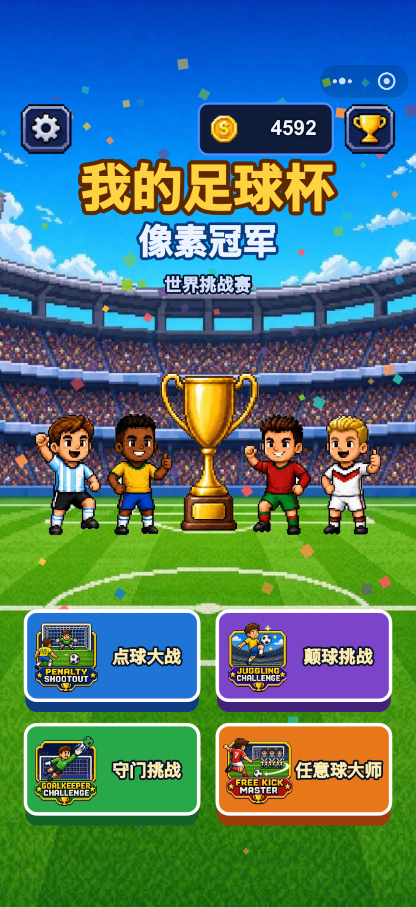
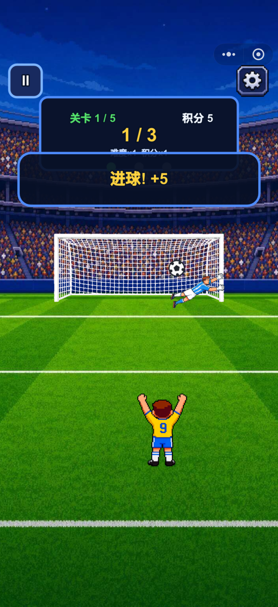
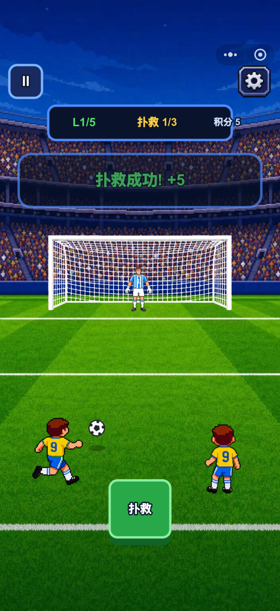
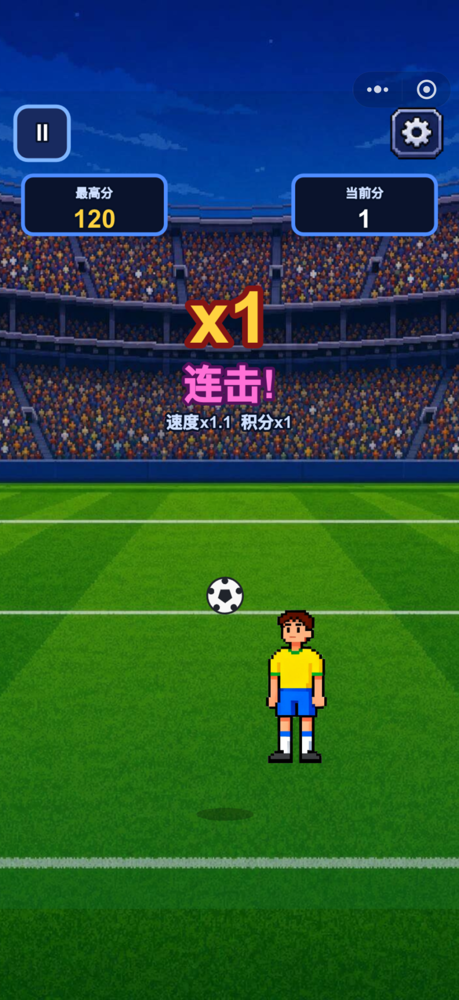
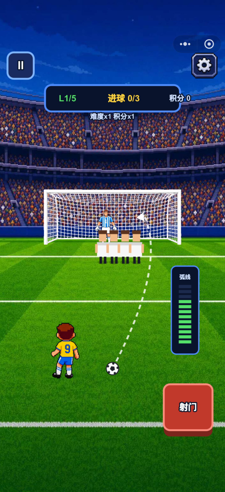

# 从一个想法到一款微信小游戏（上）：我如何用 GPT + GPT Image 2 + VSCode Copilot 独立开发《我的足球杯》

> 作者: Niyao | 平台: 微信公众号 | 日期: 2026-08-05 17:07 | 原文: https://mp.weixin.qq.com/s/DanPxOGZ6-JFQVCMYvJsNQ

> **摘要**: 前言今年六月份突发奇想，想蹭世界杯的热度做个足球小游戏，从六月中旬开发到七月底正式上架，历时一个半月，从一开始

## 前言

今年六月份突发奇想，想蹭世界杯的热度做个足球小游戏，从六月中旬开发到七月底正式上架，历时一个半月，从一开始的激情满满到最后被微信小游戏备案磨的一点脾气没有终于把《我的足球杯》上线了。

本片文章先整理我是如何利用 AI 上线一款微信小游戏的，下一篇再整理这一个半月我踩过的所有坑。

> 不会画画，也没有游戏团队，一个程序员能不能借助 AI，独立完成一款微信小游戏？

我一直想做游戏开发，但是工作十几年由于我没有美术基础，板绘手残，游戏大业就只能作罢。

恰巧六月中旬的时候，2026 年世界杯马上就要来了，我突发奇想做一款足球小游戏。

但我并不是想做一个大型足球游戏，更不是做 FIFA 或实况那样的竞技游戏，而是做的是一款轻量、节奏快、打开就能玩的微信小游戏，这样也能赚点流量费。

另一方面，我也一直想验证另一件事：

**如果只有一个程序员，没有美术、没有策划、没有 UI 设计师，仅依靠 GPT、GPT Image 2 和 VSCode Copilot，到底能不能把一款游戏真正做出来？**

于是，我向 GPT 提出了这样一个问题：

> 马上就要 2026 足球世界杯了，我想做一款像素风的足球小游戏，我要开始怎么做？要求：先做一版 Web 的小游戏，然后再做微信小程序，要充分考虑资源和代码的复用性。另外图片资源需要 AI 生成 GPT Image2/或 Nano Banana，你要给我最全面的方案。帮我提供一些好玩的玩法建议，比如点球大战之类的。

这句话，也成为了《我的足球杯》的起点。

## 从游戏风格开始

我原本以为 GPT 会直接开始写代码。

没想到，它第一件事，是帮我把整个项目方向定下来。

因为我的目标非常明确：

- 2026 世界杯主题
- 像素风
- Web 和微信小游戏双端
- 后期资源可以复用
- 所有美术资源全部由 GPT Image 2 生成

GPT 给我的第一条建议，并不是 Prompt，而是统一美术规范。

它告诉我：

> 既然你的目标是：世界杯主题像素风Web + 微信小游戏双端后期资源可复用GPT Image 生成那么我建议你统一采用：16-bit Pixel ArtSNES StyleBright Color PaletteCute Character DesignTop Down Sports GameRetro Arcade Game不要混入：3DAnimeCartoonClayWatercolor否则资源风格会不统一。

这段建议对我影响很大。

以前我生成 AI 图片，经常今天一个 Prompt、明天一个 Prompt，最后人物像一个游戏、按钮像另一个游戏、背景又像第三个游戏。

GPT 提醒我，美术风格必须在项目一开始就统一，否则后面越做越难改。

## 定游戏玩法

接着，我们开始讨论玩法。

我最开始只是举了一个例子：

> 点球大战。

GPT 并没有停留在这一个玩法，而是建议我把它做成一个足球小游戏合集。

最后确定了四个核心玩法：

- ⚽ Penalty Shootout（点球大战）
- 🧤 Goalkeeper Challenge（守门员挑战）
- 🤹 Juggling Challenge（颠球挑战）
- 🎯 Free Kick Master（任意球大师）

这样不仅玩法更丰富，而且四个小游戏还能共用同一套人物、球场、足球和 UI 资源，大幅降低开发成本。

## 现在开始抠图吧 —— 用 GPT Image 2 生成整套游戏素材

对于游戏来说，视觉才是最重要的，所以美术资源比功能性要更重要，对于一个会画手残党来说，生图只能靠 GPT Image2。

它直接帮我列了一份资源清单：

- 游戏大厅
- 点球大战界面
- 守门员挑战界面
- 颠球挑战界面
- 任意球大师界面
- 主角 Sprite Sheet
- 守门员 Sprite Sheet
- 足球 Sprite Sheet
- 世界杯球场
- 首页四个图标

有了这份资源规划，后面的开发就不会缺东少西。

接下来，我们开始真正生成素材。

既然你的目标是：

- 世界杯主题
- 像素风
- Web + 微信小游戏双端
- 后期资源可复用
- GPT Image 生成

GPT 建议 prompt 统一采用：

```
16-bit Pixel Art
SNES Style
Bright Color Palette
Cute Character Design
Top Down Sports Game
Retro Arcade Game
```

不要混入：

```
3D
Anime
Cartoon
Clay
Watercolor
```

否则资源风格会不统一。

### ① 游戏大厅 Main Menu



用途：

```
游戏首页
四个模式入口
```

GPT Image 提示词：

```
Pixel art game main menu for a football world cup game,

retro 16-bit SNES style,

bright colorful football stadium background,

large golden championship trophy in center,

cute pixel football players from different countries,

four large game mode buttons:

Penalty Shootout,
Goalkeeper Challenge,
Juggling Challenge,
Free Kick Master,

arcade mobile game UI,

highly polished game interface,

clean layout,

vibrant colors,

pixel perfect,

game asset quality,

2D pixel art,

vertical mobile screen,
1080x1920
```

### ② 点球大战界面



用途：

```
Penalty Shootout
```

GPT Image 提示词：

```
Pixel art football penalty shootout game screen,

retro arcade style,

player standing behind football,

large goal net,

goalkeeper waiting in center,

world cup stadium full of audience,

scoreboard at top,

bright green football field,

16-bit SNES graphics,

cute pixel characters,

high quality mobile game UI,

clean composition,

pixel perfect,

vertical mobile screen
```

### ③ 守门员挑战界面



用途：

```
Goalkeeper Challenge
```

GPT Image 提示词：

```
Pixel art goalkeeper challenge game screen,

retro football arcade game,

goalkeeper diving to save incoming footballs,

multiple footballs flying toward goal,

crowded world cup stadium,

score counter at top,

dynamic action scene,

bright colors,

16-bit pixel art,

cute character design,

mobile game interface,

retro SNES style,

vertical layout,

game asset quality
```

### ④ 颠球挑战界面



用途：

```
Juggling Challenge
```

GPT Image 提示词：

```
Pixel art football juggling challenge game screen,

cute football player balancing a football,

combo counter showing x25 combo,

arcade score effects,

bright world cup stadium background,

confetti particles,

fun casual mobile game,

retro 16-bit pixel art,

SNES style,

clean UI,

vibrant colors,

high quality game screen,

vertical mobile game layout
```

### ⑤ 任意球大师界面



用途：

```
Free Kick Master
```

GPT Image 提示词：

```
Pixel art football free kick game screen,

player preparing a curved free kick,

visible curved trajectory guide line,

goalkeeper defending goal,

defensive wall of players,

world cup stadium atmosphere,

bright green football field,

scoreboard and timer,

retro arcade style,

16-bit pixel art,

SNES graphics,

cute character design,

high quality mobile game interface,

vertical mobile screen
```

### ⑥ 主角球员 Sprite Sheet

这是最重要的资源。

后面四个小游戏都能复用。

GPT Image 提示词：

```
Pixel art soccer player sprite sheet,

front view,
back view,
left view,
right view,

walking animation,

running animation,

kicking animation,

celebration animation,

retro 16-bit SNES style,

transparent background,

consistent proportions,

game ready sprite sheet,

professional pixel art asset,

world cup football player
```

### ⑦ 守门员 Sprite Sheet

GPT Image 提示词：

```
Pixel art goalkeeper sprite sheet,

idle pose,

dive left,

dive right,

jump center,

celebration animation,

save animation,

transparent background,

16-bit retro game style,

professional game asset,

pixel perfect,

world cup football goalkeeper
```

### ⑧ 足球资源

GPT Image 提示词：

```
Pixel art football sprite sheet,

rotating football animation,

shadow included,

retro 16-bit game style,

transparent background,

high quality game asset,

pixel perfect,

professional mobile game resource
```

### ⑨ 世界杯球场

GPT Image 提示词：

```
Pixel art football stadium,

top down perspective,

world cup final atmosphere,

crowded audience,

bright lights,

green football pitch,

retro 16-bit SNES style,

game background asset,

high quality pixel art,

seamless mobile game environment
```

### ⑩ 图标素材（首页四个按钮）

GPT Image 提示词：

```
Pixel art game icons set,

Penalty Shootout icon,
Goalkeeper Challenge icon,
Juggling Challenge icon,
Free Kick Master icon,

retro arcade style,

bright colors,

transparent background,

16-bit pixel art,

mobile game UI asset pack,

consistent visual style
```

### 推荐统一风格

最推荐这一套关键词固定出现在所有资源中：

```
Pixel Art
16-bit SNES Style
Cute Character
Bright Colors
Retro Arcade Football Game
World Cup Theme
Mobile Game Asset
Transparent Background
```

这样 GPT Image 生成出来的人物、足球、球场、按钮、UI 基本能保持同一种美术风格，后面替换到 Cocos Creator 里不会出现“像是来自不同游戏”的割裂感。

后面的人物 Sprite、足球、球场、图标，也全部按照同一套规范生成。

## 两天肝完主体程序

素材确定以后，就进入开发阶段。将 GPT Image2 的图片资源下载到本地，本来想让 AI 给我抠图，但是 AI 总是把 Alpha 通道抠成灰白格子背景最后我放弃了，直接换 Sketch 抠，毕竟我连 PS 都不会。

整个项目主要使用了三种 AI 工具：

- GPT：负责玩法讨论、功能规划、UI 设计、资源规划、Prompt 编写。
- GPT Image 2：负责生成像素风人物、球场、按钮、Sprite Sheet 等游戏素材。
- VSCode Copilot：负责补全 TypeScript 代码，实现游戏逻辑，提高开发效率。

对于一个从未开发过游戏的人来说整体 workflow 如下：

> 想法 → 和 GPT 讨论 → 确定方案 → GPT Image 2 出图 → Copilot 写代码 → 自己测试和调整。

相比过去一边写代码一边查资料，这种方式更像是在和一位策划、一位美术、一位程序助手一起协作。

## 写在最后

经过不断迭代，《我的足球杯》已经完成了第一版，游戏所有资源都保持统一的 **16-bit SNES Pixel Art**风格，也为后续扩展更多玩法预留了空间。

开发《我的足球杯》，让我最大的收获并不是完成了一款小游戏，而是重新认识了 AI 在游戏开发中的角色。

过去，一个独立开发者想做游戏，往往会卡在美术资源、UI 设计、策划方案这些环节。

而这一次，我把整个流程拆分成了不同阶段：

- 用 GPT 讨论需求、规划玩法；
- 用 GPT Image 2 生成统一风格的游戏资源；
- 用 VSCode Copilot 协助完成代码开发；
- 最后再将 Web 版本迁移到微信小游戏，尽可能实现资源和代码复用。

但是，上架一款微信小游戏最费劲的是 **微信小游戏备案**下一篇，将整理我踩过的所有微信备案的坑。
