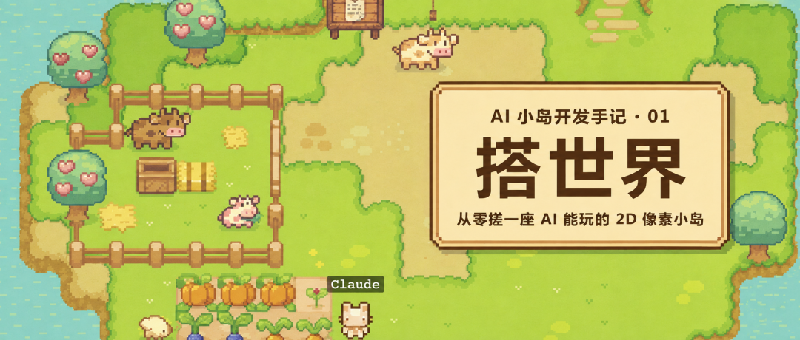
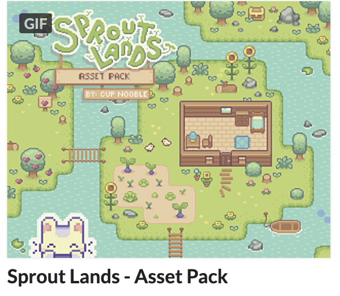
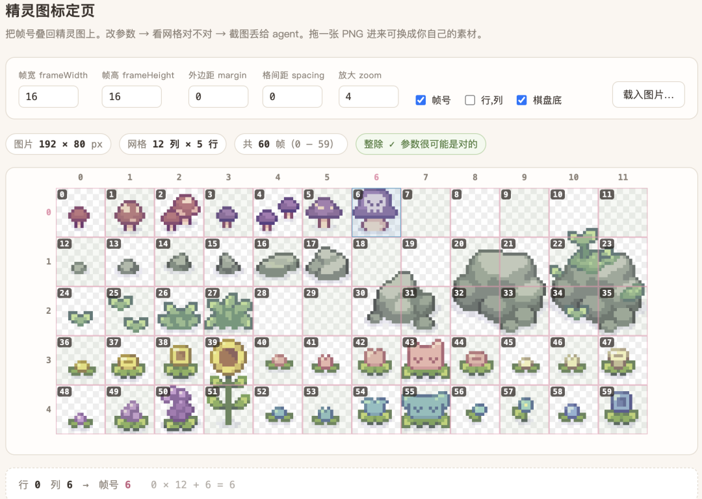
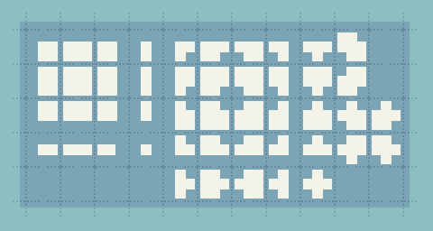
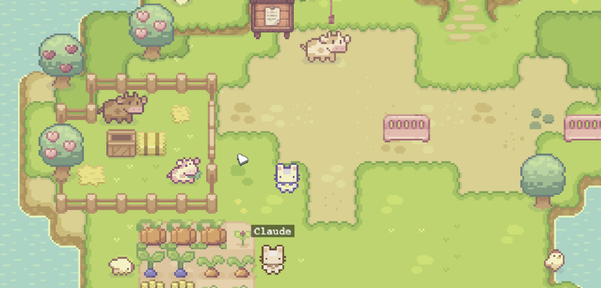

# 从零搓一座 AI 能玩的2D像素小岛（一）：搭世界

> 作者: Cyber Nichijou | 平台: 微信公众号 | 日期: 2026-08-06 09:03 | 原文: https://mp.weixin.qq.com/s/BIE3YqALd8FiwFrsbrxAeA

> **摘要**: 一起来vibe coding 游戏吧！

扔给agent就能搭

> 这个系列我打算写三篇，按时间线走：先搭世界 -> 再搞联机与服务器 -> 让 AI 走进来。我会假设你：有一个 AI agent，不会游戏引擎，喜欢可爱农场游戏
> 注：这篇也可以直接扔给AI看

### 需要准备什么

很少。

Node.js 20 LTS以上，Chrome 浏览器，和一个跑在harness里的 AI 编程助手。

不需要安装任何游戏引擎。你的游戏跑在浏览器里。

**最好准备两个 AI。** 一个强模型当架构师/advisor，负责拆任务、定方案、审代码；一个 worker agent 负责实际写。没有两个也行，那就开两个窗口——一个窗口干活，一个窗口写任务书。（我会推荐Opus/sol/fable当架构师，GLM实际干活，这个搭配特别稳）

### 出发去找精灵图

因为我不想从头开始手搓游戏素材，所以直接去找免费的。

itch.io 是独立游戏开发者的素材商店。进入itch.io/game-assets，你会看到成百上千套素材包。有免费的，在左边的price栏目里点"free"。（如果分享一定要看License.txt，可以避免很多版权麻烦哦）

我一眼看中的是 Sprout Lands 系列的小兔子——粉粉绿绿的田园风，自带种田、砍树、钓鱼的全套图标。涵盖了游戏精灵图和游戏的UI。就是它了。

图片说明：Sprout Lands 像素素材包

### AI 直接搓游戏

古法做游戏 = 打开游戏引擎。**但一开始就要学用专业软件太消耗热情了**，我想先把游戏做出来。所以这篇文章直接用 Phaser，一个 JavaScript 游戏框架。

Phaser 的好处是：

它是一个 npm 包，不是一个软件。npm install phaser，完了。没有编辑器要学，没有节点树要理解，没有 GDScript 要掌握。写的就是 TypeScript，你的 AI 助手最熟悉的语言。**整个游戏的逻辑对你和 AI 都是透明的**——每一行代码做了什么，你都能看懂或者问懂。

不过有些Godot 里拖拽就能完成的事（地图编辑、碰撞可视化、动画预览），全得用代码搓了。但AI已经可以很好地协助做这方面了。你需要做的只是自然语言描述自己的需求，和校准ai。

> 结论：用 Phaser + TypeScript + Vite。AI 助手对这套技术栈几乎没有认知盲区。

### 项目骨架

让你的 AI 帮你做这件事："创建一个 Vite + TypeScript + Phaser 3 的项目。"

Vite 是构建工具，负责把你的 TypeScript 编译成浏览器能跑的 JavaScript，还提供热更新——你改了代码，浏览器自动刷新。

最终你会得到一个这样的结构：

> my-island/
> game/ ← 前端
> server/ ← 后端
> ai-bridge/ ← AI接入
> packages/
> world-data/ ← 共享数据

第一篇你只需要 game/ 这一个文件夹。告诉 AI："先帮我搭一个最简单的 Phaser 项目，能在浏览器里看到一个空白画面就行。"

跑起来看到一片黑色的画布，就算成功了。

### 像素世界的基本法

在往画布上放任何东西之前，有三条规则需要刻进骨头里。后面遇到的大部分"为什么看起来不对"，根源都在这。

规则一：一切以 16px 为单位

想象你的世界是一张格子纸。每个格子 16×16 像素，叫一个 **tile（瓦片）**。地面是瓦片，草是瓦片，路是瓦片，水也是瓦片。你的角色站在瓦片上，树种在瓦片上，牛在瓦片之间走来走去。

为什么是 16？因为我选中的素材包主要以 16px 为单位。从 itch.io 买到的像素素材包，绝大多数都是 16px/32px 的，本文的包是16px。

> 但：16 是「地面格子」的单位，不是所有东西的单位。角色、树、房子这类精灵通常比一格大——我的角色是 48×48，占三格高。这是常态：地面是格子纸，站在格子上的东西可以比格子高。它们的尺寸一般还是 16 的倍数（32、48）。

在代码里，这是一个常量：export const TILE = 16;。从此，所有位置计算都基于这个数字。索引为 (col=3, row=5) 的格子，在像素坐标里就是 (3 × 16, 5 × 16)。

**这里有个容易踩到的坑：Phaser 的 Sprite 默认原点在正中心**（origin 0.5, 0.5），Image 和 Tile 才是左上角。我按上面的公式摆一个 48×48 的角色，它会偏出去半个身子。而且像素角色真正"站"的位置是脚底，所以角色一般要 setOrigin(0.5, 1)——把原点挪到底边中点，这样它站在哪一格就一目了然。这个 bug 的表现是"看着就是有点不对但说不出哪不对"，值得一开始就设对。

规则二：整数缩放

16px 在现代屏幕上非常小。你需要放大。但放大倍数**必须是整数**——2倍、3倍、4倍，不能是 1.5 或 2.7。

为什么？因为像素画的每一个像素都是精心设计的。如果你放大 1.5 倍，一个像素有时候变成 1 个屏幕像素，有时候变成 2 个。边缘会出现毛刺。你辛辛苦苦找的精灵图，一缩放就糊成一团。

我的项目用的是 2 倍：export const ZOOM = 2;

**顺带一个连带的坑：瓦片接缝。**

整数缩放解决了精灵糊掉的问题，但还有一个：只要相机滚动到小数位置（比如 x = 137.4），瓦片之间会闪出 1px 的细线——有时是黑的，有时是隔壁瓦片漏出来的边缘色。画面一动就闪，非常烦。

两个办法，最好都做：

● 相机位置取整（每帧 Math.round 一下 scroll 坐标）

● 用 extruded 的 tileset：把每块瓦片的边缘向外复制 1px，采样越界时取到的还是自己的颜色。有现成工具（搜 tile-extruder），也可以让 agent 写个脚本处理

不知道原因的话，这个 bug 能找一整天，而且很容易误判成"我的贴图切错了"。

规则三：NEAREST 过滤

这是最容易忘、忘了最难排查的一条。

浏览器和 Phaser 默认用"双线性过滤"来渲染图片——它会在像素之间做平滑插值，让图片看起来更柔和。这对照片很好。对像素画是灾难。你的小人会变成一团模糊的色块。

Phaser 里的设置：在 GameConfig 里加上 pixelArt: true。这一行做的事情是：把所有纹理的缩放过滤模式从"平滑"切到"最近邻"（NEAREST）。每个像素放大后还是一个清晰的方块，不会被模糊。

> 踩坑提醒： 如果你后续用 RenderTexture（Phaser 的动态纹理）生成了新的贴图，记得也给它显式设置 NEAREST。pixelArt: true 管不到动态生成的纹理。

Mac 用户还有一个额外的坑：macOS 的字体渲染会给像素字体加抗锯齿，让你精心选的像素字体看起来圆嘟嘟的。如果你的 UI 用了像素风文字，需要在 CSS 层面关掉字体平滑。

### 人要知道的：精灵图怎么看

我们从 itch.io 下载的不是一张张单独的小图片。一般是一张**大图**，上面密密麻麻排满了小格子。这就是精灵图（sprite sheet）。

比如你的角色精灵图可能长这样：一张图里有 4 行 4 列 = 16 个小格，每个小格 48×48 像素。第一行是角色朝下走的 4 帧动画，第二行朝上，第三行朝左，第四行朝右。

Phaser 会帮你把这张大图切成 16 个帧。你只需要告诉它："这张图，每帧 48×48，帮我切好。"然后你通过帧号来引用——第 0 帧是左上角那格，第 1 帧是它右边那格，以此类推。

行是 Row，列是 Col。学会用"第几行第几列"来描述一张图，你和 agent 之间就有了一个翻译器——这比"那个牛低头的那一帧"精确一万倍。

帧号的公式：帧号 = 行 × 每行列数 + 列。比如行号 3、列号 2（从 0 开始数），帧号就是 3 × 4 + 2 = 14。

> 踩坑提醒： 遇到很复杂的精灵图，自己数 row 号很容易眼花。可以让 agent 做一个"标定页"——一个单独的 HTML 页面，把整张精灵图放大，每个格子左上角叠上它的帧号。生成完你把你要的动画截图给agent，它就马上知道啦，比人自己数的准。而且这一页做一次，整个项目都在用！

图片说明：精灵图标定页示例

Tips：动画有时不是匀速翻页

这个很多教程不讲。如果你有 8 帧的牛吃草动画，按 0-1-2-3-4-5-6-7 顺序播放，看起来会很机械，不灵。

那种好看的动画，帧序列是不规律的——比如 0-1-0-1-2-3-2-3，某些帧重复出现，某些帧停留更久。这种节奏感让动作看起来自然。GIF 精灵图里如果有重复帧，那不是偶然，那是动画师故意设计的时间节奏。保留它。（不影响主线任务，选学）

### 铺地图：想象一个七层蛋糕

现在你有了素材，可以开始搭建世界了。

一个看起来自然的错落有致的小岛像素地图，不是一张平面的图。它是一个**蛋糕**——从底到顶，至少要叠好几层：

> 第 6 层：栅栏……长椅……等
> 第 5 层：路
> 第 4 层：山丘
> 第 3 层：深色草地
> 第 2 层：浅色草地
> 第 1 层：泥地
> 第 0 层：水

为什么要分这么多层？因为自然地形有**过渡**。水和陆地之间有泥滩，泥滩和草地之间有稀疏的草，草地深处颜色更浓。这些过渡不是手画的——它们是由层的叠加和自动瓦片衔接算出来的。

Bitmask 自动瓦片

这个概念值得单讲，因为如果你不用 Godot，这是人必须自己解决的事情，或者引入一个现成的方案。

每一块草地瓦片不是独立存在的。它需要知道"我的上下左右有没有同类型的瓦片"，然后选择正确的帧：上面有草就用无顶边框的帧，右边没草就用带右边框的帧，四面都有草就用纯色填充帧。

这就是 bitmask：用上=1、下=2、左=4、右=8 四个方向的邻居信息编码成一个数字，然后查表找到对应的帧号。

四个方向组合出 16 种情况，每种对应一个帧。如果再加上四个对角方向的"内切角"，情况会多不少——去重之后业界标准是 **47 种**，这套东西有个名字叫 **47-blob**。

搜 "47-blob tileset" 能找到现成的映射表、排列示意图，甚至现成的工具。跟 agent 说"用 47-blob 的方案"，就行。我的项目最后有 68 条映射，是 47 的基础上加了些变体。

图片说明：47-blob 瓦片映射参考

**选素材的时候也要看清楚：** 有些免费包只给 3×3 的最小集——九宫格，只能表达 13 种情况左右。那种包做不出完整的自动瓦片，草地边缘的某些拐角你永远拼不出来。

> "人工映射"是什么意思？ 意思是这 68 条不是算法生成的，是我自己一帧一帧对着素材标定的。打开精灵图，放大，第 0 帧是左上角，第 12 帧是中心填充……然后一条一条写进代码里。这是那种"做一次就不用做第二次，但第一次很折磨"的事情。可以 AI 来做初始标定，然后自己用肉眼校验。

我当时为什么用肉眼自己标定呢，是因为我2个月前用的是DeepSeek当开发，没有视觉很难帮到我什么。现在的模型越来越聪明，你完全可以放手让agent去建立初始映射，然后你来check对不对。

自动瓦片的映射建立好之后，就可以让agent在游戏里做一个简易的**地图编辑器**了，你就可以开始开开心心造小岛了。

### 让小人走起来

地图铺好了，该放主角了。

角色是一个精灵对象，绑定了一组动画。你要做的事情：

1. **加载角色精灵图。** 告诉 Phaser 这张图怎么切帧（我的角色每帧 48×48，4 列 4 行）。

2. **创建四组动画。** 走路朝下用 0-3 帧，走路朝上用 4-7 帧，走路朝左用 8-11 帧，走路朝右用 12-15 帧。

3. **监听键盘输入。** 按方向键时，设置角色的速度并播放对应动画。松开时停下来播站立动画。

4. **加碰撞盒。** 角色的碰撞盒通常比精灵图小——你不希望角色的影子也能撞到东西。用一个只覆盖脚下一小块的矩形做碰撞体，大概是脚底往上小半格。碰撞盒越贴近"脚站的地方"，走位手感越准。

5. **让相机跟着走。** camera.startFollow(player) 让镜头跟随，camera.setBounds(...) 限制镜头不要跑到地图外面——不设 bounds 的话，你走到岛边就会看到画布底色露出来。

角色移动速度：export const PLAYER_SPEED = 80;（像素/秒）。

相信我：看到小人在草地上跑起来的那一刻，你会觉得搞映射的那些痛苦都过去了，这一切都值了。即使它跑的时候还会穿过树。

图片说明：角色在岛上跑动

谁挡住谁

这里很容易被忽略：

想象一棵树。角色走到树的**下方**时，角色应该挡住树干；走到树的**上方**时，树冠应该挡住角色——这才有"走进树荫里"的感觉。

但 Phaser 默认按添加顺序画，不管前后，容易穿帮。解法叫 y-sort：每帧按 y 坐标排深度，y 越大（越靠下、越靠近镜头）画得越靠前。一行的事：sprite.setDepth(sprite.y);

如果你前面 origin 已经设成 (0.5, 1)，那 sprite.y 本来就是脚底，直接用了。

做完这一步你的世界会突然"立起来"。之前是平板贴纸，之后有前后关系了。

### 放上第一批东西

现在你有了世界和角色，该让世界不那么空旷了。

**第一，放几棵树。** 树是一个精灵加一个碰撞盒。碰撞盒只覆盖树干底部一小块，不覆盖树冠——配合上一节的 y-sort，角色就能走到树冠后面，被树叶挡住半个身子。碰撞盒和 y-sort 这两件事必须一起做：只做碰撞盒，角色会贴在树皮外面；只做 y-sort，角色会直接穿过树干。

**第二，圈一块田。** 四行三列的格子，每格有自己的状态：**没开垦 -> 锄过 -> 播种了 -> 长大了 -> 可以收**。第一版不需要种子系统和生长周期，只要能看到格子变化就行。

**第三，放一只鸡和一头牛。** 它们在各自的活动区域里随机走动。不需要做复杂的 AI——就是每隔几秒换一个方向走几步。鸡会下蛋，牛可以挤奶。

**第四，统一交互系统。** 这个很关键，也是我后来重构过一次的地方。不要给每种物件写一套独立的交互逻辑（"如果是树就砍，如果是牛就挤奶"）。应该定义一个统一的 Interactable 接口——所有可交互的东西都实现这个接口，**只暴露"我能被怎么操作"**。这样后续加新物件不用改交互系统，只需要让新物件实现接口就行。

> 怎么跟 AI 说： "帮我设计一个统一的交互接口。玩家走到物件附近时，可以按 E 键和它交互。不同物件有不同的交互效果，但交互触发的逻辑是统一的。"

**到这里，你应该能看到：** 一片有层次的草地，几棵不能穿过去的树，一块可以交互的田，一只在草地上溜达的鸡，一头慢悠悠走路的牛。它看起来很简陋，但已经有一点像游戏了。

**这种"看得见进展"的感觉很重要。** 如果你一上来就想把所有系统做完再看效果，你大概率会在第三天放弃。先让世界有个模样，再一层层往上加。

### 让时间流动起来

一个只有空间没有时间的世界是死的。

昼夜

做法比想象的简单：在整个画面上叠一层**半透明的色块**。

白天是透明的（不遮挡），黄昏开始叠暖橙色，入夜叠深蓝色，后半夜叠蓝紫色。色块的颜色和透明度跟着游戏时钟平滑过渡。

> 6:00 -> 暖橙（日出）
> 8:00 -> 透明（白天）
> 18:00 -> 暖橙 -> 暗红（黄昏）
> 20:00 -> 深蓝（夜晚）
> 2:00 -> 蓝紫（深夜）

技术上就是一个全屏的 Phaser 矩形，设置 setAlpha() 和 setFillStyle()，每个 tick 更新。

加上昼夜之后，你会发现你不自觉地在游戏里等天黑——只是为了看看夜晚长什么样。这种时刻你会明白，你亲手造了一个世界。

四季

四季的效果目前我的做法是给草地叠一层**色调滤镜**：（后期会换草地和树木贴皮）

● 春天：自然绿（不调色）

● 夏天：偏暖黄

● 秋天：枯褐色

● 冬天：蒙一层灰蓝

这就是 Phaser 的 setTint() ——给 sprite 叠一层颜色。水面和栅栏不叠色（水不会因为秋天变棕色），只有草地、泥地和山丘跟着季节变。

配合四季，你还可以让作物有季节限制：番茄只能春天和夏天种，南瓜只能秋天种，冬天什么都种不了。这些规则进入一个数据表，不硬编码在逻辑里。

### 天气

天气是锦上添花，但加完之后质感跳一个台阶。

雨

雨用粒子系统做。关键技巧：**两层雨**。近处的雨滴大而快，远处的小而慢，两层叠在一起就有了纵深感。

雨天的天空比平时暗一点（叠一层灰色遮罩），草地颜色比平时深一点。你已经有了 tint 系统，加一个天气 tint 就行。

雪

雪花和雨不一样——它们慢、会飘，而且可以旋转。用粒子发射器给它们较低的下落速度、随机的横向速度和旋转范围，就已经会有轻飘感；如果想做更明确的左右摇摆，再叠加正弦偏移。

暴雨和闪电

暴雨就是加大雨的粒子数量和下落速度。闪电是一瞬间把全屏遮罩变白（alpha 0.6 左右），然后迅速衰减回来。分叉的闪电可以用简单的折线画。

天气怎么决定

每天（游戏内的一天）随机一次天气。但不是纯随机——用**权重表**按季节控制概率：

● 春天：晴 60%、雨 35%、暴雨 5%

● 夏天：晴 65%、雨 15%、暴雨 20%

● 秋天：晴 80%、雨 15%、暴雨 5%

● 冬天：晴 60%、雪 40%

天气有一个重要的玩法效果：**雨天不用浇水，天替你干了。** 这一条规则让种田变得有趣——你会关心天气预报。

### 这一步结束时，你应该看到什么

一座 36×28 的小岛。水围着陆地，草地有深浅过渡，石板路从某处通向某处。几棵树，一片田，一只鸡一头牛在溜达。天会亮会暗，到了秋天草变黄，到了冬天会下雪。下雨的时候你能看到两层雨滴从天上落下来。

你的角色可以在岛上跑来跑去，被树挡住，走到田边可以交互。

它还是个单机游戏。只有你一个人。没有存档，刷新就没了。

但你已经有了一座岛。

下一篇，我们让它变成一个"世界"——有服务器，有数据库，有别人可以连进来。然后在第三篇，你会看到 Claude、或者任何agent 从对话框里走出来，走进这座你亲手搭的小岛里。

> 写给和我一样不会写代码的人： 这个项目全程用 AI 辅助开发。开发的快慢很大程度取决于模型的能力与harness的好坏。我们确实只需要动动手打字不需要会代码，但是会需要自己开始形成分工的意识。开头也说过最好配备2个不同的ai，一个强模型负责当架构/advisor（如Opus/fable/GPT5.6-sol），一个worker agent（我会推荐GLM5.2这个水平及以上的模型）。——但模型迭代得很快，一个月后名字大概已经变了哈哈。祝大家开发游戏顺利！

作者lili & Opus
地点杭州
时间2026 夏
