---
title: "一行代码没写！AI做的体感游戏女友玩嗨了！"
source: "https://www.xiaohongshu.com/discovery/item/6a57a9990000000011012d54?app_platform=android&ignoreEngage=true&app_version=9.40.1&share_from_user_hidden=true&xsec_source=app_share&type=video&xsec_token=CB-zqVzJ5xrnJkDh7hZdYz3G0yTgUlpjbBdTAaAnZuE3Y%3D&author_share=1&xhsshare=CopyLink&shareRedId=OD06N0RGNj42NzUyOTgwNjY7OTg8RkdL&apptime=1785857704&share_id=6d71650c98b549338dd4f569e6428489&share_channel=copy_link"
author: "空气分子"
author_uid: "65c0c9bc000000000903e6cf"
date: "编辑于 2天前 浙江"
tags: ["我在小红书做游戏", "vibecoding大赏", "vibecoding", "体感游戏", "AI开发", "自然语言编程", "动作识别"]
platform: "xiaohongshu"
category: "AI"
summary: "作者通过纯自然语言描述指挥AI开发体感动作肉鸽小游戏，全程未编写一行代码，依靠AI完成开发和bug修复。游戏通过摄像头识别玩家全身动作进行互动，但目前需要玩家站远才能被完整拍摄到，体验仍有改进空间。整体展示了AI辅助游戏开发的高效流程，属于vibecoding实践案例。"
---

# 一行代码没写！AI做的体感游戏女友玩嗨了！

> 作者: 空气分子 | 日期: 编辑于 2天前 浙江 | 原文: https://www.xiaohongshu.com/discovery/item/6a57a9990000000011012d54?app_platform=android&ignoreEngage=true&app_version=9.40.1&share_from_user_hidden=true&xsec_source=app_share&type=video&xsec_token=CB-zqVzJ5xrnJkDh7hZdYz3G0yTgUlpjbBdTAaAnZuE3Y%3D&author_share=1&xhsshare=CopyLink&shareRedId=OD06N0RGNj42NzUyOTgwNjY7OTg8RkdL&apptime=1785857704&share_id=6d71650c98b549338dd4f569e6428489&share_channel=copy_link

> **摘要**:作者通过纯自然语言描述指挥AI开发体感动作肉鸽小游戏，全程未编写一行代码，依靠AI完成开发和bug修复。游戏通过摄像头识别玩家全身动作进行互动，但目前需要玩家站远才能被完整拍摄到，体验仍有改进空间。整体展示了AI辅助游戏开发的高效流程，属于vibecoding实践案例。

全程一句代码也没写过，纯自然语言描述指挥 ai 干活改 bug！目前为了让全身都被摄像头拍到，人得站着比较远呢
	
#我在小红书做游戏 #vibecoding大赏 #vibecoding #体感游戏

#AI开发 #自然语言编程 #动作识别

## 视频

[视频 1](./video.mp4)

<video controls width="100%"><source src="./video.mp4" type="video/mp4">您的浏览器不支持视频播放。</video>

附件: [音频](./audio/audio.wav) | [处理清单](./video_manifest.json)

## 视频图文总结

> 按关键帧关联完整视频转录；文字保留机器转写原文，时间点仅用于定位。

### 1. 00:00

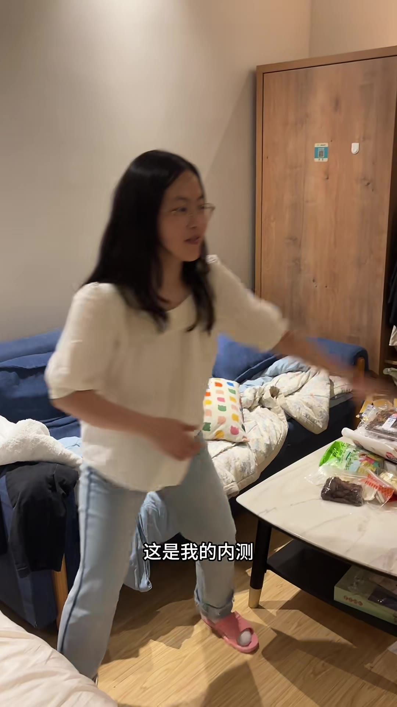

- 内容摘要：这是我的内测终极number one内测玩家（00:00-00:04）
- 画面文字（OCR）：R
这是我的内测

### 2. 00:05

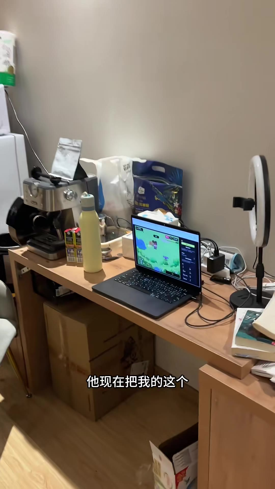

- 内容摘要：它是在把我的这个（00:05-00:07）
- 画面文字（OCR）：品
他现在把我的这个

### 3. 00:11

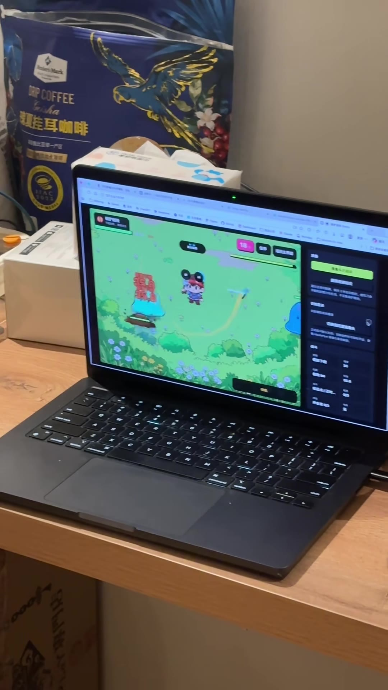

- 内容摘要：体感识别动作小游戏（00:11-00:14）
- 画面文字（OCR）：laeMek
DRP COFFEE
bha
瑰夏挂耳咖啡
#度比蓝单一产区
请此卡通#
UIAC
2023
18
房

### 4. 00:16

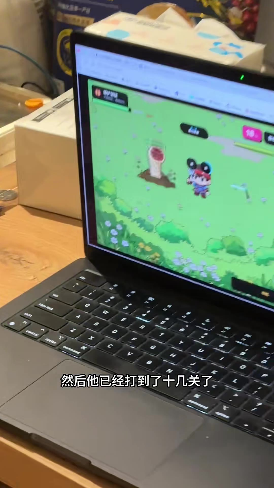

- 内容摘要：肉鸽，然后它已经打到了十几关（00:14-00:17）
- 画面文字（OCR）：然后他已经打到了十几关了。
福
W

### 5. 00:19

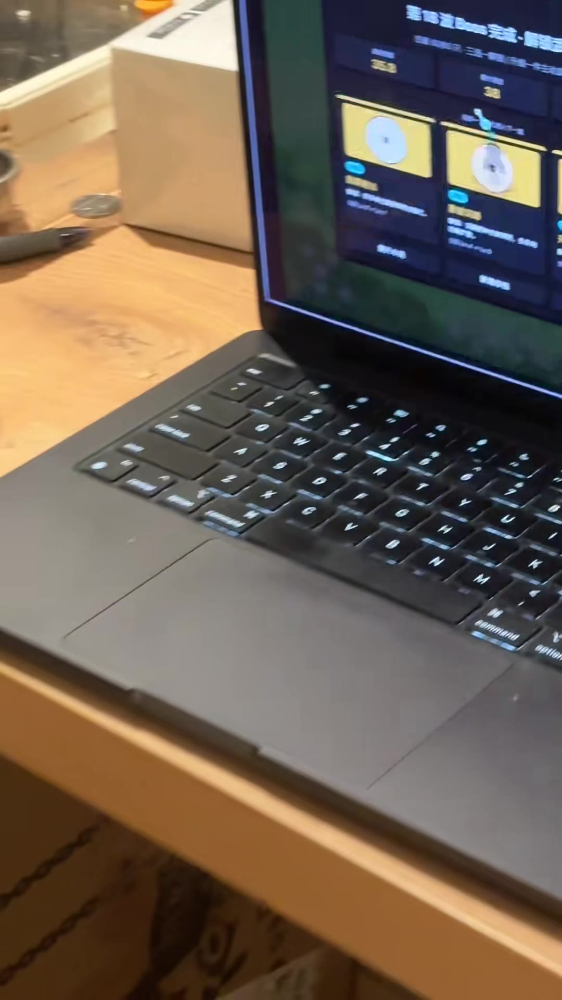

- 画面文字（OCR）：aaa
一

### 6. 00:21

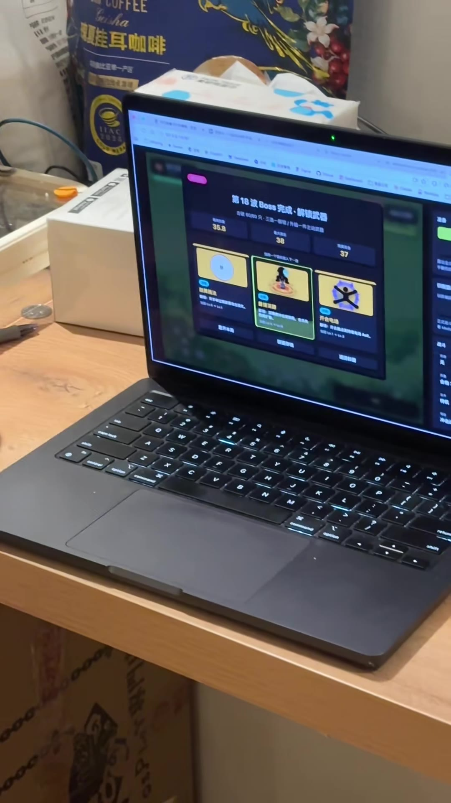

- 内容摘要：是不是啊？第十八关都已经打过了（00:22-00:24）
- 画面文字（OCR）：2明+1
AOMEU
印话
B一Y
80
850
##480只·三造一##/升#一件主动##
第18波Boss完成·解锁武器
心-#不
有

### 7. 00:26

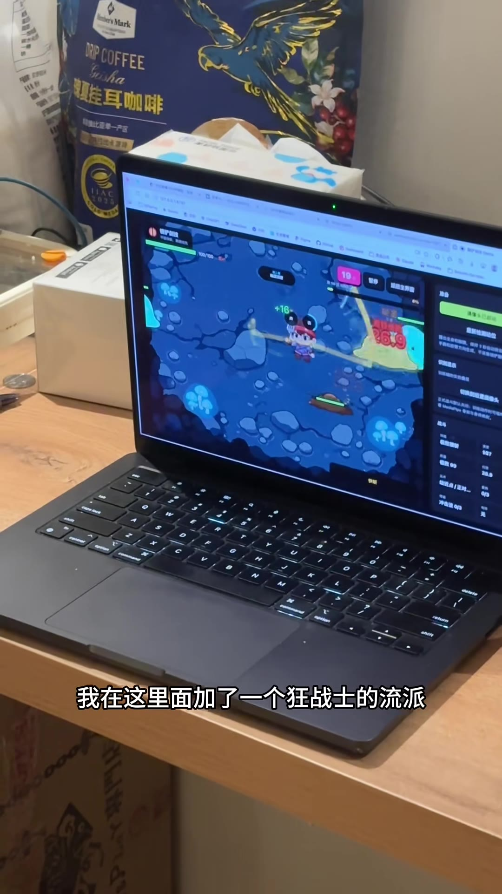

- 内容摘要：最近我在这里面加了一个狂战士的流派，就是你可以一边拿你的血卖血来换战攻击力（00:24-00:33）
- 画面文字（OCR）：91+
S2O
YI
红聘手
一
夏挂耳咖啡
Suisha

### 8. 00:32

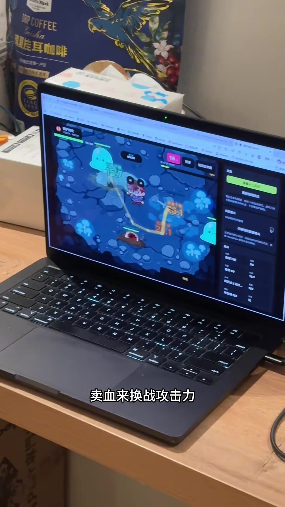

- 画面文字（OCR）：咖啡
19
SILP
18
2
卖血来换战攻击力

### 9. 00:37

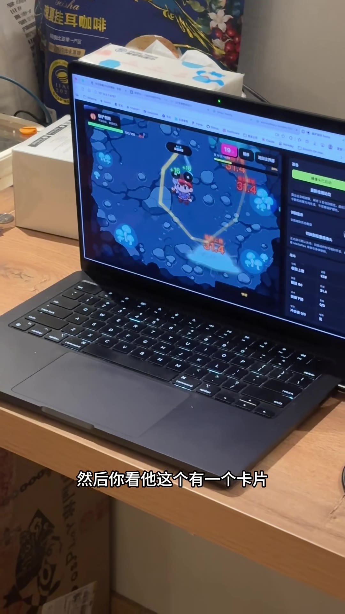

- 内容摘要：然后你看它这个有一个卡片就是（00:36-00:40）
- 画面文字（OCR）：简奥比亚单一产区
档比卡谨聘
#国主男面
19
销护刮技
31.4
16
31.4
op3
然后你看他这个有一个卡片

### 10. 00:42

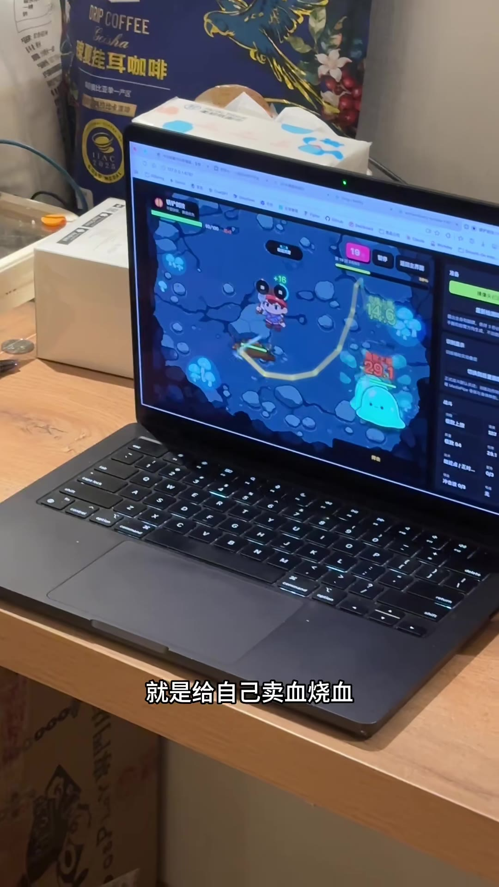

- 内容摘要：给自己卖血烧血，然后另外一张卡狂战士就可以叠战役叠狂（00:40-00:46）
- 画面文字（OCR）：#耳咖啡
比亚单一产区
档比卡#动
25
19
16
就是给自己卖血烧血

### 11. 00:47

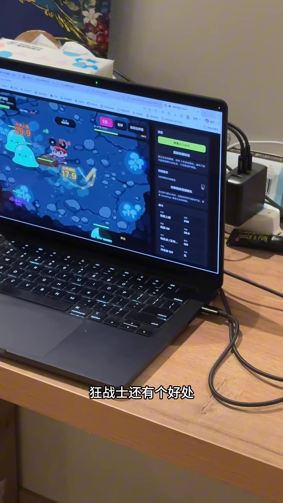

- 内容摘要：我靠。狂战士还有一个好处就是你被怪打了以后，它也会给你点战意（00:46-00:52）
- 画面文字（OCR）：营主养器
请拿头已#动
19
重新检路站位
保#3#自动#线，电万
最出全的柜时a
手的#就管方向生成，不显##护#色。
职刻墨杂
诚论实的登#
招典到后营喝带头
尚时可#时开品
正式维网管认美
专国为电#
我锁
17.9
提斗
完员上
宽美60
站进点/正对
冷由眼03
狂战士还有个好处

### 12. 00:53

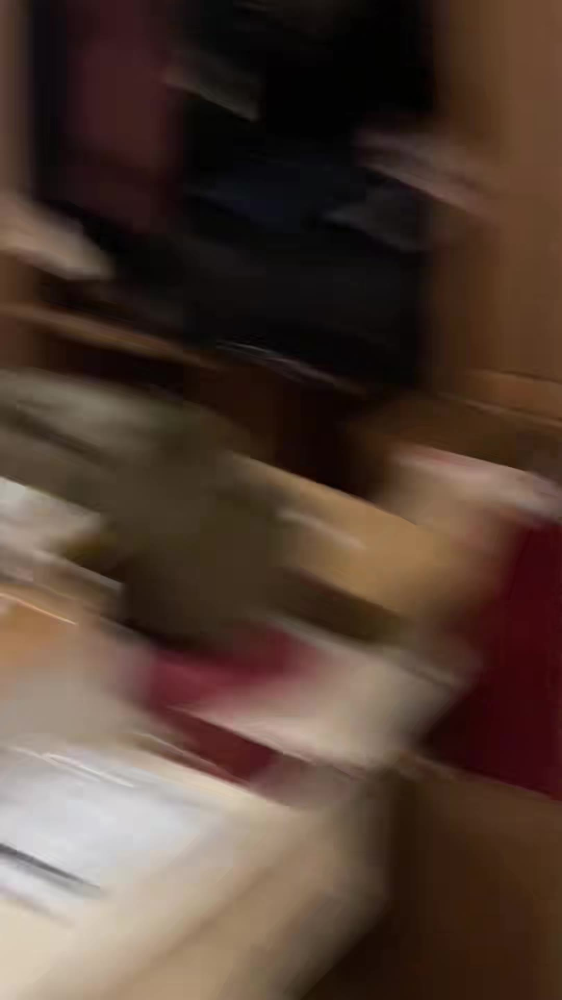

- 该时间点暂无可提取文字。

### 13. 00:58

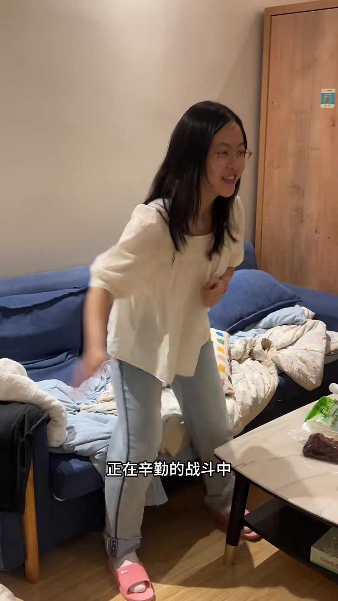

- 内容摘要：好，那我们看这边。这位女士正在辛勤的战斗中（00:53-00:59）
- 画面文字（OCR）：正在辛勤的战斗中

### 14. 01:03

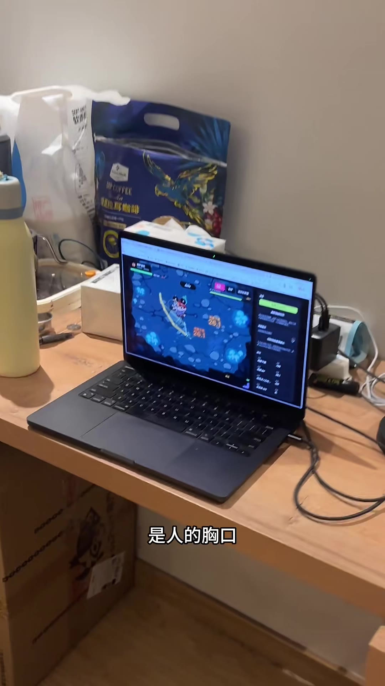

- 内容摘要：还在走位，对我现在这个小人的识别位置是人的胸口（00:59-01:05）
- 画面文字（OCR）：WPCOFFEE
耳咖啡
HA
是人的胸口

### 15. 01:09

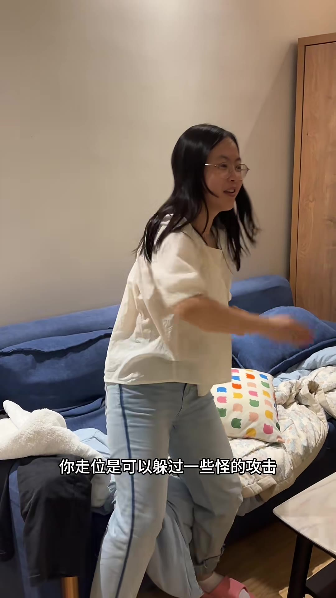

- 内容摘要：所以说你走位是可以躲过一些怪的攻击（01:05-01:09）
- 画面文字（OCR）：你走位是可以躲过一些怪的攻击

### 16. 01:14

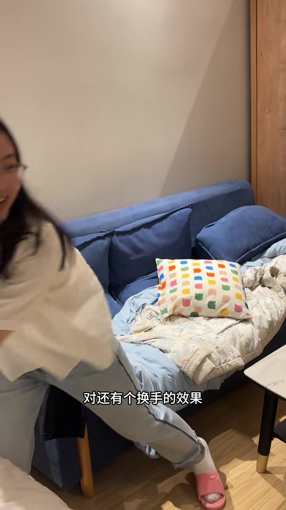

- 内容摘要：对，还有个换手效果，就是你把两只手放在胸口，它可以换手（01:13-01:18）
- 画面文字（OCR）：对还有个换手的效果
电

### 17. 01:19

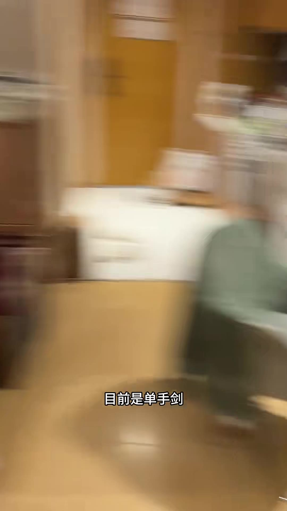

- 内容摘要：目前是单手接（01:18-01:20）

## 视频画面文字 (OCR)

> OCR 仅供参考，可能包含识别错误；请以视频画面和转写来源为准。

### 关键帧 1 · 0.5s

R
这是我的内测

### 关键帧 2 · 5.78s

品
他现在把我的这个

### 关键帧 3 · 11.05s

laeMek
DRP COFFEE
bha
瑰夏挂耳咖啡
#度比蓝单一产区
请此卡通#
UIAC
2023
18
房

### 关键帧 4 · 16.33s

然后他已经打到了十几关了。
福
W

### 关键帧 5 · 19.63s

aaa
一

### 关键帧 6 · 21.6s

2明+1
AOMEU
印话
B一Y
80
850
##480只·三造一##/升#一件主动##
第18波Boss完成·解锁武器
心-#不
有

### 关键帧 7 · 26.88s

91+
S2O
YI
红聘手
一
夏挂耳咖啡
Suisha

### 关键帧 8 · 32.15s

咖啡
19
SILP
18
2
卖血来换战攻击力

### 关键帧 9 · 37.43s

简奥比亚单一产区
档比卡谨聘
#国主男面
19
销护刮技
31.4
16
31.4
op3
然后你看他这个有一个卡片

### 关键帧 10 · 42.7s

#耳咖啡
比亚单一产区
档比卡#动
25
19
16
就是给自己卖血烧血

### 关键帧 11 · 47.98s

营主养器
请拿头已#动
19
重新检路站位
保#3#自动#线，电万
最出全的柜时a
手的#就管方向生成，不显##护#色。
职刻墨杂
诚论实的登#
招典到后营喝带头
尚时可#时开品
正式维网管认美
专国为电#
我锁
17.9
提斗
完员上
宽美60
站进点/正对
冷由眼03
狂战士还有个好处

### 关键帧 13 · 58.53s

正在辛勤的战斗中

### 关键帧 14 · 63.8s

WPCOFFEE
耳咖啡
HA
是人的胸口

### 关键帧 15 · 69.08s

你走位是可以躲过一些怪的攻击

### 关键帧 16 · 74.35s

对还有个换手的效果
电

## 字幕文件

[TXT](./transcript/video.txt) | [JSON](./transcript/video.json) | [SRT](./transcript/video.srt) | [VTT](./transcript/video.vtt)

## 转写来源

[平台字幕 TXT](./transcript/platform/video.txt) | [平台字幕 JSON](./transcript/platform/video.json) | [平台字幕 SRT](./transcript/platform/video.srt) | [平台字幕 VTT](./transcript/platform/video.vtt) | [本地 ASR TXT](./transcript/asr/video.txt) | [本地 ASR JSON](./transcript/asr/video.json) | [本地 ASR SRT](./transcript/asr/video.srt) | [本地 ASR VTT](./transcript/asr/video.vtt)

## 其他来源转写

### 本地 ASR

- **00:00-00:02** 其实我的内侧中级
- **00:02-00:04** Number 1内侧玩家
- **00:05-00:06** 可是呢
- **00:06-00:07** 反而我的这个
- **00:11-00:14** 体感识别动作小游戏
- **00:14-00:15** 肉哥
- **00:15-00:17** 然后他已经打到了十几关
- **00:22-00:24** 就是啊第十八关都已经打过了
- **00:24-00:28** 最近我就是里面加了一个狂战士的流派
- **00:28-00:30** 就是你可以一边拿你的血
- **00:30-00:33** 卖血来换战攻击力
- **00:36-00:37** 然后你看他这个
- **00:38-00:40** 有一个卡片就是
- **00:40-00:42** 给自己卖血稍血
- **00:42-00:45** 然后另外一张卡狂战士就可以叠战艺
- **00:45-00:46** 叠狂
- **00:46-00:47** 我考
- **00:47-00:49** 狂战士还有一个好处就是
- **00:49-00:50** 你被怪打了以后
- **00:50-00:51** 他也会给你叠战艺
- **00:53-00:54** 然后我们看这边
- **00:56-00:59** 这位女士正在心情的战斗中
- **00:59-01:00** 还在走位
- **01:00-01:01** 对我现在这个
- **01:01-01:03** 小人的识别位置是
- **01:03-01:05** 人的胸口
- **01:05-01:07** 所以说你走位是可以躲过一些
- **01:07-01:08** 怪的攻击
- **01:13-01:15** 对还有个换手效果就是
- **01:15-01:17** 你把两只手放在胸口
- **01:17-01:18** 他可以换手
- **01:18-01:19** 目前是单手间

## 视频转录

- **00:00-00:04** 这是我的内测终极number one内测玩家
- **00:05-00:07** 它是在把我的这个
- **00:11-00:14** 体感识别动作小游戏
- **00:14-00:17** 肉鸽，然后它已经打到了十几关
- **00:22-00:24** 是不是啊？第十八关都已经打过了
- **00:24-00:33** 最近我在这里面加了一个狂战士的流派，就是你可以一边拿你的血卖血来换战攻击力
- **00:36-00:40** 然后你看它这个有一个卡片就是
- **00:40-00:46** 给自己卖血烧血，然后另外一张卡狂战士就可以叠战役叠狂
- **00:46-00:52** 我靠。狂战士还有一个好处就是你被怪打了以后，它也会给你点战意
- **00:53-00:59** 好，那我们看这边。这位女士正在辛勤的战斗中
- **00:59-01:05** 还在走位，对我现在这个小人的识别位置是人的胸口
- **01:05-01:09** 所以说你走位是可以躲过一些怪的攻击
- **01:13-01:18** 对，还有个换手效果，就是你把两只手放在胸口，它可以换手
- **01:18-01:20** 目前是单手接

## 图片

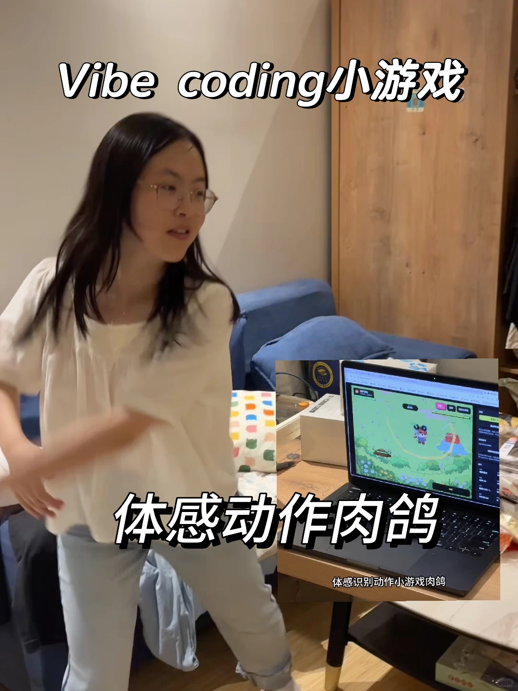

## 图片文字 (OCR)

> OCR 仅供参考，可能包含识别错误；请以原图为准。

Vibe
coding小
游戏
员
体感动作肉鸽
体感识别动作小游戏肉鸽
