---
title: "感谢AI, vibecoding了人生第一款游戏！"
source: "https://www.xiaohongshu.com/discovery/item/69778a86000000001a035ccb?app_platform=android&ignoreEngage=true&app_version=9.40.1&share_from_user_hidden=true&xsec_source=app_share&type=video&xsec_token=CBMtfXXcFvT8wVEhYByKc9ZAje-9grZA-53mivTA73Jpc%3D&author_share=1&xhsshare=CopyLink&shareRedId=OD06N0RGNj42NzUyOTgwNjY7OTg8RkdL&apptime=1785857717&share_id=b5965e4b9fdb4ffcb9d06e9b3bdbd315&share_channel=copy_link"
author: "不是一只鱼🐠（AI ing）"
author_uid: "657b238d000000002002e179"
date: "编辑于 03-25"
tags: ["我要参加黑客松", "黑客松巅峰赛", "vibecoding", "gemini3", "ai", "游戏", "拳击训练", "vibecoding大赏", "交互手势控制", "AI人工智能", "动作识别", "AI游戏开发"]
platform: "xiaohongshu"
category: "AI"
summary: "作者借助AI vibecoding完成了人生首款拳击训练游戏的开发,初衷是作为字节拳击社社长推动拳击运动创新。该游戏通过动作识别技术帮助训练者优化空击韵律、节奏和身体控制,目前MVP版本已支持直、摆、勾等攻击动作及防守、摇闪、侧闪等防守动作的多难度模式识别,未来将持续迭代并分享制作流程。"
---

# 感谢AI, vibecoding了人生第一款游戏！

> 作者: 不是一只鱼🐠（AI ing） | 日期: 编辑于 03-25 | 原文: https://www.xiaohongshu.com/discovery/item/69778a86000000001a035ccb?app_platform=android&ignoreEngage=true&app_version=9.40.1&share_from_user_hidden=true&xsec_source=app_share&type=video&xsec_token=CBMtfXXcFvT8wVEhYByKc9ZAje-9grZA-53mivTA73Jpc%3D&author_share=1&xhsshare=CopyLink&shareRedId=OD06N0RGNj42NzUyOTgwNjY7OTg8RkdL&apptime=1785857717&share_id=b5965e4b9fdb4ffcb9d06e9b3bdbd315&share_channel=copy_link

> **摘要**:作者借助AI vibecoding完成了人生首款拳击训练游戏的开发,初衷是作为字节拳击社社长推动拳击运动创新。该游戏通过动作识别技术帮助训练者优化空击韵律、节奏和身体控制,目前MVP版本已支持直、摆、勾等攻击动作及防守、摇闪、侧闪等防守动作的多难度模式识别,未来将持续迭代并分享制作流程。

[哇R]起早贪黑终于完成了自己人生第一个游戏的开发！也是vibecoding制作的第一个大项目。
	
🚀 从一开始的一个想法，因为担任了字节拳击社的社长，想着作为字节人，我们要如何站在时代的前沿，为拳击运动做一些属于自己的事情（其实也是受到身边其它优秀社长的影响）。
	
🥊 现在绝大多数的拳击训练者其实并没有养成空击训练的习惯，而这款游戏可以帮助他们不断优化自己的韵律、节奏，以及对身体的控制能力！
	
🔥 从最初只是一个想法，到开始尝试 vibecoding，再到不断试错、推翻重来、反复打磨，最终一步步落地，完成了一个相对完备的 MVP 版本。
	
🎮 目前已经支持多种难度模式的自由切换。
👊 同时支持直、摆、勾的动作识别，也支持身体识别以及防守、防守、摇闪、侧闪等动作的识别。
👀 现在展示的只是其中一种模式！
	
✨ 后续会逐步放出完整版，也会系统地分享一下我自己的制作流程和踩过的坑。
	
@科技薯 #我要参加黑客松 #黑客松巅峰赛
#vibecoding #gemini3 #ai #游戏   #拳击训练#vibecoding大赏  #交互手势控制 #AI人工智能

#拳击训练 #动作识别 #AI游戏开发

## 视频

[视频 1](./video.mp4)

<video controls width="100%"><source src="./video.mp4" type="video/mp4">您的浏览器不支持视频播放。</video>

附件: [音频](./audio/audio.wav) | [处理清单](./video_manifest.json)

## 视频图文总结

> 按关键帧关联完整视频转录；文字保留机器转写原文，时间点仅用于定位。

### 1. 00:00

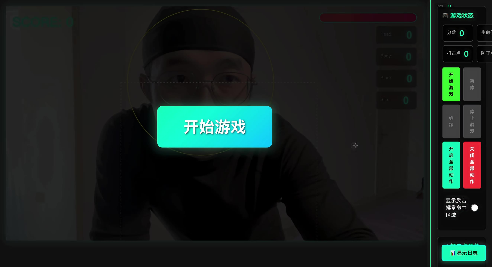

- 画面文字（OCR）：+ 3%
= 游戏状态分数 0 生命人打击点 0 防守 5
开始暂游 =
戏
©
57 继 1k
IL I= ¢ NZ NT 续游 JAR WT NX 戏
+ 开启全部动作显示反击摆涯命中 @
区域

### 2. 00:02

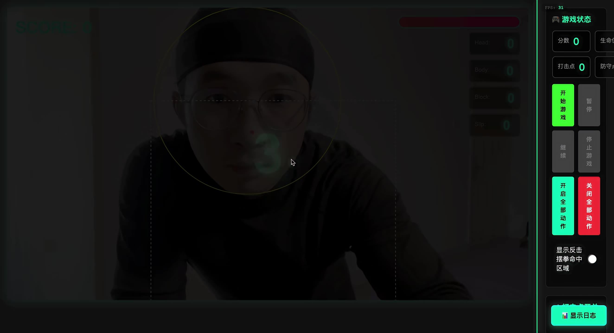

- 画面文字（OCR）：—r
7 游戏状态分数 0 生命打击点 O | | 防守 FF 始 5
游 I=
戏
=
继 iE
5 游 IN 戏开启全部动作显示反击摆源命中 @
区域

### 3. 00:06

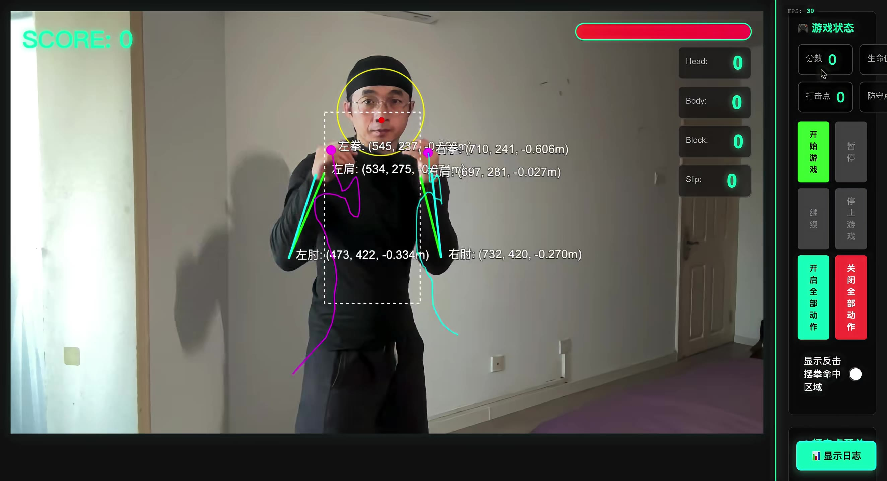

- 画面文字（OCR）：i ™- = 3 —p FPS: 30
Head: 0 分数 0 生命人 Ny
ARE © A Body: 0 打击点 0 防守上了 a n
\ J *
Ca WT DRT (VIRAL A Pa : Block: 2
EE (545, = al 10, 241, 0606m) x0 = I
AN 、游 =
, “CJR: (534, 275, J0ETEN607:281,-0.027m) | 本戏
{| ip: 0
| ，停'. 1 ; 继止
| 人，续 | 游
| 区左肘 :性 73, 422, -0.33 人 Aft: (732,420, -0.270m).
g : 7 JE
; 全全
= = = — — = 部部动动作 0
| | | i /
§ F 显示反击 pt 摆举命中 @
本一区域
I = —
) = 里

### 4. 00:09

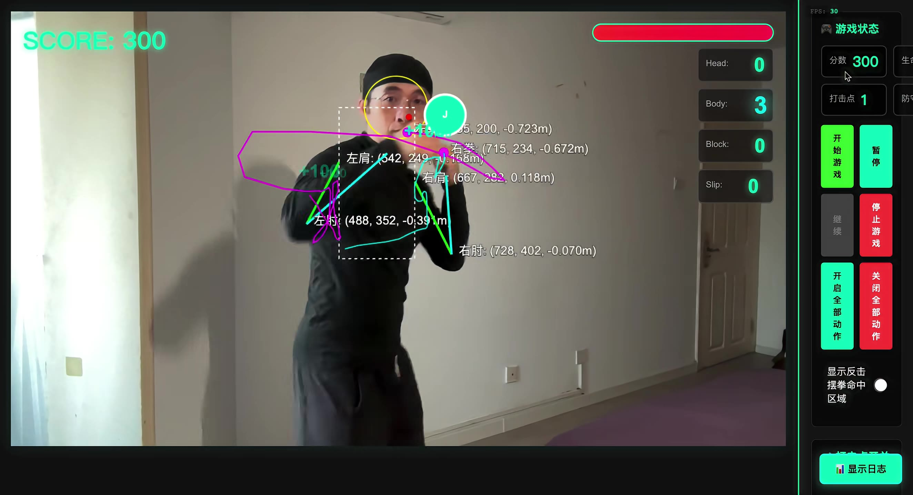

- 画面文字（OCR）：a _ 本 FPS: 30
a Bh EE | ”we
4 [ ] y
Head: 0 分数 300 ES
: 二 N
[ Ea “
i. A ao 打击点 | +
jt Sora 45, 200, -0.723m) C=
: ~~ gor (715. 234. -0.672m) Block: 0 始 FT| ER 2 Hey iim 2"游
i hy, le (68p282,0:118m) | sp 0 >
it | |
i ZA (488, 352, -0:39'\m 从 a.
| J | = 固
i 开关启闭
| 全全部部 il 动动作作
| | .
| | b 显示反击
| 4 摆涯命中 @
区域
1
上四 i 一

### 5. 00:15

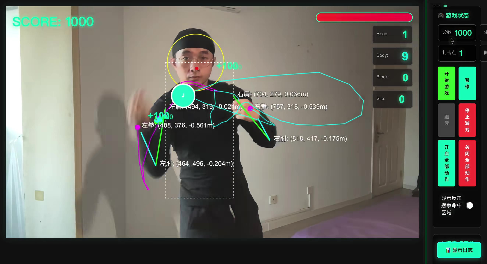

- 画面文字（OCR）：SCORES |
BE — B Head: i 了分数 100
二 a Bs
= on Body: ) 打击点 | p
oy OM C=
本 Block: ( . 是 |
* ! AN 游 5
| ( 二 wh (704, 279, 0.036m) BB = ，人证 ®
J 上 Ip: 到 4
| Zod, 319-0 02 fi NE S757, 318, 0.539m) | |
A gs Ea :
| #7408, 376, 0.561m) | | - | a
GAY: (818,417, -0.1 75m) Fr p
| | :
ZRIE464, 496, -0.204m); | 部 ES 显示反击
| pret @
| \ a =
| |
| ul 显示日志

### 6. 00:16

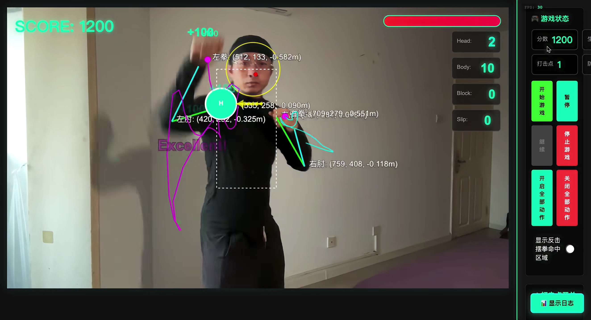

- 画面文字（OCR）：— 有 = TRE FPS: 30
- Heat: 到 5% 1200 | | 4
; ) NN
Fez (512, 133, -0i582m) ;
[ < 3 Do Body: 10 打击点 1 多时
\ 一
\ Block: 0 7
(5897258,=05090m) 游
o Fr «Ee (7098279 c0H51m) 戏 BF: Fa 7, -0.325m) 午 CN 038279,6055]m) I se Q | |
| | 一
= Ni 1 继止 Excel | | = NS 四 / ; a 戏
| 9 7 ] AiR (759, 408, -0.118m) |
| -
) ) [1 cS EERE 启闭 AR 2 2
| NN 部部
| 本动动
i } E 作作
| 8
! 4 显示反击
5 摆涯命中 @
4 区域
| Pe §

### 7. 00:19

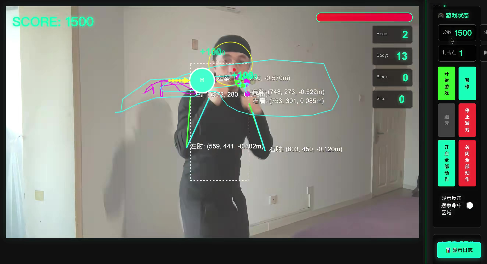

- 画面文字（OCR）：一一 FPS: 31
| ress
8
TAN au 43 打击点 1 B
a.
ea 和， & 开
= =="! sm U, =U. 0 [UIT] Block: 0 始 ZS roan » DR 游
4 i = = 753 301 0.085m A Slip: 0
4 9 信 ao u NE
| 续游
| i 戏
(
了左肘 : (559, 441, -08802m) SSRE0a 150 0 120m) # |
ll | | | 全全
\ i 部部
[rs li I 2 2
© ooo 中 [国民要作作 elt
SS -,
显示反击
\ 摆涯命中 @
a ge 和区域 JE II

### 8. 00:24

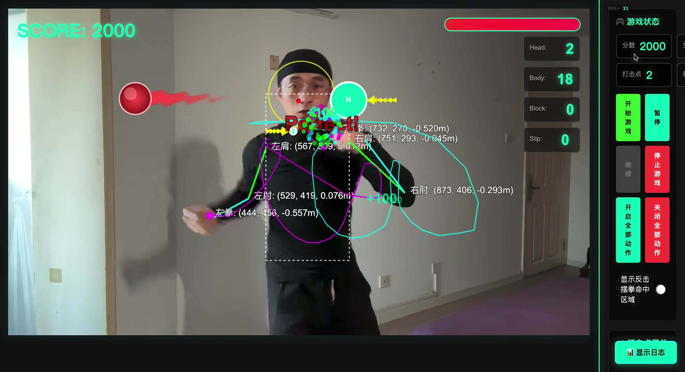

- 画面文字（OCR）：一一 — FPS: 31
Head: 2 2% 2000 /
ta 9% NN
~~ - \ Body: 18 打击点 2
1 =
0) "2 J feeiee -
d ) Block: 0 始 pv = ge _ 1 E732, 270--0.520 m) od
Lgl J AN =O SSE ie py »
7 A 990K AlE- (751,293, -084 5m) | sp 0
> =H 5 本本
| > fe AY N =
1 ] - EN 继止， BY AY a UH
i \ 戏，和有 873 4086\ -0 °
i: (529, 419, 0.076m) A, SEGRE RE 0510.293m)
| f=25 (4440456, -0.557m 有 7
uy 全全
B =i 部部动动
| | : 作个显示反击
| 本 F 摆源命中 @
pe 区域
| = a

### 9. 00:28

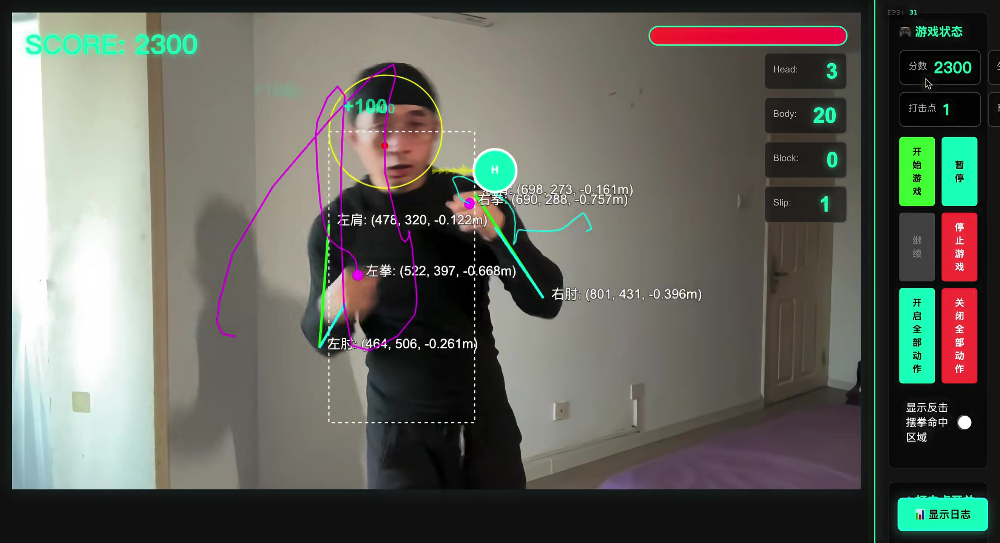

- 画面文字（OCR）：== — — FPS: 31
Head: 3 2% 2300 /
7 177) — ar 20) 打击点 1
( ki -
) =
\| Block: 0 i 加
«(698,273,-0.161m) | rl
8 SEL 1 690, 288, Sm ) Slip: 1 (BEES 和肩 : (478, 320, -0.122m) L J =
3 |. zw | IE
| Fa.
: Z£2: (522, 397, -0.668m) 戏
| ! AAT: (801, 431, -0.396m) -
| . d B 闭
2 全
| 左肝本 4647 506, -0.261m) = -
作作
1 ， 3 显示反击 BE 1 4 get @
i . <i 区域
L =

### 10. 00:38

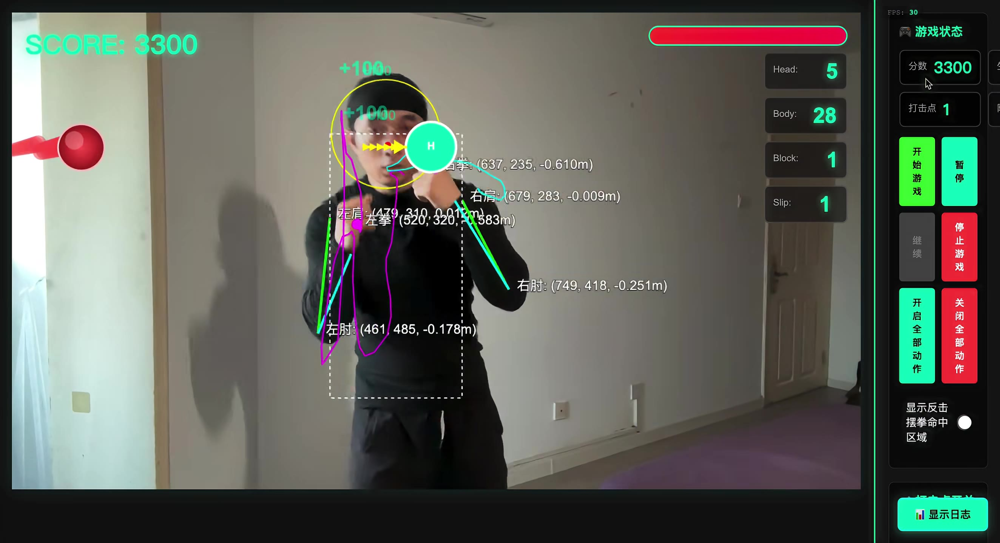

- 画面文字（OCR）：a N FPS: 30
本四 SR
i 9 -_— > ni
Head: 5 oi! 3300
: NN
30 ca Bot: 28 ec : |
二 \ \ E> |

-2 AZ=4(637, 235, -0.610m) 8 2]:
游停

-— A AES na 9Aa ) 009 | :

) 1 | \ BEE(6179,283,-0.009m) | Slip: 1 -

\ | EIR A293), 3 gh R383 11) |
| j 继止
| ! |
| | -
AAT: (749, 418, -0.251m)
| | -
y : :
'Zhdt (461/485, -0.178m) ® o
| | 部部
| / i " "
1
| 3 |
1 显示反击
| 4 F 摆源命中 @
"1 本
a.

### 11. 00:47

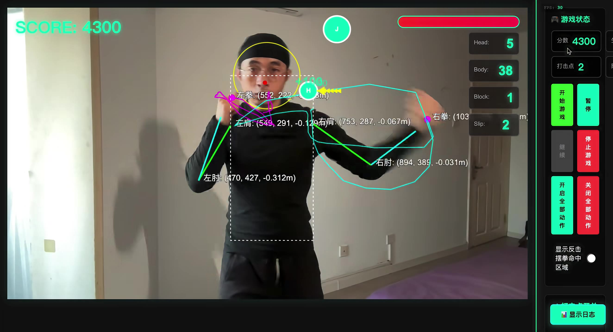

- 画面文字（OCR）：= = 一 FPS: 30
0 . C0 | wwe
B Head: 5 2% 4300

N
£ ao 38 打击点 2
二 < ol a 游
| -四 . A =r: im 戏
| ZEB (549, 291, -0.1 加有启 SE5S2PS7EOI067 用 ) 2 / sp 2 i |
| | 信
| ! a.
| ; ! ! - 2 |B |
| ( NR AR: (894, 389, 0.031m) 2
| #83470, 427, -0.312m) F
4 ail 开关
| 启闭
i : & 2
| a 用有作作
3 显示反击 grat @
| 3 — 、

### 12. 00:57

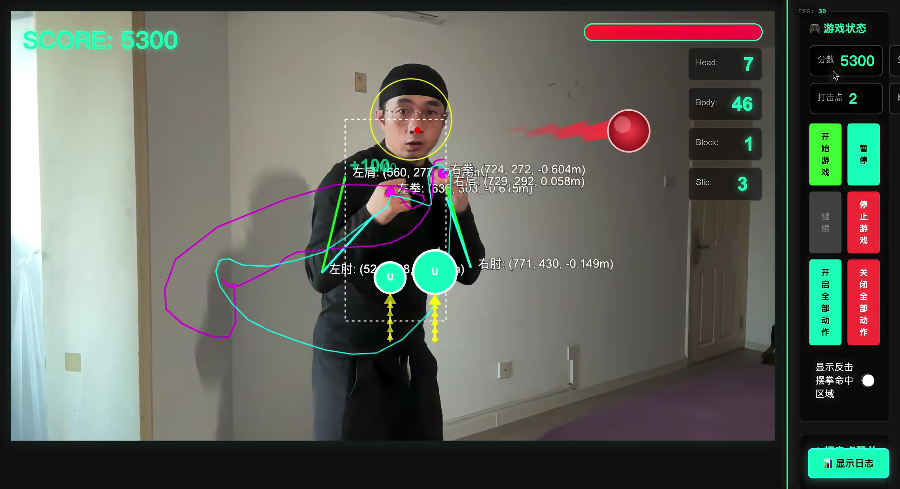

- 画面文字（OCR）：一一四 _ FPS: 30
- = = a
Head: 7 分数 5300
M NN
: — ay 46 打击点 2
， ®) | |
’ r
- EE" Block: 1 始 5
5 sv eo D7 A COA i 售
| 5! bso, 277k (120 912 0 604m) | .
11 Sep : i i =
， | a BNE
I : 续游区 7A
| 区 Et [ Fn ay 5 到
| BAY: (771, 430, -0.149m
At: (5 IRREESOR0 149m) 7 J
= \ ! B 闭
| ] 全全
N 1 部部四 1. 动动们作作
| 4 FERRE
| A 摆举命中 @
{ i - 区域
1 = ” | p i

### 13. 01:06

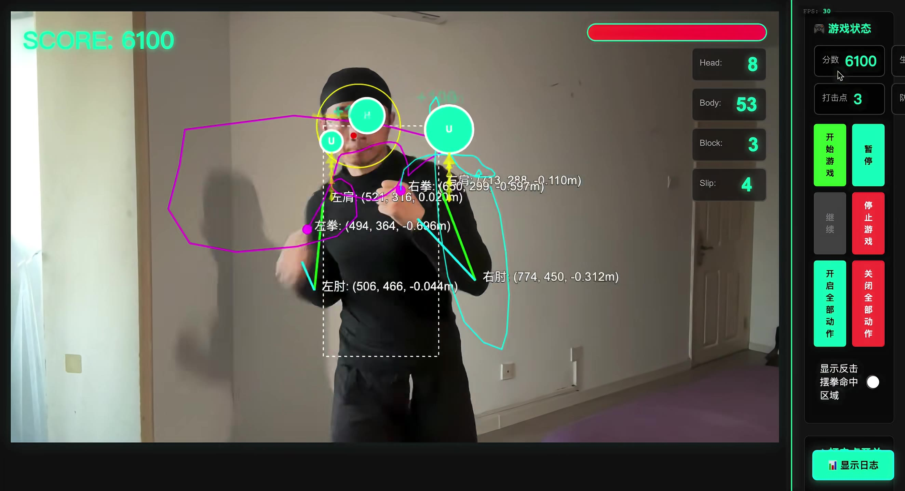

- 画面文字（OCR）：= = = 一 5 = FPS: 30
1 ) 1 ee | wens
Head: 8 2% 6100 | 4
NN 国
| Body: 53 打击点 3 | 多二 -一 8 —
| oud J Block: 3 i
| % 5
- ww、 LE 2
yh (507096 J 587m) 110m) | se 4 |
| ETE (52983116),0.020k)
n | N 和 -
| ，
72: (494, 364,-0.6Q6) z 5
i = oi. [ h 戏
i | i
: SRE (774, 450, -0.312m) 开关
| 左肘 : (506, 466, -0.044m) 1 二 I
，，全 5
| ，部部
| 动动作作
| od
Fi 显示反击
| | § A 摆涯命中 @
| 1 — Xi
ee I alle

### 14. 01:16

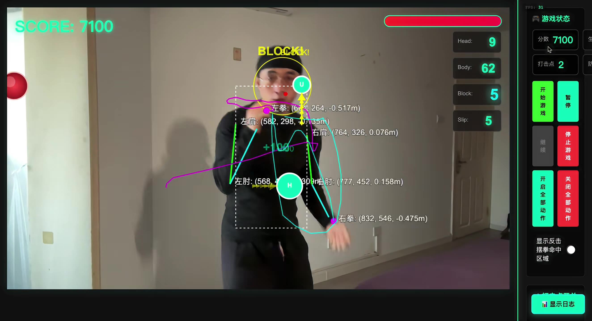

- 画面文字（OCR）：— FPS: 31
» 人 | ~
] Head: 9 分数 7100 4
国 SL OXLOCIK! 3 人
/ _— Body! 62 打击点 2 fy
#9 nN . - 人人 Block: 5 0
ee a #: (od, 264, -0.517m) od
| 725 (580, 298, 4); 35m) 上 => §
\ #15764, 326, 0.076m)
: ! ou NE
Was 让 2 WB
| 1 ] 戏 wy VERY: (568, BDOrEIf: (777, 452, 0.158m) - 国
: ，全 PE
; 部部
i, 动动
1 看涯到 832 546, -0.475m) | 作作显示反击
\ Fy . 摆涯命中 @
= 区域

### 15. 01:25

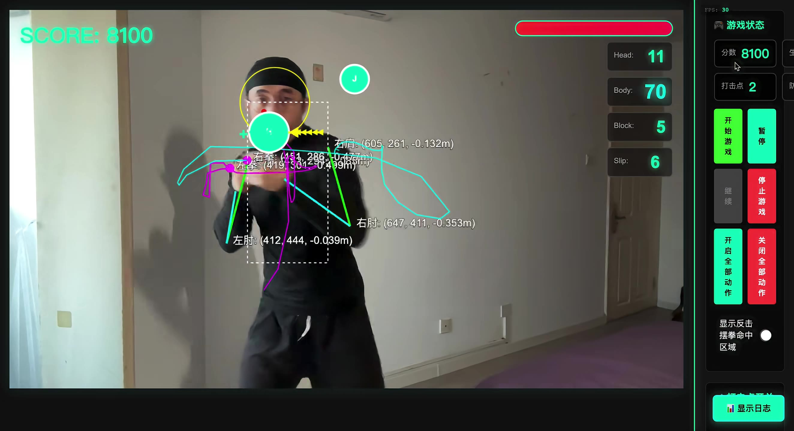

- 画面文字（OCR）：一 EERE FPS: 30
Head: 1 分数 8100 4
8 Ny
4 = \ Eri 70 打击点 2 By
- / L - : 5
- Block: 5 >
y. 175605, 261, -0.132m) 游
- a= fis b, 286, De 全汪汪 Slip: 6 gal
- Gas = 19, 5011 0.489 &’
| 由，信
| 1 继止于，戏，右肌可 647 有 1E0353m) J
左居时 412,444, -0.039m) 人 Cl x
，启闭 BN. 2 2
: 部部动动
| i rt Bo |
| ) a 显示反击
y. 摆源命中 @
了区域 bk. i =
5. y 2

### 16. 01:35

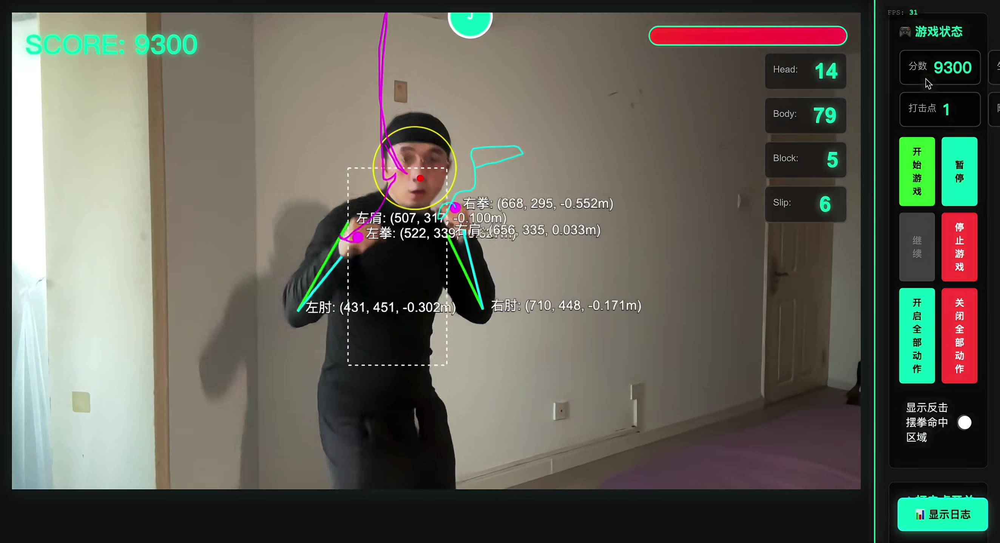

- 画面文字（OCR）：| aaa | SE Ee 站 Head: 14 分数 9300
国人 N
Body! 79 打击点 1
1 Block: 5 4 四 Zig: (507, 31EOMOOT) ‘
Ff: (522, 3397 IR-16567335,0.033m) - 1
i y q | | 续 pi:3
- : ，戏代 _ . |
肘 : (431, 451, -0.302) EHIH(710, 448, -0.171m) Z =
; 2 会
| | 部部
| 动动 TR FE 作作 If a 显示反击
| \ 摆源命中 @
区域

### 17. 01:44

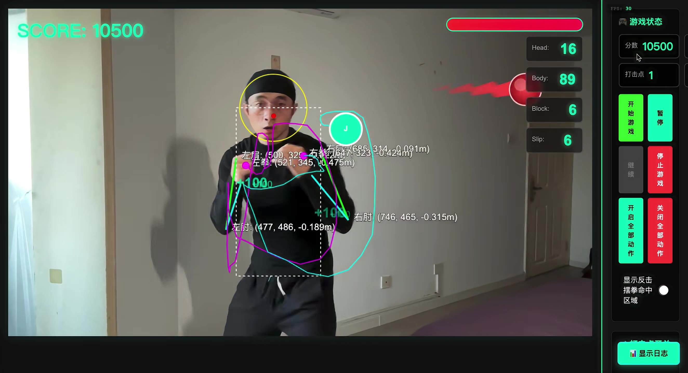

- 该时间点暂无可提取文字。

### 18. 01:54

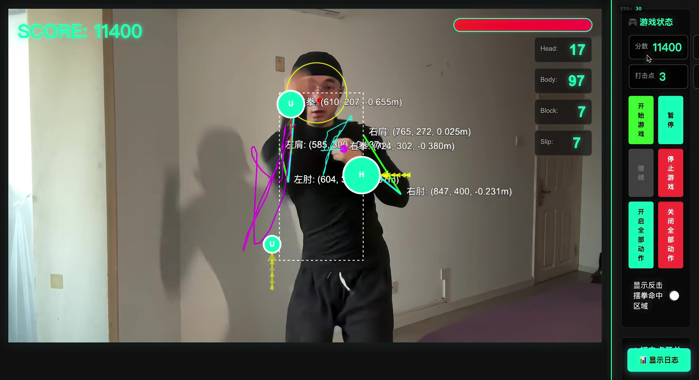

- 该时间点暂无可提取文字。

### 19. 02:02

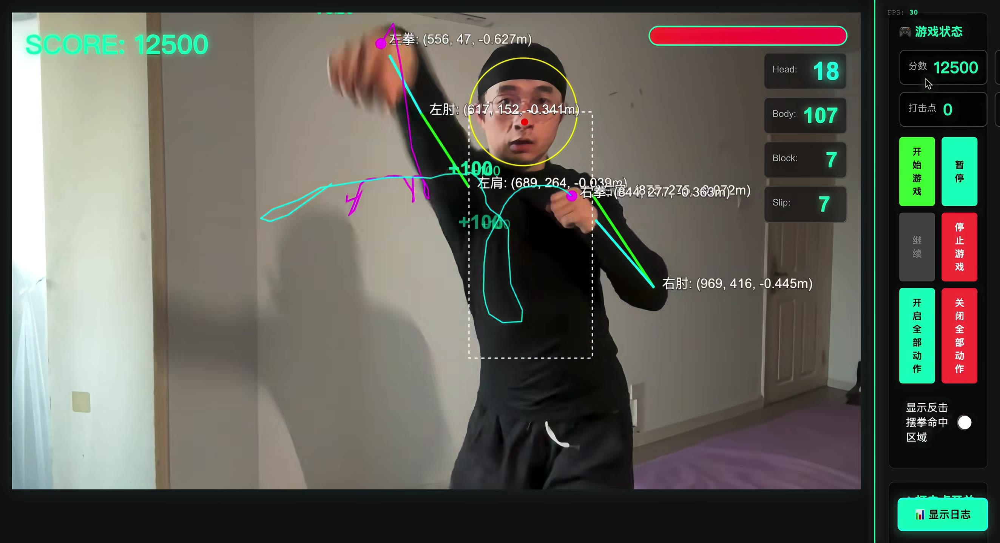

- 该时间点暂无可提取文字。

### 20. 02:03

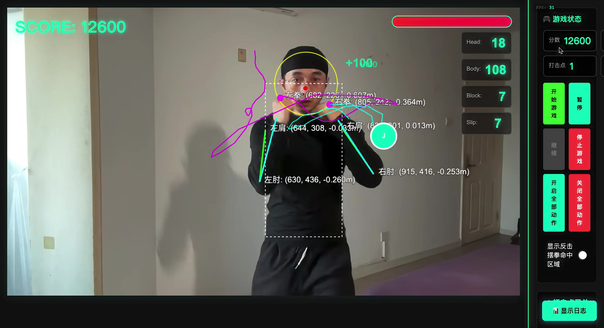

- 该时间点暂无可提取文字。

### 21. 02:13

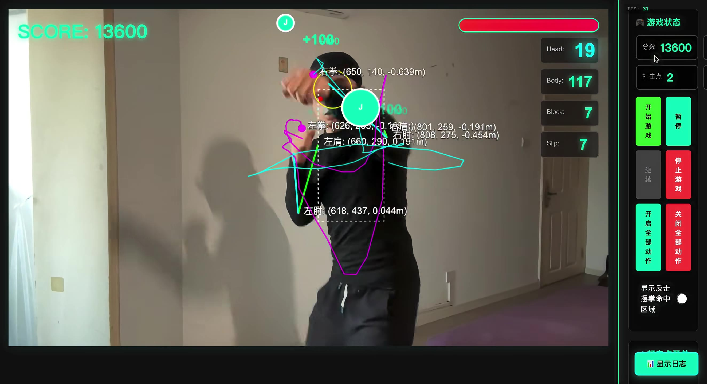

- 该时间点暂无可提取文字。

### 22. 02:14

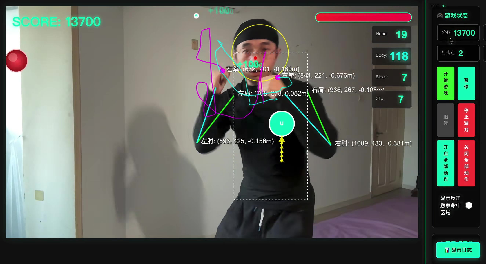

- 该时间点暂无可提取文字。

### 23. 02:20

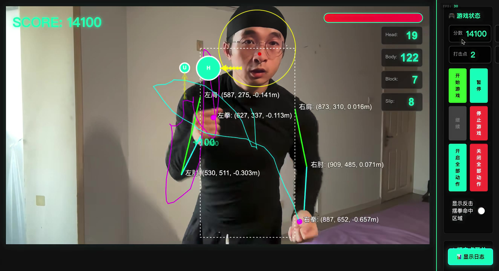

- 该时间点暂无可提取文字。

### 24. 02:22

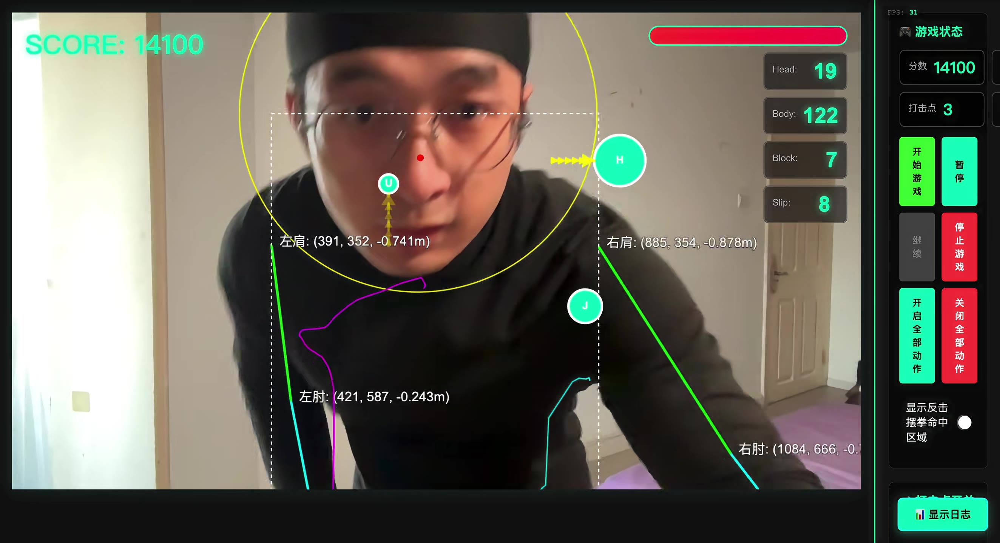

- 该时间点暂无可提取文字。

## 视频画面文字 (OCR)

> OCR 仅供参考，可能包含识别错误；请以视频画面和转写来源为准。

### 关键帧 1 · 0.5s

+ 3%
= 游戏状态分数 0 生命人打击点 0 防守 5
开始暂游 =
戏
©
57 继 1k
IL I= ¢ NZ NT 续游 JAR WT NX 戏
+ 开启全部动作显示反击摆涯命中 @
区域

### 关键帧 2 · 2.27s

—r
7 游戏状态分数 0 生命打击点 O | | 防守 FF 始 5
游 I=
戏
=
继 iE
5 游 IN 戏开启全部动作显示反击摆源命中 @
区域

### 关键帧 3 · 6.3s

i ™- = 3 —p FPS: 30
Head: 0 分数 0 生命人 Ny
ARE © A Body: 0 打击点 0 防守上了 a n
\ J *
Ca WT DRT (VIRAL A Pa : Block: 2
EE (545, = al 10, 241, 0606m) x0 = I
AN 、游 =
, “CJR: (534, 275, J0ETEN607:281,-0.027m) | 本戏
{| ip: 0
| ，停'. 1 ; 继止
| 人，续 | 游
| 区左肘 :性 73, 422, -0.33 人 Aft: (732,420, -0.270m).
g : 7 JE
; 全全
= = = — — = 部部动动作 0
| | | i /
§ F 显示反击 pt 摆举命中 @
本一区域
I = —
) = 里

### 关键帧 4 · 9.98s

a _ 本 FPS: 30
a Bh EE | ”we
4 [ ] y
Head: 0 分数 300 ES
: 二 N
[ Ea “
i. A ao 打击点 | +
jt Sora 45, 200, -0.723m) C=
: ~~ gor (715. 234. -0.672m) Block: 0 始 FT| ER 2 Hey iim 2"游
i hy, le (68p282,0:118m) | sp 0 >
it | |
i ZA (488, 352, -0:39'\m 从 a.
| J | = 固
i 开关启闭
| 全全部部 il 动动作作
| | .
| | b 显示反击
| 4 摆涯命中 @
区域
1
上四 i 一

### 关键帧 5 · 15.6s

SCORES |
BE — B Head: i 了分数 100
二 a Bs
= on Body: ) 打击点 | p
oy OM C=
本 Block: ( . 是 |
* ! AN 游 5
| ( 二 wh (704, 279, 0.036m) BB = ，人证 ®
J 上 Ip: 到 4
| Zod, 319-0 02 fi NE S757, 318, 0.539m) | |
A gs Ea :
| #7408, 376, 0.561m) | | - | a
GAY: (818,417, -0.1 75m) Fr p
| | :
ZRIE464, 496, -0.204m); | 部 ES 显示反击
| pret @
| \ a =
| |
| ul 显示日志

### 关键帧 6 · 16.9s

— 有 = TRE FPS: 30
- Heat: 到 5% 1200 | | 4
; ) NN
Fez (512, 133, -0i582m) ;
[ < 3 Do Body: 10 打击点 1 多时
\ 一
\ Block: 0 7
(5897258,=05090m) 游
o Fr «Ee (7098279 c0H51m) 戏 BF: Fa 7, -0.325m) 午 CN 038279,6055]m) I se Q | |
| | 一
= Ni 1 继止 Excel | | = NS 四 / ; a 戏
| 9 7 ] AiR (759, 408, -0.118m) |
| -
) ) [1 cS EERE 启闭 AR 2 2
| NN 部部
| 本动动
i } E 作作
| 8
! 4 显示反击
5 摆涯命中 @
4 区域
| Pe §

### 关键帧 7 · 19.46s

一一 FPS: 31
| ress
8
TAN au 43 打击点 1 B
a.
ea 和， & 开
= =="! sm U, =U. 0 [UIT] Block: 0 始 ZS roan » DR 游
4 i = = 753 301 0.085m A Slip: 0
4 9 信 ao u NE
| 续游
| i 戏
(
了左肘 : (559, 441, -08802m) SSRE0a 150 0 120m) # |
ll | | | 全全
\ i 部部
[rs li I 2 2
© ooo 中 [国民要作作 elt
SS -,
显示反击
\ 摆涯命中 @
a ge 和区域 JE II

### 关键帧 8 · 24.3s

一一 — FPS: 31
Head: 2 2% 2000 /
ta 9% NN
~~ - \ Body: 18 打击点 2
1 =
0) "2 J feeiee -
d ) Block: 0 始 pv = ge _ 1 E732, 270--0.520 m) od
Lgl J AN =O SSE ie py »
7 A 990K AlE- (751,293, -084 5m) | sp 0
> =H 5 本本
| > fe AY N =
1 ] - EN 继止， BY AY a UH
i \ 戏，和有 873 4086\ -0 °
i: (529, 419, 0.076m) A, SEGRE RE 0510.293m)
| f=25 (4440456, -0.557m 有 7
uy 全全
B =i 部部动动
| | : 作个显示反击
| 本 F 摆源命中 @
pe 区域
| = a

### 关键帧 9 · 28.94s

== — — FPS: 31
Head: 3 2% 2300 /
7 177) — ar 20) 打击点 1
( ki -
) =
\| Block: 0 i 加
«(698,273,-0.161m) | rl
8 SEL 1 690, 288, Sm ) Slip: 1 (BEES 和肩 : (478, 320, -0.122m) L J =
3 |. zw | IE
| Fa.
: Z£2: (522, 397, -0.668m) 戏
| ! AAT: (801, 431, -0.396m) -
| . d B 闭
2 全
| 左肝本 4647 506, -0.261m) = -
作作
1 ， 3 显示反击 BE 1 4 get @
i . <i 区域
L =

### 关键帧 10 · 38.42s

a N FPS: 30
本四 SR
i 9 -_— > ni
Head: 5 oi! 3300
: NN
30 ca Bot: 28 ec : |
二 \ \ E> |

-2 AZ=4(637, 235, -0.610m) 8 2]:
游停

-— A AES na 9Aa ) 009 | :

) 1 | \ BEE(6179,283,-0.009m) | Slip: 1 -

\ | EIR A293), 3 gh R383 11) |
| j 继止
| ! |
| | -
AAT: (749, 418, -0.251m)
| | -
y : :
'Zhdt (461/485, -0.178m) ® o
| | 部部
| / i " "
1
| 3 |
1 显示反击
| 4 F 摆源命中 @
"1 本
a.

### 关键帧 11 · 47.9s

= = 一 FPS: 30
0 . C0 | wwe
B Head: 5 2% 4300

N
£ ao 38 打击点 2
二 < ol a 游
| -四 . A =r: im 戏
| ZEB (549, 291, -0.1 加有启 SE5S2PS7EOI067 用 ) 2 / sp 2 i |
| | 信
| ! a.
| ; ! ! - 2 |B |
| ( NR AR: (894, 389, 0.031m) 2
| #83470, 427, -0.312m) F
4 ail 开关
| 启闭
i : & 2
| a 用有作作
3 显示反击 grat @
| 3 — 、

### 关键帧 12 · 57.38s

一一四 _ FPS: 30
- = = a
Head: 7 分数 5300
M NN
: — ay 46 打击点 2
， ®) | |
’ r
- EE" Block: 1 始 5
5 sv eo D7 A COA i 售
| 5! bso, 277k (120 912 0 604m) | .
11 Sep : i i =
， | a BNE
I : 续游区 7A
| 区 Et [ Fn ay 5 到
| BAY: (771, 430, -0.149m
At: (5 IRREESOR0 149m) 7 J
= \ ! B 闭
| ] 全全
N 1 部部四 1. 动动们作作
| 4 FERRE
| A 摆举命中 @
{ i - 区域
1 = ” | p i

### 关键帧 13 · 66.86s

= = = 一 5 = FPS: 30
1 ) 1 ee | wens
Head: 8 2% 6100 | 4
NN 国
| Body: 53 打击点 3 | 多二 -一 8 —
| oud J Block: 3 i
| % 5
- ww、 LE 2
yh (507096 J 587m) 110m) | se 4 |
| ETE (52983116),0.020k)
n | N 和 -
| ，
72: (494, 364,-0.6Q6) z 5
i = oi. [ h 戏
i | i
: SRE (774, 450, -0.312m) 开关
| 左肘 : (506, 466, -0.044m) 1 二 I
，，全 5
| ，部部
| 动动作作
| od
Fi 显示反击
| | § A 摆涯命中 @
| 1 — Xi
ee I alle

### 关键帧 14 · 76.34s

— FPS: 31
» 人 | ~
] Head: 9 分数 7100 4
国 SL OXLOCIK! 3 人
/ _— Body! 62 打击点 2 fy
#9 nN . - 人人 Block: 5 0
ee a #: (od, 264, -0.517m) od
| 725 (580, 298, 4); 35m) 上 => §
\ #15764, 326, 0.076m)
: ! ou NE
Was 让 2 WB
| 1 ] 戏 wy VERY: (568, BDOrEIf: (777, 452, 0.158m) - 国
: ，全 PE
; 部部
i, 动动
1 看涯到 832 546, -0.475m) | 作作显示反击
\ Fy . 摆涯命中 @
= 区域

### 关键帧 15 · 85.82s

一 EERE FPS: 30
Head: 1 分数 8100 4
8 Ny
4 = \ Eri 70 打击点 2 By
- / L - : 5
- Block: 5 >
y. 175605, 261, -0.132m) 游
- a= fis b, 286, De 全汪汪 Slip: 6 gal
- Gas = 19, 5011 0.489 &’
| 由，信
| 1 继止于，戏，右肌可 647 有 1E0353m) J
左居时 412,444, -0.039m) 人 Cl x
，启闭 BN. 2 2
: 部部动动
| i rt Bo |
| ) a 显示反击
y. 摆源命中 @
了区域 bk. i =
5. y 2

### 关键帧 16 · 95.3s

| aaa | SE Ee 站 Head: 14 分数 9300
国人 N
Body! 79 打击点 1
1 Block: 5 4 四 Zig: (507, 31EOMOOT) ‘
Ff: (522, 3397 IR-16567335,0.033m) - 1
i y q | | 续 pi:3
- : ，戏代 _ . |
肘 : (431, 451, -0.302) EHIH(710, 448, -0.171m) Z =
; 2 会
| | 部部
| 动动 TR FE 作作 If a 显示反击
| \ 摆源命中 @
区域

## 图片

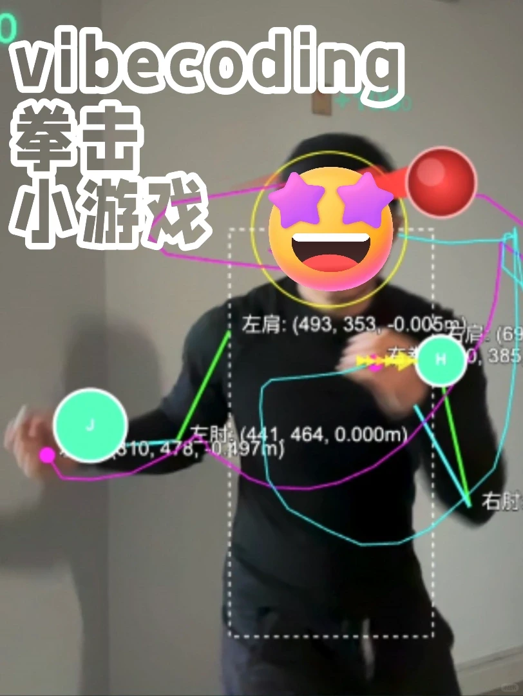

## 图片文字 (OCR)

> OCR 仅供参考，可能包含识别错误；请以原图为准。

vibecoding
拳击
小游戏
左肩：（493，353
-0.005g
1047时6
464,0.000m

## 评论 (共 24 条,已存 24 条)

详见 `comments-69778a86000000001a035ccb.json`。
