# 6岁儿童用Ai做了个 简易版我的世界游戏

> 作者: 洋洋AI科学 | 日期: 06-27 | 原文: https://www.xiaohongshu.com/explore/6a3f851a000000000f0146b1?xsec_token=ABRH4A7Z73l6N_dTADyeSl5sSN8yKMXvI9_cZFZUk9_EA=&xsec_source=pc_search

> **摘要**:本文介绍了一名6岁儿童利用AI工具(涉及claude、codex等)制作了一个简易版我的世界游戏的案例。文章展示了该游戏的界面截图,可见包含角色、金币、背包、武器、工具、方块等经典我的世界元素,游戏具有白天/夜晚系统。

6岁儿童用Ai做了个 简易版我的世界游戏
#儿童 #claude #codex #AI #学习
6岁儿童用Ai做了个 简易版我的世界游戏
06-27

#儿童编程 #AI辅助开发 #我的世界 #少儿教育 #AI编程

## 视频

[视频 1](./video.mp4)

<video controls width="100%"><source src="./video.mp4" type="video/mp4">您的浏览器不支持视频播放。</video>

附件: [音频](./audio/audio.wav) | [处理清单](./video_manifest.json)

## 视频图文总结

> 按关键帧关联完整视频转录；文字保留机器转写原文，时间点仅用于定位。

### 1. 00:00

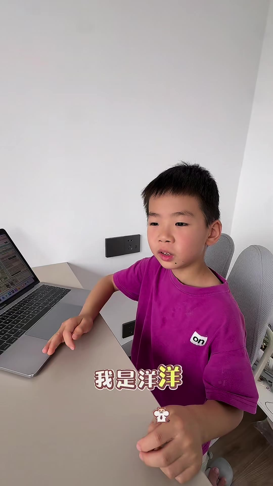

- 内容摘要：老师讲今天我们做了个clock ai的我的世界道具和人物游戏（00:00-00:04）
- 画面文字（OCR）：C
on
我是洋洋

### 2. 00:06

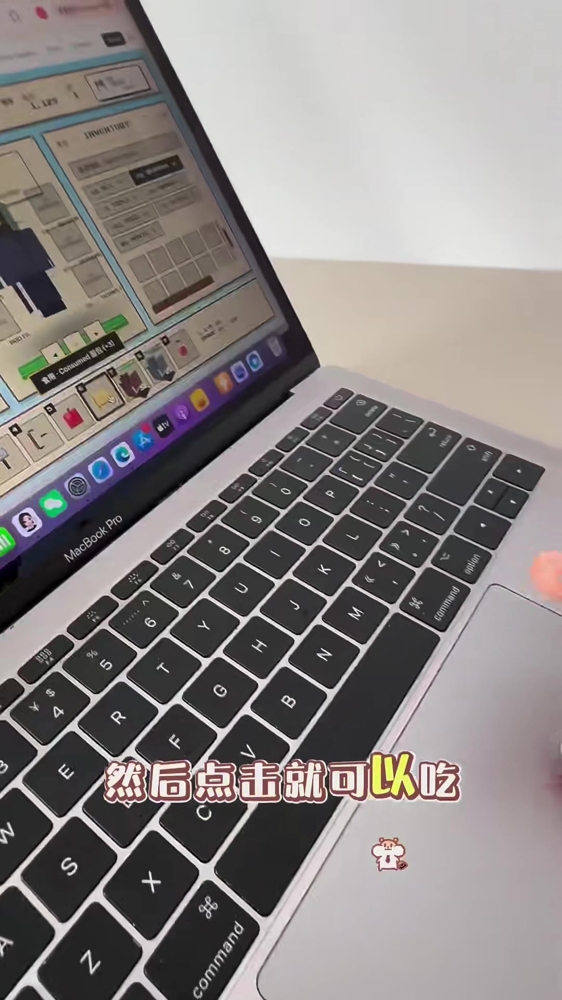

- 内容摘要：然后点击就可以吃，然后我们现在其实刚才已经玩过（00:04-00:08）
- 画面文字（OCR）：IHUEHTURY
后点击就可以吃

### 3. 00:12

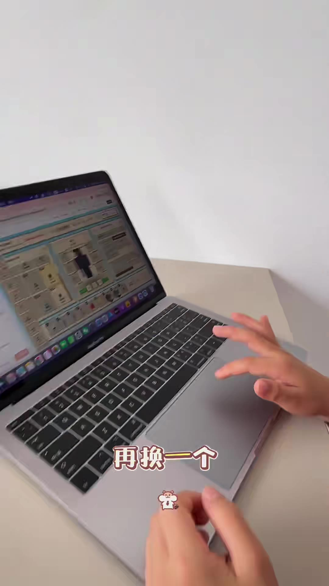

- 内容摘要：再换一个看看，换成那个黄色的小人是不是？（00:08-00:11）
- 画面文字（OCR）：00
再换一个

### 4. 00:15

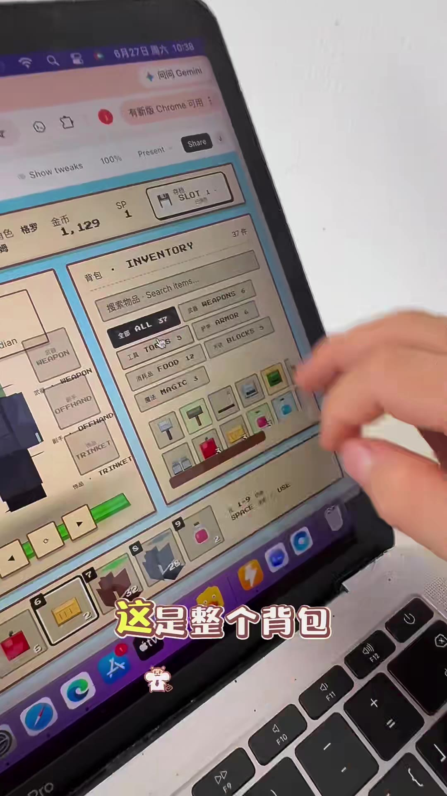

- 内容摘要：这个血量最高，所以破坏成这个这两个背包，这里是食物袋，这些这些食物啊（00:13-00:19）
- 画面文字（OCR）：灵整个背包
CeRSe
S
SRPE
平国
STCAAE
21
COOO
到
9
BERO
出
G
Sipo1
首工
NO
9
SNODUEE
2770
e ceee
37件
INVENTORY
背包
T
101S
T
1551
ds
格罗金币
setre
eser
%001
aeemiMo
有新版Chrome可用
问问Gemin

### 5. 00:19

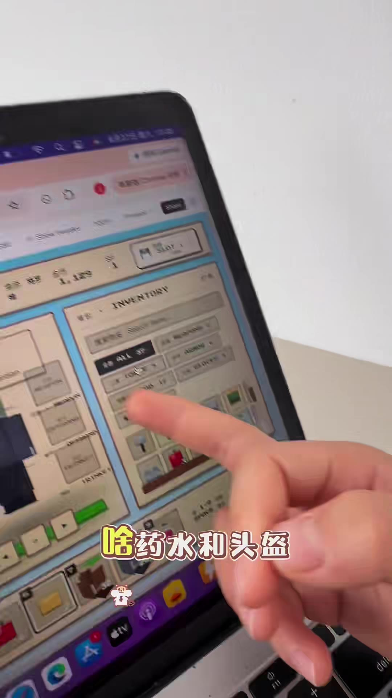

- 内容摘要：胶水和红色蔬菜吗？（00:19-00:21）
- 画面文字（OCR）：Mr
1版
INVENTORY
饮
3
6
4
S
药水和头盔

### 6. 00:24

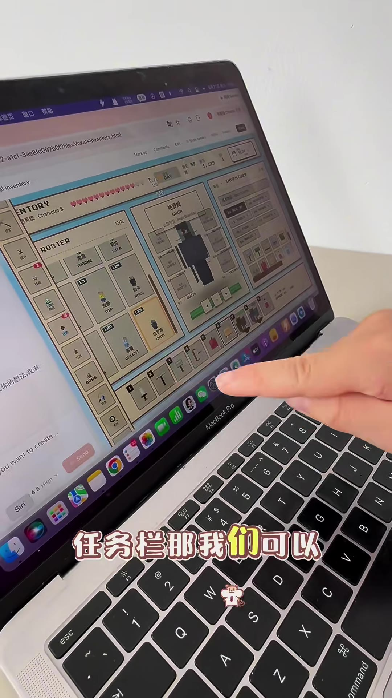

- 内容摘要：为什么？为什么没有物品呢？任务栏，那我们可以领取东西啊，我们点进去（00:21-00:26）
- 画面文字（OCR）：福
e=Voxel+inventory.html
0
iventory
A3788
ENTORY
司
☆
包系统
Markuo
Character&
Ear
DAY
2
角包特罗
ROSTER
2S
金市
好
1,129
H m.
430
1
12/12
☆
格罗姆
授租
INVENTOQY
索恩
莉拉
GRON
THORNE
LILA
山顶守卫PeaxDunds
L5
L24
1
N
OEs
皮普
如卡
23
任务
PIP
RUKA
L2S
oon
L20
BOOTS
品
080
格罗姆
高管
GRON
CELEST
BOSS
T
甲
C
00
#Y
福
MacBook Pro
务栏那我们
品88
F4
%
5
H

### 7. 00:25

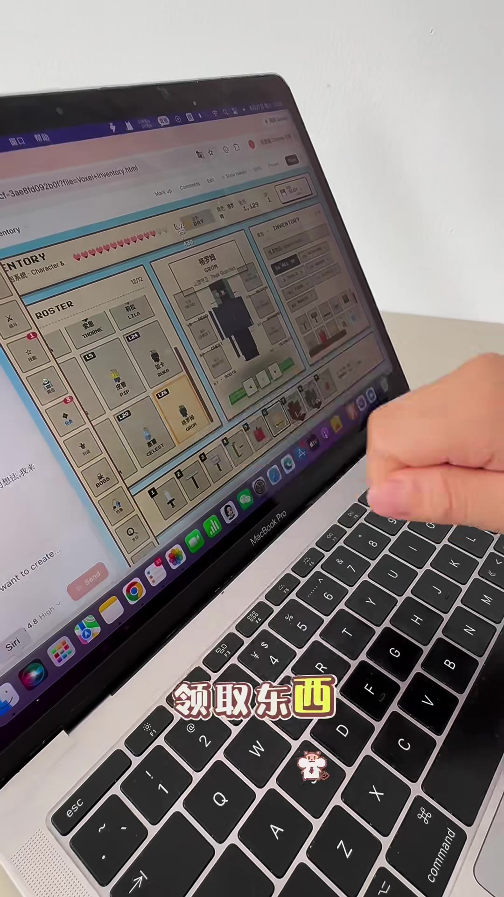

- 画面文字（OCR）：ory
Woxel+lnventory.html
6月179#
TORY
阿☆
不设
9
Character&
Markup Comments Ear
ShowTweals
ROSTER
出
迎夹
DAY
角色格萝全币
格
1,129
430
H
SLOr
1
12/12
索恩
格罗妈
THORNE
莉拉
微·INVENTORY
GROM
LILA
山顶守卫 PeakQuancas
L5
L24
站
417
皮普
如卡
OHST
PIP
RUKA
OE
1
L20
LZS
对战
8001
·80019
基管
格罗姆
BOSS
CELEST
GRON
T
T
T
00
®
MacBookPro
cA
000
000
F4
品
F3
领取在
5
V
4
H
F1
R

### 8. 00:28

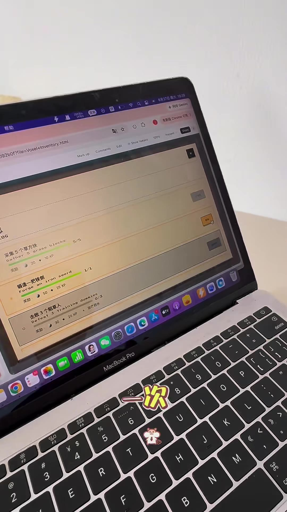

- 画面文字（OCR）：28K0/0
豆包
0
拼
福
2KB/
Q
品D
6月27日周六10:39
of?file=Voxel+inventory:html
何间Gemini
明☆咖
有新版Chrome可用
Markup
Comments
EditShow tweaks 100%
Presens
Share
集5个草方块
奖助
20+10XP
5/5
锻造一把铁剑
Forge an iron svord
1/1
奖励
50+25XP
击败3个稻草人
Defeat 3 training dunnies
0/3
奖励30+20XP
+治疗药水
stV
A
MacBook Pro
Q
000
F12
000
DII
DD
F4
次
8
F7
FB
F5
$
%
5
6
8
T

### 9. 00:31

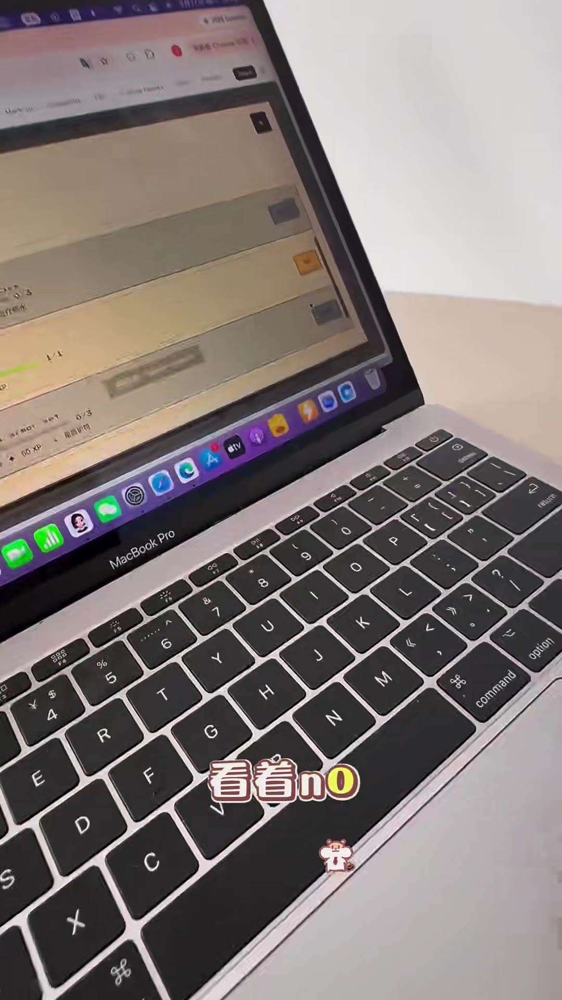

- 内容摘要：因为我们一开始已经领过一次，我们还可以再领一次，可能我看任务栏还有可以领（00:26-00:32）
- 画面文字（OCR）：看着no
2
peewron
N
W
H
%
DD
1I
Cee eoeee
A1P
2/0
V
R
®
心

### 10. 00:32

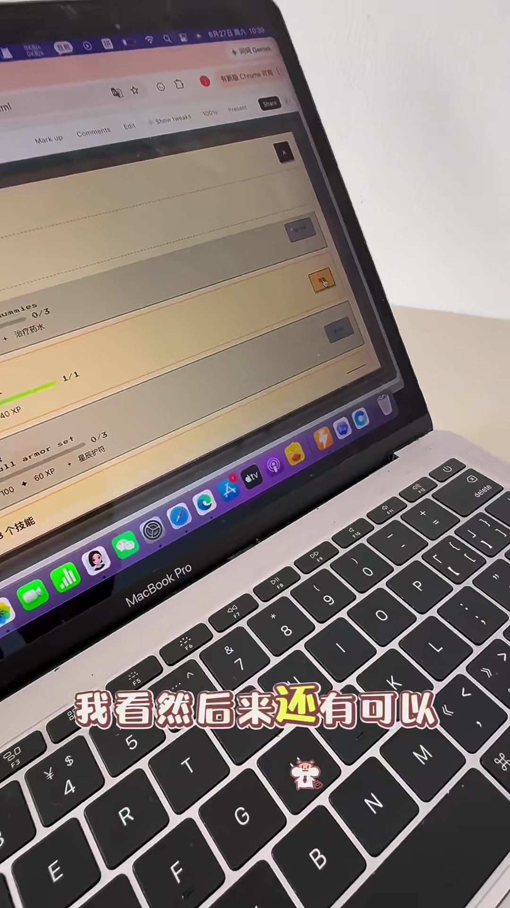

- 画面文字（OCR）：看然后来还有可叫
P
L
DD
时
8
eeee
八1
香
T/T
2/0
car
%001
COMIMOUS
RPE
ne
4auS
10916
deaee
*
Eo
有新版Chtome 可用！
HAO

### 11. 00:34

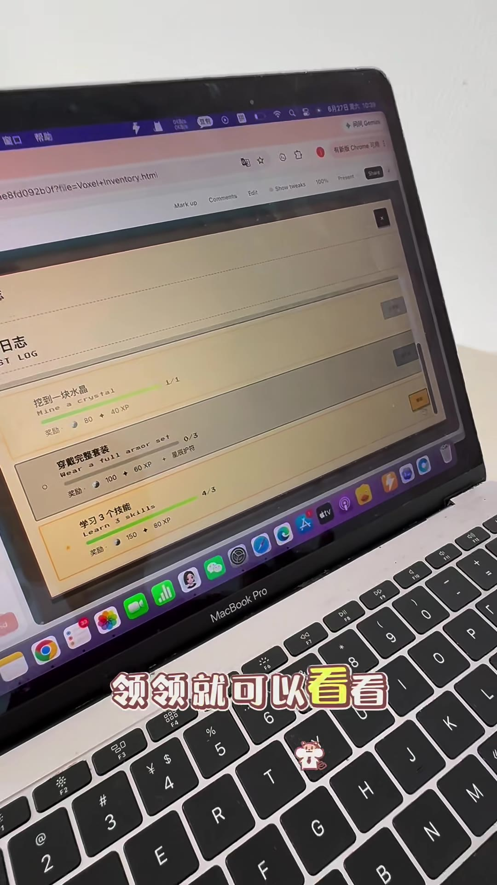

- 画面文字（OCR）：领领就可以看看
D
000
700
DD
B
二4
8
Peeee
八
+200
·然
dX08
SRTSA
3
09+00
3/0
eeeerr eeereae
00000
T/T
TeAshe e Sute
挖到一块水晶
907
￥
5
2
"001
eamMo
WP3
SU
de yer
区
®
*
i ee
6月27日周六10:39
维
0
BB
X
>0
招鞋
口

### 12. 00:36

- 内容摘要：就可以看看，就是要点击我们现在领完之后就可以返回了（00:33-00:38）
- 画面文字（OCR）：GKB
豆包
?
拼
Voxel+inventory.html
Q
6月27日周六10:39
Ge
的☆白
有款Chone可用
Mark up
Comments
Edit
Showtweaks
100%
vreLent
80
40XP
V1
戴完整套装
ear
a full armor
奖励·
100
set
0/3
60XP
星辰护符
学习3个技能
Learn 3
Skili
奖励
150
4/3
80XP
atv
MacBook Pro
DII
A
F7
F6
E

### 13. 00:37

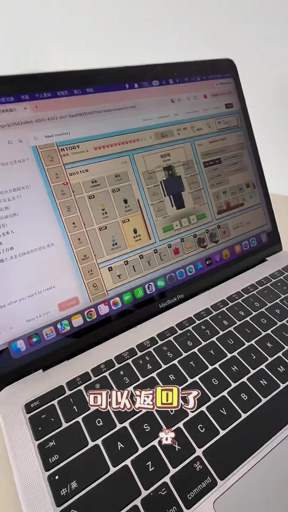

- 内容摘要：我们对现在要放一下什么？（00:38-00:42）
- 画面文字（OCR）：书签个人质料
福班页
第口
耐筋
X
+
c
句文
S0
9
c
Vaxelinventaory
川个
ENTORY
B系nChatactar
L409
m色
ROSTER
1m
格罗姆
索恩
箱
GN
THORG
LILA
支针
0
PIp
456
的世法我来
L20
000
格罗妈
BOSS
CELEST
GRON
ate
日
日
2
[-
T
T
MacBookPro
品
o00
000
?
2
可以返回了
s
A
英

### 14. 00:45

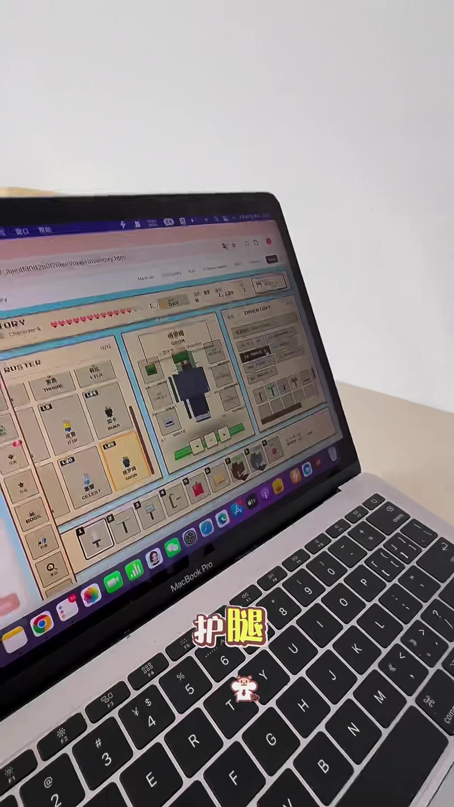

- 内容摘要：诶，然后再两个护腿，这里是工具，这里是食物仓，这里是这种放物品的地方，这里是（00:43-00:50）
- 画面文字（OCR）：系助
专店
hotlsey+iey
#
吃☆日
wUn
m
EM
LUL
DAY
原色格岁
福
住
1129
M
10712
1
珞姆
THUH
移拉
GOON
·IHVENTORT
1110
山顶守
0
皮普
C
OP
如卡
RUKA
2T
LRS
BUOTS
茶酱
CELEST
格罗姆
口Q
GROH
2
口
T
甲
$IV
MacBook Pro
护腿
O0O
000
F4
%
5

### 15. 00:48

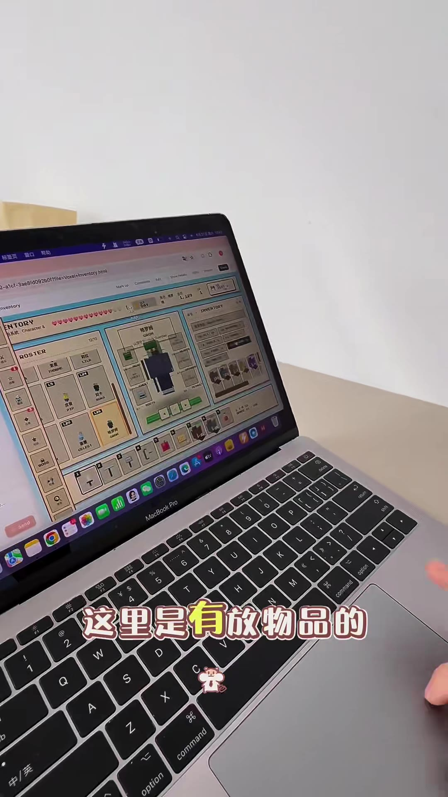

- 画面文字（OCR）：窗口
帮助
美目
电约17佳大1
3aef2tile=Voxenvento
公文
日
2
Markve
161
Se feae
TORY
Chatacter&
#0电roSN
身色特宴
H
0
0
OAY
W
1.129
ROSTER
SHVENTORY
12/12
格罗姆
GRON
柯拉
THORNE
LILA
皮粉
如卡
PIP
RUKA
格罗姆
CELEOT
T
甲
MacBookPro
J
gd
9
8
290
吕0
060
这里是有放物品的
F3
option
W
command

### 16. 00:57

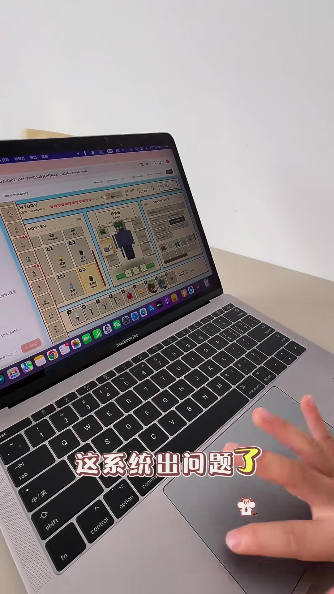

- 内容摘要：装回去不这系统出问题了，现在你们且回答正常请（00:54-01:00）
- 画面文字（OCR）：标链页
窗口
帮助
c
专具
S
复分
银
2
Q2
4月27日入104
nventory
匈☆
98
ENTORY
warkvo
Comeerts
妇系统
L
Poe Tesps
Character&
100%
eese2c0Ss2
G
0
隐色桂罗
DAY
推
16
1,129
4-
Mor
ROSTER
12/12
格罗姆
1
IHVENTORY
家肥
GRON
THORNE
柯拉
LILA
回
AL3
PIP
WUKA
Ha
量
格罗姆
DOSS
CELEST
5
T
甲
[-
T
MacBookPro
。
S
p
'
R
94
4
心
茶
点
2
吕0
888
心
￥2
"'
14
9
0
1
1
8
%5
…
8
p
7
0
6
3
4
T
R
E
W
H
optian
F
我
s
command
comma
ontion

### 17. 01:00

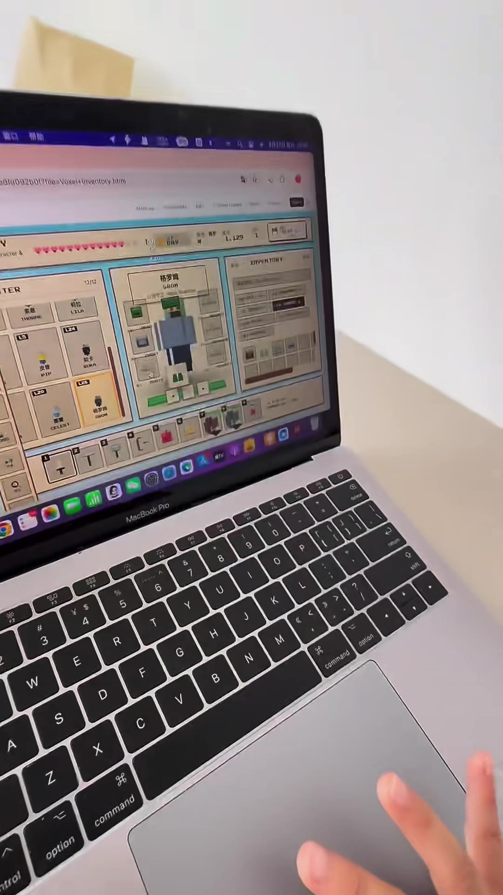

- 该时间点暂无可提取文字。

### 18. 01:07

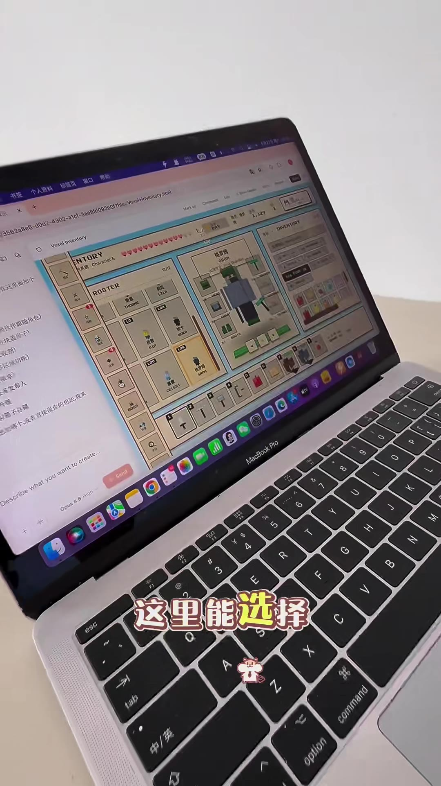

- 内容摘要：右臂找到武器，旁边这里就是这些武器（01:02-01:05）
- 内容摘要：这里呢选择可以对待（01:06-01:07）

### 19. 01:11

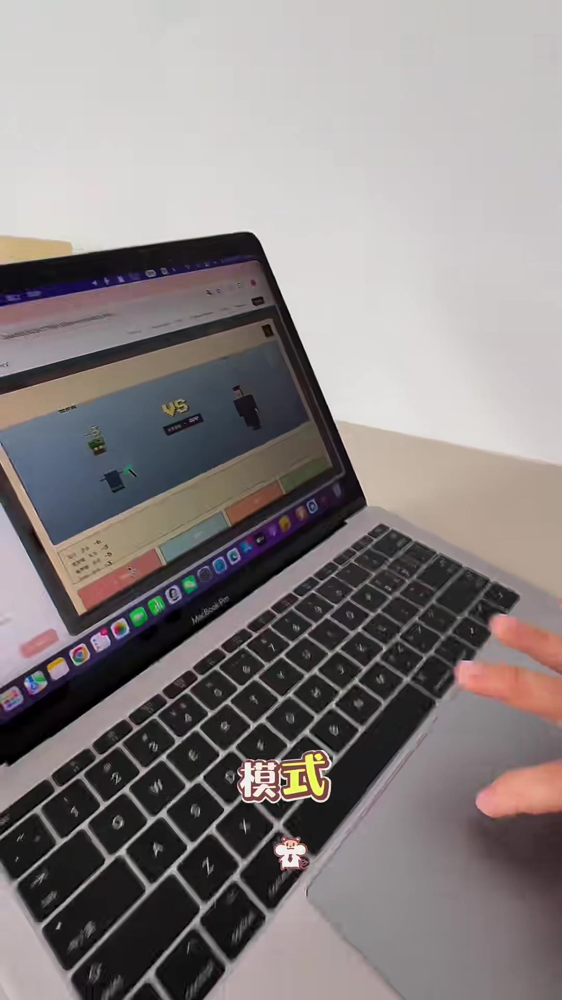

- 内容摘要：还可以pk，我们就看看这个pk模式，我们一直在攻击它，我们可以（01:07-01:14）

### 20. 01:12

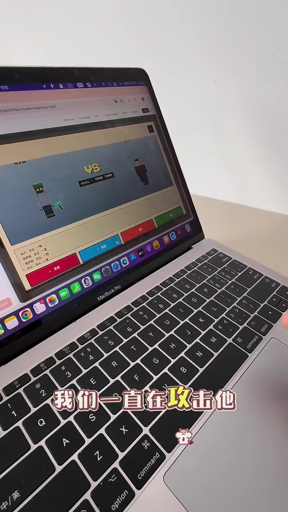

- 该时间点暂无可提取文字。

### 21. 01:16

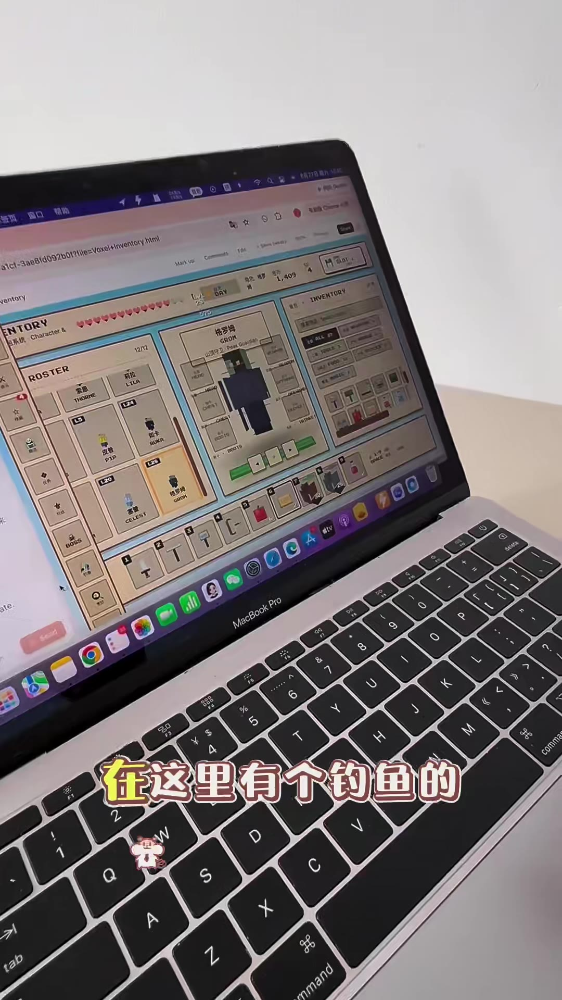

- 内容摘要：不火，在这里有个钓鱼的，我们就可以去钓钓鱼，点击点击这个这等级计划，现在我们（01:15-01:23）

### 22. 01:24

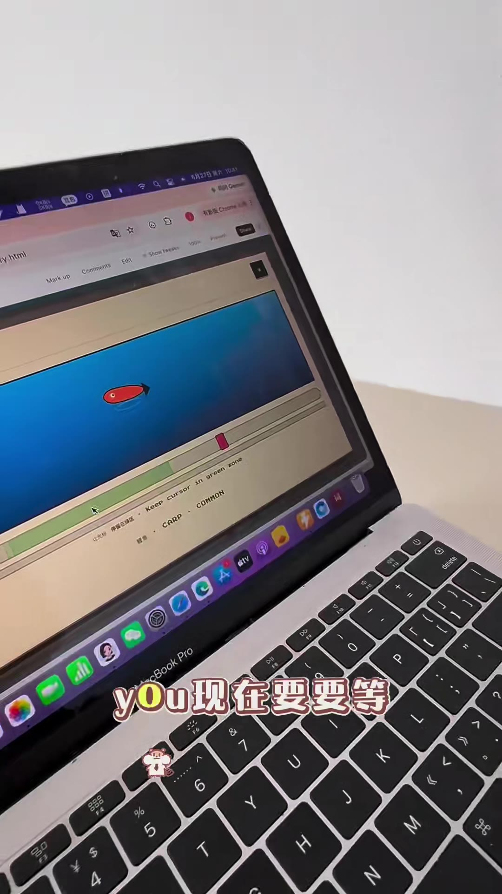

- 内容摘要：在钓鱼时期，现在腰腰杆在这里就可以压缩，但有点问题我们（01:23-01:28）
- 内容摘要：那现在是语音（01:28-01:29）

### 23. 01:36

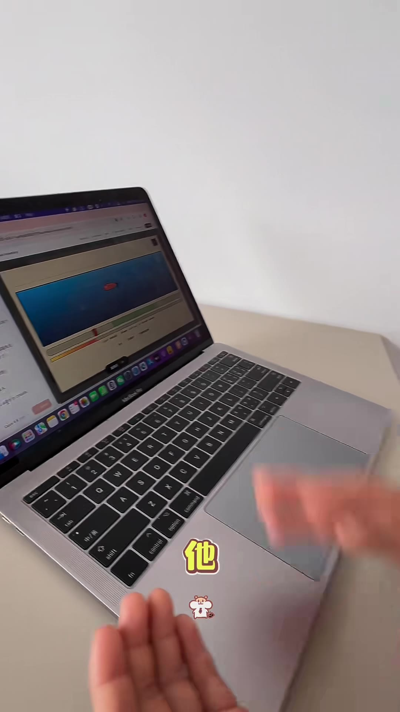

- 内容摘要：所以我们就不用打字（01:29-01:31）
- 内容摘要：我们点这语音之后我们就可以说了，它必须修改一下，这也太短了，它能走的时候（01:31-01:38）
- 内容摘要：可以拉它太远太短了，还很很快（01:38-01:41）

### 24. 01:48

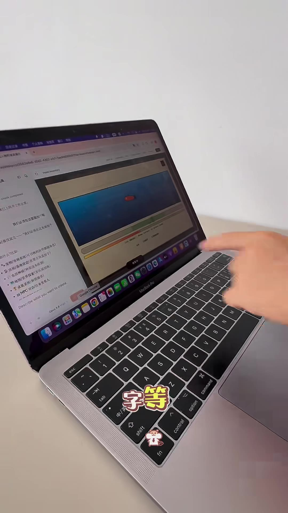

- 内容摘要：现在我们要等待它识别，它识别出来，我们等一下就会点这个，这个它下它就会走这（01:41-01:48）
- 内容摘要：点这个好ai那它自己会修改，现在好了，只要点击这个（01:48-01:54）

### 25. 02:00

- 内容摘要：就可以，然后就可以那个把它给修改了，它现在在（01:54-01:58）
- 内容摘要：思考（01:59-02:00）
- 内容摘要：它现在又识别出来问题（02:01-02:03）
- 内容摘要：我觉得这钓鱼法挺不好的，我们钓上鱼还是没有，这是以前我做的过程（02:03-02:09）

### 26. 02:12

- 内容摘要：现在我们就可以看看这过程有谁还知道武器呀（02:09-02:12）
- 内容摘要：啥各种样的食物，我们调整了好久才才可以造好，这点我们现在做好（02:12-02:18）

### 27. 02:24

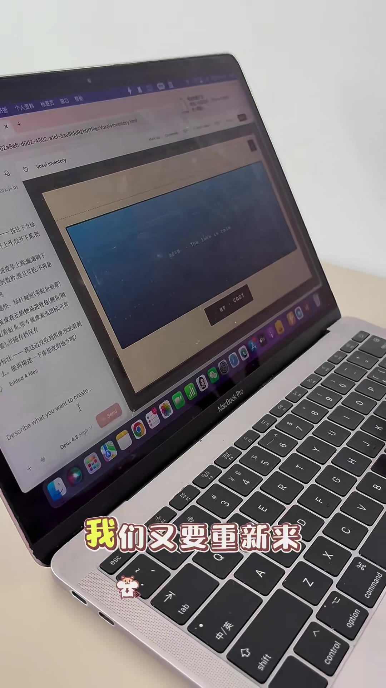

- 内容摘要：这个大家看清升级了，因为你看这个（02:18-02:21）
- 内容摘要：轻一点，前面大家做的不好，我们又要重新来，第十钓鱼竿，现在等它了ok（02:21-02:29）
- 内容摘要：这个a i还挺多，已经帮我们做好了（02:29-02:31）

### 28. 02:36

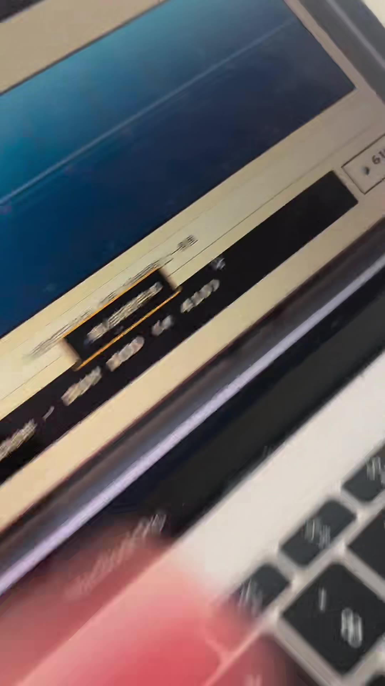

- 内容摘要：所以你们看我们然后这个这个裙子呢，我买了一个，我们还能选择购买一单（02:31-02:35）
- 内容摘要：我们买了两根四根了，现在我们不够了再钓鱼去，现在是手动上（02:35-02:42）

### 29. 02:48

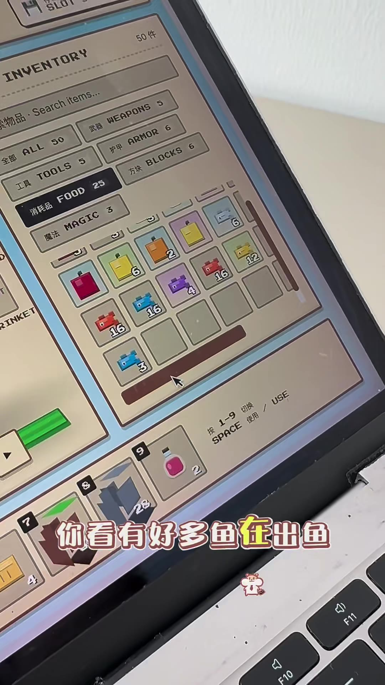

- 内容摘要：我们现在背包里掉了很多，我们什么情况？（02:43-02:45）
- 内容摘要：你看有好多鱼在出鱼（02:46-02:48）
- 内容摘要：你看这里好多条鱼，我都要惊呆了，你看正好在变，它在它在变多好像（02:48-02:55）

### 30. 03:00

- 内容摘要：要不要给这个人换一个这个？（02:55-02:58）

## 视频画面文字 (OCR)

> OCR 仅供参考，可能包含识别错误；请以视频画面和转写来源为准。

### 关键帧 1 · 0.5s

C
on
我是洋洋

### 关键帧 2 · 6.9s

IHUEHTURY
后点击就可以吃

### 关键帧 3 · 12.52s

00
再换一个

### 关键帧 4 · 15.37s

灵整个背包
CeRSe
S
SRPE
平国
STCAAE
21
COOO
到
9
BERO
出
G
Sipo1
首工
NO
9
SNODUEE
2770
e ceee
37件
INVENTORY
背包
T
101S
T
1551
ds
格罗金币
setre
eser
%001
aeemiMo
有新版Chrome可用
问问Gemin

### 关键帧 5 · 19.13s

Mr
1版
INVENTORY
饮
3
6
4
S
药水和头盔

### 关键帧 6 · 24.54s

福
e=Voxel+inventory.html
0
iventory
A3788
ENTORY
司
☆
包系统
Markuo
Character&
Ear
DAY
2
角包特罗
ROSTER
2S
金市
好
1,129
H m.
430
1
12/12
☆
格罗姆
授租
INVENTOQY
索恩
莉拉
GRON
THORNE
LILA
山顶守卫PeaxDunds
L5
L24
1
N
OEs
皮普
如卡
23
任务
PIP
RUKA
L2S
oon
L20
BOOTS
品
080
格罗姆
高管
GRON
CELEST
BOSS
T
甲
C
00
#Y
福
MacBook Pro
务栏那我们
品88
F4
%
5
H

### 关键帧 7 · 25.7s

ory
Woxel+lnventory.html
6月179#
TORY
阿☆
不设
9
Character&
Markup Comments Ear
ShowTweals
ROSTER
出
迎夹
DAY
角色格萝全币
格
1,129
430
H
SLOr
1
12/12
索恩
格罗妈
THORNE
莉拉
微·INVENTORY
GROM
LILA
山顶守卫 PeakQuancas
L5
L24
站
417
皮普
如卡
OHST
PIP
RUKA
OE
1
L20
LZS
对战
8001
·80019
基管
格罗姆
BOSS
CELEST
GRON
T
T
T
00
®
MacBookPro
cA
000
000
F4
品
F3
领取在
5
V
4
H
F1
R

### 关键帧 8 · 28.57s

28K0/0
豆包
0
拼
福
2KB/
Q
品D
6月27日周六10:39
of?file=Voxel+inventory:html
何间Gemini
明☆咖
有新版Chrome可用
Markup
Comments
EditShow tweaks 100%
Presens
Share
集5个草方块
奖助
20+10XP
5/5
锻造一把铁剑
Forge an iron svord
1/1
奖励
50+25XP
击败3个稻草人
Defeat 3 training dunnies
0/3
奖励30+20XP
+治疗药水
stV
A
MacBook Pro
Q
000
F12
000
DII
DD
F4
次
8
F7
FB
F5
$
%
5
6
8
T

### 关键帧 9 · 31.1s

看着no
2
peewron
N
W
H
%
DD
1I
Cee eoeee
A1P
2/0
V
R
®
心

### 关键帧 10 · 32.37s

看然后来还有可叫
P
L
DD
时
8
eeee
八1
香
T/T
2/0
car
%001
COMIMOUS
RPE
ne
4auS
10916
deaee
*
Eo
有新版Chtome 可用！
HAO

### 关键帧 11 · 34.23s

领领就可以看看
D
000
700
DD
B
二4
8
Peeee
八
+200
·然
dX08
SRTSA
3
09+00
3/0
eeeerr eeereae
00000
T/T
TeAshe e Sute
挖到一块水晶
907
￥
5
2
"001
eamMo
WP3
SU
de yer
区
®
*
i ee
6月27日周六10:39
维
0
BB
X
>0
招鞋
口

### 关键帧 12 · 36.56s

GKB
豆包
?
拼
Voxel+inventory.html
Q
6月27日周六10:39
Ge
的☆白
有款Chone可用
Mark up
Comments
Edit
Showtweaks
100%
vreLent
80
40XP
V1
戴完整套装
ear
a full armor
奖励·
100
set
0/3
60XP
星辰护符
学习3个技能
Learn 3
Skili
奖励
150
4/3
80XP
atv
MacBook Pro
DII
A
F7
F6
E

### 关键帧 13 · 37.97s

书签个人质料
福班页
第口
耐筋
X
+
c
句文
S0
9
c
Vaxelinventaory
川个
ENTORY
B系nChatactar
L409
m色
ROSTER
1m
格罗姆
索恩
箱
GN
THORG
LILA
支针
0
PIp
456
的世法我来
L20
000
格罗妈
BOSS
CELEST
GRON
ate
日
日
2
[-
T
T
MacBookPro
品
o00
000
?
2
可以返回了
s
A
英

### 关键帧 14 · 45.9s

系助
专店
hotlsey+iey
#
吃☆日
wUn
m
EM
LUL
DAY
原色格岁
福
住
1129
M
10712
1
珞姆
THUH
移拉
GOON
·IHVENTORT
1110
山顶守
0
皮普
C
OP
如卡
RUKA
2T
LRS
BUOTS
茶酱
CELEST
格罗姆
口Q
GROH
2
口
T
甲
$IV
MacBook Pro
护腿
O0O
000
F4
%
5

### 关键帧 15 · 48.57s

窗口
帮助
美目
电约17佳大1
3aef2tile=Voxenvento
公文
日
2
Markve
161
Se feae
TORY
Chatacter&
#0电roSN
身色特宴
H
0
0
OAY
W
1.129
ROSTER
SHVENTORY
12/12
格罗姆
GRON
柯拉
THORNE
LILA
皮粉
如卡
PIP
RUKA
格罗姆
CELEOT
T
甲
MacBookPro
J
gd
9
8
290
吕0
060
这里是有放物品的
F3
option
W
command

### 关键帧 16 · 57.97s

标链页
窗口
帮助
c
专具
S
复分
银
2
Q2
4月27日入104
nventory
匈☆
98
ENTORY
warkvo
Comeerts
妇系统
L
Poe Tesps
Character&
100%
eese2c0Ss2
G
0
隐色桂罗
DAY
推
16
1,129
4-
Mor
ROSTER
12/12
格罗姆
1
IHVENTORY
家肥
GRON
THORNE
柯拉
LILA
回
AL3
PIP
WUKA
Ha
量
格罗姆
DOSS
CELEST
5
T
甲
[-
T
MacBookPro
。
S
p
'
R
94
4
心
茶
点
2
吕0
888
心
￥2
"'
14
9
0
1
1
8
%5
…
8
p
7
0
6
3
4
T
R
E
W
H
optian
F
我
s
command
comma
ontion

## 字幕文件

[TXT](./transcript/video.txt) | [JSON](./transcript/video.json) | [SRT](./transcript/video.srt) | [VTT](./transcript/video.vtt)

## 转写来源

[平台字幕 TXT](./transcript/platform/video.txt) | [平台字幕 JSON](./transcript/platform/video.json) | [平台字幕 SRT](./transcript/platform/video.srt) | [平台字幕 VTT](./transcript/platform/video.vtt) | [本地 ASR TXT](./transcript/asr/video.txt) | [本地 ASR JSON](./transcript/asr/video.json) | [本地 ASR SRT](./transcript/asr/video.srt) | [本地 ASR VTT](./transcript/asr/video.vtt)

## 其他来源转写

### 本地 ASR

- **00:00-00:03** 我们做了可乐可爱的
- **00:03-00:05** 或者是细节套去和人物有限
- **00:05-00:07** 然后眼睛就可以去
- **00:07-00:09** 然后我们现在其实它可以一块吧
- **00:09-00:10** 再换一个
- **00:10-00:11** 我是一个红色的小组
- **00:11-00:12** 真的
- **00:12-00:13** 真的
- **00:13-00:14** 这个使用最高速
- **00:14-00:15** 不过你这种
- **00:15-00:16** 这两个没吗
- **00:16-00:17** 这里是属胎
- **00:17-00:19** 这些是必须属胎
- **00:19-00:22** 较水和红红的属胎吧
- **00:22-00:24** 会有没有物品的用过来
- **00:24-00:25** 那我们可以领选
- **00:25-00:27** 东西然后点点圈
- **00:27-00:28** 跟我们一看就已经
- **00:28-00:30** 马上也在里面一看
- **00:30-00:33** 我看人物还可以
- **00:33-00:34** 做可以
- **00:34-00:36** 看完就是点几
- **00:36-00:37** 我们现在点完之后
- **00:37-00:38** 就可以放回来
- **00:38-00:39** 放来
- **00:39-00:40** 对
- **00:40-00:41** 对
- **00:41-00:42** 对
- **00:42-00:44** 对
- **00:44-00:47** 对
- **00:47-00:48** 对
- **00:48-00:49** 对
- **00:49-00:50** 对
- **00:50-00:51** 对
- **00:51-00:53** 对
- **00:53-00:55** 对
- **00:55-00:56** 对
- **00:56-00:57** 对
- **00:57-00:58** 对
- **00:58-00:59** 对
- **00:59-01:00** 对
- **01:00-01:04** 对
- **01:04-01:05** 对
- **01:05-01:07** 那你能选择
- **01:07-01:08** 可以对它可以皮皮
- **01:08-01:10** 我们就看看这个机器
- **01:10-01:11** 可以模式
- **01:11-01:12** 我们一直在攻击它
- **01:12-01:14** 我们可以我们
- **01:14-01:15** 我们
- **01:15-01:16** 模糊
- **01:16-01:17** 这就是有个教育的
- **01:17-01:18** 我们就可以去一家的
- **01:18-01:19** 剪接
- **01:19-01:20** 剪接之后
- **01:20-01:21** 要等计划
- **01:21-01:22** 现在我们
- **01:22-01:23** 还要留学期
- **01:23-01:24** 现在要
- **01:24-01:25** 要点点点
- **01:25-01:26** 就可以调整锅
- **01:26-01:27** 要有点问题
- **01:27-01:28** 我们
- **01:28-01:29** 现在是日益
- **01:29-01:30** 所以我们就不用打字
- **01:30-01:31** 我们点点右一
- **01:31-01:32** 就我们就可以说了
- **01:32-01:33** 它地形
- **01:33-01:34** [uncertain] 很快
- **01:42-01:44** [uncertain] 所以我们要等在她身边
- **01:44-01:45** [uncertain] 他10%以来
- **01:46-01:47** [uncertain] 等着和她盾着
- **01:47-01:48** [uncertain] 等着和她
- **01:48-01:49** [uncertain] 对
- **01:49-01:50** [uncertain] 对
- **01:50-01:51** [uncertain] 等着
- **01:52-01:58** [uncertain] 对
- **02:00-02:01** [uncertain] 我觉得
- **02:01-02:02** [uncertain] 现在
- **02:02-02:03** [uncertain] 可以
- **02:03-02:05** 我觉得这椒鱼发挺不好
- **02:05-02:07** 我们椒上鱼还是没有
- **02:07-02:12** 现在我们就可以尝尝这过程
- **02:12-02:14** 有些是倒污汽 热热热热热热
- **02:14-02:15** 我们调热好就差
- **02:15-02:17** 它可以遮好一点
- **02:17-02:18** 我们现在做好了
- **02:18-02:20** 这段时间已经上去了
- **02:20-02:21** 你们你看这个
- **02:21-02:22** 一点点
- **02:22-02:23** 前面大家做的不好
- **02:23-02:24** 我们又要从这边
- **02:24-02:28** 一时要一个
- **02:28-02:28** 现在等它了
- **02:28-02:29** OK
- **02:29-02:30** 这个案还挺好
- **02:30-02:31** 已经帮我做好
- **02:31-02:33** 所以你们它们就要做出一个全头
- **02:33-02:34** 买了一个
- **02:34-02:36** 我买了几个更没买
- **02:36-02:37** 我买了两个四个了
- **02:37-02:39** 现在我们很高了
- **02:39-02:40** 等椒鱼去
- **02:40-02:42** 现在是小豆腐山
- **02:42-02:43** 是它买的
- **02:43-02:44** 我们现在这包里加了很多
- **02:44-02:46** 你看
- **02:46-02:47** 这好多鱼了
- **02:47-02:49** 再充分一点
- **02:49-02:50** 它这里好多条鱼
- **02:50-02:52** 我的药清冬
- **02:52-02:52** 你看
- **02:52-02:53** 这好
- **02:53-02:53** 这边
- **02:53-02:55** 它在电脱好像
- **02:55-02:55** 好
- **02:55-02:56** 这边
- **02:56-02:56** 对
- **02:56-02:57** 这个人
- **02:57-02:58** 把鱼拿去吃

## 视频转录

- **00:00-00:04** 老师讲今天我们做了个clock ai的我的世界道具和人物游戏
- **00:04-00:08** 然后点击就可以吃，然后我们现在其实刚才已经玩过
- **00:08-00:11** 再换一个看看，换成那个黄色的小人是不是？
- **00:13-00:19** 这个血量最高，所以破坏成这个这两个背包，这里是食物袋，这些这些食物啊
- **00:19-00:21** 胶水和红色蔬菜吗？
- **00:21-00:26** 为什么？为什么没有物品呢？任务栏，那我们可以领取东西啊，我们点进去
- **00:26-00:32** 因为我们一开始已经领过一次，我们还可以再领一次，可能我看任务栏还有可以领
- **00:33-00:38** 就可以看看，就是要点击我们现在领完之后就可以返回了
- **00:38-00:42** 我们对现在要放一下什么？
- **00:43-00:50** 诶，然后再两个护腿，这里是工具，这里是食物仓，这里是这种放物品的地方，这里是
- **00:54-01:00** 装回去不这系统出问题了，现在你们且回答正常请
- **01:02-01:05** 右臂找到武器，旁边这里就是这些武器
- **01:06-01:07** 这里呢选择可以对待
- **01:07-01:14** 还可以pk，我们就看看这个pk模式，我们一直在攻击它，我们可以
- **01:15-01:23** 不火，在这里有个钓鱼的，我们就可以去钓钓鱼，点击点击这个这等级计划，现在我们
- **01:23-01:28** 在钓鱼时期，现在腰腰杆在这里就可以压缩，但有点问题我们
- **01:28-01:29** 那现在是语音
- **01:29-01:31** 所以我们就不用打字
- **01:31-01:38** 我们点这语音之后我们就可以说了，它必须修改一下，这也太短了，它能走的时候
- **01:38-01:41** 可以拉它太远太短了，还很很快
- **01:41-01:48** 现在我们要等待它识别，它识别出来，我们等一下就会点这个，这个它下它就会走这
- **01:48-01:54** 点这个好ai那它自己会修改，现在好了，只要点击这个
- **01:54-01:58** 就可以，然后就可以那个把它给修改了，它现在在
- **01:59-02:00** 思考
- **02:01-02:03** 它现在又识别出来问题
- **02:03-02:09** 我觉得这钓鱼法挺不好的，我们钓上鱼还是没有，这是以前我做的过程
- **02:09-02:12** 现在我们就可以看看这过程有谁还知道武器呀
- **02:12-02:18** 啥各种样的食物，我们调整了好久才才可以造好，这点我们现在做好
- **02:18-02:21** 这个大家看清升级了，因为你看这个
- **02:21-02:29** 轻一点，前面大家做的不好，我们又要重新来，第十钓鱼竿，现在等它了ok
- **02:29-02:31** 这个a i还挺多，已经帮我们做好了
- **02:31-02:35** 所以你们看我们然后这个这个裙子呢，我买了一个，我们还能选择购买一单
- **02:35-02:42** 我们买了两根四根了，现在我们不够了再钓鱼去，现在是手动上
- **02:43-02:45** 我们现在背包里掉了很多，我们什么情况？
- **02:46-02:48** 你看有好多鱼在出鱼
- **02:48-02:55** 你看这里好多条鱼，我都要惊呆了，你看正好在变，它在它在变多好像
- **02:55-02:58** 要不要给这个人换一个这个？

## 图片

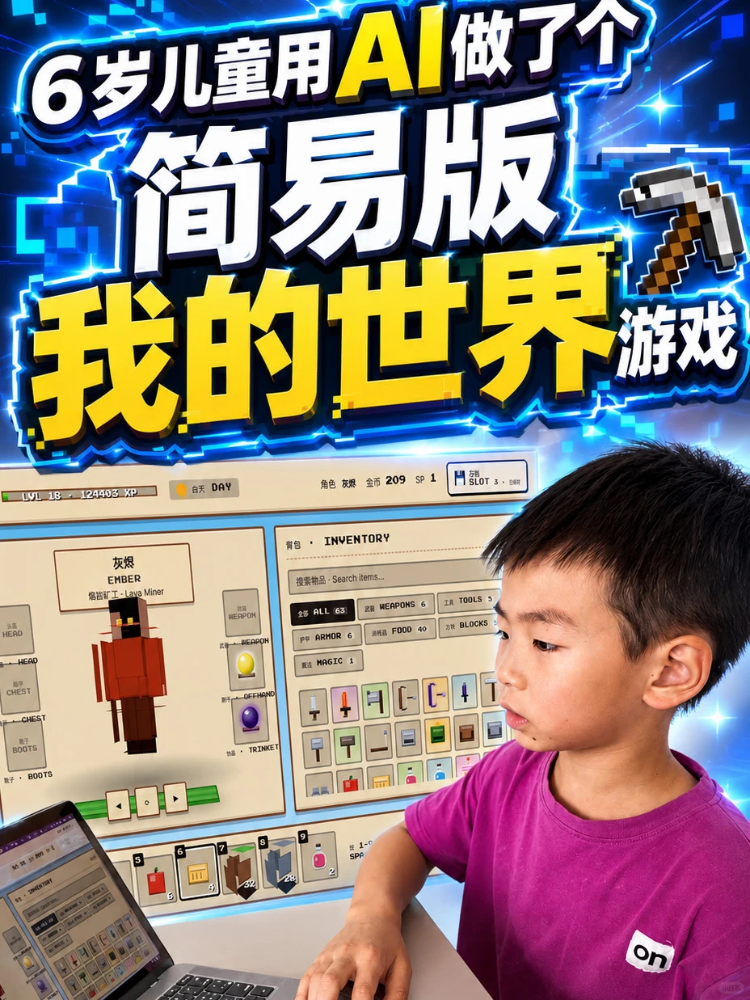

## 图片文字 (OCR)

> OCR 仅供参考，可能包含识别错误；请以原图为准。

6岁儿童用AI做了个
简易版
我的世界
YL 18·124403 XP
白天DAY
角色灰烬金币209
SP1
SLOT3·
背包
INVENTORY
灰烬
EMBER
培酱矿工-LavaMiner
搜索物品·Searchitems..
1
WEAPON
全部ALL
63
2
WEAPONS
工具
TOOLS
R
武
WEAPON
沪P
ARHOR
托品
F000
40
8
BLOCKS
联
HAGIC
E
OFFHAND
TRINKET
00□
"
经
32
SPP
