---
title: "7 岁女儿今天新写的游戏"
source: "https://www.xiaohongshu.com/discovery/item/6a6dae76000000003300e883?app_platform=android&ignoreEngage=true&app_version=9.39.1&share_from_user_hidden=true&xsec_source=app_share&type=video&xsec_token=CBN7cNY4SafdirFDGg0WGbTJs7q4OQnLj-ZtpBLwLhTMU%3D&author_share=1&xhsshare=CopyLink&shareRedId=N0dINjg3NUpMPko6S0EySDs0P0lFSjdL&apptime=1785609433&share_id=d3e37dabb9c245abae4654f6643a9e8d&share_channel=copy_link"
author: "蓝青学姐"
author_uid: "5c6e25da0000000011033b45"
date: "昨天 16:29 广东"
tags: ["儿童编程", "Scratch", "编程教育", "逻辑思维", "亲子教育"]
platform: "xiaohongshu"
category: "学习"
summary: "作者分享了7岁女儿用笔记本仅学习5天就独立编写出的多款游戏作品，包括3D、2D等多种类型，展现出孩子在编程方面的天赋和学习能力。文章探讨了儿童编程教育的价值，特别是Scratch作为免费积木式编程工具，对培养孩子逻辑思维的作用，引发对编程学习必要性的思考。"
---

# 7 岁女儿今天新写的游戏

> 作者: 蓝青学姐 | 日期: 昨天 16:29 广东 | 原文: https://www.xiaohongshu.com/discovery/item/6a6dae76000000003300e883?app_platform=android&ignoreEngage=true&app_version=9.39.1&share_from_user_hidden=true&xsec_source=app_share&type=video&xsec_token=CBN7cNY4SafdirFDGg0WGbTJs7q4OQnLj-ZtpBLwLhTMU%3D&author_share=1&xhsshare=CopyLink&shareRedId=N0dINjg3NUpMPko6S0EySDs0P0lFSjdL&apptime=1785609433&share_id=d3e37dabb9c245abae4654f6643a9e8d&share_channel=copy_link

> **摘要**:作者分享了7岁女儿用笔记本仅学习5天就独立编写出的多款游戏作品，包括3D、2D等多种类型，展现出孩子在编程方面的天赋和学习能力。文章探讨了儿童编程教育的价值，特别是Scratch作为免费积木式编程工具，对培养孩子逻辑思维的作用，引发对编程学习必要性的思考。

7 岁女儿今天新写的游戏
    
我女儿玩了笔记本才 5 天就可以，她已经写了很多很多游戏了，有 3D的，有平面的、2D的、二维的、三维的，她全部都有在写。她这个游戏是她今天新写的，我觉得蛮有趣的，就发出来
其实她也没有学过编程，也可以做到这个效果。那究竟编程还要不要继续学呢？小朋友学的编程，尤其是Scratch，其实是可以免费学的，而且它的这个Scratch，理论上它只是一个思维逻辑的一个积木，它不是实际编程上的一些脚本指令
昨天 16:29 广东

#儿童编程 #Scratch #编程教育 #逻辑思维 #亲子教育

## 视频

[视频 1](./video.mp4)

<video controls width="100%"><source src="./video.mp4" type="video/mp4">您的浏览器不支持视频播放。</video>

附件: [音频](./audio/audio.wav) | [处理清单](./video_manifest.json)

## 视频图文总结

> 按关键帧关联完整视频转录；文字保留机器转写原文，时间点仅用于定位。

### 1. 00:00

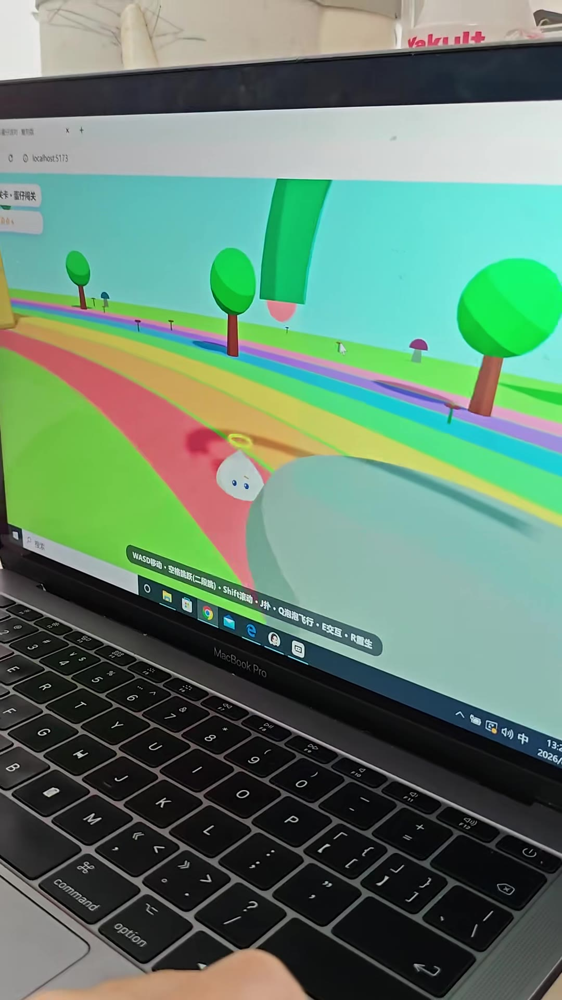

- 画面文字（OCR）：lexalhost5173
闯关
WASD移动·空跳跃跳ift滚动·扑泡泡飞·交互·重
技术
MacBook Pro
F12
DI
品
2
F0
9
8

### 2. 00:07

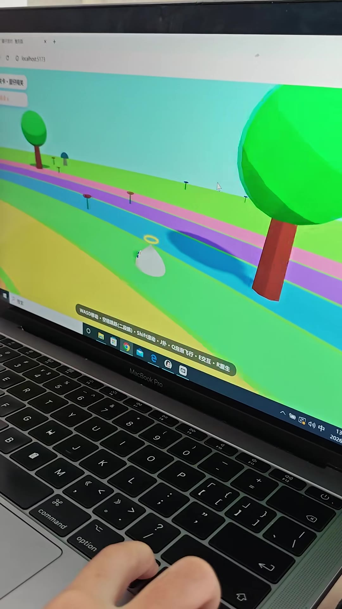

- 内容摘要：你看我能滚动，不过不过呢，要要按键盘才能滚动哦，非常（00:00-00:10）
- 画面文字（OCR）：Thost:5173
一
力·空格跳跃（二段跳）·Shift滚动·J扑·Q泡泡飞行·E交互·R重生
WASD移动·
MacBookPro
8
F12
F11
一
1

### 3. 00:14

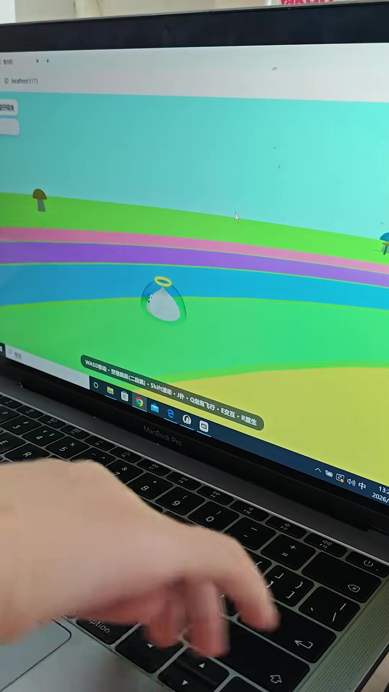

- 内容摘要：好的可以飞呀，不过能要吐泡泡（00:11-00:17）
- 画面文字（OCR）：ilhost5173
WAS移·空格段滚泡飞
e
MacBookPro
>画
中
8
A
F12
X
一
一

### 4. 00:20

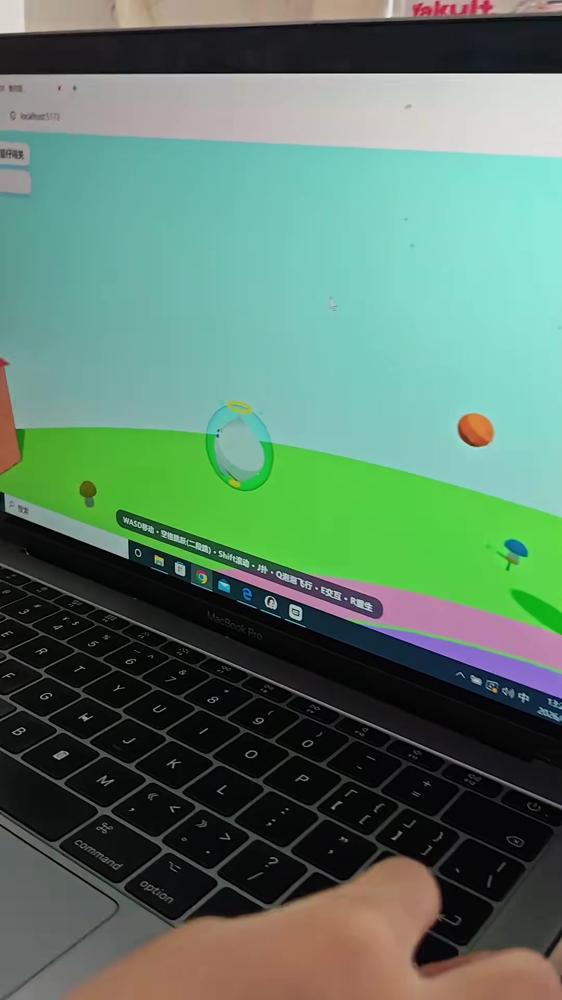

- 画面文字（OCR）：7
WASD移动·空格跳跃（二段跳）·Shif滚动··Q泡泡飞行·E·R重生
e
中
MacBookPro
42
I
一
7

### 5. 00:27

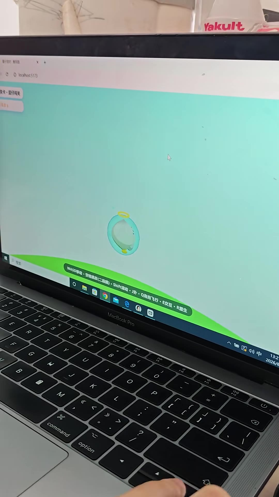

- 内容摘要：那里有个小豆豆啊，我看了看居然是气球，可以投泡泡，现在可以飞的，对对对呀（00:20-00:29）
- 内容摘要：哇，这个世界都不见了（00:29-00:32）
- 画面文字（OCR）：host5173
人
WASD移动·空格跳跃（二段跳）·Shift滚动·J扑·Q泡泡飞行·E交互·R重生
诊中
MacBook Pro
ell
00
川
F12
一
√
K

### 6. 00:34

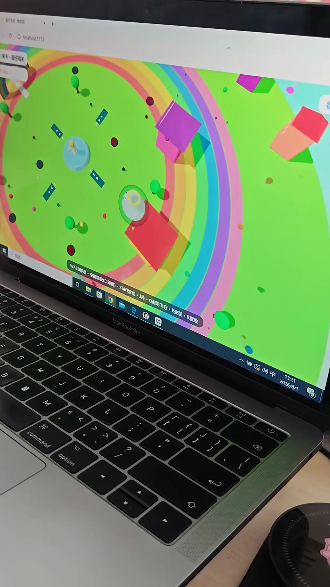

- 画面文字（OCR）：X
13
中
13:21
MacBookPro
2026/8/1
F12
2
2

### 7. 00:41

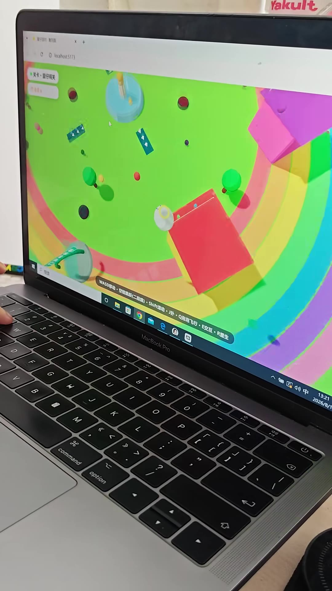

- 内容摘要：但是呢，不能降下，这样摔得疼也疼，你看我变成包包子饼了（00:39-00:48）
- 画面文字（OCR）：打到
x +
C
0localhost5173
关卡·仔障关
心
00
WASD移动·空格跳跃（(二段跳）·Shift滚动·J扑·Q泡泡飞行·E交互·R重生
按发
MacBookPro
8
D
18
00
1
F10
4
0
2
#

### 8. 00:48

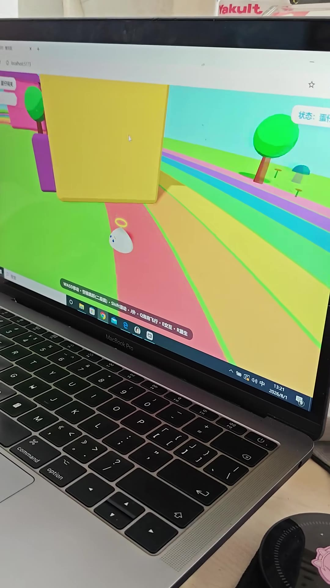

- 内容摘要：包子扁了，然后我我盖上泡泡（00:48-00:52）
- 画面文字（OCR）：☆
状态
10100500
03
9
D
>中
2
B
日
0
MacBookPro
2
uondo
ocahest5173
书

### 9. 00:55

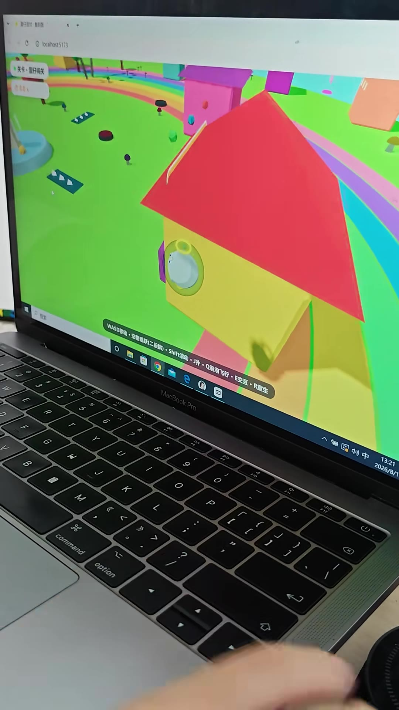

- 内容摘要：偷踢飞，诶，等会儿，那里那有几个玻璃都踩上去看看（00:52-01:00）
- 画面文字（OCR）：关卡·雷仔关
服仔对复
localhost5173
#
X
8
MacBookPro
®
日
乙
C
20

### 10. 01:01

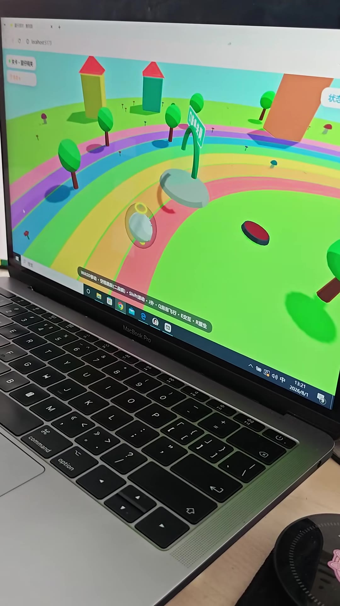

- 画面文字（OCR）：上
x+
00bahet5173
*关卡·#仔陶关
状
-
A
WASD移动·空格跳跃（二段）Sh动·J扑·Q泡泡飞·交互·R生
MacBookPro
中
13:21
2026/8/1
8
DI
00
R
F12

### 11. 01:08

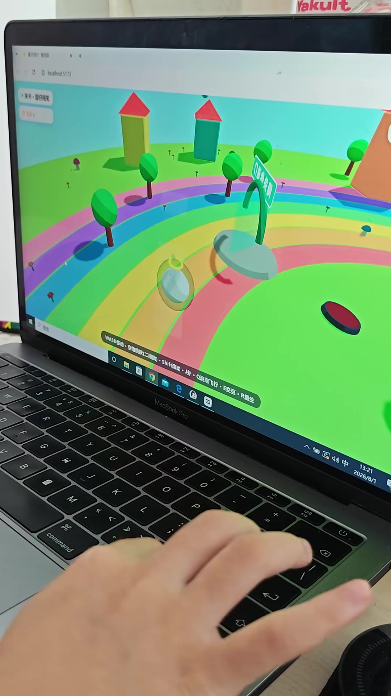

- 内容摘要：那里有玻璃你看不到，原来你近视啊（01:02-01:09）
- 画面文字（OCR）：R
雪
>中
2
日
MacBookPro
Ixahost5173
P
关卡·仔关
。
command

### 12. 01:15

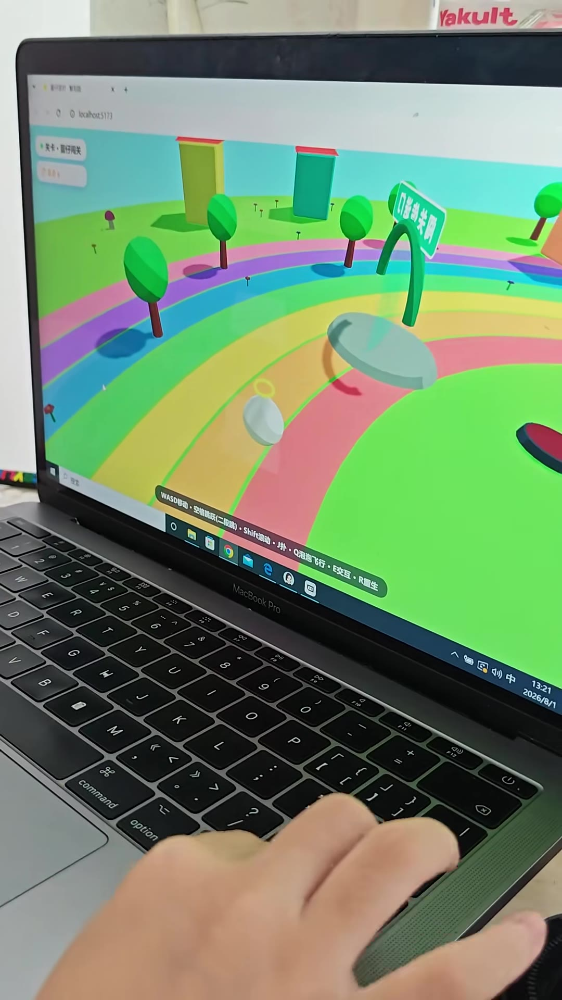

- 内容摘要：你是不是有玻璃呀？（01:13-01:15）
- 画面文字（OCR）：1
富
日
7
MacBookPro
option
8
lxahost5173
关卡·仔周关
command

### 13. 01:22

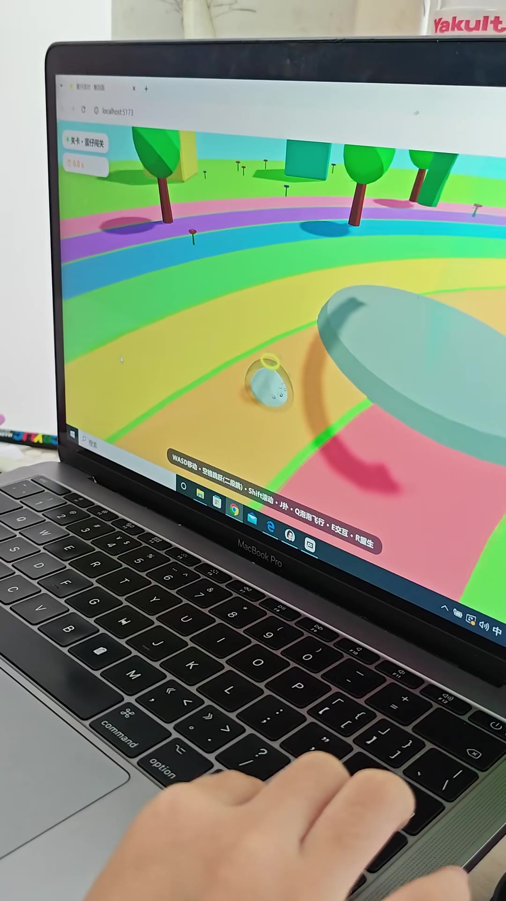

- 内容摘要：哎呀，又降下了，快点快点快点快点飞上去（01:19-01:26）
- 画面文字（OCR）：水
0
X
日
MacBookPro
WASD移动·空格跳跃（二段跳）·Shift滚动·J扑·Q泡泡飞行·E交互·R重生
N
H
C0localhost5173
关卡·蛋仔闯关
command
拉
0
Q

### 14. 01:29

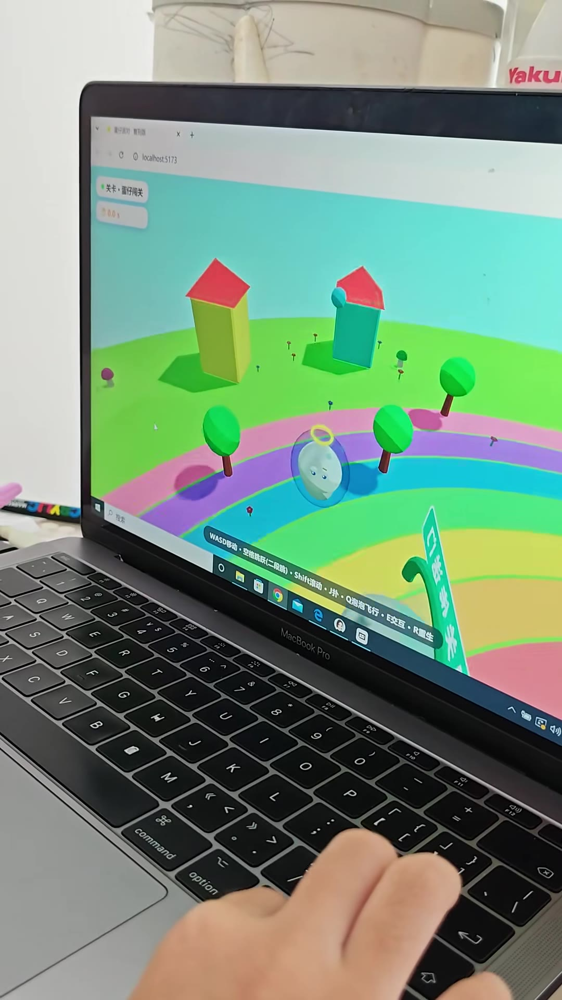

- 内容摘要：都看看它的尽头是哪里（01:26-01:28）
- 内容摘要：诶，我看不到它的镜头诶（01:29-01:31）
- 画面文字（OCR）：日服打
× +
e
0
localhost.5173
关卡·蛋仔闯关
0.01
订海丝
WASD移动·空格跳跃（二段跳）·Shift滚动·J扑·Q泡泡飞行·E交互·R重生
搜索
e
MacBookPro
F11
个
comma

### 15. 01:35

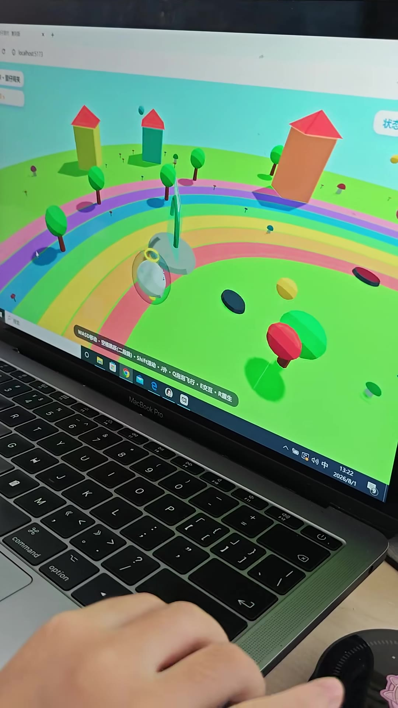

- 内容摘要：来看镜头就是这里（01:33-01:35）
- 内容摘要：哎呀，这只是一个玻璃而已（01:35-01:38）
- 画面文字（OCR）：110225
320
9
中
2
D
日
MacBookPro
7
option
ES
我
*
command

### 16. 01:42

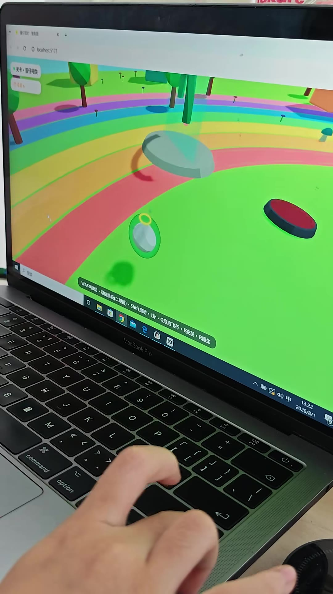

- 内容摘要：给我滚动一下（01:40-01:41）
- 画面文字（OCR）：1
富
>中
Z
日
MacBookPro
option
lcalhost5173
H
puwwon
卫
关卡·雷仔闯关
©

## 视频画面文字 (OCR)

> OCR 仅供参考，可能包含识别错误；请以视频画面和转写来源为准。

### 关键帧 1 · 0.5s

lexalhost5173
闯关
WASD移动·空跳跃跳ift滚动·扑泡泡飞·交互·重
技术
MacBook Pro
F12
DI
品
2
F0
9
8

### 关键帧 2 · 7.31s

Thost:5173
一
力·空格跳跃（二段跳）·Shift滚动·J扑·Q泡泡飞行·E交互·R重生
WASD移动·
MacBookPro
8
F12
F11
一
1

### 关键帧 3 · 14.13s

ilhost5173
WAS移·空格段滚泡飞
e
MacBookPro
>画
中
8
A
F12
X
一
一

### 关键帧 4 · 20.94s

7
WASD移动·空格跳跃（二段跳）·Shif滚动··Q泡泡飞行·E·R重生
e
中
MacBookPro
42
I
一
7

### 关键帧 5 · 27.76s

host5173
人
WASD移动·空格跳跃（二段跳）·Shift滚动·J扑·Q泡泡飞行·E交互·R重生
诊中
MacBook Pro
ell
00
川
F12
一
√
K

### 关键帧 6 · 34.57s

X
13
中
13:21
MacBookPro
2026/8/1
F12
2
2

### 关键帧 7 · 41.39s

打到
x +
C
0localhost5173
关卡·仔障关
心
00
WASD移动·空格跳跃（(二段跳）·Shift滚动·J扑·Q泡泡飞行·E交互·R重生
按发
MacBookPro
8
D
18
00
1
F10
4
0
2
#

### 关键帧 8 · 48.2s

☆
状态
10100500
03
9
D
>中
2
B
日
0
MacBookPro
2
uondo
ocahest5173
书

### 关键帧 9 · 55.02s

关卡·雷仔关
服仔对复
localhost5173
#
X
8
MacBookPro
®
日
乙
C
20

### 关键帧 10 · 61.83s

上
x+
00bahet5173
*关卡·#仔陶关
状
-
A
WASD移动·空格跳跃（二段）Sh动·J扑·Q泡泡飞·交互·R生
MacBookPro
中
13:21
2026/8/1
8
DI
00
R
F12

### 关键帧 11 · 68.65s

R
雪
>中
2
日
MacBookPro
Ixahost5173
P
关卡·仔关
。
command

### 关键帧 12 · 75.46s

1
富
日
7
MacBookPro
option
8
lxahost5173
关卡·仔周关
command

### 关键帧 13 · 82.28s

水
0
X
日
MacBookPro
WASD移动·空格跳跃（二段跳）·Shift滚动·J扑·Q泡泡飞行·E交互·R重生
N
H
C0localhost5173
关卡·蛋仔闯关
command
拉
0
Q

### 关键帧 14 · 89.09s

日服打
× +
e
0
localhost.5173
关卡·蛋仔闯关
0.01
订海丝
WASD移动·空格跳跃（二段跳）·Shift滚动·J扑·Q泡泡飞行·E交互·R重生
搜索
e
MacBookPro
F11
个
comma

### 关键帧 15 · 95.91s

110225
320
9
中
2
D
日
MacBookPro
7
option
ES
我
*
command

### 关键帧 16 · 102.72s

1
富
>中
Z
日
MacBookPro
option
lcalhost5173
H
puwwon
卫
关卡·雷仔闯关
©

## 字幕文件

[TXT](./transcript/video.txt) | [JSON](./transcript/video.json) | [SRT](./transcript/video.srt) | [VTT](./transcript/video.vtt)

## 转写来源

[平台字幕 TXT](./transcript/platform/video.txt) | [平台字幕 JSON](./transcript/platform/video.json) | [平台字幕 SRT](./transcript/platform/video.srt) | [平台字幕 VTT](./transcript/platform/video.vtt) | [本地 ASR TXT](./transcript/asr/video.txt) | [本地 ASR JSON](./transcript/asr/video.json) | [本地 ASR SRT](./transcript/asr/video.srt) | [本地 ASR VTT](./transcript/asr/video.vtt)

## 其他来源转写

### 本地 ASR

- **00:00-00:03** 你看我能滾動
- **00:03-00:09** 不過要按線盤才能滾動
- **00:09-00:11** 飛身
- **00:11-00:13** 飛不飛到
- **00:13-00:14** 可以飛啊
- **00:14-00:17** 不過能要吐泡泡
- **00:17-00:22** 那你有個吵鬥鬥
- **00:22-00:25** 我看個泡居然是氣球
- **00:25-00:27** 它是吐泡泡才可以飛
- **00:27-00:29** 對
- **00:30-00:33** 你這個世界都不見了
- **00:36-00:39** 飛上去看你自己的世界
- **00:39-00:41** 但是不能降下
- **00:41-00:44** 這樣摔倒騰夜騰
- **00:44-00:47** 你看我變成包包似貶了
- **00:47-00:49** 包似貶了
- **00:49-00:52** 然後我蓋上泡泡
- **00:52-00:54** 喝起飛
- **00:54-00:57** 那你有幾個玻璃
- **00:57-00:59** 都踩上去看看
- **00:59-01:04** 變得有玻璃
- **01:04-01:05** 那你有玻璃
- **01:05-01:07** 你看不著
- **01:07-01:09** 原來你見識了
- **01:09-01:12** 你看
- **01:12-01:15** 你是不是有玻璃
- **01:15-01:18** 有玻璃擋著你不給你行
- **01:18-01:20** 又降下了
- **01:20-01:22** 快點快點
- **01:22-01:23** 飛上去
- **01:23-01:25** 飛上去
- **01:25-01:28** 都看看鏡頭是哪裡
- **01:28-01:32** 我看不到可以鏡頭
- **01:32-01:34** 看鏡頭是這裡
- **01:34-01:40** 這只是一個玻璃耳裡
- **01:40-01:42** 有我滾動一下

## 视频转录

- **00:00-00:10** 你看我能滚动，不过不过呢，要要按键盘才能滚动哦，非常
- **00:11-00:17** 好的可以飞呀，不过能要吐泡泡
- **00:20-00:29** 那里有个小豆豆啊，我看了看居然是气球，可以投泡泡，现在可以飞的，对对对呀
- **00:29-00:32** 哇，这个世界都不见了
- **00:39-00:48** 但是呢，不能降下，这样摔得疼也疼，你看我变成包包子饼了
- **00:48-00:52** 包子扁了，然后我我盖上泡泡
- **00:52-01:00** 偷踢飞，诶，等会儿，那里那有几个玻璃都踩上去看看
- **01:02-01:09** 那里有玻璃你看不到，原来你近视啊
- **01:13-01:15** 你是不是有玻璃呀？
- **01:19-01:26** 哎呀，又降下了，快点快点快点快点飞上去
- **01:26-01:28** 都看看它的尽头是哪里
- **01:29-01:31** 诶，我看不到它的镜头诶
- **01:33-01:35** 来看镜头就是这里
- **01:35-01:38** 哎呀，这只是一个玻璃而已
- **01:40-01:41** 给我滚动一下

## 评论 (16)

> 通过真实登录态浏览器抓取，主评论 1 + 子评论 15。对话围绕「小孩用 AI 写游戏，还需不需要学编程」展开。

### 对话脉络

| # | 发言人 | 内容 |
|---|--------|------|
| 1 | 追忆 | 这是用什么写的 |
| 2 | 蓝青学姐（作者） | 各种各样的龙虾 要开服务器的那种游戏 |
| 3 | 蓝青学姐（作者） | 它是混合几个龙虾……它不是一个软件写出来的。但其实，小朋友是不用学编程的，真的不需要，5 天就可以写出这个鬼样子，而且是今天写的这个游戏 |
| 4 | 追忆 | 听你这么说，感觉有点像我今天去的 ChinaJoy 里的腾讯展区，输入关键词就能生成对应的游戏，进入网站直接使用不用下载本地部署，也能快速上手，但腾讯估计后天收费会贵的离谱 |
| 5 | 追忆 | 说实话，小朋友能自己做出这种类型的游戏已经非常厉害，恩我得借鉴借鉴 |
| 6 | 追忆 | 这就是第一个龙虾生成大纲，第二个龙虾生成框架，第三个龙虾生成模型和场景模型，第四个龙虾生成移动脚本，第五个龙虾进行烘焙贴图，好家伙龙虾真万能 |
| 7 | 蓝青学姐（作者） | 小朋友的那个天真的想法，他脑子里想的东西跟大人想的东西是不一样的。他们做出来的游戏跟大人做出来的游戏，大人是没有他小朋友想要玩的那个游戏逻辑的 |
| 8 | 追忆 | 我的结论是不用学透，而是要学会……不是要你学模块，要学的是思维逻辑和底层，重要的是给出个问题，小朋友就能想到如何去做，当你知道怎么去做，这个繁杂工作就可以用 AI 代替 |
| 9 | 追忆 | 那也行没必要一定要学，小朋友列表类模块学的如何 |
| 10 | 追忆 | 现在问题来了小朋友直接学 C++ 可能会直接体验什么叫痛苦，但尝试尝试也不错说不定小朋友有天赋呢……那不然让小朋友去 scratch 社区去开源，现在 scratch 都出版本 5 了 |
| 11 | 蓝青学姐（作者） | 女儿有设计好的皮肤但我没空管她，目前是先让她乱乱来解决不了再喊我 |
| 12 | 蓝青学姐（作者） | 如果你要学思维逻辑的话，列表类模块是可以锻炼思维逻辑，但这个真不是编程。它完全是一个在写好编程的平台里面去搭积木，因为它是有限制的 |
| 13 | 蓝青学姐（作者） | 怎么可能用钱嘛？你让他把所有国内的龙虾那个免费，就是让他多增加自己免费获得积分的那个方案，然后几十种龙虾挨家挨户用完他的额度，最后剩下每月每天都有额度的再留在手上继续用 |
| 14 | 蓝青学姐（作者） | 但问题是他没有学过编程也可以达到这种效果，那还需要学编程吗？需要学，但不能学 Scratch，得学 Python 和 C++。我女儿写到这个游戏程度才对编程有兴趣，但她死活都不要学 Scratch，7 岁居然跟我说太幼稚 |
| 15 | 蓝青学姐（作者） | 试课了核桃编程几节课，那个直播老师太差了，女儿把她当透明人，我更不可能花钱买课 |
| 16 | 蓝青学姐（作者） | 看能力选吧，不是直接学 C++……包括我现在写一个数据处理平台出来，我写了 3 个月，基本上所有做大模型的人请的兼职，包括大厂，都说我的平台写得最舒服。但他们去学的基本上都只是一个简单的工作流而已，套壳软件能赚钱，家长愿意给 |

### 洞察提炼

1. **「龙虾」= AI 模型**：作者用多个国内 AI 大模型协作写游戏——一个生成大纲、一个生成框架、一个生成模型/场景、一个写移动脚本、一个烘焙贴图，用完一个的额度换下一个。
2. **孩子天赋 vs 工具**：作者强调「小朋友没学过编程也能做出这效果」，因为用的是 AI 自动生成；但网友认为孩子能独立完成已非常厉害。
3. **编程教育观点交锋**：作者认为 Scratch 是「思维逻辑的积木」不是真编程，要学就学 Python/C++（7 岁女儿嫌 Scratch「太幼稚」）；网友认为不用学透要学会，重点是「知道要做什么、基本框架」，繁杂工作交给 AI，不建议报机构（大多坑）。
4. **现实考量**：试课核桃编程直播老师差；机构「套壳软件能赚钱」的商业模式；家长愿付费、机构不愿明说。
5. **核心矛盾**：AI 让「不会编程也能做东西」成为可能，但编程的「思维逻辑、结构设计」能力仍然是 AI 难以替代的底层——这正是本条最有价值的部分。

## 图片

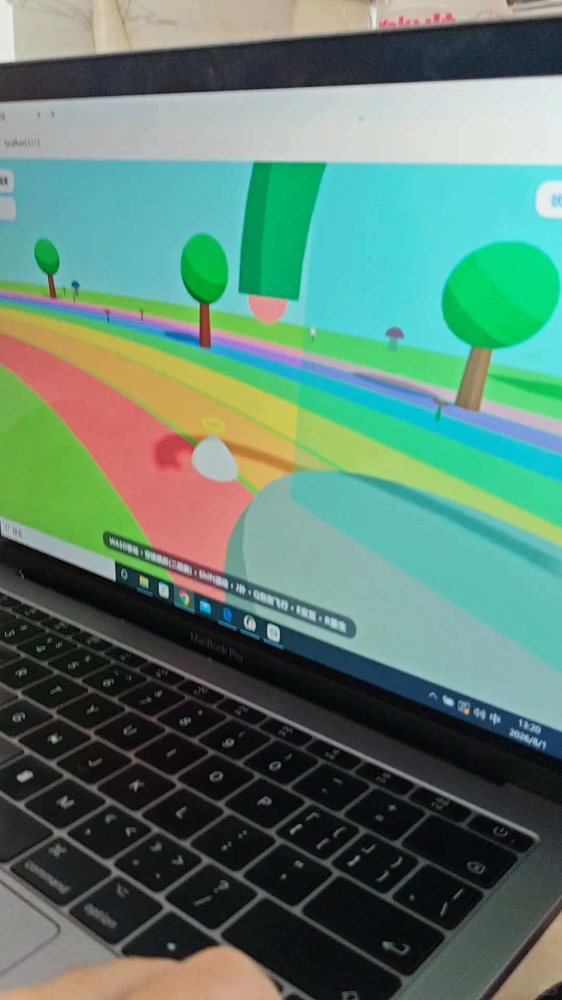

## 图片文字 (OCR)

> OCR 仅供参考，可能包含识别错误；请以原图为准。

（#）·h小#，#·Q#飞行·境·民生
WAS0畅动：
20190
物中
MacBookPro
