---
title: "Unity 2D互动绘本完整项目｜山顶的萤火灯"
source: "https://www.xiaohongshu.com/explore/6a6d94ae0000000005031cdf?xsec_token=CBN7cNY4SafdirFDGg0WGbTMO5YLPKdRn7Cm8do8uAMXg="
author: "unity小叮咚"
author_uid: "unknown-6a6d94ae0000000005031cdf"
date: "7小时前 江西"
tags: ["unity", "绘本", "unity代做"]
platform: "xiaohongshu"
category: "游戏设计"
summary: "Unity制作的儿童剧情互动绘本，讲述小刺猬栗栗护送萤火灯登上山顶的森林冒险故事。"
---

# Unity 2D互动绘本完整项目｜山顶的萤火灯

> 作者: unity小叮咚 | 日期: 7小时前 江西 | 原文: https://www.xiaohongshu.com/explore/6a6d94ae0000000005031cdf?xsec_token=CBN7cNY4SafdirFDGg0WGbTMO5YLPKdRn7Cm8do8uAMXg=

> **摘要**:Unity制作的儿童剧情互动绘本，讲述小刺猬栗栗护送萤火灯登上山顶的森林冒险故事。

Unity制作的儿童剧情互动绘本，整体采用温暖治愈的森林冒险题材，水彩纸纹风格搭配蓝紫夜景与暖黄色萤火光效，画面完整，适合课程设计、毕业设计、互动绘本展示及二次开发参考。

故事讲述小刺猬栗栗为了独自把奶奶留下的萤火灯送上山顶，一路经历强风、溪流、山洞迷路等困难，最终学会接受伙伴帮助，三人共同守住灯火并照亮回家的山路。

#unity #绘本 #unity代做

## 视频

[视频 1](./video.mp4)

<video controls width="100%"><source src="./video.mp4" type="video/mp4">您的浏览器不支持视频播放。</video>

附件: [音频](./audio/audio.wav) | [处理清单](./video_manifest.json)

## 视频关键帧

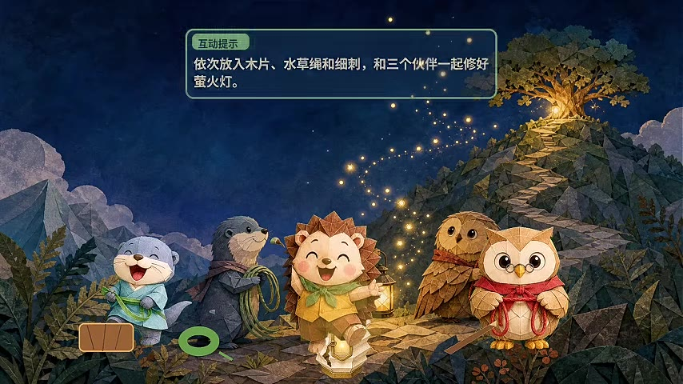

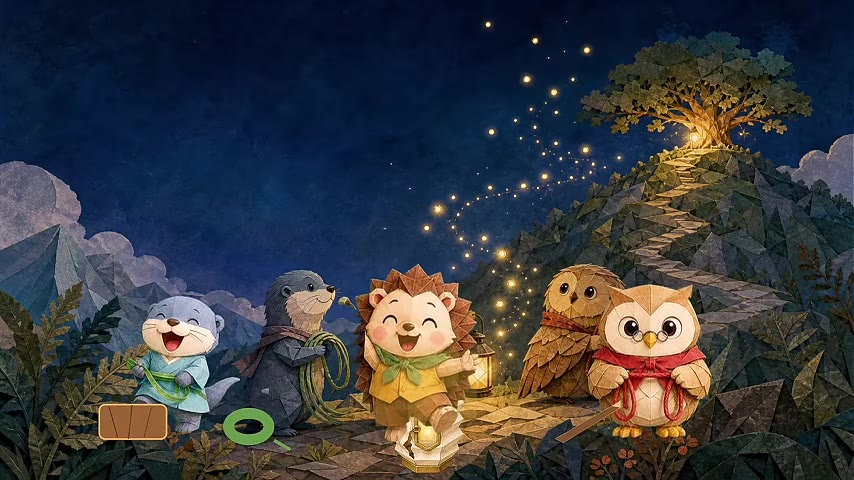

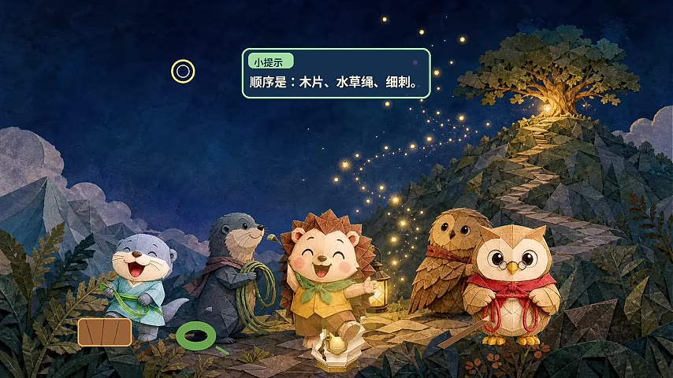

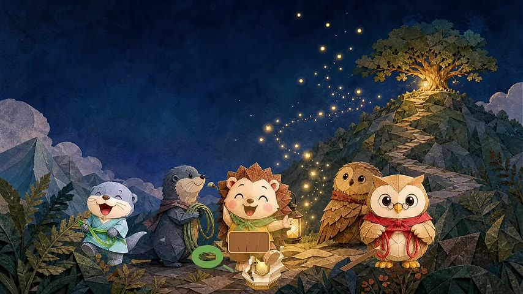

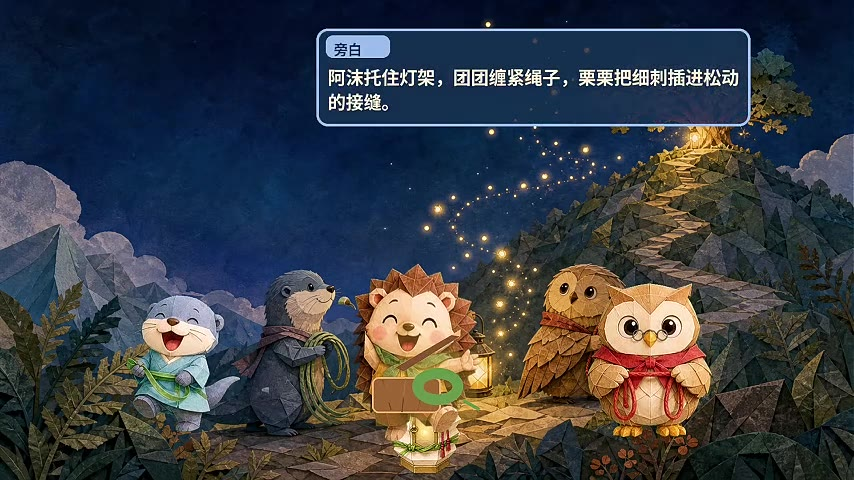

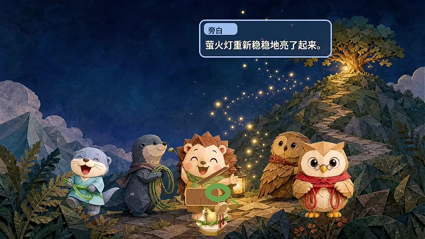

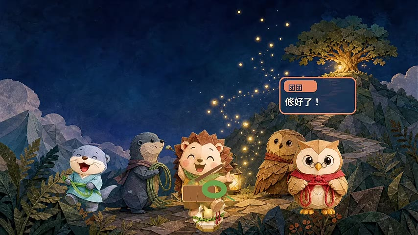

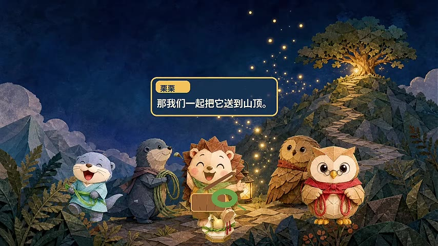

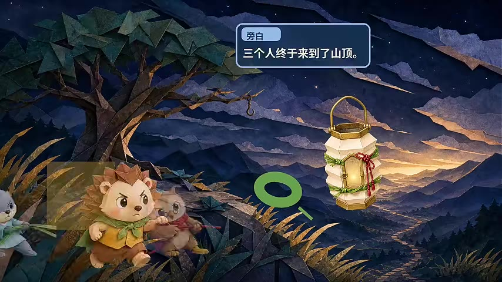

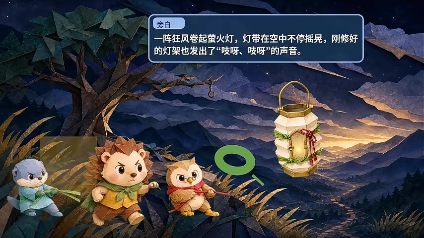

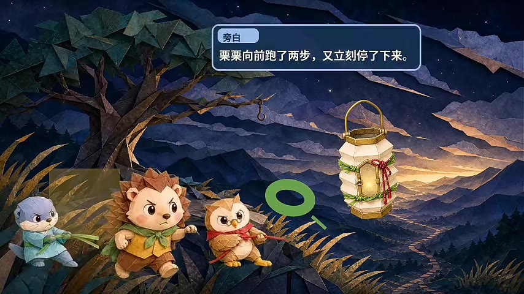

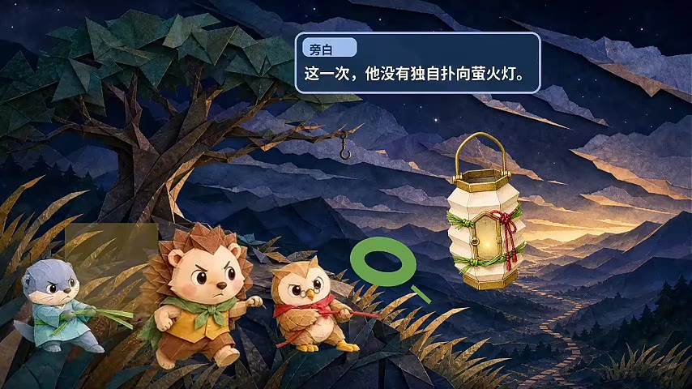

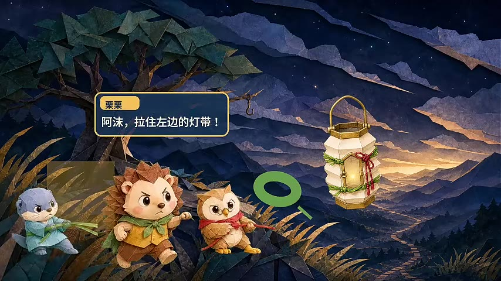

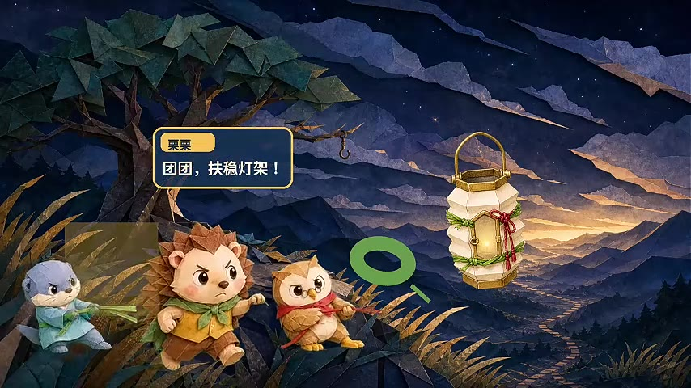

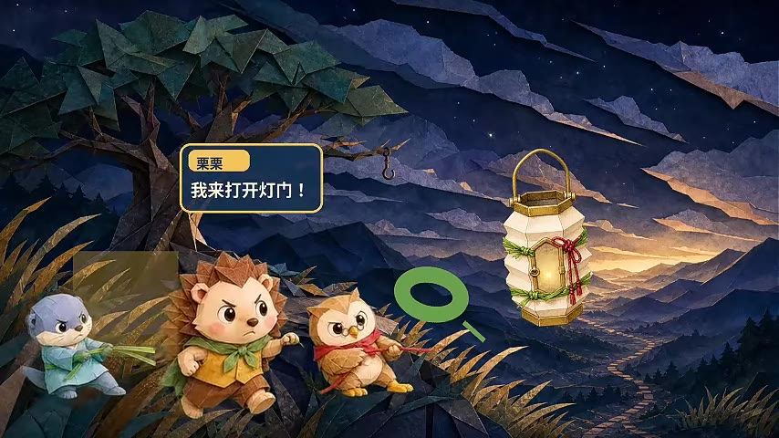

## 图片

